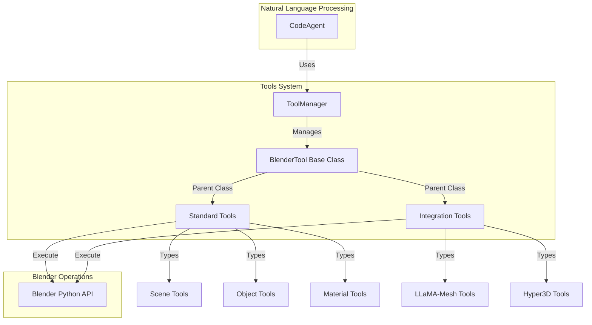
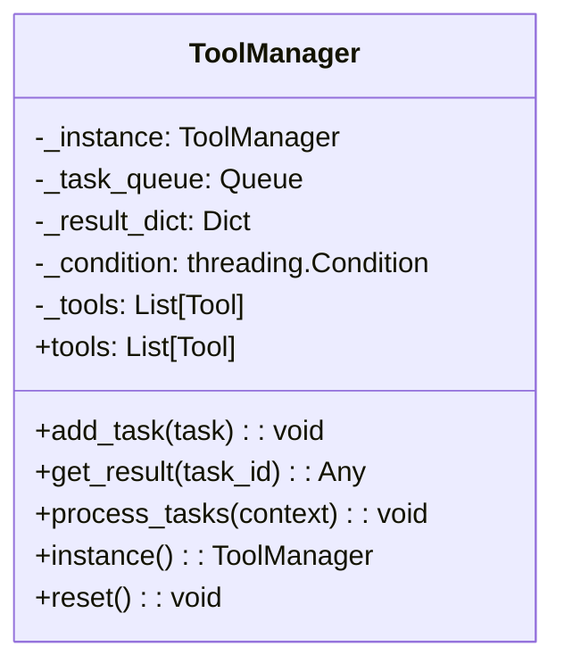
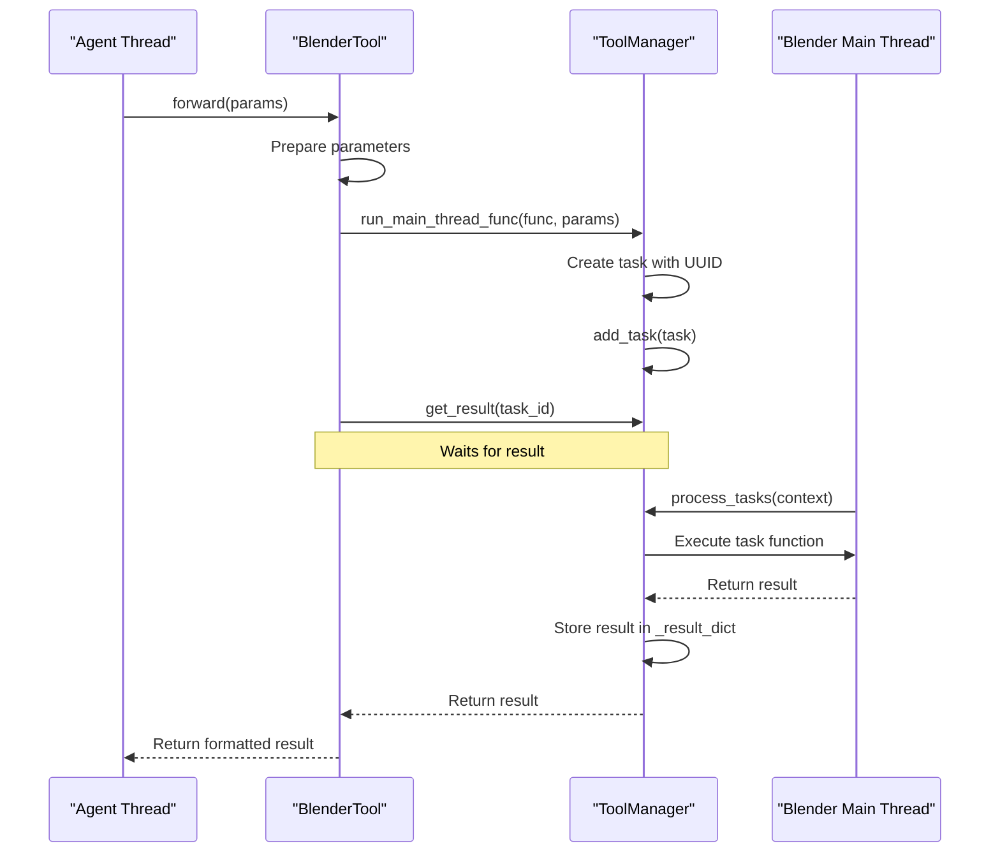
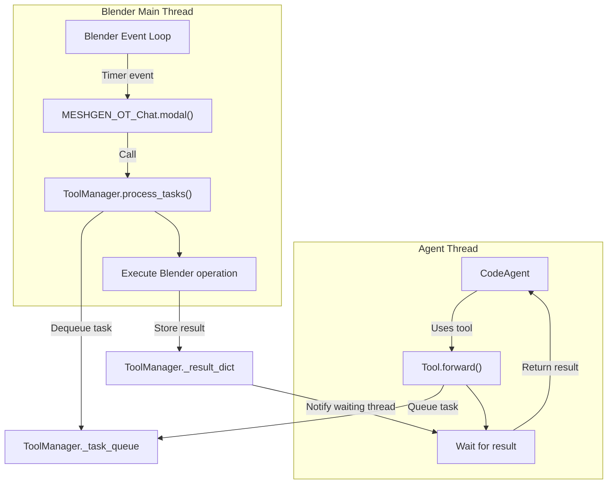

<!-- source: DeepWiki mcp.deepwiki.com · repo huggingface/meshgen · page 3.2 Tools System · fetched 2026-10-26 -->

# Tools System

<details>
<summary>Relevant source files</summary>

The following files were used as context for generating this wiki page:

- [operators.py](operators.py)
- [tools.py](tools.py)

</details>


## Purpose and Scope

The Tools System serves as the crucial bridge between natural language commands and Blender functionality in MeshGen. It provides a structured framework for the AI agent to execute operations in Blender through a collection of well-defined tools. 

The system is responsible for:
- Translating AI intentions into concrete Blender operations
- Managing thread synchronization between the AI engine and Blender
- Providing a discovery mechanism for available tools
- Supporting both basic Blender operations and integration with external AI systems

This page focuses specifically on the architecture and implementation of the Tools System. For information about the AI Backend that uses these tools, see [Backend System](#3.1). For details about how state is managed across chat sessions, see [State Management](#3.3).

## Architecture Overview

The Tools System architecture is built around a central manager that coordinates tool execution and a collection of specialized tools that implement specific Blender operations.



Sources: [tools.py:12-90](), [tools.py:92-111]()

### ToolManager

At the core of the Tools System is the `ToolManager` class - a singleton responsible for managing tool execution and thread synchronization. The ToolManager:

1. Maintains a registry of available tools
2. Queues tasks for execution on the main Blender thread
3. Executes tasks when called from the main thread
4. Manages task results and thread synchronization



The ToolManager is implemented as a singleton, which ensures that there's only one instance managing tools throughout the application. The singleton pattern is implemented using a class-level `_instance` variable and a custom `__new__` method that ensures only one instance is created.

Sources: [tools.py:12-90]()

### Thread Management

One of the key challenges the Tools System addresses is Blender's threading model. Blender requires most operations to be performed on the main thread, while the AI agent runs on a separate thread. The Tools System solves this with a task queueing system:



The key steps in this process:

1. When a tool is called on the agent thread, it creates a task with a unique ID
2. The task is added to the queue and the tool waits for the result
3. During Blender's event loop, the `process_tasks` method is called from the main thread
4. Tasks are dequeued and executed, with results stored in a dictionary
5. The tool retrieves its result using the task ID

This approach ensures thread-safe execution while maintaining UI responsiveness.

Sources: [tools.py:97-111](), [operators.py:161-162]()

### BlenderTool Base Class

All tools inherit from the `BlenderTool` base class, which extends the `Tool` class from the `smolagents` library. The `BlenderTool` class provides:

1. A consistent interface for defining tools
2. The `run_main_thread_func` utility method to handle thread management
3. Standardized formatting for inputs and outputs

```python
class BlenderTool(Tool):
    """
    Base class for all Blender tools.
    Provides utility method to run functions on the main blender thread.
    """

    def run_main_thread_func(self, func: callable, params: dict = None) -> str:
        task_id = str(uuid.uuid4())
        task = {
            "id": task_id,
            "func": func,
            "params": params,
        }
        tool_manager = ToolManager.instance()
        tool_manager.add_task(task)
        result = tool_manager.get_result(task_id)
        if result["status"] == "error":
            return f"Error in {func.__name__}: {result['data']}"
        return result["data"]
```

Sources: [tools.py:92-111]()

## Standard Tools

The Tools System provides a comprehensive set of standard tools for common Blender operations. Each tool defines its:
- Name: A unique identifier
- Description: Detailed documentation for the AI
- Inputs: Parameters with types and descriptions
- Output type: The format of the returned data
- Forward method: The implementation logic

### Scene Information Tools

- **GetSceneInfoTool**: Retrieves information about the current scene, including objects, materials, and other scene properties

### Object Manipulation Tools

| Tool Name | Purpose | Key Parameters |
|-----------|---------|----------------|
| GetObjectInfoTool | Retrieves detailed information about a specific object | name |
| CreateObjectTool | Creates a new primitive object (cube, sphere, etc.) | type, name, location, rotation, scale |
| ModifyObjectTool | Changes properties of an existing object | name, location, rotation, scale, visible |
| DeleteObjectTool | Removes an object from the scene | name |

### Material Tools

- **SetMaterialTool**: Creates and assigns materials to objects, with options to set colors and other material properties

Sources: [tools.py:164-202](), [tools.py:247-276](), [tools.py:411-547](), [tools.py:606-668](), [tools.py:695-712](), [tools.py:789-839]()

## Integration Tools

The Tools System extends beyond basic Blender operations to integrate with external AI systems, enabling advanced mesh generation capabilities.

### LLaMA-Mesh Tools

When the LLaMA-Mesh model is loaded, the following tools become available:

- **LlamaMeshGenerateTool**: Generates 3D meshes from text descriptions
- **LlamaMeshDescribeTool**: Analyzes 3D objects and generates text descriptions

These tools are managed by the `LlamaMeshModelManager` singleton, which handles model loading and unloading.

### Hyper3D Tools

When the Hyper3D integration is enabled in preferences:

- **Hyper3dGenerateObjectTool**: Generates high-fidelity 3D models from text descriptions using the Hyper3D API

These integration tools significantly extend MeshGen's capabilities by leveraging specialized AI models for 3D content creation.

Sources: [tools.py:842-892](), [tools.py:974-1039](), [tools.py:1110-1156](), [tools.py:1316-1350]()

## Tool Registration and Discovery

Tools are dynamically registered with the ToolManager during initialization based on available integrations:

```python
def _initialize(self):
    prefs = bpy.context.preferences.addons[__package__].preferences

    self._task_queue = queue.Queue()
    self._result_dict = {}
    self._condition = threading.Condition()
    self._tools = [
        PythonInterpreterTool(),
        FinalAnswerTool(),
        GetSceneInfoTool(),
        GetObjectInfoTool(),
        CreateObjectTool(),
        ModifyObjectTool(),
        DeleteObjectTool(),
        SetMaterialTool(),
    ]

    if LlamaMeshModelManager.instance().is_loaded:
        self._tools += [
            LlamaMeshGenerateTool(),
            LlamaMeshDescribeTool(),
        ]

    if prefs.enable_hyper3d:
        self._tools += [Hyper3dGenerateObjectTool()]
```

This approach ensures only available tools are presented to the agent, creating a dynamic tool palette based on the current configuration.

Sources: [tools.py:25-49]()

## Integration with Chat Flow

The Tools System is integrated into the main chat flow through the modal operator, which processes tool tasks during the Blender event loop:



The `process_tasks` method is called from the `modal` method of the `MESHGEN_OT_Chat` operator, ensuring tasks are processed regularly during the chat session.

Sources: [operators.py:161-162]()

## Creating New Tools

Developers can extend MeshGen by creating new tools that follow the established pattern:

1. Inherit from `BlenderTool`
2. Define name, description, inputs, and output_type
3. Implement the `forward` method
4. Register the tool in the ToolManager initialization

For example, a new tool for joining objects might look like:

```python
class JoinObjectsTool(BlenderTool):
    name = "join_objects"
    description = """
    This is a tool that joins multiple objects into a single object.
    It returns the name of the resulting joined object.
    """
    inputs = {
        "objects": {
            "type": "array",
            "description": "List of object names to join",
        },
        "target_name": {
            "type": "string",
            "description": "Name for the joined object (optional)",
            "nullable": True,
        }
    }
    output_type = "string"
    
    def forward(self, objects: List[str], target_name: Optional[str] = None):
        params = {
            "objects": objects,
            "target_name": target_name,
        }
        return self.run_main_thread_func(join_objects, params)
```

## Conclusion

The Tools System provides a robust framework for AI-driven interaction with Blender, solving complex problems like thread management and tool discovery. By providing a structured interface to Blender operations, it enables the AI agent to create and manipulate 3D content through natural language instructions, forming the operational core of MeshGen.

---

