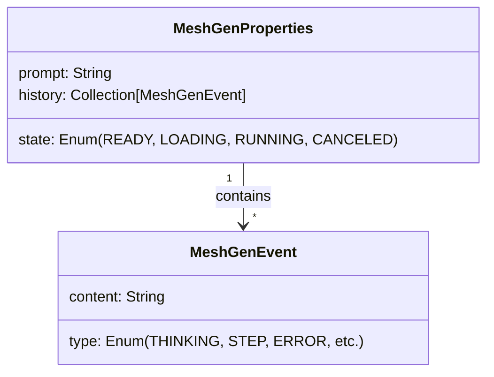
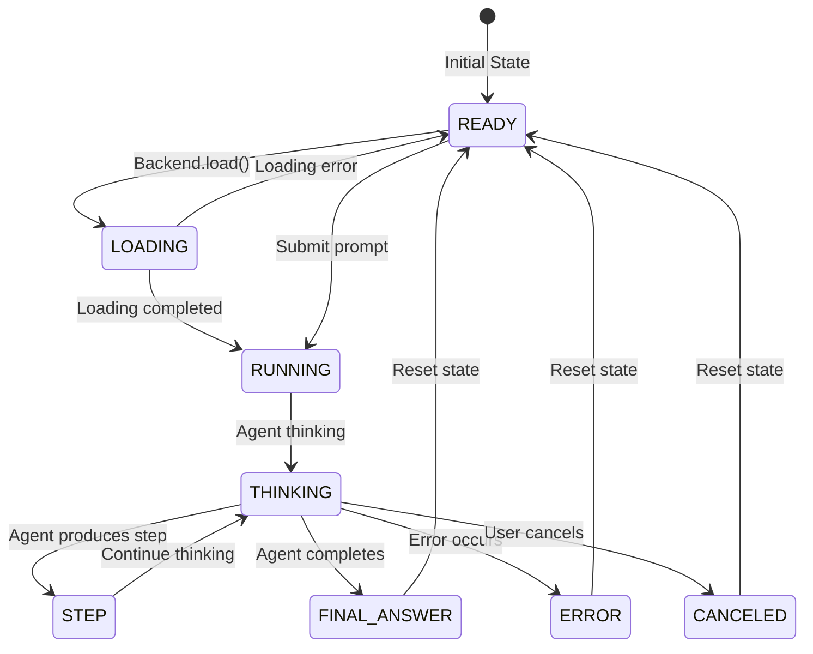
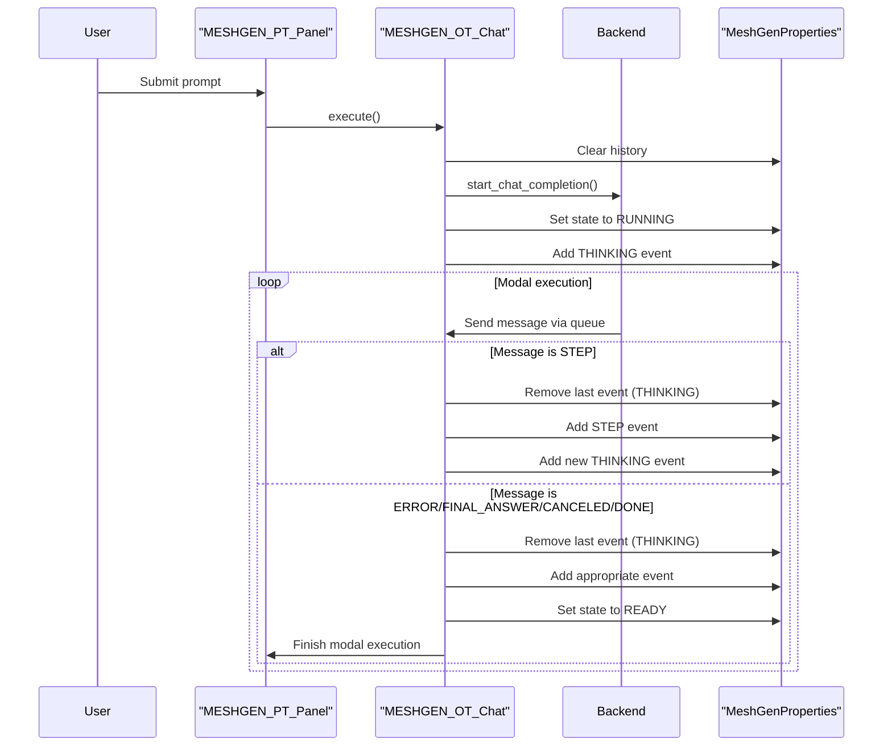
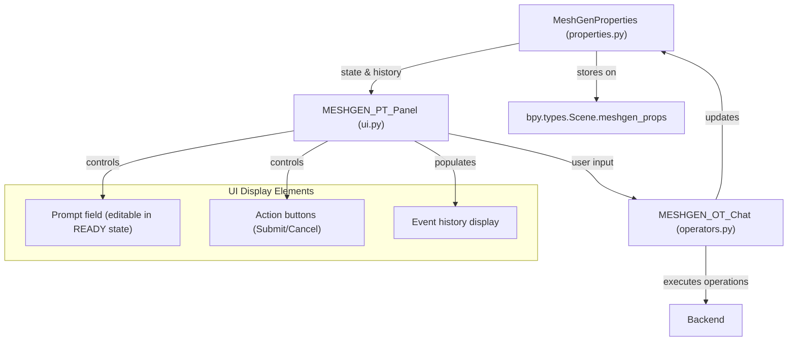

<!-- source: DeepWiki mcp.deepwiki.com · repo huggingface/meshgen · page 3.3 State Management · fetched 2026-10-26 -->

# State Management

<details>
<summary>Relevant source files</summary>

The following files were used as context for generating this wiki page:

- [operators.py](operators.py)
- [properties.py](properties.py)
- [ui.py](ui.py)

</details>


## Purpose and Scope

This document details MeshGen's state management system, which tracks the application's runtime state, manages event history, and ensures proper information flow between the backend and UI. The state management system is responsible for:

- Tracking the current operational state of the application
- Recording and displaying history of agent interactions
- Facilitating state transitions during agent execution
- Providing a consistent interface for the UI to display appropriate controls

This system is primarily focused on application state - for information about the backend system itself, see [Backend System](#3.1), and for details about the user interface, see [Blender UI Panel](#4.1).

## Core State Components

MeshGen's state management revolves around two primary property classes:



### MeshGenProperties

The `MeshGenProperties` class serves as the central state container for the application, stored as a property on the Blender scene:

- `prompt`: Stores the current user input text
- `state`: Tracks the primary application state as an enum 
- `history`: A collection of `MeshGenEvent` instances recording the agent's actions

When a user interacts with MeshGen, these properties update to reflect the current application state and maintain a record of events that have occurred.

Sources: [properties.py:28-47]()

### MeshGenEvent

The `MeshGenEvent` class represents individual events in the agent's processing sequence:

- `type`: An enum indicating the event type (THINKING, STEP, ERROR, etc.)
- `content`: A string containing the event's message or data

This flexible event system allows detailed tracking of agent progress and provides rich information for display in the UI.

Sources: [properties.py:4-25]()

## State Machine and Transitions

The application follows a state machine pattern with well-defined transitions:



### Primary Application States

MeshGen cycles through four primary states during operation:

| State | Description | Triggered By |
|-------|-------------|-------------|
| READY | System is idle, awaiting user input | Initial state, completion of previous operation |
| LOADING | Backend model is loading | `Backend.load()` when model not loaded |
| RUNNING | Agent is actively processing a request | Submission of user prompt |
| CANCELED | Operation is flagged for cancellation | User clicks Cancel button |

The main state transitions are managed by the `MESHGEN_OT_Chat` operator during its modal execution.

Sources: [properties.py:35-45](), [operators.py:17-192]()

### Event Types and History

Events form a more granular tracking system within the state machine, recording specific actions and progress steps:

| Event Type | Description | Icon |
|------------|-------------|------|
| THINKING | Agent is processing | SORTTIME |
| STEP | Intermediate result/thought | LIGHT |
| ERROR | Error occurred | ERROR |
| CANCELED | User canceled operation | X |
| SUCCESS | Final result produced | CHECKMARK |
| LOADING | Model is loading | SORTTIME |
| LOADING_SUCCESS | Model loaded successfully | CHECKMARK |
| LOADING_ERROR | Model failed to load | ERROR |

Events are added to the history collection as the agent progresses, providing a timeline of actions and results.

Sources: [properties.py:6-18](), [ui.py:5-25]()

## Event Flow and Management

The event management system follows a specific sequence during agent execution:



### Event Addition and Removal

The `MESHGEN_OT_Chat` operator provides methods to manage events:

- `add_event(event_type, message, long_message)`: Creates a new event and adds it to history
- `pop_event()`: Removes the most recent event from history

This allows the operator to replace intermediate states (like "Thinking...") with substantive events (like specific steps or errors) as processing continues.

Sources: [operators.py:165-178]()

### Modal Execution Loop

The heart of the state management system is the modal execution loop in the `MESHGEN_OT_Chat` operator, which:

1. Checks for cancellation requests
2. Processes messages from the backend queue
3. Updates state and history based on message type
4. Manages state transitions

The loop continues until a terminal state is reached (success, error, or cancellation), at which point it resets the state to READY.

Sources: [operators.py:118-163]()

## Integration with Blender UI

The state management system integrates with Blender's UI system through the `MESHGEN_PT_Panel` class:



### UI Adaptation

The UI panel adapts based on the current state:
- In the READY state, the prompt field is editable, and a Submit button is shown
- In LOADING or RUNNING states, the prompt is display-only, and a Cancel button is shown
- The event history is displayed with appropriate icons and labels based on event types

Sources: [ui.py:28-83]()

### Event Visualization

Events are visualized in the UI using predefined labels and icons:

```python
EVENT_LABELS = {
    "THINKING": "Thinking...",
    "STEP": "Step",
    # ...other event types
}

EVENT_ICONS = {
    "THINKING": "SORTTIME",
    "STEP": "LIGHT",
    # ...other event types
}
```

This provides consistent visual feedback about the system's state and progress.

Sources: [ui.py:5-25](), [ui.py:70-82]()

## Implementation Details

### Property Registration

The state management classes are registered with Blender's property system:

```python
def register():
    bpy.utils.register_class(MeshGenEvent)
    bpy.utils.register_class(MeshGenProperties)
    bpy.types.Scene.meshgen_props = bpy.props.PointerProperty(type=MeshGenProperties)
```

This makes the properties accessible from any Blender context via `context.scene.meshgen_props`.

Sources: [properties.py:50-53]()

### State Transitions in Chat Operator

The `MESHGEN_OT_Chat` operator manages state transitions through several key methods:

- `execute()`: Initializes state, clears history, and starts the backend process
- `modal()`: Handles ongoing state updates based on backend messages
- `finish()`: Resets state to READY when operation completes

The operator also handles error states and user cancellations, ensuring the system returns to a consistent state.

Sources: [operators.py:23-185]()

### Cancellation Handling

Cancellation is handled specifically by the `MESHGEN_OT_CancelChat` operator, which sets the state to CANCELED:

```python
def execute(self, context):
    props = context.scene.meshgen_props
    props.state = "CANCELED"
    return {"FINISHED"}
```

The main chat operator detects this state change and performs the necessary cleanup.

Sources: [operators.py:193-202]()

---

