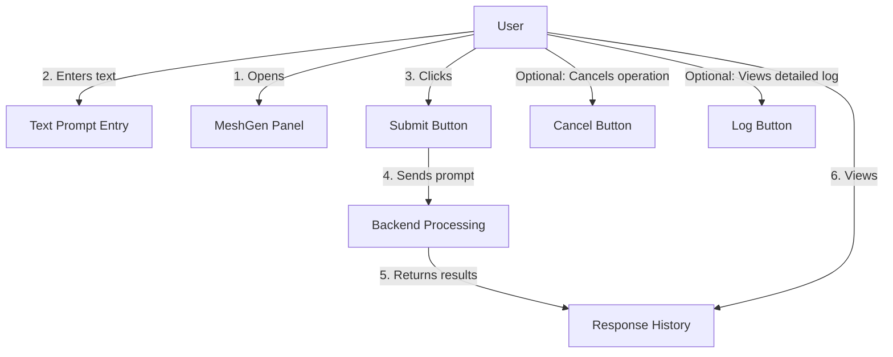
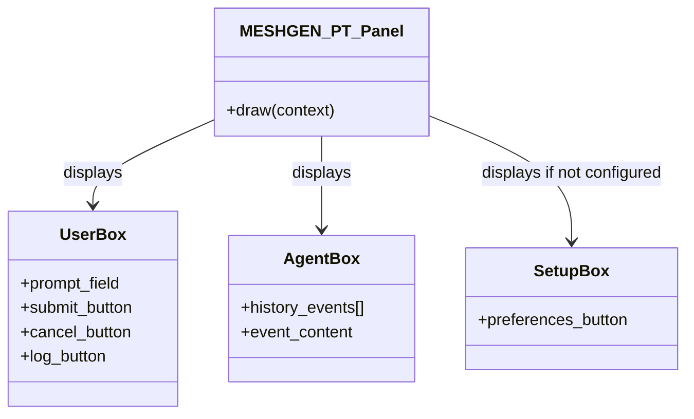
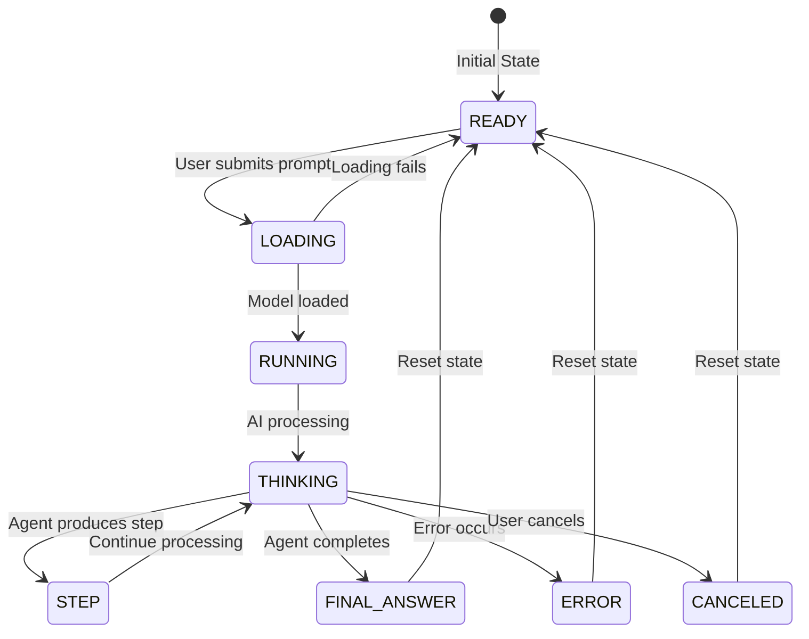
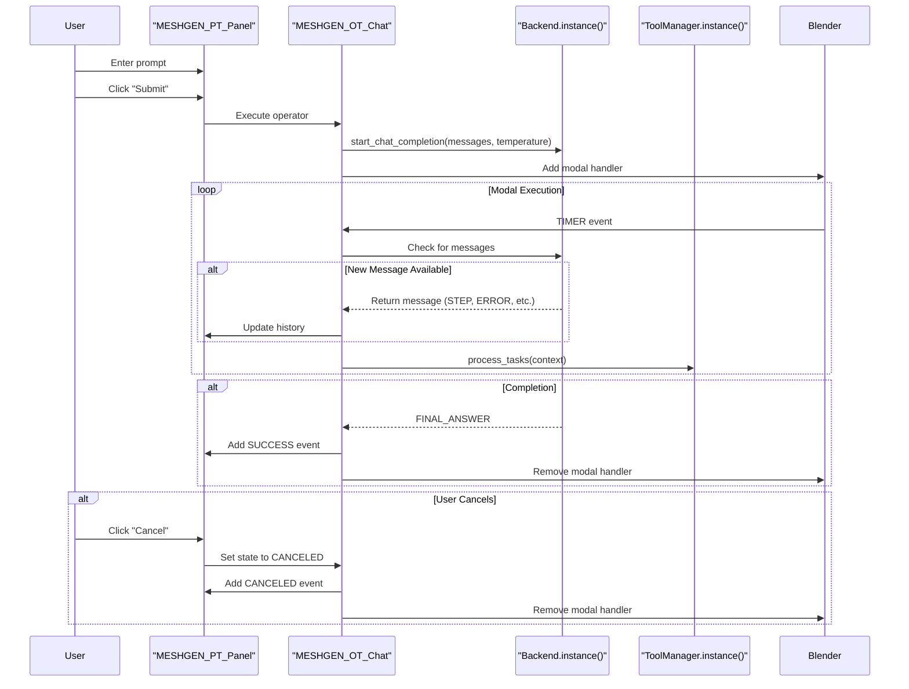
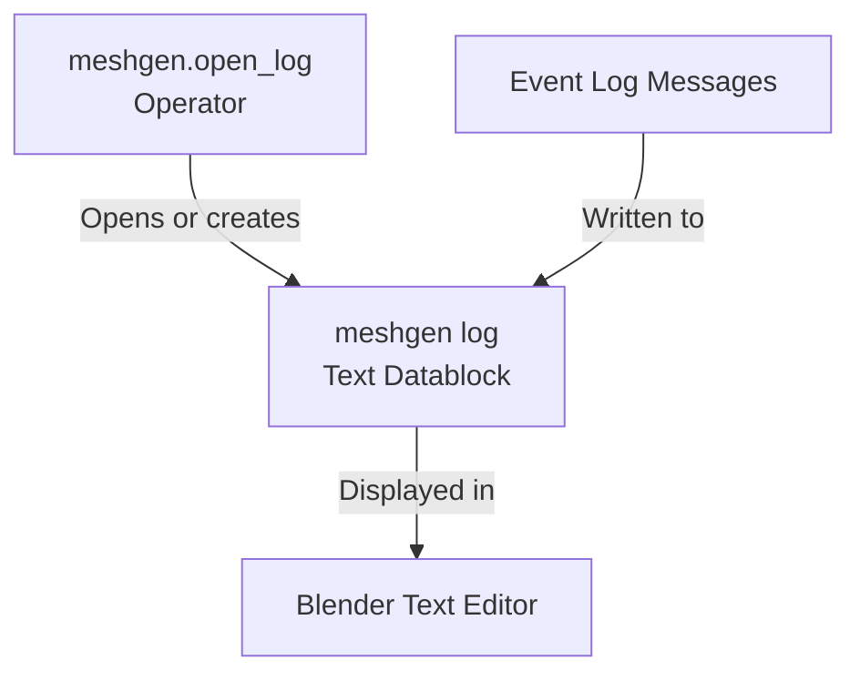
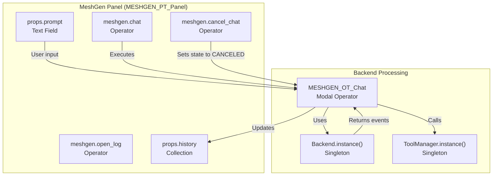
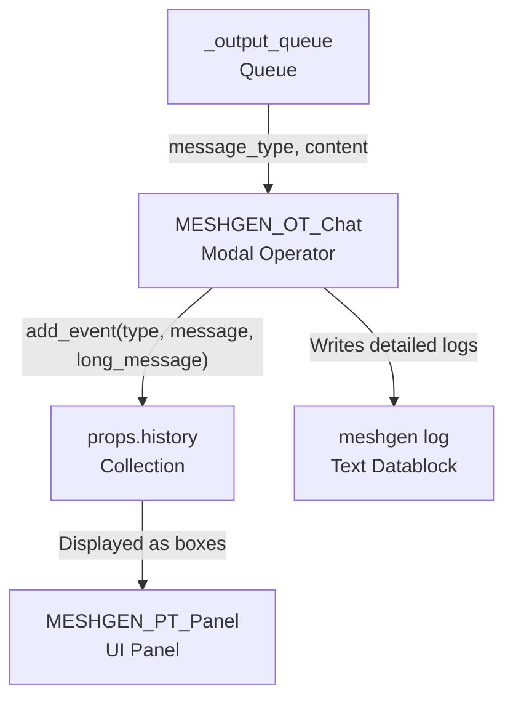
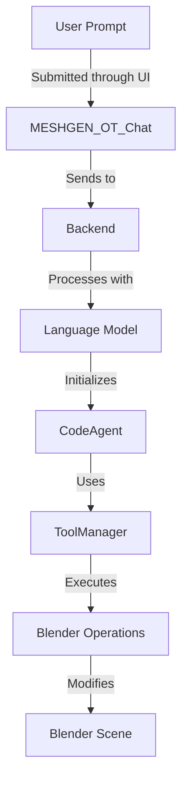

<!-- source: DeepWiki mcp.deepwiki.com · repo huggingface/meshgen · page 4 User Interaction · fetched 2026-10-26 -->

# User Interaction

Relevant source files

The following files were used as context for generating this wiki page:

- [README.md](README.md)
- [docs/meshgen.gif](docs/meshgen.gif)
- [operators.py](operators.py)
- [ui.py](ui.py)

This page provides a comprehensive overview of how users interact with MeshGen in Blender. It covers the primary interaction points, UI components, and the underlying event flow that enables natural language control of Blender. For detailed documentation of specific UI elements, see [Blender UI Panel](#4.1), and for step-by-step usage instructions, see [Workflow Guide](#4.2).

## User Interaction Overview

MeshGen allows users to control Blender using natural language prompts. The primary interaction happens through a dedicated panel in Blender's sidebar, where users can enter text prompts that are processed by an AI backend to generate or modify 3D content.

Sources: [ui.py:28-83](), [operators.py:17-186](), [README.md:126-131]()

## UI Panel Structure

The MeshGen UI panel (`MESHGEN_PT_Panel`) is organized into clear sections for user input and agent response. The panel adapts based on the current state of the system.

Sources: [ui.py:28-83]()

## State Management and User Flow

MeshGen implements a state machine to manage user interactions. The UI and available actions change based on the current state.

Sources: [operators.py:17-186](), [ui.py:28-83]()

## Event System

The event system in MeshGen processes user actions and provides real-time feedback. Events are stored in history and displayed in the UI with appropriate icons.

### Event Types and Visualization

| Event Type | Label | Icon | Description |
|------------|-------|------|-------------|
| THINKING | "Thinking..." | SORTTIME | Agent is processing |
| STEP | "Step" | LIGHT | Agent has performed an action |
| ERROR | "Error" | ERROR | An error occurred |
| CANCELED | "Canceled" | X | Operation was canceled |
| SUCCESS | "Finished" | CHECKMARK | Operation completed successfully |
| LOADING | "Loading..." | SORTTIME | Model is loading |
| LOADING_SUCCESS | "Loaded model" | CHECKMARK | Model loaded successfully |
| LOADING_ERROR | "Failed to load model" | ERROR | Failed to load model |

Sources: [ui.py:5-25](), [operators.py:162-175]()

## Modal Operator Architecture

The chat functionality is implemented as a modal operator (`MESHGEN_OT_Chat`) that continuously processes AI responses while allowing the user to maintain control of Blender.

Sources: [operators.py:17-186](), [ui.py:28-83]()

## Log System

MeshGen provides a detailed log system that captures all agent outputs and system messages. The log is implemented as a Blender text datablock and can be opened in a text editor area.

Sources: [operators.py:205-223](), [operators.py:173-174]()

## Mapping UI Elements to Code

The following diagram shows how UI elements correspond to specific code entities:

Sources: [ui.py:28-83](), [operators.py:17-186]()

## Response Handling and Display

When the AI agent responds, MeshGen processes the response and displays it in the UI panel. The following diagram shows how responses are processed and displayed:

Sources: [operators.py:126-161](), [operators.py:162-175](), [ui.py:76-82]()

## Interaction with Blender

MeshGen interacts with Blender through the Tools system, which executes operations on the Blender scene. This section provides an overview of how user commands are translated into Blender operations.

Sources: [operators.py:17-186]()

This diagram shows how user prompts flow through the system to ultimately modify the Blender scene. The prompt is processed by the language model, which generates code for the CodeAgent to execute using the ToolManager, which in turn performs operations on the Blender scene.

---

