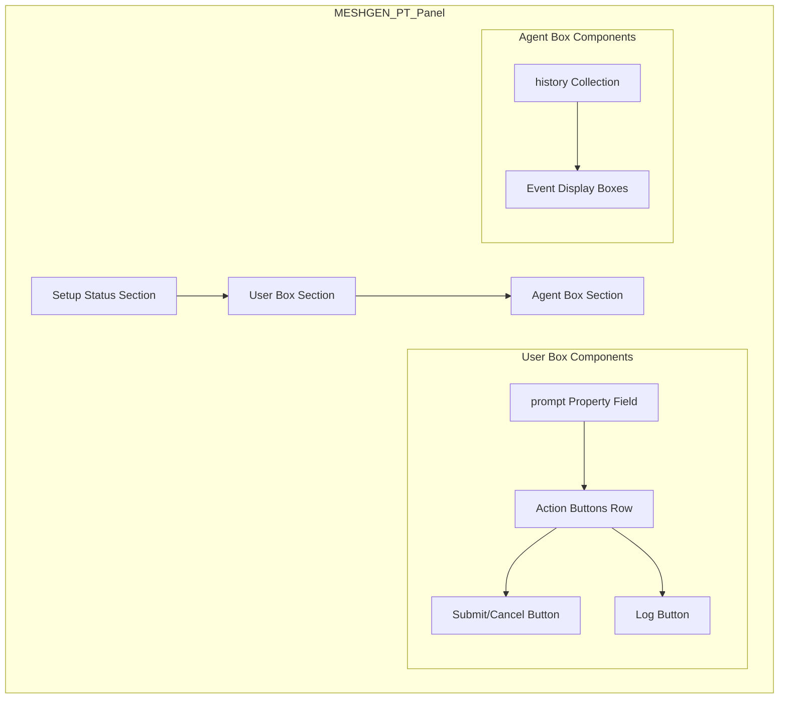
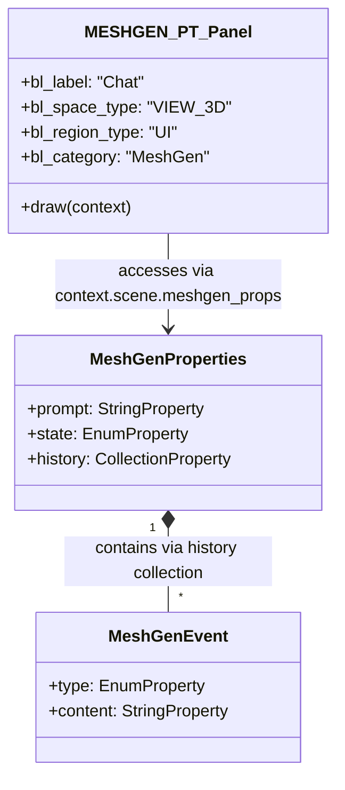
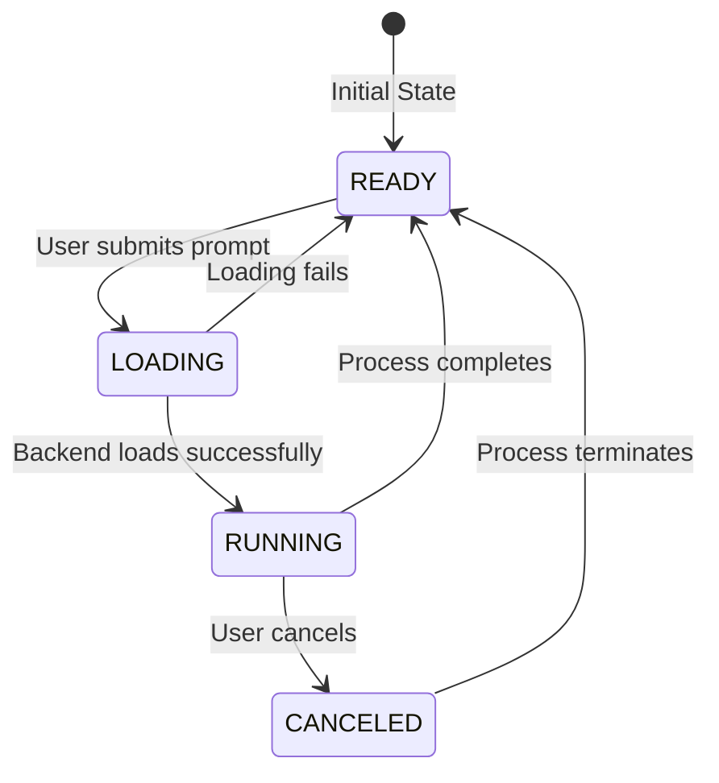
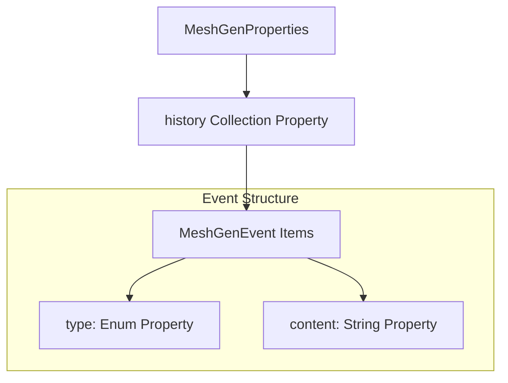
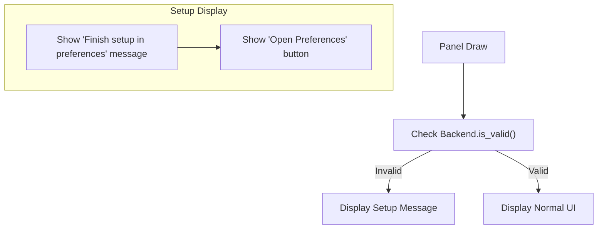
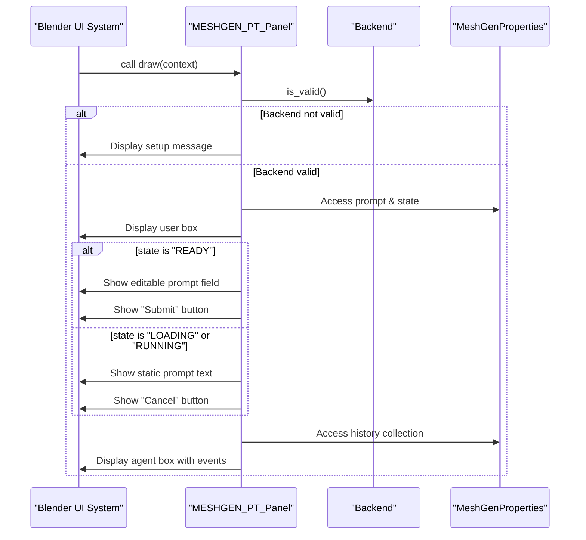

<!-- source: DeepWiki mcp.deepwiki.com · repo huggingface/meshgen · page 4.1 Blender UI Panel · fetched 2026-10-26 -->

# Blender UI Panel

Relevant source files

The following files were used as context for generating this wiki page:

- [properties.py](properties.py)
- [ui.py](ui.py)

The Blender UI Panel is the primary interface for user interaction with MeshGen. It provides a chat-like interface where users can enter text prompts for creating or modifying 3D objects and view the AI agent's responses in real-time. For information about the overall workflow when using this panel, see [Workflow Guide](#4.2).

## Panel Location and Structure

The MeshGen UI panel is located in Blender's 3D View side panel (accessed with the `N` key) under the "MeshGen" category tab. The panel itself is labeled "Chat" and consists of several key components.

Sources: [ui.py:28-83]()

## Panel Implementation

The UI panel is implemented as a Blender panel class that renders differently based on the current state of the application.

Sources: [ui.py:28-33](), [properties.py:28-47](), [properties.py:4-25]()

## Panel States and Behavior

The UI panel appearance changes based on the current state stored in `props.state`. This property controls what buttons and inputs are shown to the user.

| State | Input Field | Main Button | Description |
|-------|-------------|-------------|-------------|
| READY | Editable prompt | "Submit" | Ready to process a new request |
| LOADING | Static text (non-editable) | "Cancel" | Model is loading |
| RUNNING | Static text (non-editable) | "Cancel" | Agent is processing the request |
| CANCELED | Static text (non-editable) | - | Marked for cancellation |

Sources: [properties.py:35-45](), [ui.py:60-68]()

## Event Display System

The agent's responses are displayed in the Agent Box as a series of events. Each event has a type, a corresponding label, and an icon to visually indicate its purpose.

| Event Type | Label | Icon | Description |
|------------|-------|------|-------------|
| THINKING | "Thinking..." | SORTTIME | Agent is processing |
| STEP | "Step" | LIGHT | Intermediate step in processing |
| ERROR | "Error" | ERROR | Error occurred |
| CANCELED | "Canceled" | X | User canceled operation |
| SUCCESS | "Finished" | CHECKMARK | Operation completed |
| LOADING | "Loading..." | SORTTIME | Model is loading |
| LOADING_SUCCESS | "Loaded model" | CHECKMARK | Model loaded successfully |
| LOADING_ERROR | "Failed to load model" | ERROR | Model failed to load |

The event system uses Blender's property system to maintain state between panel redraws:

Sources: [ui.py:5-25](), [ui.py:78-82](), [properties.py:4-25]()

## Backend Validation

Before displaying the main UI components, the panel checks if the backend is properly configured:

If the backend is not properly configured, the panel displays a message prompting the user to complete setup in the preferences panel, with a button to open it directly.

Sources: [ui.py:37-49]()

## Drawing the UI Components

The panel's drawing logic is handled in the `draw` method, which is called by Blender whenever the panel needs to be redrawn. The method performs the following steps:

1. Check if the backend is valid; if not, show setup instructions
2. Display the User Box with prompt input and action buttons
3. Display the Agent Box with the history of events

Sources: [ui.py:34-82]()

## User Interaction Flow

The UI panel serves as the entry point for user interaction with the MeshGen system:

1. User enters a prompt describing what they want to create or modify
2. User clicks "Submit" to send the prompt to the AI agent
3. Panel changes to show the operation is in progress
4. Agent responses appear in the history as they are processed
5. When complete (or on error/cancel), the panel returns to the ready state

The panel itself doesn't handle the actual processing of the prompt - it delegates this to the operators system which interacts with the backend and tools components.

Sources: [ui.py:60-68]()

## Summary

The Blender UI Panel is the primary touchpoint for users of MeshGen. It provides a simple, chat-like interface for interacting with the AI agent, with visual feedback on the current state and progress of operations. The panel adapts its appearance based on the current state of the system and displays a history of events to show the agent's thought process and actions.

<chunk>
# Blender UI Panel

The Blender UI Panel is the primary interface for user interaction with MeshGen. It provides a chat-like interface where users can enter text prompts for creating or modifying 3D objects and view the AI agent's responses in real-time. For information about the overall workflow when using this panel, see [Workflow Guide](#4.2).

## Panel Location and Structure

The MeshGen UI panel is located in Blender's 3D View side panel (accessed with the `N` key) under the "MeshGen" category tab. The panel itself is labeled "Chat" and consists of several key components.

Sources: [ui.py:28-83]()

## Panel Implementation

The UI panel is implemented as a Blender panel class that renders differently based on the current state of the application.

Sources: [ui.py:28-33](), [properties.py:28-47](), [properties.py:4-25]()

## Panel States and Behavior

The UI panel appearance changes based on the current state stored in `props.state`. This property controls what buttons and inputs are shown to the user.

| State | Input Field | Main Button | Description |
|-------|-------------|-------------|-------------|
| READY | Editable prompt | "Submit" | Ready to process a new request |
| LOADING | Static text (non-editable) | "Cancel" | Model is loading |
| RUNNING | Static text (non-editable) | "Cancel" | Agent is processing the request |
| CANCELED | Static text (non-editable) | - | Marked for cancellation |

Sources: [properties.py:35-45](), [ui.py:60-68]()

## Event Display System

The agent's responses are displayed in the Agent Box as a series of events. Each event has a type, a corresponding label, and an icon to visually indicate its purpose.

| Event Type | Label | Icon | Description |
|------------|-------|------|-------------|
| THINKING | "Thinking..." | SORTTIME | Agent is processing |
| STEP | "Step" | LIGHT | Intermediate step in processing |
| ERROR | "Error" | ERROR | Error occurred |
| CANCELED | "Canceled" | X | User canceled operation |
| SUCCESS | "Finished" | CHECKMARK | Operation completed |
| LOADING | "Loading..." | SORTTIME | Model is loading |
| LOADING_SUCCESS | "Loaded model" | CHECKMARK | Model loaded successfully |
| LOADING_ERROR | "Failed to load model" | ERROR | Model failed to load |

The event system uses Blender's property system to maintain state between panel redraws:

Sources: [ui.py:5-25](), [ui.py:78-82](), [properties.py:4-25]()

## Backend Validation

Before displaying the main UI components, the panel checks if the backend is properly configured:

If the backend is not properly configured, the panel displays a message prompting the user to complete setup in the preferences panel, with a button to open it directly.

Sources: [ui.py:37-49]()

## Drawing the UI Components

The panel's drawing logic is handled in the `draw` method, which is called by Blender whenever the panel needs to be redrawn. The method performs the following steps:

1. Check if the backend is valid; if not, show setup instructions
2. Display the User Box with prompt input and action buttons
3. Display the Agent Box with the history of events

Sources: [ui.py:34-82]()

## User Interaction Flow

The UI panel serves as the entry point for user interaction with the MeshGen system:

1. User enters a prompt describing what they want to create or modify
2. User clicks "Submit" to send the prompt to the AI agent
3. Panel changes to show the operation is in progress
4. Agent responses appear in the history as they are processed
5. When complete (or on error/cancel), the panel returns to the ready state

The panel itself doesn't handle the actual processing of the prompt - it delegates this to the operators system which interacts with the backend and tools components.

Sources: [ui.py:60-68]()

## Summary

The Blender UI Panel is the primary touchpoint for users of MeshGen. It provides a simple, chat-like interface for interacting with the AI agent, with visual feedback on the current state and progress of operations. The panel adapts its appearance based on the current state of the system and displays a history of events to show the agent's thought process and actions.
</chunk>

---

