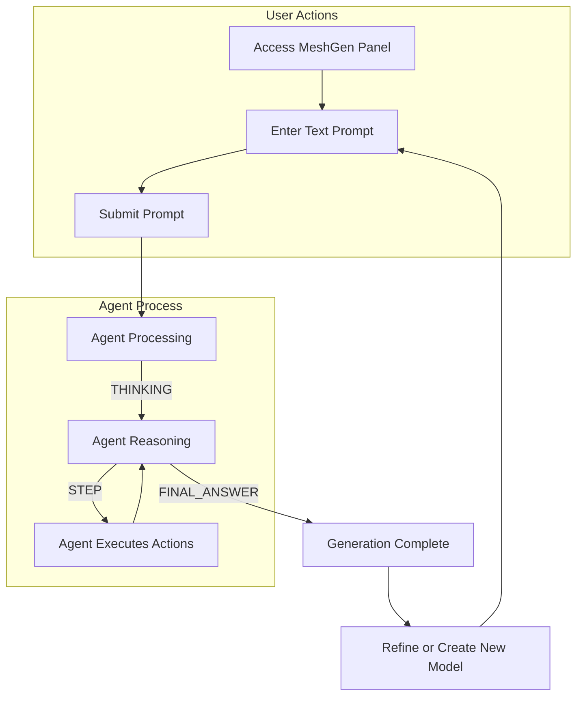
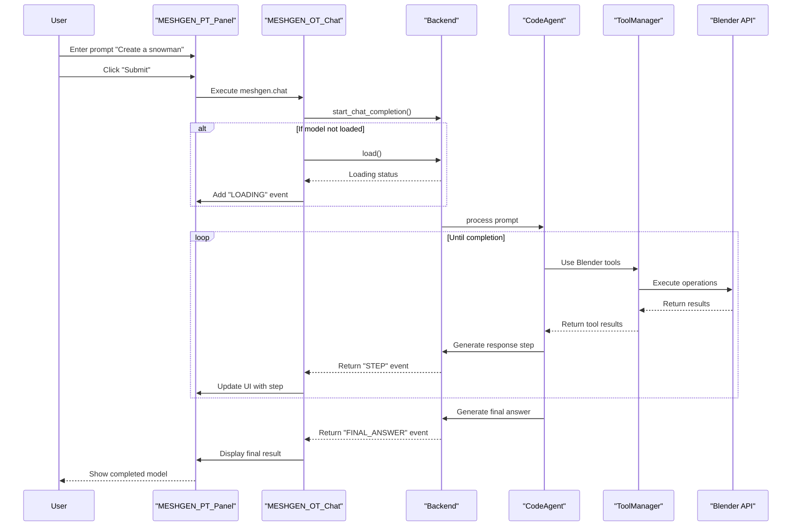
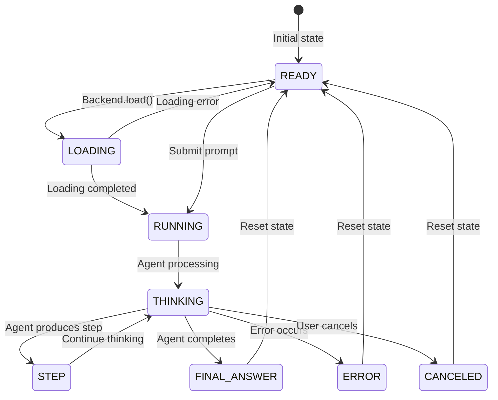
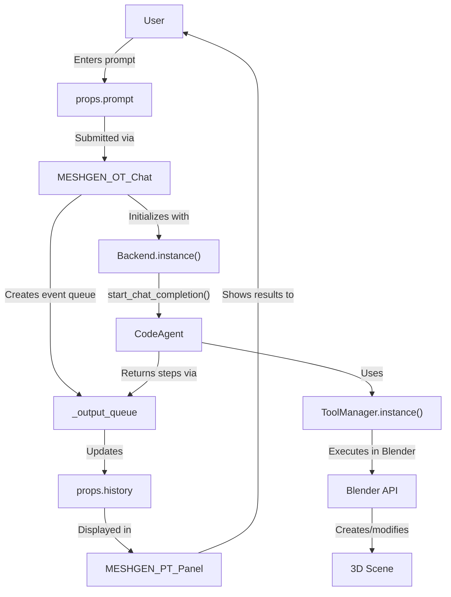

<!-- source: DeepWiki mcp.deepwiki.com · repo huggingface/meshgen · page 4.2 Workflow Guide · fetched 2026-10-26 -->

# Workflow Guide

Relevant source files

The following files were used as context for generating this wiki page:

- [README.md](README.md)
- [docs/meshgen.gif](docs/meshgen.gif)
- [operators.py](operators.py)
- [ui.py](ui.py)

This page provides a comprehensive, step-by-step guide for using MeshGen to create 3D models from text prompts. It covers the basic workflow, advanced usage patterns, and troubleshooting tips to help you effectively interact with the AI agent to create the desired 3D content. For information about the UI elements themselves, see [Blender UI Panel](#4.1), and for details on backend configuration, refer to [Backend System](#3.1).

## Basic Workflow

The core workflow of MeshGen follows a conversation-based approach where you provide natural language prompts and an AI agent interprets these to create 3D models in Blender.

### 1. Accessing the MeshGen Panel

1. In Blender, press `N` to open the sidebar
2. Select the "MeshGen" tab in the sidebar

Alternatively:
- Go to `View` → `Sidebar` → Select the `MeshGen` tab

### 2. Creating Your First Model

1. In the MeshGen panel, you'll see a text box under "You"
2. Enter a descriptive prompt for your desired 3D model
   - Example: "Create a snowman with three spheres, carrot nose, and stick arms"
3. Click the "Submit" button to send your prompt to the agent

### 3. Understanding the Response Process

After submitting your prompt, the agent goes through several states:

| State | Icon | Description |
|-------|------|-------------|
| LOADING | ⏱️ | Loading the language model (if not already loaded) |
| THINKING | ⏱️ | Agent is processing your request |
| STEP | 💡 | Agent is executing a specific action in Blender |
| SUCCESS | ✓ | Agent has completed the task successfully |
| ERROR | ⚠️ | An error occurred during processing |
| CANCELED | ❌ | The operation was canceled by the user |

The agent will typically progress through multiple "Thinking" and "Step" states as it works on your model, eventually reaching a "Success" state when complete.

Sources: [operators.py:17-157](), [ui.py:5-25](), [README.md:128-131]()

## Example Workflow

Below is a visualization of how a typical interaction flows from user prompt to completed 3D model:

Sources: [operators.py:17-163](), [ui.py:28-83]()

## Advanced Usage Strategies

### Working with Complex Requests

For complex 3D modeling requests, it's often better to:

1. **Start simple**: Begin with a basic form and then refine
2. **Be specific**: Include details about size, proportion, and positioning
3. **Use references**: Mention familiar objects for scale or style comparison

### Viewing Agent Progress

The agent displays its thought process in two places:

1. **Panel interface**: Shows condensed steps and status
2. **Log window**: Contains detailed reasoning and operations

To open the detailed log:
- Click the small text icon next to the Submit/Cancel button
- This shows complete agent reasoning, which can be helpful for troubleshooting

### Using Multiple Prompts for Refinement

Complex models often require multiple prompts. A good workflow is:

1. Start with a base model: "Create a basic castle with four towers"
2. Refine with specific details: "Add crenellations to the castle walls"
3. Add finishing touches: "Create a moat around the castle"

This incremental approach typically yields better results than attempting to create complex models in a single prompt.

Sources: [operators.py:33-74](), [ui.py:68-83]()

## State Management and Workflow

The diagram below illustrates the state transitions that occur during the MeshGen workflow:

Understanding these states can help you interpret what's happening during model generation and troubleshoot if issues arise.

Sources: [operators.py:23-26](), [operators.py:73-157]()

## Troubleshooting

### Common Issues and Solutions

| Issue | Possible Cause | Solution |
|-------|---------------|----------|
| Generation takes too long | Complex prompt or slow model | Simplify prompt or use a faster model |
| Model doesn't match expectation | Ambiguous prompt | Be more specific and descriptive |
| Agent reports an error | Invalid operation or Blender limitation | Check log for details (click text icon) |
| Operation seems frozen | Agent is still thinking | Wait or cancel and try a simpler prompt |

### Canceling Operations

If the generation is taking too long or not proceeding as expected:

1. Click the "Cancel" button that appears during processing
2. The operation will stop and return to the READY state
3. You can then refine your prompt and try again

### Accessing Logs for Detailed Information

For more detailed information about what's happening:

1. Click the text icon button next to the Submit/Cancel button
2. This opens a text editor with the complete log
3. The log contains detailed information about each step and any errors

Sources: [operators.py:192-223](), [README.md:132-137]()

## Integration-Specific Workflows

### Using LLaMA-Mesh for Enhanced Mesh Generation

When [LLaMA-Mesh Integration](#5.1) is enabled, the agent gains additional capabilities for mesh understanding and creation:

1. The agent can analyze existing meshes for better understanding
2. More sophisticated mesh generation becomes possible
3. Mesh modification can be more precise

To use LLaMA-Mesh effectively:
- Make sure it's enabled in the MeshGen preferences under "Integrations"
- Be patient as it may take additional processing time
- Consider using more detailed prompts about mesh structure

### Using Hyper3D for High-Fidelity Models

When [Hyper3D Integration](#5.2) is enabled, you can generate higher-quality models:

1. Request high-fidelity models using specific terminology
2. Expect longer generation times (several minutes per mesh)
3. For best results, be very specific about the object you want to create

To use Hyper3D effectively:
- Enable it in the MeshGen preferences under "Integrations"
- Use clear, single-object descriptions
- Be prepared for longer processing times

Sources: [README.md:96-124]()

## Processing Flow Between Components

The diagram below shows how your prompt flows through the MeshGen system:

This process creates a continuous feedback loop where:
1. The user provides a prompt
2. The agent processes it through multiple components
3. The Blender scene is updated
4. Results and progress are displayed to the user
5. The user can then provide additional prompts for refinement

Sources: [operators.py:17-186](), [ui.py:28-83]()

By following this workflow guide, you'll be able to effectively use MeshGen to create and refine 3D models using natural language prompts, leveraging the power of AI-assisted modeling within Blender.

---

