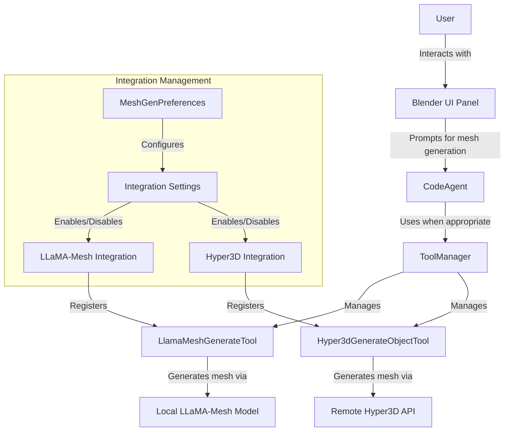
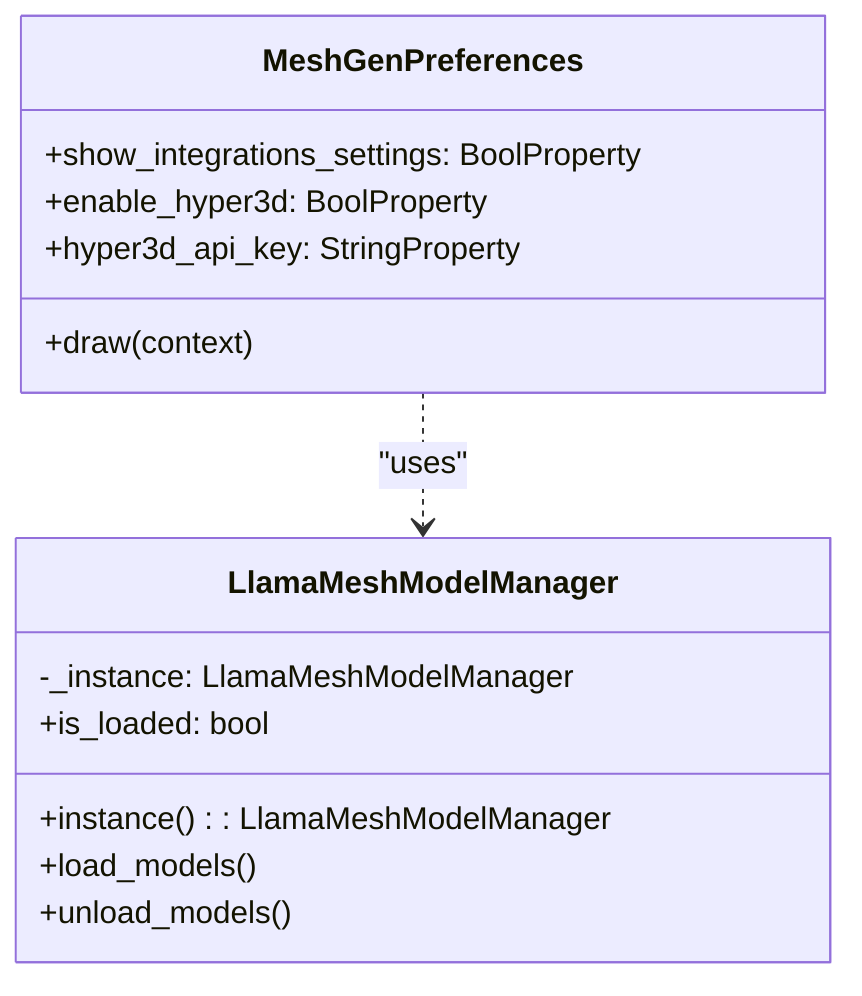
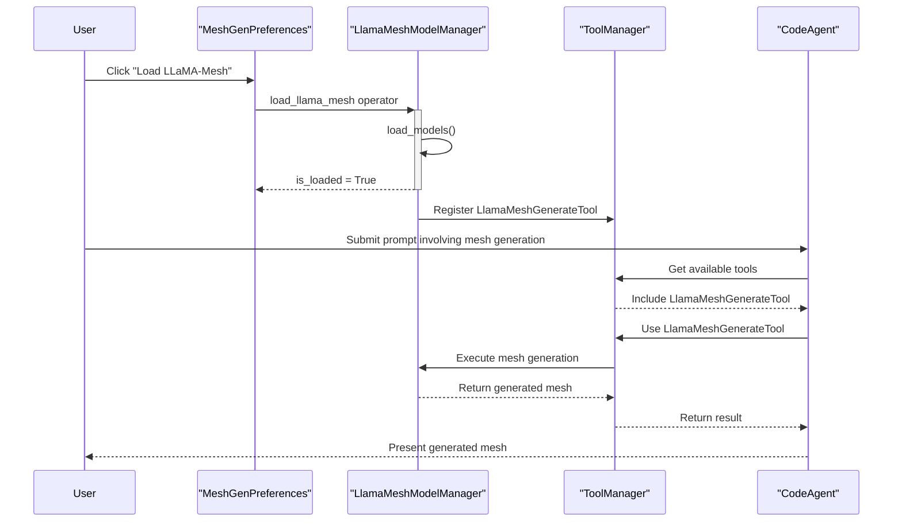
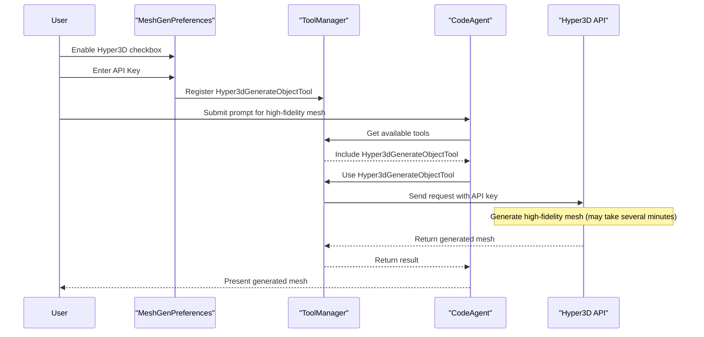
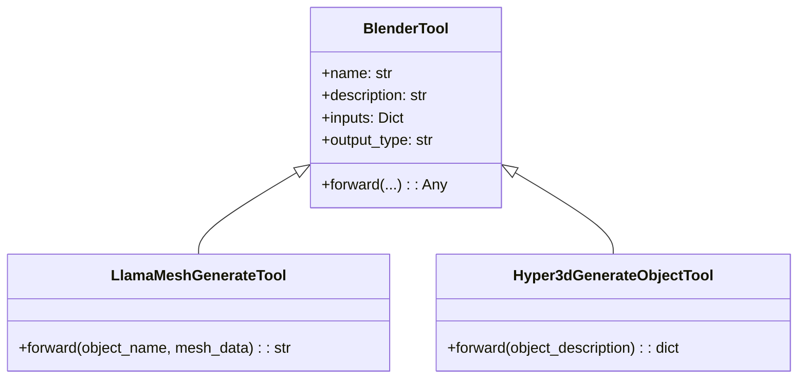
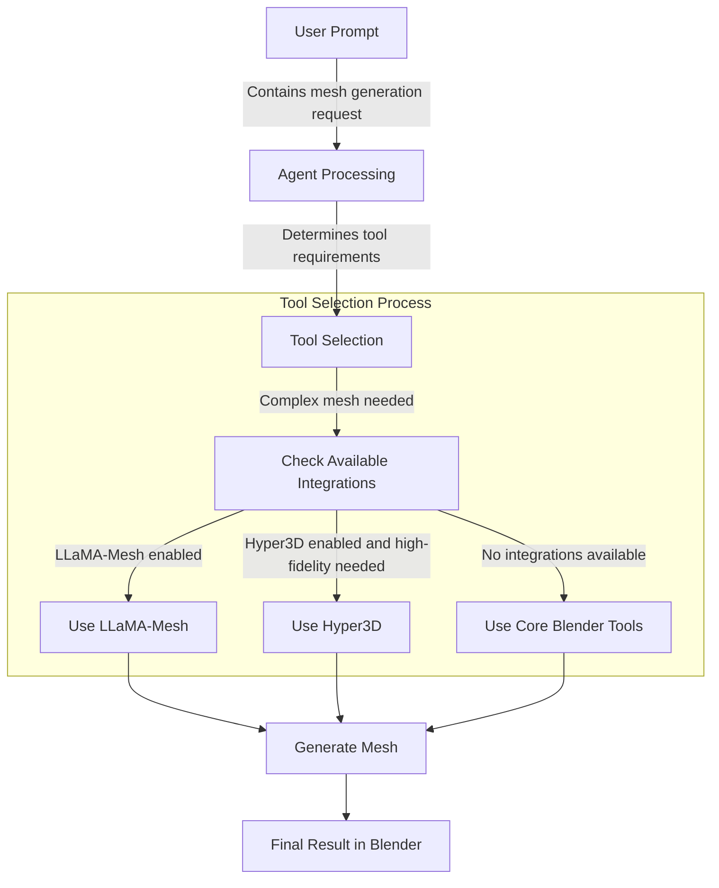

<!-- source: DeepWiki mcp.deepwiki.com · repo huggingface/meshgen · page 5 Integrations · fetched 2026-10-26 -->

# Integrations

<details>
<summary>Relevant source files</summary>

The following files were used as context for generating this wiki page:

- [README.md](README.md)
- [docs/integrations.png](docs/integrations.png)
- [docs/local.png](docs/local.png)
- [docs/meshgen.gif](docs/meshgen.gif)
- [docs/remote.png](docs/remote.png)
- [preferences.py](preferences.py)

</details>


This page documents the external integrations available in MeshGen that enhance its core capabilities through specialized mesh generation and understanding features. For information on the core system architecture, see [System Architecture](#3).

## Overview

MeshGen supports optional integrations with specialized AI systems to extend its capabilities beyond what's possible with the core language model backends. These integrations are managed through the preferences system and provide additional tools that the AI agent can utilize when generating 3D content.



Sources: [preferences.py:170-354](), [README.md:95-124]()

## Integration Configuration

Integrations are configured through the MeshGen preferences panel under the "Integrations" section. The integration settings are stored in the `MeshGenPreferences` class, which extends Blender's addon preferences system.



Sources: [preferences.py:170-185](), [preferences.py:319-354]()

The relevant properties in the `MeshGenPreferences` class include:

| Property | Type | Description |
|----------|------|-------------|
| `show_integrations_settings` | BoolProperty | Controls visibility of integration settings in UI |
| `enable_hyper3d` | BoolProperty | Toggles the Hyper3D integration on/off |
| `hyper3d_api_key` | StringProperty | API key for Hyper3D service |

Sources: [preferences.py:170-185]()

## Current Integrations

MeshGen currently supports two integrations:

1. **LLaMA-Mesh** - Local mesh understanding and generation
2. **Hyper3D** - High-fidelity 3D mesh generation via remote API

### LLaMA-Mesh Integration

LLaMA-Mesh is an integration for local mesh understanding and generation based on NVIDIA research. It requires significant GPU resources (at least 5GB additional VRAM) and is generally recommended for use with a remote backend to avoid VRAM contention with the local backend.



Sources: [preferences.py:321-343](), [README.md:103-113]()

The LLaMA-Mesh integration UI is defined in the `draw` method of `MeshGenPreferences`:

```python
llama_mesh_box = plugin_box.box()
llama_mesh_box.label(text="LLaMA-Mesh", icon="PACKAGE")
llama_mesh_box.label(text="Use LLaMA-Mesh for local mesh generation and understanding.")

if LlamaMeshModelManager.instance().is_loaded:
    llama_mesh_box.label(text="LLaMA-Mesh is loaded", icon="CHECKBOX_HLT")
    llama_mesh_box.operator("meshgen.unload_llama_mesh", text="Unload LLaMA-Mesh", icon="X")
else:
    if self.backend_type == "LOCAL":
        llama_mesh_box.label(
            text="Requires 5GB additional VRAM. Not recommended with local backend.",
            icon="ERROR",
        )
    llama_mesh_box.operator(
        "meshgen.load_llama_mesh", text="Load LLaMA-Mesh", icon="IMPORT"
    )
```

Sources: [preferences.py:321-343]()

### Hyper3D Integration

Hyper3D (also referred to as Rodin in the code) is an integration for high-fidelity 3D mesh generation via a remote API service. Unlike LLaMA-Mesh, Hyper3D runs remotely and doesn't require local GPU resources, making it suitable for all users regardless of their hardware.



Sources: [preferences.py:345-354](), [README.md:115-124]()

The Hyper3D integration UI is defined in the `draw` method of `MeshGenPreferences`:

```python
hyper3d_box = plugin_box.box()
hyper3d_box.label(text="Hyper3D", icon="PACKAGE")
hyper3d_box.label(text="Use Hyper3D (Rodin) API for mesh generation.")
hyper3d_box.prop(self, "enable_hyper3d")
if self.enable_hyper3d:
    hyper3d_box.prop(self, "hyper3d_api_key")
```

Sources: [preferences.py:345-354]()

## Integration Tools

The integrations register specialized tools with the ToolManager, which are then available to the AI agent when appropriate for the user's request.



These tools extend the `BlenderTool` base class and implement specific functionality for their respective integrations:

1. **LlamaMeshGenerateTool** - Generates mesh data using the local LLaMA-Mesh model
2. **Hyper3dGenerateObjectTool** - Creates 3D objects using the remote Hyper3D API

The tools are automatically registered with the ToolManager when their respective integrations are enabled, making them available for the AI agent to use when needed.

Sources: [README.md:101-102]()

## Hardware Requirements and Compatibility

The integrations have different hardware requirements and backend compatibility considerations:

| Integration | Hardware Requirements | Backend Compatibility | Setup |
|-------------|----------------------|---------------------|-------|
| LLaMA-Mesh | NVIDIA GPU with 8GB+ VRAM | Recommended with remote backend | Load via preferences panel |
| Hyper3D | None (remote API) | Compatible with all backends | Enable and provide API key |

When using LLaMA-Mesh with a local backend, the total VRAM requirement becomes quite high (LLaMA-Mesh needs an additional 5GB on top of the local backend's requirements), which may cause performance issues on systems with limited VRAM.

Sources: [preferences.py:336-339](), [README.md:103-113](), [README.md:115-124]()

## Integration Usage Flow

The following diagram illustrates how integrations are used in the typical MeshGen workflow:



The AI agent automatically determines which tool is most appropriate for the user's request based on:

1. Which integrations are enabled
2. The specific requirements of the mesh (complexity, fidelity, etc.)
3. Context from the user's prompt

This selection process is transparent to the user, who simply provides a natural language prompt and receives the resulting 3D model in Blender.

Sources: [README.md:101-102](), [README.md:125-131]()

---

