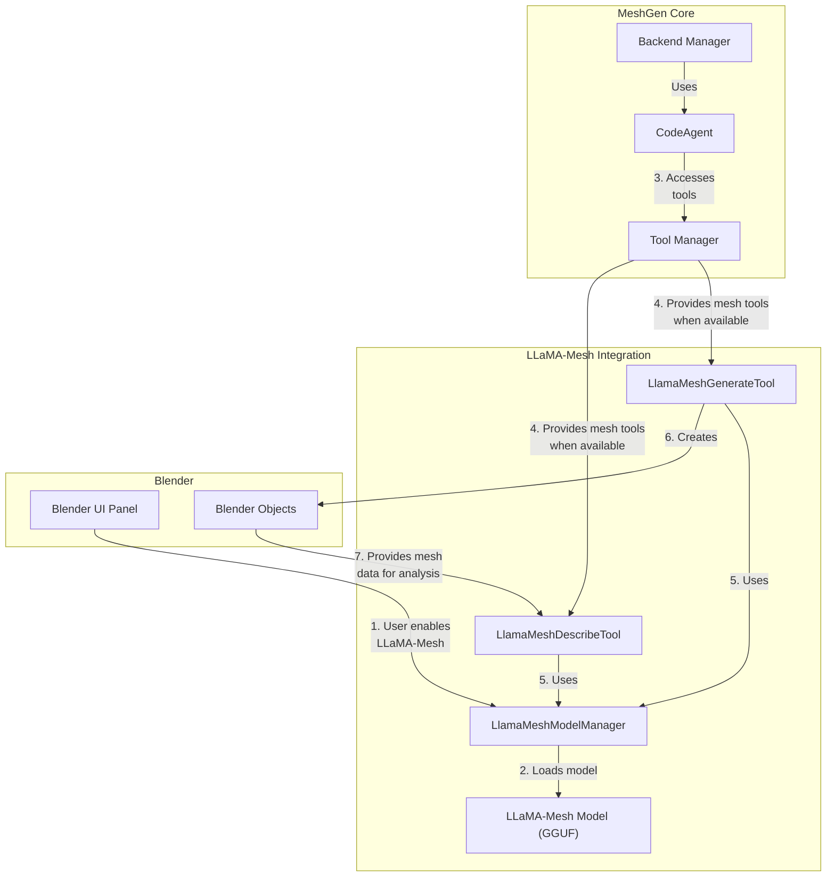
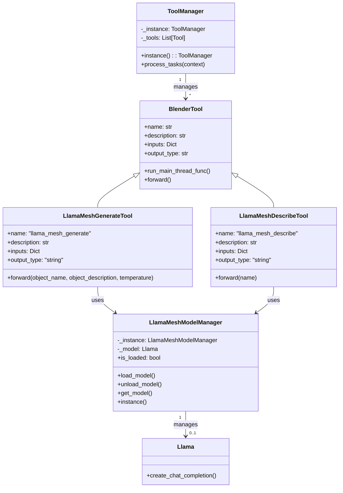
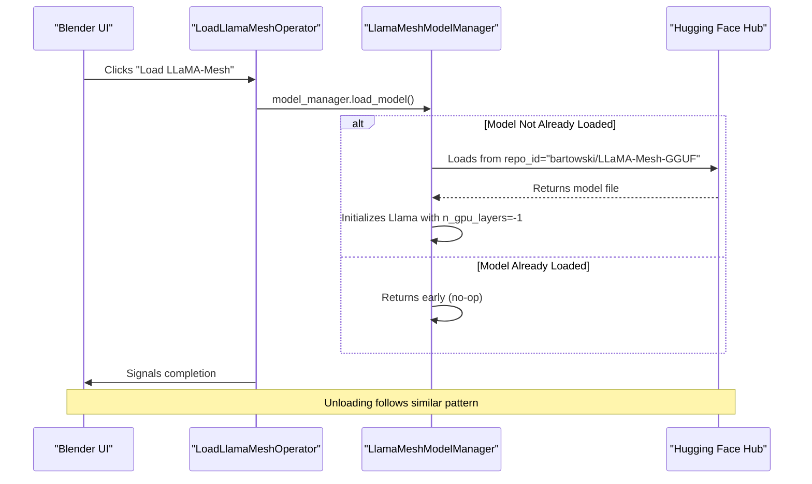
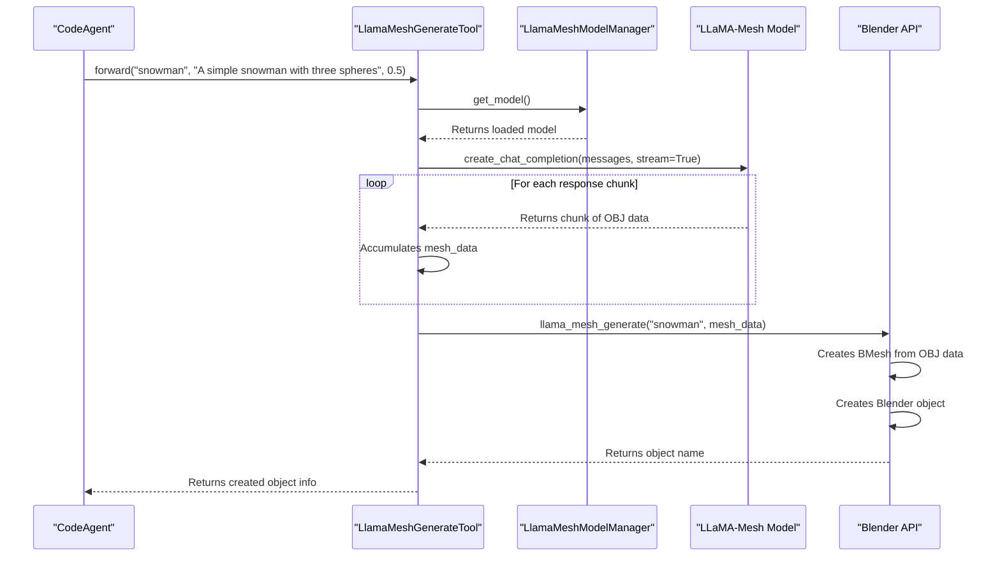

<!-- source: DeepWiki mcp.deepwiki.com · repo huggingface/meshgen · page 5.1 LLaMA-Mesh Integration · fetched 2026-10-26 -->

# LLaMA-Mesh Integration

<details>
<summary>Relevant source files</summary>

The following files were used as context for generating this wiki page:

- [README.md](README.md)
- [docs/meshgen.gif](docs/meshgen.gif)
- [operators.py](operators.py)
- [preferences.py](preferences.py)
- [tools.py](tools.py)

</details>


## Overview

The LLaMA-Mesh integration enables MeshGen to perform local mesh understanding and generation directly within Blender. This integration leverages [LLaMA-Mesh](https://github.com/nv-tlabs/LLaMA-Mesh), a specialized language model that can both generate 3D meshes from text descriptions and understand existing 3D geometry.

This page focuses on the technical implementation of the LLaMA-Mesh integration within MeshGen. For information about the Hyper3D integration (another mesh generation system), see [Hyper3D Integration](#5.2).

Sources: [README.md:101-114](), [preferences.py:322-343]()

## Architecture

LLaMA-Mesh functions as an optional integration within MeshGen's architecture, providing specialized mesh generation and understanding capabilities through a dedicated model manager and tool system.

### Integration Architecture



Sources: [tools.py:842-893](), [tools.py:974-1038](), [tools.py:1110-1155]()

### Component Relationships



Sources: [tools.py:12-90](), [tools.py:842-893](), [tools.py:974-1038](), [tools.py:1110-1155]()

## Model Management

The `LlamaMeshModelManager` implements a singleton pattern to manage a single instance of the LLaMA-Mesh model across MeshGen. This ensures efficient memory usage and prevents duplicate model loading.

### Key Features

- **Singleton Pattern**: Maintains a single model instance across the entire application
- **On-Demand Loading**: Loads the model only when requested and not automatically on startup
- **Memory Management**: Properly unloads the model when no longer needed to free GPU memory
- **Thread Safety**: Uses locks to prevent race conditions during initialization

### Model Details

- **Repository**: `bartowski/LLaMA-Mesh-GGUF`
- **Model file**: `LLaMA-Mesh-Q4_K_M.gguf` (quantized model for efficient memory usage)
- **Context size**: 8192 tokens
- **Memory requirement**: ~5GB VRAM



Sources: [tools.py:842-893](), [operators.py:417-440]()

## LLaMA-Mesh Tool Implementation

MeshGen integrates LLaMA-Mesh functionality through two specialized Blender tools that leverage the model for 3D operations.

### LlamaMeshGenerateTool

This tool converts natural language descriptions into 3D meshes by generating OBJ file data via the LLaMA-Mesh model.

**Input Parameters:**
- `object_name`: Name for the generated object in Blender
- `object_description`: Text description of the desired 3D object
- `temperature` (optional): Controls randomness in generation (0.0-1.0, default: 0.5)

**Process Flow:**
1. Retrieves the LLaMA-Mesh model from the model manager
2. Constructs a chat prompt asking for OBJ file generation
3. Streams the response from the model to build mesh data
4. Calls `llama_mesh_generate` on the main Blender thread to create the object

**Output:**
- Returns the name of the created Blender object

### LlamaMeshDescribeTool

This tool analyzes existing 3D meshes and generates natural language descriptions of what they represent.

**Input Parameters:**
- `name`: Name of the existing Blender object to analyze

**Process Flow:**
1. Retrieves mesh data from the specified Blender object
2. Extracts and prepares OBJ format data with vertices and faces
3. Sends this data to the LLaMA-Mesh model
4. Returns the model's interpretation of what the 3D object represents

**Output:**
- A string description of the analyzed 3D object

**Limitations:**
- Only works with meshes containing fewer than 800 vertices

### Processing Example



Sources: [tools.py:974-1038](), [tools.py:1110-1155](), [tools.py:895-972](), [tools.py:1041-1107]()

## Integration in the Tool System

When LLaMA-Mesh is loaded, its tools are automatically made available to the MeshGen agent, allowing it to use mesh generation and understanding capabilities in its workflows.

### Tool Registration

```python
def _initialize(self):
    prefs = bpy.context.preferences.addons[__package__].preferences

    self._task_queue = queue.Queue()
    self._result_dict = {}
    self._condition = threading.Condition()
    self._tools = [
        PythonInterpreterTool(),
        FinalAnswerTool(),
        GetSceneInfoTool(),
        GetObjectInfoTool(),
        CreateObjectTool(),
        ModifyObjectTool(),
        DeleteObjectTool(),
        SetMaterialTool(),
    ]

    if LlamaMeshModelManager.instance().is_loaded:
        self._tools += [
            LlamaMeshGenerateTool(),
            LlamaMeshDescribeTool(),
        ]

    if prefs.enable_hyper3d:
        self._tools += [Hyper3dGenerateObjectTool()]
```

The tool manager checks if LLaMA-Mesh is loaded during initialization and conditionally adds the LLaMA-Mesh tools to the available tools list. When the Backend is reset (which occurs after loading or unloading LLaMA-Mesh), the tool manager is also reset, ensuring that tools match the currently available capabilities.

Sources: [tools.py:12-50](), [operators.py:426-439]()

## User Interface and Activation

The LLaMA-Mesh integration is managed through the MeshGen preferences panel under the "Integrations" section.

### UI Representation

The integration appears as a box labeled "LLaMA-Mesh" with either:
- A "Load LLaMA-Mesh" button when the model is not loaded
- An "Unload LLaMA-Mesh" button when the model is loaded

When using the LOCAL backend type, a warning is displayed indicating the high VRAM requirements and that it's not recommended to use both local inference and LLaMA-Mesh simultaneously.

### Activation Process

1. User navigates to Edit → Preferences → Add-ons → MeshGen → Integrations
2. User clicks the "Load LLaMA-Mesh" button
3. The model is downloaded (if not already present) and loaded into memory
4. The Backend is reset to incorporate the newly available tools
5. The UI updates to show that LLaMA-Mesh is loaded

Sources: [preferences.py:322-343](), [operators.py:417-440]()

## Technical Requirements and Limitations

### Hardware Requirements

- **GPU**: NVIDIA GPU with CUDA support
- **VRAM**: Minimum 5GB additional VRAM (beyond what's needed for Blender itself)
- **Installation**: Must install the CUDA version of the addon

### Performance Considerations

- Not recommended to use with the local backend because:
  - Combined VRAM usage may exceed what's available on many GPUs
  - Performance may degrade significantly with both models loaded

### Limitations

- **Mesh Generation**: Produces simple, low-polygon meshes suitable for basic shapes
- **Mesh Analysis**: Only works with meshes containing fewer than 800 vertices
- **Memory Management**: Users should unload the model when not needed to free GPU memory

## Usage Examples

### Generating a Simple 3D Object

When LLaMA-Mesh is loaded, the agent can generate simple 3D models from descriptions:

```
User: Create a simple snowman with three spheres
Agent: I'll create a snowman using LLaMA-Mesh to generate the 3D model.
Agent: [Uses llama_mesh_generate tool with "A snowman made of three stacked spheres"]
Agent: I've created a snowman object. The model is simple and low-poly.
```

### Analyzing an Existing Mesh

The agent can also describe existing 3D models:

```
User: What is this object I imported?
Agent: Let me analyze the object using LLaMA-Mesh.
Agent: [Uses llama_mesh_describe tool with the object name]
Agent: This appears to be a simple chair model with four legs and a backrest.
```

Sources: [tools.py:974-1038](), [tools.py:1110-1155]()

## Related Components

For a complete understanding of the MeshGen system, also refer to:
- [Backend System](#3.1) - Details on how language models integrate with MeshGen
- [Tools System](#3.2) - Information on the overall tool architecture
- [Hyper3D Integration](#5.2) - Another integration for high-fidelity mesh generation

---

