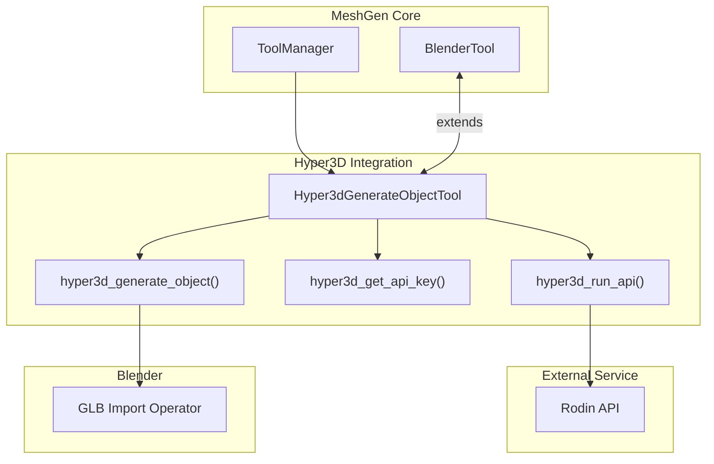
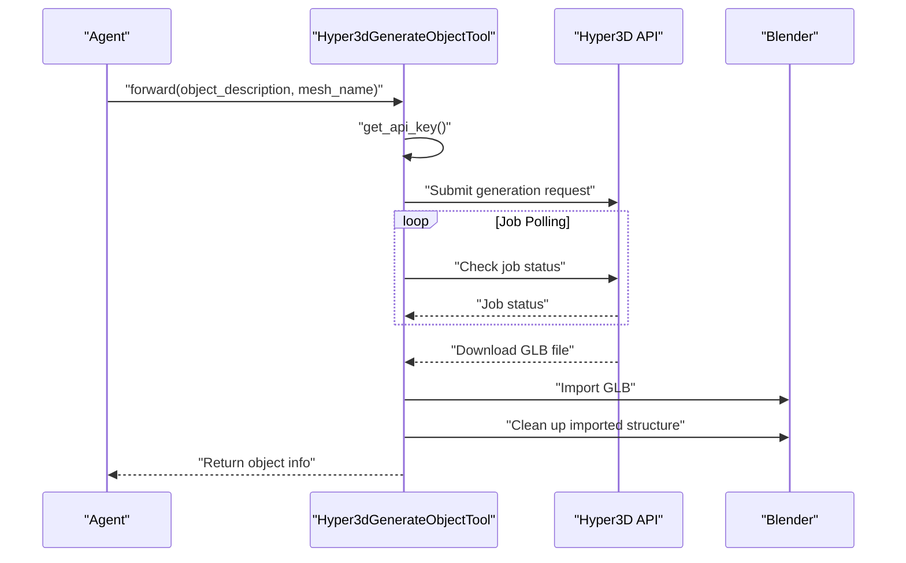
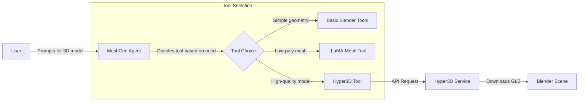

<!-- source: DeepWiki mcp.deepwiki.com · repo huggingface/meshgen · page 5.2 Hyper3D Integration · fetched 2026-10-26 -->

# Hyper3D Integration

<details>
<summary>Relevant source files</summary>

The following files were used as context for generating this wiki page:

- [README.md](README.md)
- [docs/meshgen.gif](docs/meshgen.gif)
- [preferences.py](preferences.py)
- [tools.py](tools.py)

</details>


This page documents the Hyper3D integration in MeshGen, which provides high-fidelity 3D mesh generation through an external API. This allows the MeshGen agent to create detailed 3D models with materials based on natural language descriptions. For information about local mesh generation, see [LLaMA-Mesh Integration](#5.1).

## Overview

Hyper3D (also referred to as Rodin in the API endpoints) is a remote service that generates high-quality 3D meshes with materials from text descriptions. Unlike the LLaMA-Mesh integration which runs locally, Hyper3D operates via API calls to an external service, providing more detailed and visually appealing results at the cost of requiring internet connectivity and longer generation times.

Sources: [README.md:97-124](), [tools.py:1156-1350]()

## Enabling the Integration

The Hyper3D integration is disabled by default and must be explicitly enabled through the MeshGen preferences panel.

### Configuration Steps

1. Navigate to Blender's Preferences → Add-ons → MeshGen
2. Expand the "Integrations" section
3. Check the "Enable Hyper3D" option
4. Enter an API key (the default key "awesomemcp" is pre-filled and provides free usage)

Once enabled, the Hyper3D tool becomes available to the agent automatically.

Sources: [preferences.py:345-355](), [tools.py:47-49]()

## System Architecture

The Hyper3D integration is implemented as a specialized tool within MeshGen's tool management system. When enabled, it's automatically added to the available toolkit for the agent to use.

### Component Diagram



Sources: [tools.py:1157-1351](), [preferences.py:175-186]()

## Implementation Details

The Hyper3D integration consists of three main components:

1. **API Communication** - Handling the interaction with the Hyper3D/Rodin API
2. **Job Management** - Polling for job completion and retrieving results
3. **Import Processing** - Importing and cleaning up the generated 3D model in Blender

### API Communication Flow



Sources: [tools.py:1166-1248](), [tools.py:1251-1314]()

### API Endpoints Used

- Submit generation: `https://hyperhuman.deemos.com/api/v2/rodin`
- Check status: `https://hyperhuman.deemos.com/api/v2/status`
- Download result: `https://hyperhuman.deemos.com/api/v2/download`

The implementation handles authentication, job submission, polling for completion, and downloading results.

Sources: [tools.py:1178-1248]()

### Object Import Process

Once the GLB file is downloaded, the system:

1. Imports it using Blender's GLTF importer
2. Identifies the mesh object from the imported structure
3. Cleans up any unnecessary parent nodes
4. Renames the mesh to the requested name
5. Returns information about the imported object to the agent

This process ensures that only the relevant mesh is retained in the scene with proper naming.

Sources: [tools.py:1251-1314]()

## Tool Structure

The `Hyper3dGenerateObjectTool` class implements the Hyper3D integration as a Blender tool:

```
Hyper3dGenerateObjectTool
├── name: "hyper3d_generate_object"
├── description: Detailed usage guide
├── inputs:
│   ├── object_description: Text description of desired object
│   └── mesh_name: Name for the generated mesh
└── output_type: "object"
```

The tool's forward method orchestrates the entire generation process from API communication to Blender import.

Sources: [tools.py:1316-1350]()

## Usage and Best Practices

The Hyper3D integration is best used for generating high-quality individual objects rather than complex scenes. The generated models include materials and textures, providing ready-to-use assets.

### Recommended Use Cases

- Individual detailed objects
- Characters or creatures
- Props and furniture
- Vehicles and mechanical objects

### Limitations

As noted in the tool's description, there are several important limitations:

1. **Not suitable for generating entire scenes** - Generate individual objects instead
2. **Not effective for terrain generation** - Use Blender's built-in terrain tools
3. **Cannot generate complex multi-part objects** - Generate single cohesive objects
4. **Generation takes several minutes** - Be patient during the generation process

The generated models are normalized in size and may need rescaling to fit specific scene requirements.

Sources: [tools.py:1318-1327](), [README.md:116-124]()

## Integration in the Agent Workflow

When the Hyper3D integration is enabled, the agent is automatically given access to the tool through the ToolManager. The agent can choose to use this tool when appropriate based on the user's request.



Sources: [tools.py:12-50](), [tools.py:1342-1350]()

## Example Agent Interaction

When the agent decides to use Hyper3D for mesh generation, it will:

1. Call the `hyper3d_generate_object` tool with a description and name
2. Inform the user that generation is in progress and may take several minutes
3. Wait for the generation and import process to complete
4. Receive the object information (name, type, location, etc.)
5. Continue the interaction by potentially modifying the object or adding more scene elements

This process is seamlessly integrated into the agent's workflow when the integration is enabled.

Sources: [tools.py:1316-1350]()

## Technical Implementation Notes

The integration relies on a temporary file to store the downloaded GLB before importing it into Blender. The file is created in the system's temporary directory and is automatically cleaned up after successful import.

The import process includes special handling for different GLB structures, ensuring compatibility with various export formats from the Hyper3D service.

Sources: [tools.py:1227-1248](), [tools.py:1264-1283]()

---

