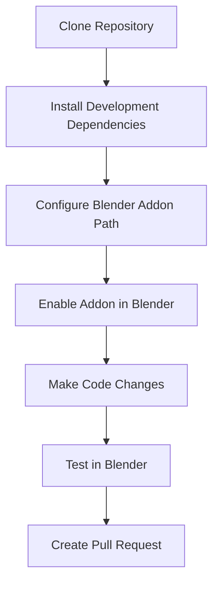
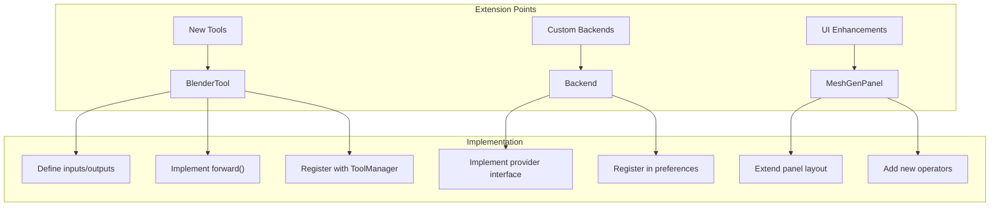
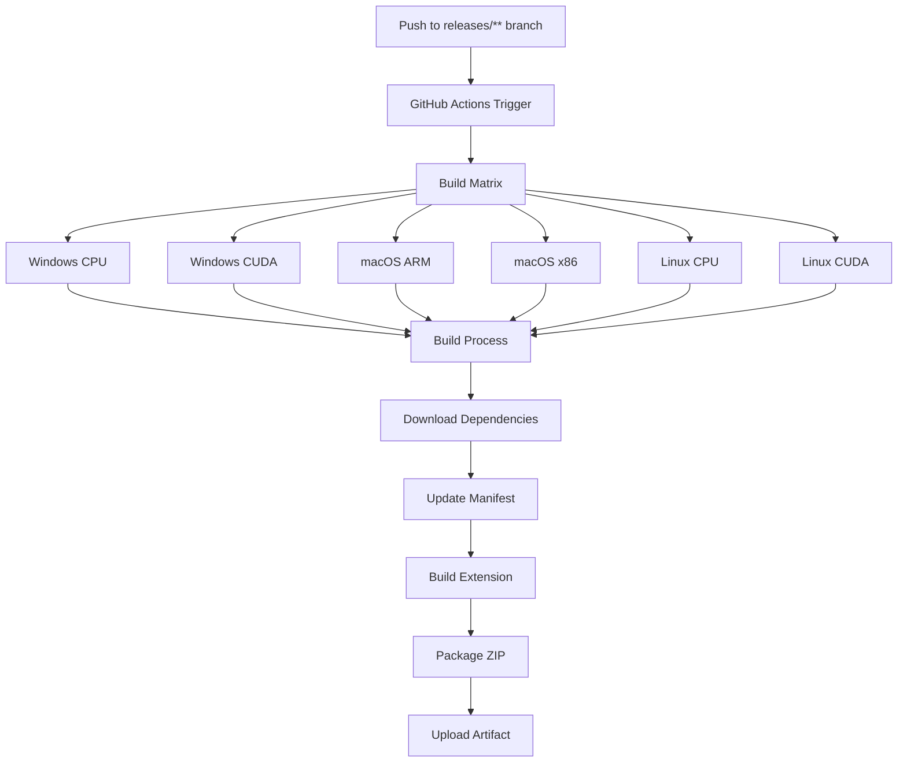
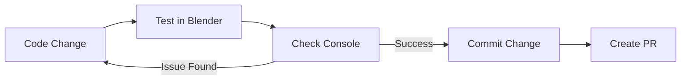

<!-- source: DeepWiki mcp.deepwiki.com · repo huggingface/meshgen · page 6 Development Guide · fetched 2026-10-26 -->

# Development Guide

<details>
<summary>Relevant source files</summary>

The following files were used as context for generating this wiki page:

- [.github/workflows/package-release.yml](.github/workflows/package-release.yml)
- [__init__.py](__init__.py)
- [blender_manifest.toml](blender_manifest.toml)

</details>


This guide provides information for developers who want to contribute to or extend the MeshGen addon for Blender. It covers the development environment setup, codebase architecture, extension points, and build processes. For user installation instructions, see [Installation Guide](#2.1), and for usage information, see [Workflow Guide](#4.2).

## Development Environment Setup

Setting up a development environment for MeshGen requires:

1. **Blender 4.2+**: MeshGen is developed for Blender 4.2.0 or higher
2. **Python 3.11**: Used for dependency management and building
3. **Git**: For source code management

### Getting Started



To set up your development environment:

1. Clone the repository: `git clone https://github.com/huggingface/meshgen.git`
2. Install development dependencies: `pip install tomli tomli-w setuptools`
3. Link or copy the addon to Blender's addon directory for development

Sources: [__init__.py:33-40](), [.github/workflows/package-release.yml:51-63]()

## Codebase Architecture

MeshGen is structured as a Blender addon with several key modules:

```mermaid
classDiagram
    class "__init__.py" {
        +register()
        +unregister()
        +reset_backend()
        +reset_runtime_preferences()
    }
    
    class "operators.py" {
        +MeshGenOperator
        +MeshGenCancelOperator
        +register()
        +unregister()
    }
    
    class "preferences.py" {
        +MeshGenPreferences
        +register()
        +unregister()
    }
    
    class "properties.py" {
        +MeshGenProperties
        +register()
        +unregister()
    }
    
    class "ui.py" {
        +MeshGenPanel
        +register()
        +unregister()
    }
    
    class "backend.py" {
        +Backend
        +LocalBackend
        +RemoteBackend
    }
    
    class "tools.py" {
        +ToolManager
        +BlenderTool
    }
    
    "__init__.py" --> "operators.py" : registers
    "__init__.py" --> "ui.py" : registers
    "__init__.py" --> "preferences.py" : registers
    "__init__.py" --> "properties.py" : registers
    "__init__.py" --> "backend.py" : imports
    "__init__.py" --> "tools.py" : imports
    "operators.py" --> "backend.py" : uses
    "operators.py" --> "properties.py" : updates
    "ui.py" --> "operators.py" : calls
    "ui.py" --> "properties.py" : displays
    "backend.py" --> "tools.py" : uses
    "preferences.py" --> "backend.py" : configures
```

The codebase follows Blender's addon structure with registration/unregistration patterns. Key components include:

1. **Backend System**: Manages language model interactions (local or remote)
2. **Tool Manager**: Handles execution of Blender operations
3. **Operators**: Implements Blender operators for user actions
4. **UI Components**: Provides user interface panels and controls
5. **Properties & Preferences**: Stores configuration and state

Sources: [__init__.py:1-56]()

## Extension Points

MeshGen provides several extension points for developers:



### Adding New Tools

To add a new tool to MeshGen:

1. Subclass `BlenderTool` from the tools module
2. Define the tool's inputs, outputs, and behavior
3. Register the tool with the `ToolManager`

Example tool structure:
```python
class MyCustomTool(BlenderTool):
    name = "my_custom_tool"
    description = "Does something useful"
    inputs = {"param1": "Type description", "param2": "Type description"}
    output_type = "Description of return value"
    
    def forward(self, param1, param2):
        # Implementation
        return result
```

### Creating Custom Backends

To add a new language model backend:

1. Extend the `Backend` class with provider-specific implementation
2. Add configuration options to preferences
3. Implement model loading and inference methods

### Enhancing the UI

The UI can be extended by:

1. Adding new panels or extending existing panels
2. Creating new operators for user interactions
3. Updating property definitions to store new states

Sources: Analysis of the core system components diagram

## Build and Release Process

MeshGen uses GitHub Actions for building and releasing packages:



### Build Process

The build process:

1. Sets up the environment with required dependencies
2. Downloads Python wheels according to platform requirements
3. Updates the manifest file with wheel paths
4. Builds the Blender extension package
5. Creates platform-specific ZIP packages

### Release Workflow

To create a new release:

1. Create a new branch with the naming pattern `releases/**`
2. Push the branch to GitHub
3. The GitHub Actions workflow automatically builds packages for all platforms
4. Download the artifacts from the GitHub Actions tab

### Package Dependencies

Dependencies are managed in the `blender_manifest.toml` file, which specifies:

1. Addon metadata (name, version, etc.)
2. Required Python wheel dependencies
3. Permissions needed by the addon

Sources: [.github/workflows/package-release.yml:1-137](), [blender_manifest.toml:1-99]()

## Debugging and Testing

When developing MeshGen:

1. Use Blender's Python console for interactive debugging
2. Enable verbose logging in the preferences
3. Test changes with different backends and tools
4. Verify compatibility across platforms



## Contributing Guidelines

When contributing to MeshGen:

1. Follow the existing code style and organization
2. Keep changes focused and well-documented
3. Test changes across multiple platforms when possible
4. Submit pull requests with clear descriptions of changes

Sources: Repository analysis and development best practices

---

