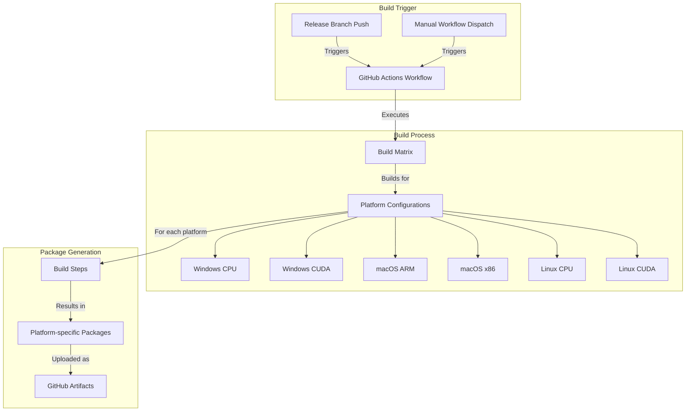
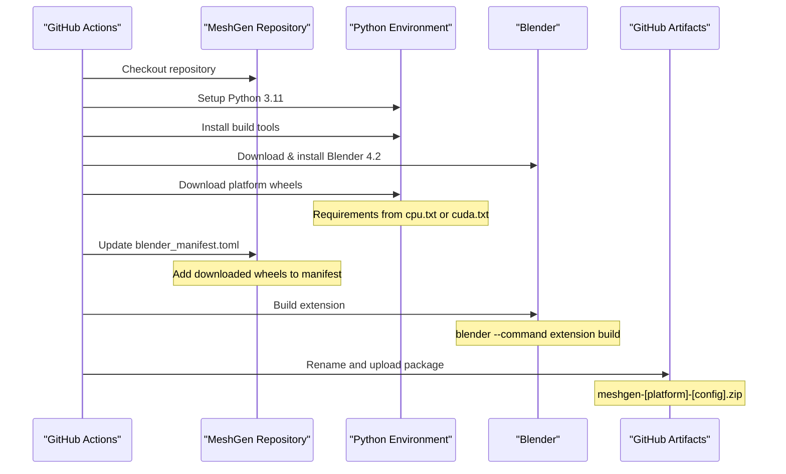
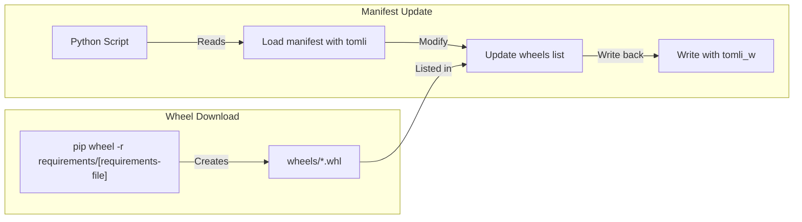

<!-- source: DeepWiki mcp.deepwiki.com · repo huggingface/meshgen · page 6.1 Build System · fetched 2026-10-26 -->

# Build System

<details>
<summary>Relevant source files</summary>

The following files were used as context for generating this wiki page:

- [.github/workflows/package-release.yml](.github/workflows/package-release.yml)
- [blender_manifest.toml](blender_manifest.toml)

</details>


This page documents the MeshGen build system and release workflow. It explains how the addon is built, packaged, and released across different platforms and configurations. For information on extending MeshGen with new functionality, see [Extending MeshGen](#6.2).

## Overview

MeshGen employs a comprehensive build system designed to package the Blender addon with all its dependencies for multiple platforms. The system uses GitHub Actions for automation, generating platform-specific packages that bundle the core code with the necessary Python dependencies.



Sources: [.github/workflows/package-release.yml:1-48]()

## Manifest System

At the core of the build system is the Blender manifest file, which defines the addon's metadata and dependencies. This manifest is dynamically updated during the build process to include all required Python wheels.

```mermaid
classDiagram
    class "blender_manifest.toml" {
        schema_version: "1.0.0"
        id: "meshgen"
        version: "0.7.1"
        name: "meshgen"
        tagline: String
        maintainer: "Hugging Face"
        type: "add-on"
        website: URL
        tags: List[String]
        blender_version_min: "4.2.0"
        license: ["MIT"]
        copyright: ["2024 Hugging Face"]
        wheels: List[String]
        permissions: Object
    }

    class "permissions" {
        network: "Download required models"
        files: "Install required models"
    }

    "blender_manifest.toml" --> "permissions"
```

The manifest contains critical information:
- Addon identification and version
- Blender compatibility requirements (minimum version 4.2.0)
- License and copyright information
- Comprehensive list of Python wheel dependencies
- Required permissions for network access and file operations

Sources: [blender_manifest.toml:1-100]()

## Build Workflow

The build workflow is defined in GitHub Actions and triggers either when changes are pushed to branches matching the pattern `releases/**` or when manually dispatched.

### Build Matrix

The build system employs a matrix strategy to create packages for all supported platforms and configurations:

| Platform | Architecture | CPU | CUDA | Requirements File |
|----------|--------------|-----|------|------------------|
| Windows  | x64          | ✓   | ✓    | cpu.txt/cuda.txt |
| macOS    | ARM          | ✓   | -    | cpu.txt          |
| macOS    | x86          | ✓   | -    | cpu.txt          |
| Linux    | x64          | ✓   | ✓    | cpu.txt/cuda.txt |

This matrix ensures that MeshGen is available for different operating systems and hardware configurations, with appropriate optimizations for each platform.

Sources: [.github/workflows/package-release.yml:8-47]()

### Build Process Steps

Each platform in the build matrix goes through the following process:



Sources: [.github/workflows/package-release.yml:49-137]()

## Dependency Management

MeshGen depends on numerous Python packages for AI capabilities, data processing, and network communication. These dependencies are managed through the build process.

### Wheel Collection

During the build process, the system downloads all required Python wheels based on the platform-specific requirements file (`cpu.txt` or `cuda.txt`). These wheels are stored in a `wheels` directory, which is later included in the addon package.

Key dependencies include:
- AI libraries (`llama_cpp_python`, `tiktoken`, `openai`)
- Data processing (`numpy`, `pandas`)
- HTTP communication (`aiohttp`, `httpx`)
- Hugging Face integrations (`huggingface_hub`)

Sources: [blender_manifest.toml:26-95](), [.github/workflows/package-release.yml:101-107]()

### Manifest Update

A critical step in the build process is updating the manifest with the downloaded wheels:



This dynamic update ensures that the manifest always reflects the exact dependencies included in each platform-specific package.

Sources: [.github/workflows/package-release.yml:109-120]()

## Extension Building

The final step in the build process is building the Blender extension package:

```bash
blender --command extension build
```

This command, executed in the repository root, creates a ZIP package containing:
- The addon code
- All dependencies (wheels)
- The updated manifest file

The package is then renamed to include platform information (`meshgen-[platform]-[config].zip`) and uploaded as a GitHub artifact.

Sources: [.github/workflows/package-release.yml:122-137]()

## Release Process

The release process is fully automated through GitHub Actions:

1. A branch with the pattern `releases/**` is created or pushed
2. The GitHub Actions workflow is triggered
3. Packages are built for all platforms and configurations
4. The packages are uploaded as GitHub artifacts
5. These artifacts can then be downloaded and attached to an official GitHub release

This automation ensures consistent builds across all platforms and simplifies the release process.

Sources: [.github/workflows/package-release.yml:1-7]()

## Development Workflow

For developers contributing to MeshGen, the recommended workflow is:

1. Make changes to the code or dependencies
2. Test locally using a similar build process
3. Create a pull request to the main repository
4. Once merged, create a release branch to trigger the build workflow
5. Test the resulting artifacts
6. Create an official GitHub release with the tested artifacts

This process ensures that all changes are properly tested and packaged before release.

Sources: [.github/workflows/package-release.yml:1-137]()

---

