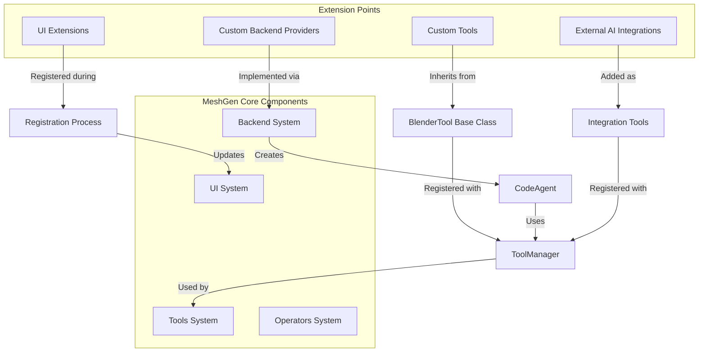
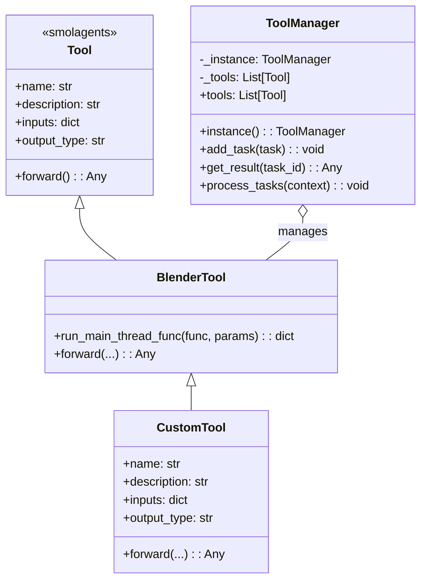
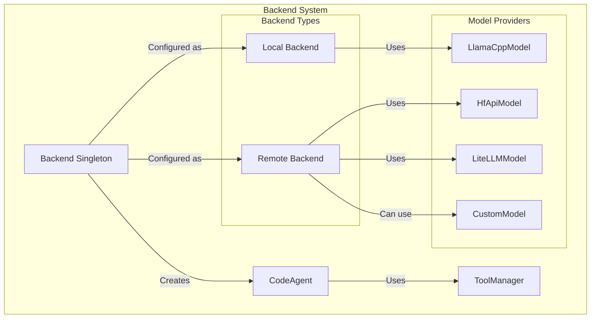
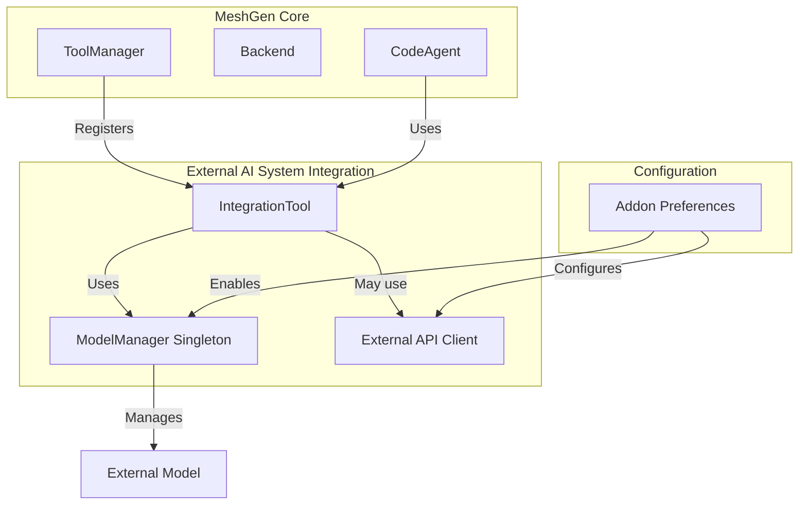
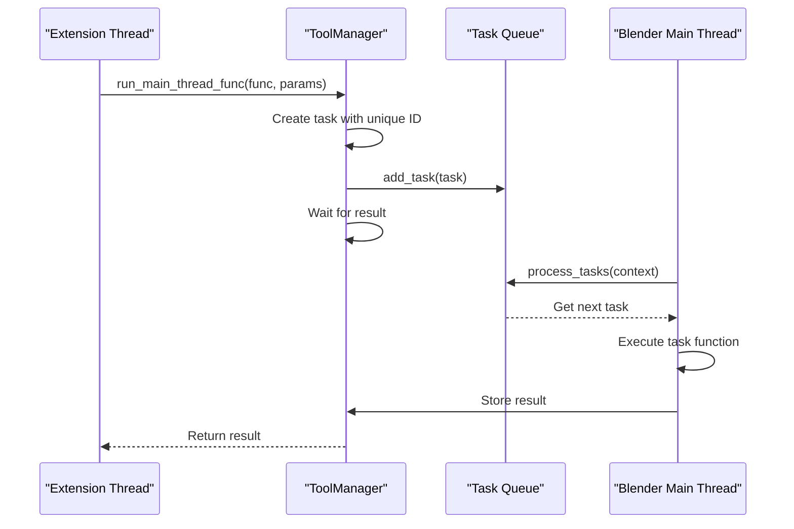

<!-- source: DeepWiki mcp.deepwiki.com · repo huggingface/meshgen · page 6.2 Extending MeshGen · fetched 2026-10-26 -->

# Extending MeshGen

<details>
<summary>Relevant source files</summary>

The following files were used as context for generating this wiki page:

- [__init__.py](__init__.py)
- [backend.py](backend.py)
- [tools.py](tools.py)

</details>


This guide explains how to extend MeshGen with new functionality for developers who want to contribute to or modify the addon. MeshGen follows a modular architecture that allows for extending the system through tools, backends, and Blender integration components. 

For information about building and packaging MeshGen, see [Build System](#6.1).

## Table of Contents

- [Extension Architecture](#extension-architecture)
- [Creating New Tools](#creating-new-tools)
- [Adding New Backend Providers](#adding-new-backend-providers)
- [Integrating External AI Systems](#integrating-external-ai-systems)
- [UI Extensions](#ui-extensions)
- [Best Practices](#best-practices)

## Extension Architecture

MeshGen's architecture is designed to be modular and extensible. The system consists of several key components that can be extended:



Sources: [tools.py:12-89](), [backend.py:12-37](), [__init__.py:34-50]()

This architecture enables:

1. Adding new tools to perform Blender operations
2. Implementing custom backend providers for different LLM services
3. Integrating external AI systems for specialized tasks
4. Extending the UI to support new functionality

## Creating New Tools

The Tool system is the primary way to extend MeshGen's functionality. Tools are Python classes that define operations that can be performed by the AI agent.

### Tool Architecture



Sources: [tools.py:12-111](), [tools.py:92-111]()

### Creating a Custom Tool

To create a new tool for MeshGen:

1. Create a new class that inherits from `BlenderTool`
2. Define the required attributes: `name`, `description`, `inputs`, and `output_type`
3. Implement the `forward` method to perform the tool's operation

Here's the basic structure for creating a custom tool:

```python
class MyCustomTool(BlenderTool):
    name = "my_custom_tool"
    description = """
    Detailed description of what the tool does.
    Include input and output format information.
    """
    inputs = {
        "param1": {
            "type": "string",
            "description": "Description of parameter 1",
        },
        "param2": {
            "type": "number",
            "description": "Description of parameter 2",
            "nullable": True,  # Optional parameter
        },
    }
    output_type = "object"  # Or "string", depending on your return type

    def forward(self, param1: str, param2: Optional[float] = None):
        # Define parameters to pass to the Blender main thread function
        params = {
            "param1": param1,
            "param2": param2,
        }
        
        # Run the function in Blender's main thread and return the result
        return self.run_main_thread_func(my_blender_function, params)
```

The `BlenderTool` base class handles the complex process of:
1. Creating a task with a unique ID
2. Adding the task to the queue
3. Waiting for the result
4. Processing error messages

Sources: [tools.py:92-111](), [tools.py:412-547]()

### Registering Tools with ToolManager

Custom tools must be registered with the `ToolManager` singleton to be available to the AI agent. You can modify the `_initialize` method in the `ToolManager` class to include your custom tools:

```python
def _initialize(self):
    prefs = bpy.context.preferences.addons[__package__].preferences
    
    self._task_queue = queue.Queue()
    self._result_dict = {}
    self._condition = threading.Condition()
    self._tools = [
        # Default tools
        PythonInterpreterTool(),
        FinalAnswerTool(),
        GetSceneInfoTool(),
        # ... other default tools ...
        
        # Your custom tools
        MyCustomTool(),
    ]
    
    # Conditional tools based on preferences
    if prefs.enable_my_feature:
        self._tools += [MyFeatureTool()]
```

This approach allows for dynamic tool registration based on user preferences or available features.

Sources: [tools.py:25-49]()

## Adding New Backend Providers

The Backend system in MeshGen manages the connection to language models. You can extend it to support new model providers.

### Backend Architecture



Sources: [backend.py:12-139]()

### Implementing a Custom Model Provider

To add a new model provider:

1. Create a new model implementation class (or use an existing one)
2. Update the `Backend` class to support the new provider:
   - Add validation in the `is_valid` method
   - Create a method to load your model
   - Update the `load` method to call your loading method

Here's an example of adding a new provider:

```python
# 1. Add validation for your provider
def is_valid(self):
    prefs = bpy.context.preferences.addons[__package__].preferences
    if prefs.backend_type == "REMOTE" and prefs.llm_provider == "my_provider":
        return (prefs.my_provider_api_key and prefs.my_provider_model_id)
    # ... existing validation logic ...

# 2. Create a method to load your model
def _load_my_provider_model(self):
    prefs = bpy.context.preferences.addons[__package__].preferences
    model_id = prefs.my_provider_model_id
    api_key = prefs.my_provider_api_key
    
    # Initialize your model implementation
    self.model = MyProviderModel(
        model_id=model_id,
        api_key=api_key,
        max_tokens=prefs.context_length
    )

# 3. Update the load method
def load(self):
    prefs = bpy.context.preferences.addons[__package__].preferences
    if prefs.backend_type == "REMOTE" and prefs.llm_provider == "my_provider":
        self._load_my_provider_model()
    # ... existing load logic ...
```

Sources: [backend.py:26-138]()

## Integrating External AI Systems

MeshGen supports integration with external AI systems like LLaMA-Mesh and Hyper3D. You can extend the system to integrate with additional AI services.

### Integration Architecture



Sources: [tools.py:842-893](), [tools.py:1158-1248]()

### Creating an Integration

To integrate an external AI system:

1. Create a model manager singleton (if needed)
2. Implement tools that interface with the external system
3. Update the `ToolManager` to conditionally register your tools

For example, the LLaMA-Mesh integration uses this pattern:

```python
# 1. Model Manager
class MyAIModelManager:
    _instance = None
    _lock = threading.Lock()
    _model = None

    def __new__(cls):
        if cls._instance is None:
            with cls._lock:
                if cls._instance is None:
                    cls._instance = super(MyAIModelManager, cls).__new__(cls)
        return cls._instance

    @property
    def is_loaded(self):
        return self._model is not None

    def load_model(self):
        # Load your AI model here
        pass

    @classmethod
    def instance(cls):
        return cls()

# 2. Integration Tool
class MyAIGenerateTool(BlenderTool):
    name = "my_ai_generate"
    description = "Use MyAI to generate content"
    inputs = {
        "prompt": {
            "type": "string",
            "description": "Description of what to generate",
        }
    }
    output_type = "string"

    def forward(self, prompt: str):
        model_manager = MyAIModelManager.instance()
        model = model_manager.get_model()
        
        # Call your model and process the result
        # ...
        
        return result
```

Then, update the `ToolManager._initialize` method to conditionally add your tools:

```python
if MyAIModelManager.instance().is_loaded:
    self._tools += [MyAIGenerateTool()]
```

Sources: [tools.py:842-893](), [tools.py:974-1039](), [tools.py:25-49]()

## UI Extensions

MeshGen uses Blender's addon registration system to manage UI components. This section covers how to extend the UI for new functionality.

### Registration Process

MeshGen follows Blender's addon registration pattern, where components are registered during the addon initialization:

```mermaid
flowchart TD
    subgraph "Registration Process"
        register["register()"]
        unregister["unregister()"]
        
        register -->|"Registers"| ops["operators.register()"]
        register -->|"Registers"| ui["ui.register()"]
        register -->|"Registers"| prefs["preferences.register()"]
        register -->|"Registers"| props["properties.register()"]
        
        unregister -->|"Unregisters"| ops_un["operators.unregister()"]
        unregister -->|"Unregisters"| ui_un["ui.unregister()"]
        unregister -->|"Unregisters"| prefs_un["preferences.unregister()"]
        unregister -->|"Unregisters"| props_un["properties.unregister()"]
    end
    
    subgraph "Extension Points"
        NewOperator["Custom Operators"]
        NewUIPanel["Custom UI Panels"]
        NewPrefs["Preference Extensions"]
        NewProps["Property Extensions"]
    end
    
    NewOperator -->|"Added to"| ops
    NewUIPanel -->|"Added to"| ui
    NewPrefs -->|"Added to"| prefs
    NewProps -->|"Added to"| props
```



Sources: [__init__.py:34-50]()

To extend the UI, you would typically:

1. Create new operators for user actions
2. Create UI panels to display options
3. Add preferences for configuration
4. Define properties to store state

Each of these components would be registered in their respective module's register function, which is called by the addon's main register function.

## Best Practices

When extending MeshGen, follow these best practices to ensure your extensions work well within the system:

### Thread Safety

MeshGen uses a task queueing system to ensure thread safety when interacting with Blender's API:



Sources: [tools.py:12-89](), [tools.py:92-111]()

Always use the `run_main_thread_func` method from `BlenderTool` when your extension needs to interact with Blender's API.

### Error Handling

MeshGen uses a consistent error handling pattern for tools:

1. Wrap Blender operations in try-except blocks
2. Return results in a standardized format: `{"status": status, "data": data}`
3. Check for errors in the returned status before using results

For example:

```python
def my_blender_function(context, param1, param2):
    try:
        # Your Blender operations here
        result = ...
        return {"status": "success", "data": result}
    except Exception as e:
        print(f"Error in my_blender_function: {str(e)}")
        traceback.print_exc()
        return {"status": "error", "data": str(e)}
```

Sources: [tools.py:164-161](), [tools.py:204-244]()

### Performance Considerations

1. **Lazy Loading**: Use lazy loading for heavy resources, similar to the `LlamaMeshModelManager`
2. **Resource Cleanup**: Implement proper cleanup in unregister methods
3. **Avoid Blocking Operations**: Long-running operations should be executed in separate threads
4. **UI Responsiveness**: Update the UI frequently during long operations

Sources: [tools.py:842-893](), [backend.py:157-179]()

## Conclusion

MeshGen provides a flexible framework for extending its functionality through tools, backends, and UI components. By following the patterns established in the codebase and adhering to the best practices outlined in this guide, you can create powerful extensions that enhance MeshGen's capabilities.

For information about building and packaging your extensions as part of MeshGen, see the [Build System](#6.1) documentation.