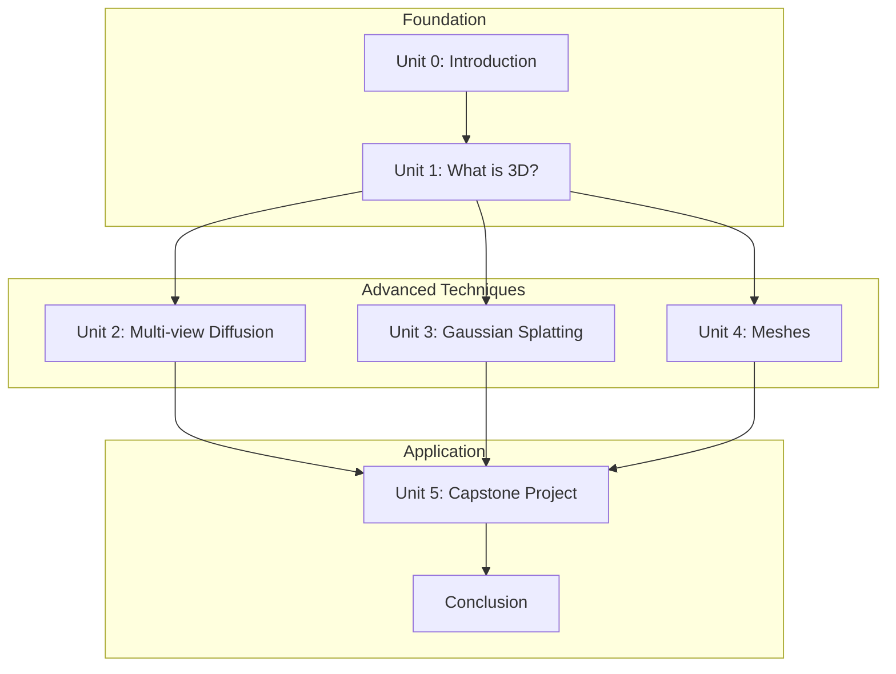
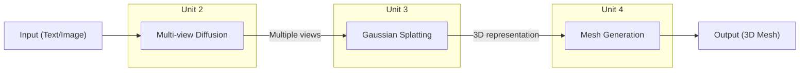
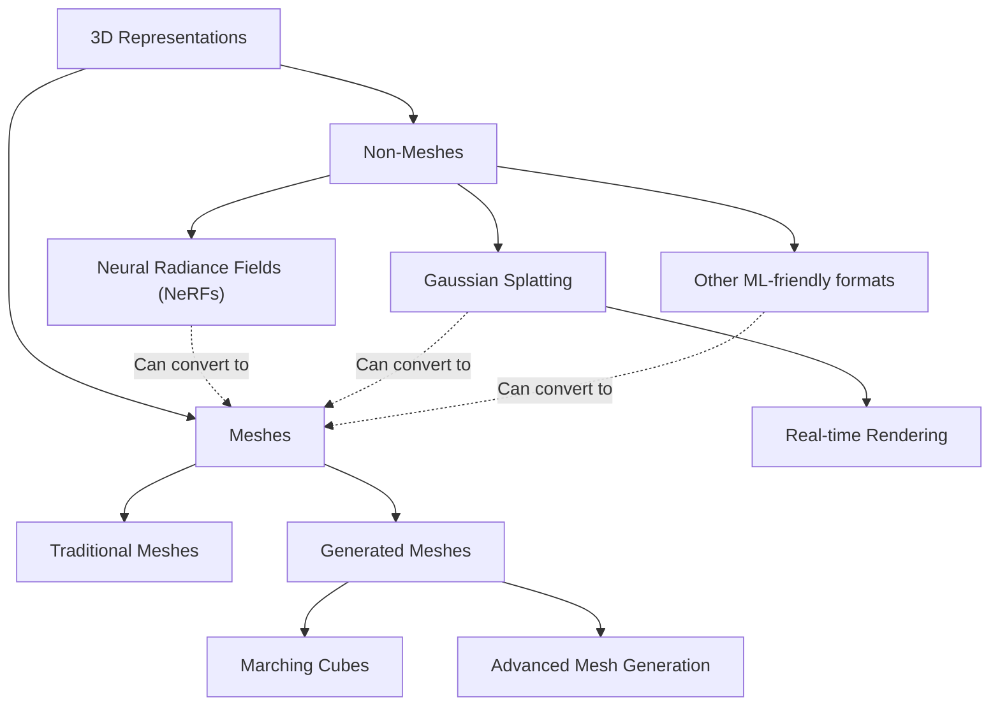
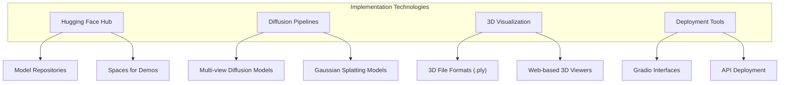

<!-- source: DeepWiki mcp.deepwiki.com · repo huggingface/ml-for-3d-course · page 1 ML for 3D Course Overview · fetched 2026-10-26 -->

# ML for 3D Course Overview

<details>
<summary>Relevant source files</summary>

The following files were used as context for generating this wiki page:

- [README.md](README.md)
- [units/en/_toctree.yml](units/en/_toctree.yml)
- [units/en/unit0/introduction.mdx](units/en/unit0/introduction.mdx)
- [units/en/unit2/hands-on-1.mdx](units/en/unit2/hands-on-1.mdx)

</details>


## Purpose and Scope

This document provides a comprehensive overview of the Machine Learning for 3D Course, which teaches students how to create and work with 3D content using state-of-the-art machine learning techniques. The course covers the full 3D generation pipeline, from creating multi-view representations to advanced mesh generation. For detailed information about prerequisites and setup requirements, see [Prerequisites and Setup](#1.2).

Sources: [units/en/unit0/introduction.mdx:18-25](), [README.md:1-7]()

## Course Structure

The ML for 3D Course follows a structured learning path, beginning with fundamental concepts and progressively advancing to specialized techniques and practical applications.



Sources: [units/en/_toctree.yml:1-72]()

## Core Units Description

### Unit 0: Introduction
Provides an overview of the current state of machine learning for 3D, explains why recent developments are significant, and introduces the course structure.

### Unit 1: What is 3D?
Covers fundamental concepts of 3D representations, distinguishing between traditional mesh-based approaches and newer non-mesh representations optimized for machine learning workflows.

### Unit 2: Multi-view Diffusion
Explores techniques for generating multiple views of 3D objects from single images or text prompts using diffusion models.

### Unit 3: Gaussian Splatting
Introduces 3D Gaussian Splatting, a real-time rendering technique that represents 3D scenes as a collection of 3D Gaussians.

### Unit 4: Meshes
Covers techniques for converting machine learning-friendly 3D representations into traditional meshes suitable for various applications.

### Unit 5: Capstone Project
Guides students through building a complete image-to-3D generation model and deploying it as a usable demo.

Sources: [units/en/_toctree.yml:1-72](), [units/en/unit0/introduction.mdx:18-25]()

## Generative 3D Pipeline Architecture

The course follows a logical progression that mirrors the typical generative 3D pipeline used in modern ML systems.



The pipeline consists of three main stages:
1. **Multi-view Diffusion**: Generating multiple 2D views of a 3D object from a text prompt or image
2. **Gaussian Splatting**: Converting multiple views into an ML-friendly 3D representation
3. **Mesh Generation**: Converting the 3D representation into a traditional mesh format

Sources: [units/en/_toctree.yml:21-56](), [units/en/unit2/hands-on-1.mdx:1-44]()

## 3D Representation Taxonomy

The course explains different approaches to representing 3D data, which is fundamental to understanding the entire ML for 3D pipeline.



Sources: [units/en/_toctree.yml:11-20](), [units/en/_toctree.yml:47-56]()

## Learning Objectives

By completing this course, students will:

| Objective | Relevant Units |
|-----------|----------------|
| Understand different 3D representations | Unit 1 |
| Generate multiple views using diffusion models | Unit 2 |
| Create 3D scenes using Gaussian Splatting | Unit 3 |
| Convert between different 3D formats | Unit 4 |
| Build and deploy a complete image-to-3D pipeline | Unit 5 |

Sources: [units/en/unit0/introduction.mdx:18-25]()

## Course Resources

The course provides multiple learning formats to accommodate different learning styles:

- **Written tutorials**: Comprehensive documentation available on the Hugging Face course platform
- **Video content**: Available on YouTube through the [IndividualKex](https://www.youtube.com/@IndividualKex) channel
- **Code examples**: Available in the [GitHub repository](https://github.com/huggingface/ml-for-3d-course)
- **Community support**: The Hugging Face Discord server (#3d channel) provides a place to ask questions and share work

Sources: [units/en/unit0/introduction.mdx:28-35](), [README.md:1-7]()

## Course Author

The ML for 3D Course is created by [Dylan Ebert](https://twitter.com/dylan_ebert_), a developer advocate at Hugging Face specializing in 3D technologies. Dylan is also known as [IndividualKex](https://www.youtube.com/@IndividualKex) on YouTube, where he creates educational content on various technical topics.

Sources: [units/en/unit0/introduction.mdx:26-30](), [README.md:14-15]()

## Implementation Components

The course teaches students how to work with several key technologies and tools:



Sources: [units/en/_toctree.yml:57-68](), [units/en/unit2/hands-on-1.mdx:1-44]()

## Staying Updated

To receive updates as new course content is released, students can:

1. Sign up for the course mailing list at the link provided in the course introduction
2. Join the Hugging Face Discord community (#3d channel)
3. Watch the GitHub repository for updates

Sources: [units/en/unit0/introduction.mdx:14-16](), [units/en/unit0/introduction.mdx:32-34](), [README.md:7]()

## Citation

For academic or research purposes, the course can be cited using the following BibTeX format:

```
@misc{ml-for-3d-course,
  author = {Dylan Ebert},
  title = {Hugging Face Machine Learning for 3D Course},
  year = {2024},
  publisher = {GitHub},
  note = {GitHub repository},
  howpublished = {\url{https://github.com/huggingface/ml-for-3d-course}},
}
```

Sources: [README.md:9-22]()

---

