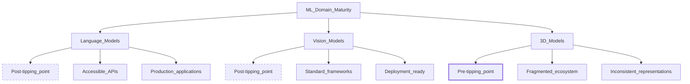
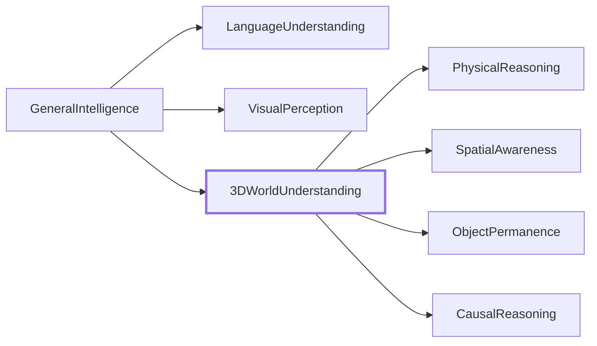
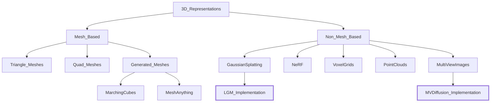
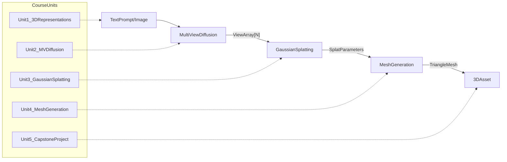
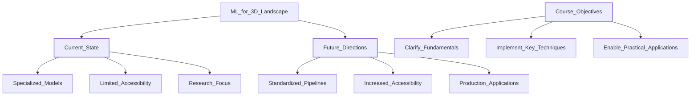

<!-- source: DeepWiki mcp.deepwiki.com · repo huggingface/ml-for-3d-course · page 1.1 Course Context and Motivation · fetched 2026-10-26 -->

# Course Context and Motivation

Relevant source files

The following files were used as context for generating this wiki page:

- [units/en/unit0/whats-going-on.mdx](units/en/unit0/whats-going-on.mdx)
- [units/en/unit0/why-does-it-matter.mdx](units/en/unit0/why-does-it-matter.mdx)

This document explains the technical context and motivation behind machine learning for 3D generation and representation. It covers the current state of ML for 3D, its importance across different domains, and the challenges in 3D representation that this course aims to address. For information on technical requirements needed to follow the course, see [Prerequisites and Setup](#1.2).

## The Current State of ML for 3D

While machine learning has reached impressive maturity in language and vision domains, the 3D domain is approaching but has not yet reached its tipping point.

The 3D ML domain faces several technical challenges:

1. Rapid research evolution without standardization
2. Inconsistent definitions of what "3D" means in different contexts
3. Limited transparency in how research results are implemented

Sources: [units/en/unit0/whats-going-on.mdx:3-15](), [units/en/unit0/whats-going-on.mdx:18-25]()

## Why ML for 3D Matters

### As a Practical Tool

3D content is fundamental to numerous industries, with ML approaches offering potential for automation and enhancement similar to what we've seen in 2D domains.

| Industry | ML for 3D Application |
|----------|------------------------|
| Gaming | Automated asset creation |
| Film/VFX | Character/environment generation |
| E-commerce | Product visualization |
| Architecture | Design visualization |
| Manufacturing | CAD automation |

### For General Intelligence

Understanding the 3D world is considered crucial for advancing artificial intelligence beyond current capabilities. As stated in the course materials: "In order to achieve general intelligence, AI needs to be grounded to the 3D world." However, there remains significant debate about how 3D should be represented and understood in AI systems.

### For Different Practitioners

The ML for 3D course serves diverse technical audiences:

| Practitioner Type | Value Proposition |
|-------------------|-------------------|
| ML Engineers | Apply ML techniques to 3D problems |
| 3D Artists/Developers | Integrate ML into 3D workflows |
| Newcomers | Build foundational knowledge in an emerging field |

Sources: [units/en/unit0/why-does-it-matter.mdx:3-29]()

## The 3D Representation Challenge

One of the core technical challenges in ML for 3D is the diversity of representation methods, each with different strengths and limitations.

When encountering 3D results in research, it's often unclear what representation is being used:
- Is it a mesh?
- A Gaussian splat?
- A Neural Radiance Field (NeRF)?
- Multi-view diffusion?

Each representation requires different technical approaches and has different trade-offs in terms of quality, rendering speed, and ease of generation.

Sources: [units/en/unit0/whats-going-on.mdx:18-25]()

## ML for 3D Course Pipeline

This course implements an end-to-end ML for 3D pipeline with the following components:

The course structure reflects the technical pipeline stages:

1. Understanding 3D representations (Unit 1)
2. Generating multiple views using diffusion models (Unit 2)
3. Converting views to 3D representation via Gaussian splatting (Unit 3)
4. Transforming to mesh format for standard 3D applications (Unit 4)
5. Building an integrated application in the capstone project (Unit 5)

Each unit provides both theoretical understanding and practical implementation knowledge of its respective component in the pipeline.

Sources: [units/en/unit0/whats-going-on.mdx:24-25](), [units/en/unit0/why-does-it-matter.mdx:21-29]()

## The Evolving Landscape of 3D Generation

The field of ML for 3D is rapidly evolving, with new research emerging constantly. This creates both challenges and opportunities for practitioners.

This course aims to provide clarity in this complex landscape by:

1. Explaining fundamental concepts and representation methods
2. Implementing practical techniques that bridge research and application
3. Providing a framework for evaluating new developments in the field

By understanding the current state and technical foundations of ML for 3D, learners will be better equipped to contribute to and leverage advances in this rapidly evolving field.

Sources: [units/en/unit0/whats-going-on.mdx:11-15](), [units/en/unit0/why-does-it-matter.mdx:21-29]()

---

