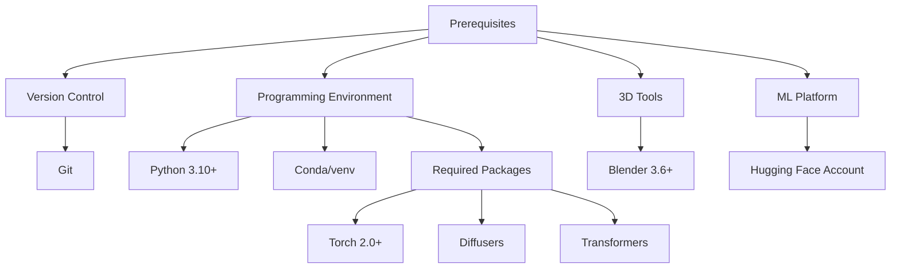
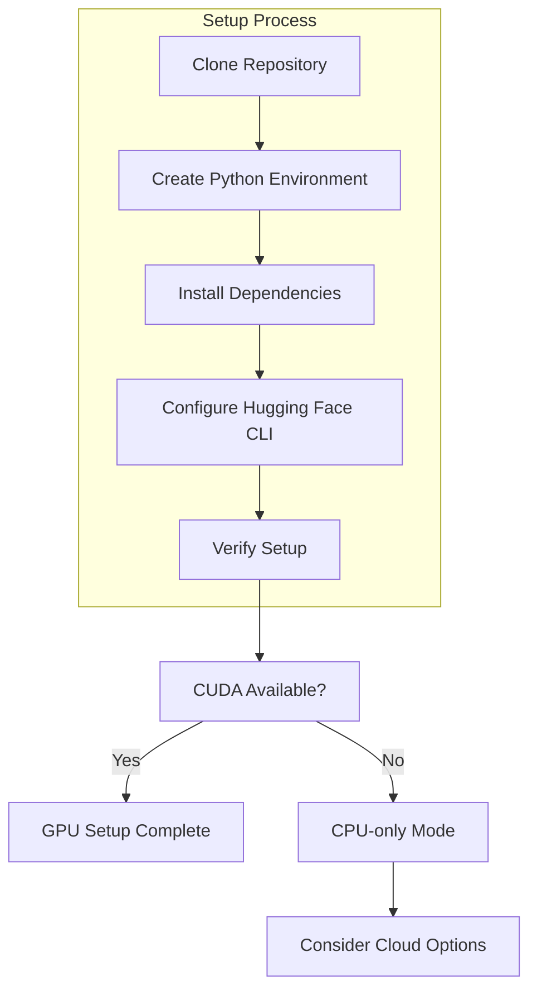
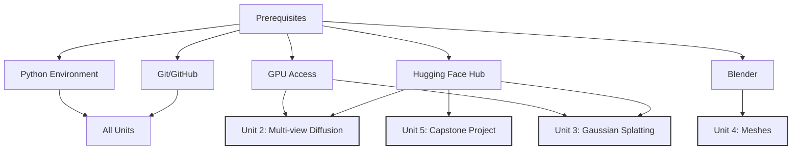

<!-- source: DeepWiki mcp.deepwiki.com · repo huggingface/ml-for-3d-course · page 1.2 Prerequisites and Setup · fetched 2026-10-26 -->

# Prerequisites and Setup

<details>
<summary>Relevant source files</summary>

The following files were used as context for generating this wiki page:

- [units/en/unit0/how-to-do-it-yourself.mdx](units/en/unit0/how-to-do-it-yourself.mdx)

</details>


This page outlines the technical requirements, knowledge prerequisites, and setup instructions needed to successfully follow the ML for 3D course. It covers the essential software, hardware requirements, and configuration steps required before starting the hands-on components of the course.

## Knowledge Prerequisites

Before beginning this course, you should have a basic understanding of:

| Prerequisite | Recommended Level | Why It's Important |
|--------------|-------------------|-------------------|
| Python programming | Intermediate | All code examples use Python |
| Machine learning concepts | Basic | Understanding of neural networks, training, and inference |
| Computer graphics terms | Familiarity | Concepts like meshes, textures, and rendering |
| Git workflows | Basic | For accessing course materials and submitting projects |

If you're lacking in any of these areas, don't worry - the course is designed to explain core concepts as they appear, but having this foundation will make following along easier.

## Software Requirements

The following software tools are essential for completing this course:



Sources: [units/en/unit0/how-to-do-it-yourself.mdx:5-10]()

### Detailed Software Requirements

1. **Git**: For version control and accessing course materials
   - Installation guide: https://git-scm.com/downloads

2. **Python**: Python 3.10 or newer is recommended
   - Installation via Anaconda is recommended for managing environments

3. **Hugging Face Hub Account**: Required for accessing models and sharing your projects
   - Create an account at https://huggingface.co/join

4. **Blender**: Required for the mesh manipulation sections (primarily Unit 4)
   - Version 3.6+ recommended
   - Only required for later units

## Hardware Requirements

To run the models and exercises in this course effectively, your system should meet:

| Component | Minimum | Recommended | Notes |
|-----------|---------|-------------|-------|
| CPU | 4 cores | 8+ cores | Multi-threading helps with data processing |
| RAM | 16GB | 32GB+ | Required for larger models |
| GPU | 4GB VRAM | 8GB+ VRAM | NVIDIA GPU with CUDA support recommended |
| Storage | 20GB free | 50GB+ free | For models, datasets, and generated content |
| Internet | Broadband | High-speed | For downloading models (can be several GB) |

**Important Note**: While a GPU is highly recommended for this course, alternative options include:
- Using Google Colab for GPU-accelerated notebooks
- Using Hugging Face Spaces for inference
- Running models with CPU-only mode (significantly slower)

## Environment Setup

Follow these steps to set up your environment for the course:



### Step 1: Clone the Course Repository

```bash
git clone https://github.com/huggingface/ml-for-3d-course.git
cd ml-for-3d-course
```

### Step 2: Create Python Environment

Using Conda (recommended):

```bash
conda create -n ml3d python=3.10
conda activate ml3d
```

Or using venv:

```bash
python -m venv ml3d-env
# On Windows
ml3d-env\Scripts\activate
# On Unix/MacOS
source ml3d-env/bin/activate
```

### Step 3: Install Dependencies

```bash
pip install -r requirements.txt
```

### Step 4: Hugging Face Configuration

```bash
# Login to Hugging Face Hub
huggingface-cli login
```

### Step 5: Verify Your Setup

Run the verification script to confirm your environment is properly configured:

```bash
python verify_setup.py
```

## Course Architecture and Components

The following diagram shows how the prerequisites relate to the different units in the course:



## Troubleshooting Common Issues

| Issue | Possible Solution |
|-------|-------------------|
| CUDA not found | Ensure you have installed the correct version of PyTorch for your CUDA version |
| Out of memory errors | Reduce batch size in configuration or use gradient accumulation |
| Slow generation times | Check if you're using GPU acceleration; consider cloud options |
| Package conflicts | Use a clean virtual environment; check requirements.txt for specific versions |
| Hugging Face authentication issues | Verify your token is correctly set; regenerate if necessary |

## What's Next

Once you have completed setting up your environment, you're ready to dive into the course content. The next unit will introduce you to 3D representations and the fundamentals needed to understand the generative 3D pipeline.

Proceed to [3D Representations](#2) to begin learning about the different ways to represent 3D data in machine learning contexts.

Don't forget to join the course Discord community for additional support and to connect with fellow learners.

Sources: [units/en/unit0/how-to-do-it-yourself.mdx:3-23]()

---

