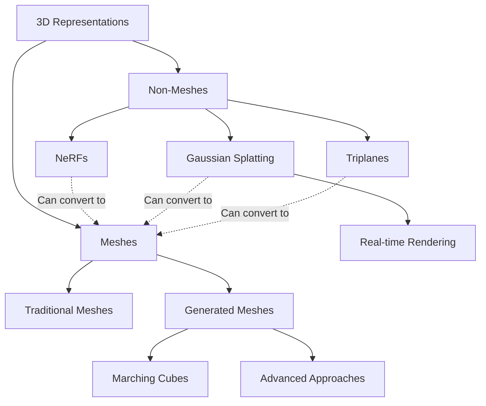
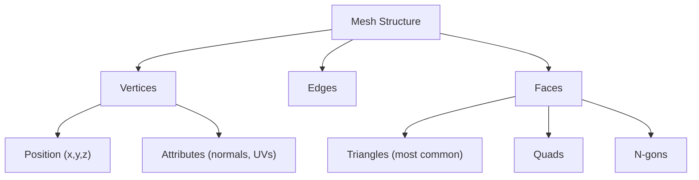
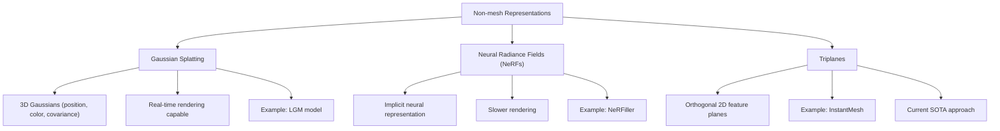
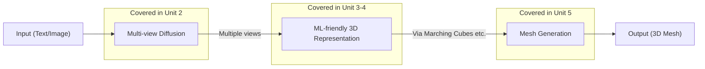

<!-- source: DeepWiki mcp.deepwiki.com · repo huggingface/ml-for-3d-course · page 2 3D Representations · fetched 2026-10-26 -->

# 3D Representations

Relevant source files

The following files were used as context for generating this wiki page:

- [units/en/unit1/introduction.mdx](units/en/unit1/introduction.mdx)
- [units/en/unit1/meshes.mdx](units/en/unit1/meshes.mdx)
- [units/en/unit1/non-meshes.mdx](units/en/unit1/non-meshes.mdx)

This document provides an overview of different approaches to representing 3D data in machine learning contexts. It covers both traditional and ML-friendly 3D representations, their relationships, and how they fit into the broader 3D generation pipeline. For specific implementations, see [Multi-view Diffusion](#3), [Gaussian Splatting](#4), and [Mesh Generation](#5).

## Overview: The 3D Representation Landscape

3D representations are methods for encoding three-dimensional objects and scenes in digital formats. In the context of machine learning for 3D, different representations offer varying tradeoffs in terms of rendering speed, ML compatibility, and ease of manipulation.

**Diagram Title: 3D Representation Taxonomy**

Sources: units/en/unit1/meshes.mdx, units/en/unit1/non-meshes.mdx

The 3D representations landscape can be broadly divided into two categories:
1. **Mesh representations**: The traditional standard for 3D applications
2. **Non-mesh representations**: More ML-friendly alternatives often used in research

## Mesh Representations

A mesh is a collection of vertices, edges, and faces that define a 3D object. They are the predominant representation in real-world 3D applications including games, animation, CAD, and virtual reality.

**Diagram Title: Mesh Component Structure**

Sources: units/en/unit1/meshes.mdx:5-7

### Advantages and Challenges

| Aspect | Details |
|--------|---------|
| **Advantages** | • Industry standard with established tooling • Efficient for real-time rendering • Intuitive for human creators |
| **ML Challenges** | • Variable topology making standardization difficult • Complex structure not naturally compatible with neural networks • Limited differentiability due to discrete nature |

The incompatibility with machine learning has led to a two-step approach in current 3D generation:
1. ML models generate non-mesh representations
2. These representations are converted to meshes (typically using Marching Cubes algorithm from the 1980s)

This creates a gap between 3D research (advancing non-mesh representations) and 3D applications (requiring meshes).

Sources: units/en/unit1/meshes.mdx:11-22

## Non-mesh Representations

Non-mesh representations are alternative ways to define 3D objects that are more compatible with machine learning approaches. They have gained popularity in research because they are often more suitable for neural network processing.

**Diagram Title: ML-Friendly 3D Representation Types**

Sources: units/en/unit1/non-meshes.mdx:5-9

### Key Non-mesh Representation Types

1. **Triplanes**: Used in state-of-the-art models like InstantMesh, triplanes represent 3D data using orthogonal 2D feature planes.

2. **Neural Radiance Fields (NeRFs)**: Implicit neural representations that encode 3D scenes as continuous functions mapping 3D coordinates to color and density. Used in models like NeRFiller.

3. **Gaussian Splatting**: A representation that models 3D scenes as collections of 3D Gaussians with associated colors, positions, and covariance matrices. Used in models like LGM.

Sources: units/en/unit1/non-meshes.mdx:5-9

### Gaussian Splatting: A Special Case

Gaussian Splatting deserves special attention because it bridges research and application:

- Capable of real-time rendering, unlike most other non-mesh representations
- Supports features like animation, physics (in hybrid approaches), and lighting
- Could potentially serve as an alternative to meshes in some applications
- Maintains compatibility with neural network architectures

However, since the existing 3D ecosystem is built around meshes, Gaussian splatting is likely to complement rather than replace meshes entirely.

Sources: units/en/unit1/non-meshes.mdx:19-25

## The 3D Generation Pipeline

The modern generative 3D pipeline builds on these different representations to create a workflow from initial input to final 3D model.

**Diagram Title: Generative 3D Pipeline**

Sources: units/en/unit1/meshes.mdx:15-18, units/en/unit1/non-meshes.mdx:29-33

### Pipeline Components

1. **Input Processing**: Starting with text or images as prompts for 3D generation
2. **Multi-view Generation**: Creating consistent 2D views of the desired 3D object
3. **Non-mesh Representation**: Converting multi-view data into an ML-friendly 3D representation (often Gaussian Splatting or Triplanes)
4. **Mesh Conversion**: Converting the non-mesh representation to a mesh for real-world applications

This pipeline reflects the current state of 3D machine learning, where there's still a gap between research (focused on steps 1-3) and applications (requiring the final output of step 4).

## Current State and Future Directions

The field of 3D representations is rapidly evolving, with several key trends:

| Representation | Current State | Future Potential |
|----------------|--------------|-----------------|
| **Meshes** | Standard for applications but challenging for ML | Improved direct generation methods |
| **NeRFs** | Popular in research but slow rendering | Better optimization for real-time use |
| **Triplanes** | Current SOTA approach for generation | Evolving rapidly with new architectures |
| **Gaussian Splatting** | Promising for real-time ML applications | Growing ecosystem for animation and interaction |

While traditional approaches have relied on Marching Cubes (from the 1980s) to convert ML-friendly representations to meshes, newer techniques are beginning to emerge that may bridge this gap more effectively.

In this course, we'll focus on both meshes and Gaussian Splatting, as they represent both the established standard and a promising emerging approach for 3D representation in machine learning.

Sources: units/en/unit1/meshes.mdx:24-28, units/en/unit1/non-meshes.mdx:29-33

## Conclusion

3D representations form the foundation of how we store, generate, and interact with 3D data. Understanding the different approaches and their tradeoffs is essential for working effectively in 3D machine learning.

This course will build on this foundation by exploring:
- How to generate multi-view images ([Multi-view Diffusion](#3))
- Working with Gaussian Splatting ([Gaussian Splatting](#4))
- Converting to and working with meshes ([Mesh Generation](#5))

These components together will enable you to build complete 3D generation pipelines from input to final 3D model.

---

