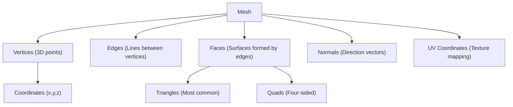
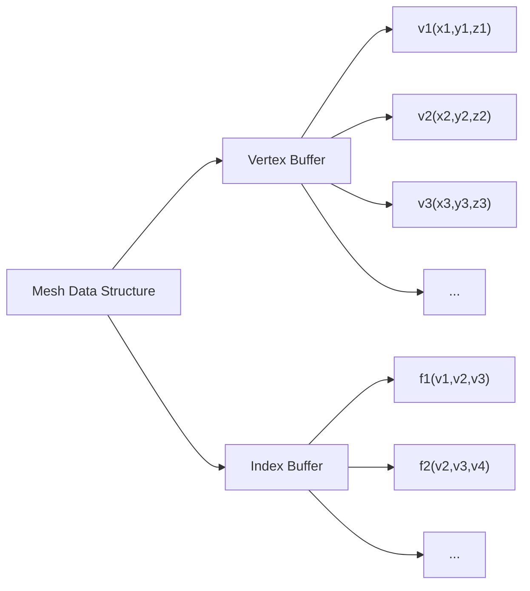
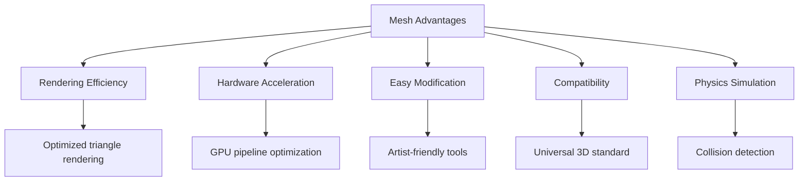
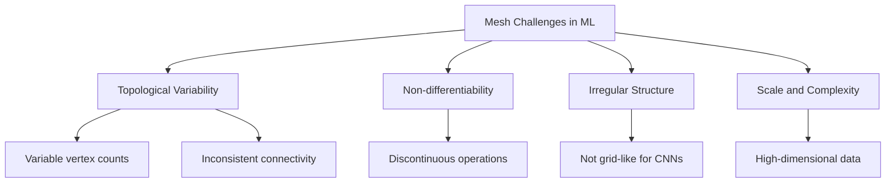
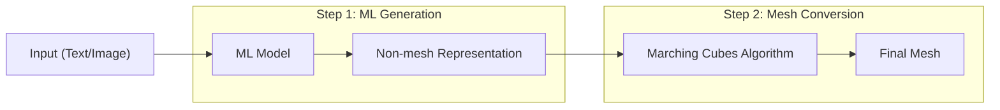
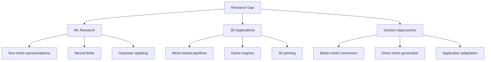

<!-- source: DeepWiki mcp.deepwiki.com · repo huggingface/ml-for-3d-course · page 2.1 Mesh Representations · fetched 2026-10-26 -->

# Mesh Representations

Relevant source files

The following files were used as context for generating this wiki page:

- [units/en/unit1/meshes.mdx](units/en/unit1/meshes.mdx)

## Purpose and Scope

This document explains mesh representations as the traditional approach to 3D data representation in computer graphics and their significance in machine learning for 3D applications. While meshes are the industry standard for 3D content creation and rendering, they present unique challenges in ML contexts. For information about alternative representations more suitable for ML workflows, see [Non-mesh Representations](#2.2).

## What is a Mesh?

A mesh is a collection of vertices, edges, and faces that define the shape of a 3D object. This representation is the foundation of virtually all 3D applications in gaming, visual effects, computer-aided design, and virtual reality.

Sources: [units/en/unit1/meshes.mdx:3-9]()

### Core Components

A 3D mesh is defined by three fundamental elements:

| Component | Description | Purpose |
|-----------|-------------|---------|
| Vertices | Points in 3D space with (x,y,z) coordinates | Define the precise geometry positions |
| Edges | Lines connecting two vertices | Define the connectivity between points |
| Faces | Surfaces bounded by edges (typically triangles) | Define the actual visible surfaces |

Additional data often associated with meshes includes:

- **Normals**: Vectors perpendicular to faces that determine how light interacts with surfaces
- **UV coordinates**: 2D mapping coordinates that define how textures are applied
- **Material properties**: Surface characteristics like color, reflectivity, and roughness

## Mesh Data Structures

The most common data structure for meshes in computer graphics consists of:

1. **Vertex buffer**: Array of vertex coordinates and attributes
2. **Index buffer**: Array of indices that define faces by referencing vertices

This structure optimizes memory usage by allowing vertex reuse across multiple faces.

## Common Mesh File Formats

Several standard file formats are used to store and exchange mesh data:

| Format | Extension | Description | Characteristics |
|--------|-----------|-------------|----------------|
| Wavefront OBJ | .obj | Text-based format | Simple, widely supported, includes material support |
| STL | .stl | Binary or ASCII format | Triangle-only, no texture support, common in 3D printing |
| FBX | .fbx | Binary format | Complex hierarchies, animation support, proprietary |
| glTF | .gltf, .glb | JSON-based format | Modern standard, efficient, web-friendly |
| PLY | .ply | Flexible format | Supports custom properties, common in research |

## Why Meshes Matter in 3D Applications

Meshes have become the dominant 3D representation in practical applications for several key reasons:

Sources: [units/en/unit1/meshes.mdx:5-7]()

## Challenges with Meshes in Machine Learning

Despite their ubiquity in production environments, meshes present significant challenges for machine learning models:

Sources: [units/en/unit1/meshes.mdx:11-15]()

The primary challenges include:

1. **Topological variability**: Meshes can have arbitrary numbers of vertices and connectivity patterns, making them difficult to process with fixed-architecture neural networks.

2. **Non-differentiability**: Many mesh operations (like boolean operations or rasterization) are not naturally differentiable, complicating gradient-based learning.

3. **Irregular structure**: Unlike images or voxels, meshes lack the regular grid structure that makes convolutional approaches effective.

4. **Complexity**: High-quality meshes can contain millions of vertices and faces, creating computational challenges.

## The Current ML for 3D Pipeline

The current approach in 3D machine learning typically follows a two-step process:

Sources: [units/en/unit1/meshes.mdx:15-20]()

1. **Step 1**: ML models generate ML-friendly non-mesh 3D representations (NeRF, Gaussian Splatting, etc.)
2. **Step 2**: These representations are converted to meshes via algorithms like Marching Cubes for practical applications

This two-step approach creates a disconnect between the rapid advancements in ML generation (Step 1) and the relatively stagnant conversion methods (Step 2) that haven't fundamentally changed since the 1980s.

## Research Gap and Future Directions

Sources: [units/en/unit1/meshes.mdx:20-28]()

The fundamental gap in current 3D ML research is the disconnect between:

- **ML Research**: Rapidly advancing in generating high-quality 3D content using non-mesh representations
- **3D Applications**: Still predominantly requiring traditional mesh-based formats

This gap has several potential solutions:

1. **Improved conversion algorithms**: Developing better methods to convert ML-friendly representations to high-quality meshes
2. **Direct mesh generation**: Creating ML models that directly generate meshes
3. **Application adaptation**: Modifying existing 3D pipelines to work with non-mesh representations

## Relationship to Course Structure

Understanding mesh representations is fundamental to the ML for 3D course as it:

1. Establishes the industry-standard 3D representation
2. Highlights the challenges that motivated alternative approaches
3. Provides context for why conversion techniques like [Marching Cubes Algorithm](#5.1) are important
4. Sets the stage for exploring ML-friendly alternatives in [Non-mesh Representations](#2.2)

The techniques covered later in this course, including [Multi-view Diffusion](#3), [Gaussian Splatting](#4), and [Mesh Generation](#5), all relate to bridging this fundamental gap between ML research and practical 3D applications.

---

