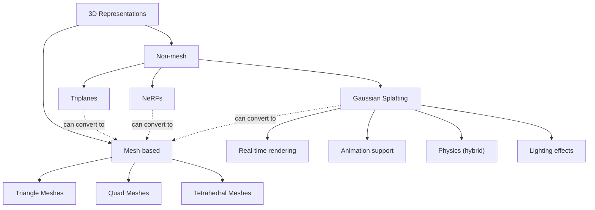
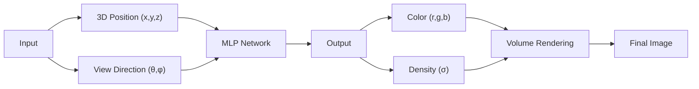
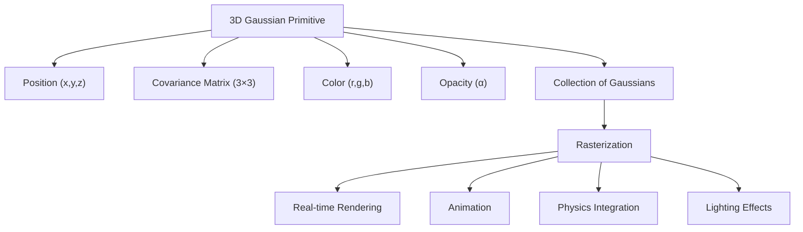
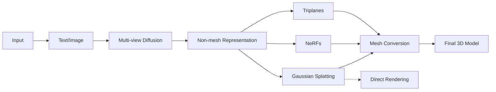

<!-- source: DeepWiki mcp.deepwiki.com · repo huggingface/ml-for-3d-course · page 2.2 Non-mesh Representations · fetched 2026-10-26 -->

# Non-mesh Representations

Relevant source files

The following files were used as context for generating this wiki page:

- [units/en/unit1/non-meshes.mdx](units/en/unit1/non-meshes.mdx)

## Purpose and Scope

This document explains alternative 3D representations used in machine learning that do not rely on traditional mesh structures. While meshes are the standard for production 3D applications (see [Mesh Representations](#2.1)), non-mesh representations offer unique advantages for ML pipelines and can later be converted to meshes when needed. This page covers the main types of non-mesh representations, their properties, and their roles in ML for 3D workflows, with special attention to Gaussian Splatting.

Sources: [units/en/unit1/non-meshes.mdx:1-4]()

## Overview of Non-mesh Representations

Non-mesh representations are alternative methods for encoding 3D information that don't use the traditional vertex-edge-face structure of meshes. They are commonly used in ML research because they often provide properties that are more amenable to optimization, differentiable rendering, or neural network processing.

The main types of non-mesh representations include:

1. **Triplanes** - Orthogonal 2D feature planes encoding 3D information
2. **Neural Radiance Fields (NeRFs)** - Implicit neural representations of 3D scenes
3. **Gaussian Splatting** - Collections of 3D Gaussians that represent surfaces and volumes

These approaches continue to evolve rapidly in the research community, with new variations and improvements frequently emerging.

Sources: [units/en/unit1/non-meshes.mdx:5-11]()

## 3D Representation Taxonomy

Diagram: 3D Representation Taxonomy

The diagram illustrates the relationship between traditional mesh-based representations and non-mesh alternatives. While all non-mesh representations can eventually be converted to meshes, they each have unique characteristics that make them suitable for different ML applications.

Sources: [units/en/unit1/non-meshes.mdx:3-11]()

## Key Non-mesh Representation Types

### Triplanes

Triplanes represent 3D data using three orthogonal 2D feature planes (typically corresponding to the xy, xz, and yz planes). Each plane contains learned features that encode 3D information. Triplanes are used in systems like InstantMesh from TencentARC.

**Advantages:**
- Memory efficient compared to voxel grids
- Well-suited for neural network operations
- Faster training than NeRFs

**Limitations:**
- Less intuitive representation
- Limited resolution for fine details

Sources: [units/en/unit1/non-meshes.mdx:7]()

### Neural Radiance Fields (NeRFs)

NeRFs represent 3D scenes as continuous functions that map 3D coordinates and viewing directions to color and density values. Typically implemented as Multi-Layer Perceptrons (MLPs), NeRFs encode entire scenes implicitly.

Diagram: NeRF Structure

**Advantages:**
- Continuous representation without resolution limitations
- High-quality novel view synthesis
- Compact scene representation

**Limitations:**
- Slow training and inference
- Non-real-time rendering
- Can struggle with sparse observations

Sources: [units/en/unit1/non-meshes.mdx:8]()

### Gaussian Splatting

Gaussian Splatting represents 3D scenes as a collection of 3D Gaussian primitives defined by their position, covariance matrix (shape), color, and opacity. These Gaussians are "splatted" onto the image plane during rendering.

Diagram: Gaussian Splatting Structure

**Advantages:**
- **Real-time rendering** - Unlike other non-mesh representations
- **Animation support** - Can represent dynamic scenes
- **Hybrid physics** - Can be integrated with physics systems
- **Lighting capabilities** - Supports various lighting effects
- **High visual quality** - Excellent for complex visual details

**Limitations:**
- Larger storage requirements than some alternatives
- Less established ecosystem compared to meshes

Sources: [units/en/unit1/non-meshes.mdx:19-25]()

## Comparison of Non-mesh Representations

| Feature | Triplanes | NeRFs | Gaussian Splatting |
|---------|-----------|-------|-------------------|
| Rendering Speed | Medium | Slow | Fast (Real-time) |
| Training Speed | Fast | Slow | Medium |
| Memory Efficiency | High | High | Medium |
| Visual Quality | Good | Excellent | Excellent |
| Animation Support | Limited | Limited | Good |
| Differentiability | Yes | Yes | Yes |
| Real-world Adoption | Research | Research | Emerging practical use |

Gaussian Splatting stands out among non-mesh representations due to its ability to render in real-time while maintaining high visual quality. This makes it a potential candidate for certain real-world applications, not just as an intermediate representation in ML pipelines.

Sources: [units/en/unit1/non-meshes.mdx:21-25]()

## Integration in ML for 3D Pipelines

Diagram: Non-mesh Representations in ML Pipeline

In typical ML for 3D pipelines, non-mesh representations often serve as intermediate formats that are optimized for ML operations. They're usually converted to meshes for final delivery to applications. However, Gaussian Splatting has the unique potential to be used directly for rendering without mesh conversion, particularly for real-time generative 3D applications.

Sources: [units/en/unit1/non-meshes.mdx:25-31]()

## Course Focus

While this page provides an overview of all major non-mesh representations, this course will particularly focus on:

1. Gaussian Splatting - Due to its real-time rendering capabilities and potential for real-world applications
2. Mesh representations and conversion - As the standard format for production 3D

The course will not delve deeply into the implementation details of triplanes or NeRFs, as these representations are rapidly evolving. Instead, it aims to provide a solid understanding of the building blocks of 3D machine learning and focus on representations that can be practically applied today.

Sources: [units/en/unit1/non-meshes.mdx:27-33]()

## Summary

Non-mesh representations offer powerful alternatives to traditional meshes for ML applications, with different options suited to different use cases:

- **Triplanes** excel at efficient learning of 3D features
- **NeRFs** provide high-quality novel view synthesis with implicit representation
- **Gaussian Splatting** offers real-time rendering and potential for direct application

While the field continues to evolve rapidly, understanding these alternative representations is essential for working with modern ML for 3D pipelines. Though most applications ultimately convert these representations to meshes, Gaussian Splatting in particular shows potential for direct use in real-time applications.

Sources: [units/en/unit1/non-meshes.mdx:3-33]()

---

