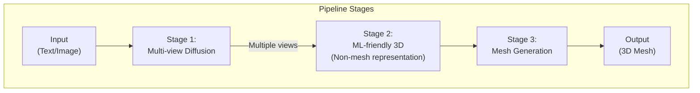
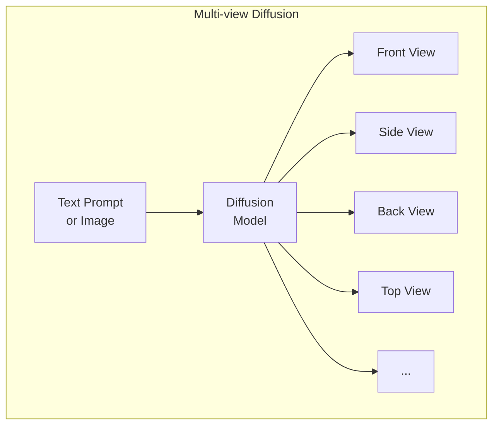
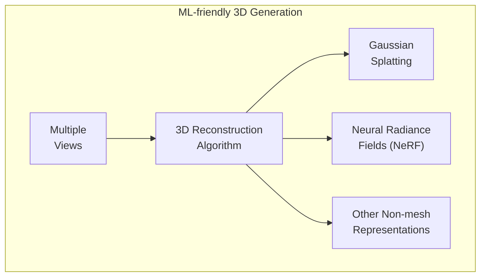
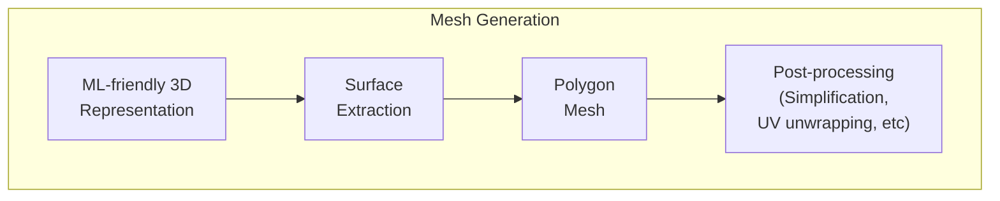
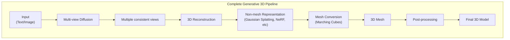

<!-- source: DeepWiki mcp.deepwiki.com · repo huggingface/ml-for-3d-course · page 2.3 Generative 3D Pipelines · fetched 2026-10-26 -->

# Generative 3D Pipelines

Relevant source files

The following files were used as context for generating this wiki page:

- [units/en/unit1/pipelines.mdx](units/en/unit1/pipelines.mdx)

## Purpose and Scope

This document explains the end-to-end pipeline for generating 3D models using machine learning techniques. It covers the overall architecture, key components, and how they interact to transform inputs (text or images) into 3D outputs. For specific details about mesh representations, see [Mesh Representations](#2.1), and for non-mesh representations, see [Non-mesh Representations](#2.2).

Sources: [units/en/unit1/pipelines.mdx:1-7]()

## Pipeline Architecture Overview

The generative 3D pipeline consists of three main stages that work together to create 3D content from simpler inputs:

Sources: [units/en/unit1/pipelines.mdx:3-7]()

This pipeline transforms simple inputs like text descriptions or single images into complete 3D models through a series of increasingly complex representations. Each stage builds upon the previous one, gradually adding more 3D information until a full model is created.

## Pipeline Components

### 1. Multi-view Diffusion

Multi-view diffusion models generate multiple consistent views of an object from either text descriptions or source images. These models use diffusion techniques (similar to those in image generation) to create a set of 2D renders showing the object from different angles.

Multi-view diffusion serves as a critical bridge between 2D inputs and 3D representations, creating the necessary visual information from multiple angles that subsequent stages can use to reconstruct 3D geometry.

Sources: [units/en/unit1/pipelines.mdx:9-13]()

### 2. ML-friendly 3D Representation

The multiple views generated in the previous stage are processed to create an intermediate 3D representation that is well-suited for machine learning manipulation. These representations (like Gaussian Splatting, NeRFs, or Triplanes) are optimized for neural network processing rather than for traditional 3D workflows.

This intermediate representation focuses on accurately encoding the 3D structure in a format that's differentiable and can be optimized using neural networks, but may not be directly usable in traditional 3D applications.

Sources: [units/en/unit1/pipelines.mdx:7]()

### 3. Mesh Generation

The final stage converts the ML-friendly representation into a traditional polygon mesh that can be used in standard 3D applications, game engines, or for 3D printing. This often involves algorithms like Marching Cubes that extract surface geometry from volumetric or implicit representations.

The mesh output represents the final product of the pipeline, providing a representation that's compatible with established 3D workflows and tools.

Sources: [units/en/unit1/pipelines.mdx:7]()

## Pipeline Integration and Implementation

The complete generative 3D pipeline combines these components into a coherent workflow, with each stage building upon the output of the previous one:

### Practical Implementation Considerations

When implementing a generative 3D pipeline, several factors need to be considered:

1. **Computational requirements**: Each stage has different computational needs:
   - Multi-view diffusion is GPU-intensive but can use existing diffusion models
   - ML-friendly 3D representation may require optimization steps
   - Mesh generation can be memory-intensive for high-resolution outputs

2. **Quality vs. speed tradeoffs**: More views and higher resolution lead to better quality but slower processing.

3. **Cross-stage consistency**: Ensuring that details remain consistent across pipeline stages is crucial for high-quality output.

4. **Implementation options**:
   - Use pre-trained models from Hugging Face for each stage
   - Create custom implementations for specific use cases
   - Mix existing components with custom elements

Sources: [units/en/unit1/pipelines.mdx:15-23]()

## Course Coverage

In the ML for 3D course, each of these pipeline components is covered in dedicated units:

| Pipeline Stage | Course Unit | Focus Area |
|----------------|-------------|------------|
| Multi-view diffusion | Unit 3 | Tools and ecosystem integration |
| ML-friendly 3D | Unit 4 | Deep dive into Gaussian Splatting |
| Mesh Generation | Unit 5 | Practical applications |

Each unit includes both theoretical understanding and hands-on practical implementation, enabling you to build and customize your own generative 3D pipelines.

Sources: [units/en/unit1/pipelines.mdx:15-23]()

## Summary

Generative 3D pipelines represent a structured approach to creating 3D content using machine learning. By breaking down the complex problem of 3D generation into discrete stages (multi-view diffusion, ML-friendly 3D representation, and mesh generation), these pipelines make it possible to generate high-quality 3D models from simple inputs like text or single images. Understanding each component and how they fit together is essential for effectively working with and developing generative 3D systems.

---

