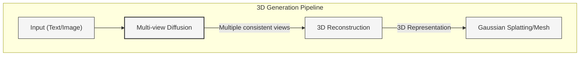
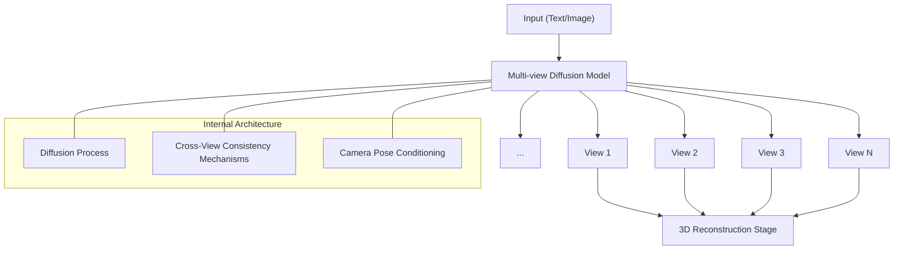
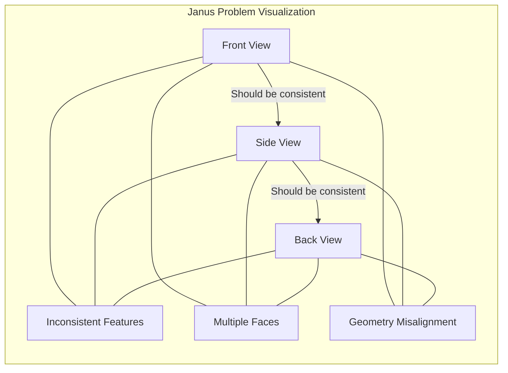
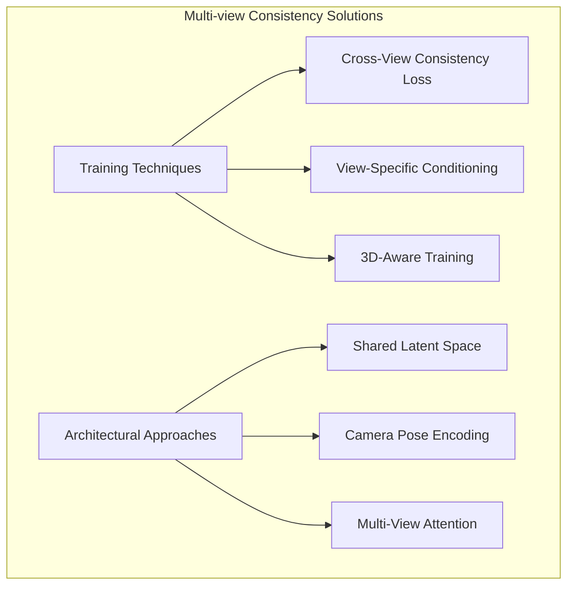
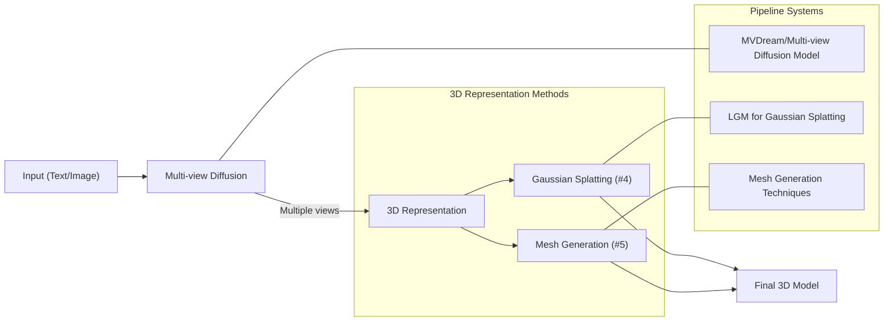
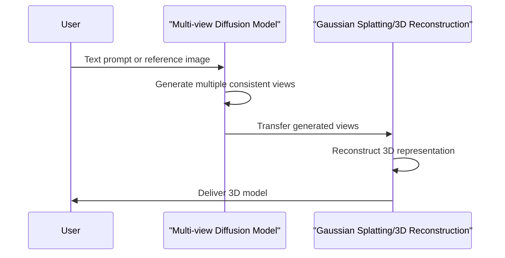

<!-- source: DeepWiki mcp.deepwiki.com · repo huggingface/ml-for-3d-course · page 3 Multi-view Diffusion · fetched 2026-10-26 -->

# Multi-view Diffusion

Relevant source files

The following files were used as context for generating this wiki page:

- [units/en/unit2/introduction.mdx](units/en/unit2/introduction.mdx)
- [units/en/unit2/what-is-it.mdx](units/en/unit2/what-is-it.mdx)

## Purpose and Scope

This document explains Multi-view Diffusion, a key technique in 3D generation pipelines that creates consistent multiple views of an object from different perspectives based on a single input (text or image). Multi-view Diffusion represents the first step in the ML for 3D pipeline, generating the raw visual data needed for subsequent 3D representation techniques. This document focuses on what Multi-view Diffusion is, its challenges, available solutions, and its implementation in the 3D generation workflow. For detailed information about implementing Multi-view Diffusion, see [Multi-view Diffusion Pipeline](#3.1) and [Implementing Multi-view Diffusion](#3.2).

Sources: [units/en/unit2/introduction.mdx:14-20](), [units/en/unit2/what-is-it.mdx:1-3]()

## What is Multi-view Diffusion?

Multi-view Diffusion is a specialized type of diffusion model that, unlike standard diffusion models like Stable Diffusion (which generate single images), is trained to generate multiple consistent views of the same object from different camera angles. This approach is crucial for 3D generation because it provides the foundational image data required to infer 3D structure.

The model takes either a text prompt or a single image as input and produces a set of images representing the same object from different viewpoints, typically arranged in a predetermined layout (often in a circular pattern around the object).

### Multi-view Diffusion in the 3D Generation Pipeline

Sources: [units/en/unit2/introduction.mdx:14-20](), [units/en/unit2/what-is-it.mdx:1-5]()

## Technical Architecture

Multi-view Diffusion models are primarily adapted diffusion models with architectural modifications and training approaches designed to ensure view consistency.

Sources: [units/en/unit2/what-is-it.mdx:1-5](), [units/en/unit2/what-is-it.mdx:16-19]()

## Challenges in Multi-view Diffusion

### The Janus Problem

The primary challenge in Multi-view Diffusion is maintaining consistency across different views of the same object, known as the "Janus problem." This issue manifests when:

- An object appears to have multiple faces when viewed from different angles
- Object features (colors, shapes, textures) change inconsistently between views
- The generated views don't represent a physically plausible 3D object

Sources: [units/en/unit2/what-is-it.mdx:8-13]()

## Available Solutions

State-of-the-art Multi-view Diffusion models address the Janus problem and other consistency issues through specialized architectures and training techniques:

### Key Models and Approaches

- **MVDream**: A prominent Multi-view Diffusion model available on Hugging Face that generates consistent views
- **View-Conditioned Generation**: Models that explicitly condition on camera angles
- **Cross-View Consistency Training**: Training approaches that enforce consistency between generated views

These advanced models use various techniques to ensure that the generated views maintain coherence across different perspectives of the same object.

Sources: [units/en/unit2/what-is-it.mdx:15-19]()

## Integration with the ML for 3D Pipeline

Multi-view Diffusion serves as the entry point for most generative 3D pipelines covered in this course, providing the source images needed for subsequent steps:

While Multi-view Diffusion is a crucial component in many 3D generation approaches, it's worth noting that not all generative 3D pipelines use this technique. Some approaches may use other methods to infer 3D structure directly from single images or text.

Sources: [units/en/unit2/introduction.mdx:14-20](), [units/en/unit2/what-is-it.mdx:9-10](), [units/en/unit2/what-is-it.mdx:20-21]()

## Implementation Considerations

When using Multi-view Diffusion models in a practical workflow:

1. **Model Selection**: Choose a model trained specifically for multi-view generation like MVDream
2. **Input Crafting**: Detailed prompts or clear reference images provide better results
3. **View Configuration**: Consider how many views are needed for the subsequent 3D reconstruction step
4. **Consistency Checking**: Validate that generated views maintain consistency before proceeding

### Typical Workflow

Sources: [units/en/unit2/what-is-it.mdx:19-21](), [units/en/unit2/introduction.mdx:18-20]()

## Summary

Multi-view Diffusion represents the initial step in many modern 3D generation pipelines. By generating multiple consistent views of an object from a single input prompt or image, it provides the visual foundation needed for subsequent 3D reconstruction techniques like Gaussian Splatting. While this approach faces challenges with view consistency (particularly the Janus problem), state-of-the-art models like MVDream have developed effective solutions to these issues.

The course takes a practical approach to Multi-view Diffusion, focusing on how to use existing models rather than developing them from scratch, as the technical details relate more to diffusion models than to 3D-specific techniques.

Sources: [units/en/unit2/introduction.mdx:16-20](), [units/en/unit2/what-is-it.mdx:15-21]()

---

