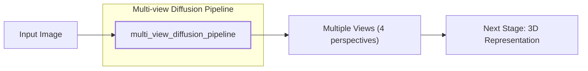
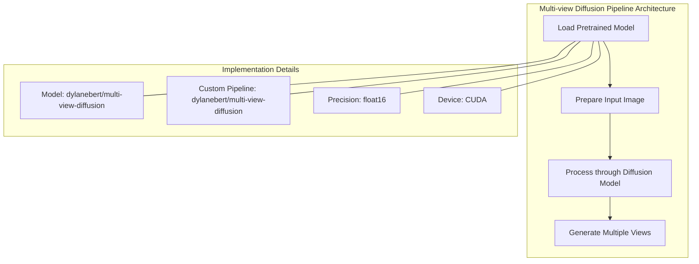
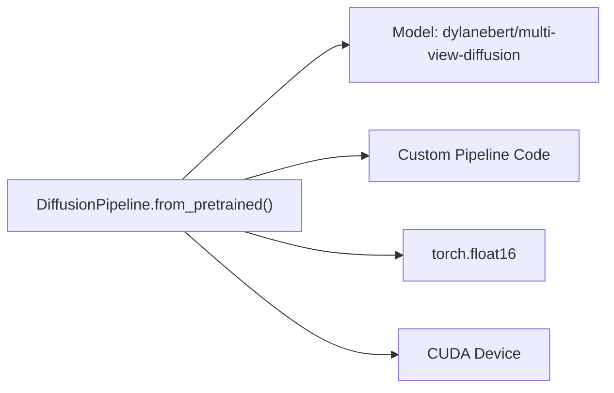
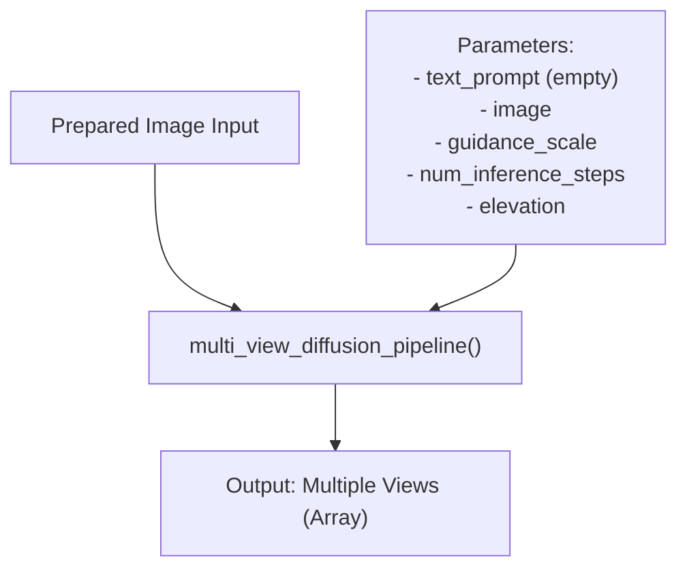
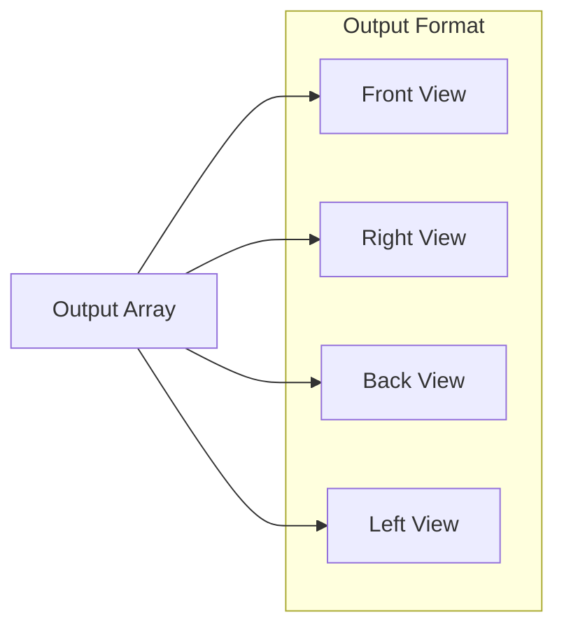
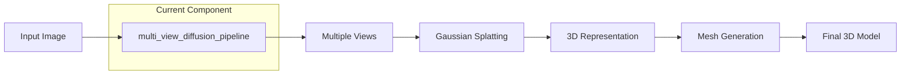

<!-- source: DeepWiki mcp.deepwiki.com · repo huggingface/ml-for-3d-course · page 3.1 Multi-view Diffusion Pipeline · fetched 2026-10-26 -->

# Multi-view Diffusion Pipeline

Relevant source files

The following files were used as context for generating this wiki page:

- [units/en/unit2/pipeline.mdx](units/en/unit2/pipeline.mdx)
- [units/en/unit2/setup.mdx](units/en/unit2/setup.mdx)

## Purpose and Scope

This document details the Multi-view Diffusion Pipeline, a critical component in the 3D generation workflow that transforms a single image into multiple consistent views of the same object. The pipeline serves as the first stage in the larger image-to-3D generation process, creating the necessary multiple perspectives that will later be processed into a 3D representation. For information about implementing this pipeline in practice, see [Implementing Multi-view Diffusion](#3.2).

Sources: [units/en/unit2/pipeline.mdx:1-21]()

## System Overview

The Multi-view Diffusion Pipeline sits at the beginning of the 3D generation workflow, converting a single image into multiple coherent views that capture the object from different angles. This is a crucial step that enables subsequent 3D modeling processes.

Sources: [units/en/unit2/pipeline.mdx:1-21]()

## Pipeline Architecture

The Multi-view Diffusion Pipeline is implemented as a custom pipeline in the Diffusers library framework. The custom implementation is necessary because standard diffusion pipelines don't natively support 3D-oriented tasks.

Sources: [units/en/unit2/pipeline.mdx:5-21]()

## Technical Requirements

The Multi-view Diffusion Pipeline has specific hardware and software requirements:

| Requirement | Description |
|-------------|-------------|
| Hardware | GPU (CUDA-compatible) |
| Dependencies | Specified in requirements.txt |
| Python Packages | torch, diffusers, PIL, numpy |
| Memory | Sufficient VRAM for model inference |

Sources: [units/en/unit2/setup.mdx:7-26]()

## Pipeline Components

### Model Loading

The pipeline utilizes a pretrained model from the Hugging Face Hub:

The pipeline is initialized with the following key components:
- Model repository: `dylanebert/multi-view-diffusion`
- Custom pipeline code path: `dylanebert/multi-view-diffusion`
- Data type: `torch.float16` for efficiency
- Processing device: GPU via CUDA

Sources: [units/en/unit2/pipeline.mdx:7-17]()

### Input Processing

The pipeline accepts an input image which is preprocessed before being fed to the model:

The preprocessing involves:
1. Loading the image using PIL
2. Converting to a numpy array
3. Normalizing pixel values to the range [0.0, 1.0]

Sources: [units/en/unit2/pipeline.mdx:25-71]()

### Pipeline Execution

The execution of the pipeline involves passing the prepared image through the diffusion model with specific parameters:

Sources: [units/en/unit2/pipeline.mdx:59-76]()

## Usage Example

The following example demonstrates how to use the Multi-view Diffusion Pipeline:

1. Load the pipeline:
   [units/en/unit2/pipeline.mdx:7-17]()

2. Prepare an input image:
   [units/en/unit2/pipeline.mdx:25-35]()

3. Execute the pipeline:
   [units/en/unit2/pipeline.mdx:59-60]()

4. Display or process the resulting views:
   [units/en/unit2/pipeline.mdx:46-57]()

Sources: [units/en/unit2/pipeline.mdx:1-85]()

## Configuration Parameters

The pipeline accepts several parameters that control the generation process:

| Parameter | Description | Example Value |
|-----------|-------------|---------------|
| text_prompt | Optional text guidance (can be empty string) | `""` |
| image | Normalized input image array | `np.array(image, dtype=np.float32) / 255.0` |
| guidance_scale | Controls how closely to follow the input | `5` |
| num_inference_steps | Number of diffusion steps | `30` |
| elevation | View elevation angle | `0` |

Sources: [units/en/unit2/pipeline.mdx:60-75]()

## Output Format

The pipeline produces an array of images representing multiple views of the input object:

The output consists of four views positioned at 90-degree intervals around the object. These views are returned as numpy arrays with values in the range [0.0, 1.0], which can be converted to standard image formats using libraries like PIL.

Sources: [units/en/unit2/pipeline.mdx:46-57](), [units/en/unit2/pipeline.mdx:77-79]()

## Integration with Overall 3D Generation Workflow

The Multi-view Diffusion Pipeline is the first stage in a broader 3D generation workflow:

The multiple views generated by this pipeline serve as input to subsequent 3D representation techniques, particularly Gaussian Splatting, which can then be further processed into meshes or other 3D formats.

Sources: [units/en/unit2/pipeline.mdx:81-85]()

## Limitations and Considerations

When using the Multi-view Diffusion Pipeline, be aware of the following:

1. **GPU Requirement**: The pipeline requires a GPU to run efficiently.
2. **Memory Usage**: Large images or high inference steps may require substantial VRAM.
3. **View Consistency**: While the pipeline attempts to maintain consistency across views, complex objects may show variations.
4. **Custom Pipeline Dependency**: The pipeline relies on custom code that extends the standard diffusers library functionality.

Sources: [units/en/unit2/setup.mdx:7-15](), [units/en/unit2/pipeline.mdx:19-21]()

---

