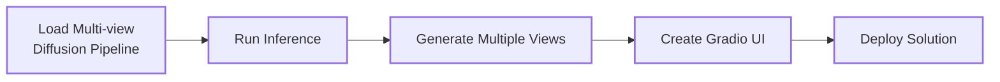
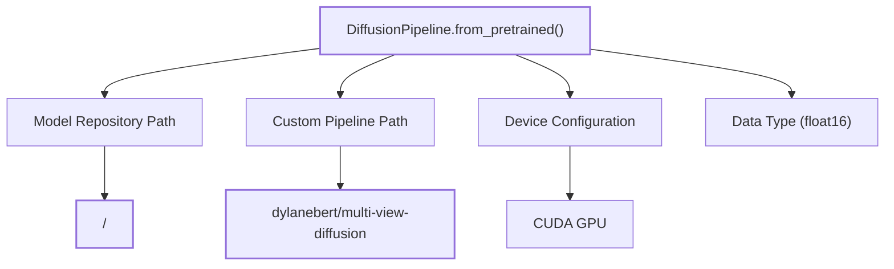
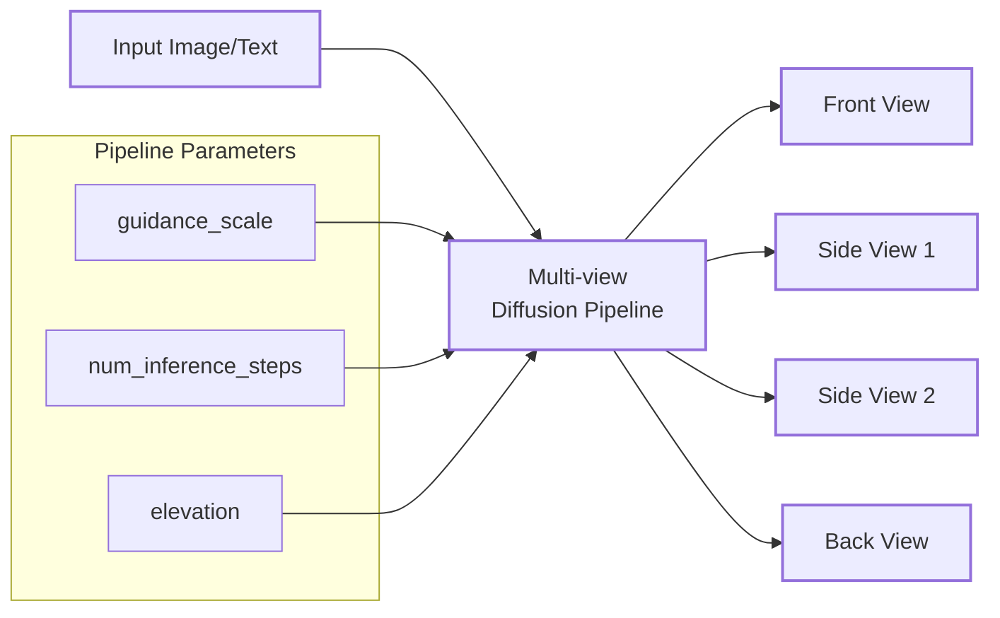
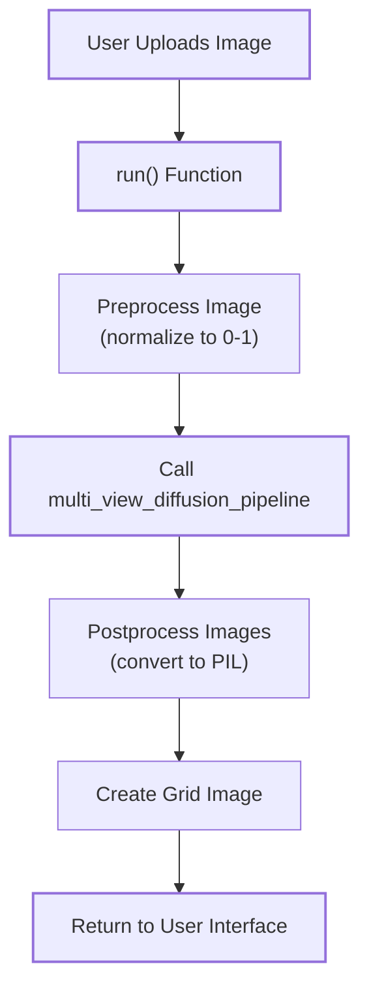
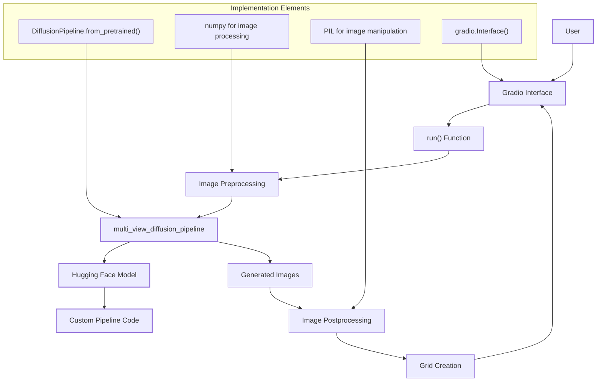
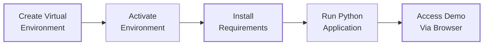

<!-- source: DeepWiki mcp.deepwiki.com · repo huggingface/ml-for-3d-course · page 3.2 Implementing Multi-view Diffusion · fetched 2026-10-26 -->

# Implementing Multi-view Diffusion

Relevant source files

The following files were used as context for generating this wiki page:

- [README.md](README.md)
- [units/en/unit2/bonus.mdx](units/en/unit2/bonus.mdx)
- [units/en/unit2/hands-on-1.mdx](units/en/unit2/hands-on-1.mdx)
- [units/en/unit2/hands-on-2.mdx](units/en/unit2/hands-on-2.mdx)

## Purpose and Scope

This document provides practical guidance on implementing multi-view diffusion models for 3D generation. We focus on how to use pre-trained multi-view diffusion models, create interactive demos with Gradio, and deploy these solutions. This page covers the technical implementation aspects rather than the theoretical foundations of multi-view diffusion (for that information, see [Multi-view Diffusion Pipeline](#3.1)).

## Implementation Overview

Multi-view diffusion implementation consists of three main components: loading the model from Hugging Face, running inference to generate multiple views, and creating a user interface with Gradio. The following diagram illustrates this workflow:

Sources: [units/en/unit2/hands-on-2.mdx:15-25](), [units/en/unit2/hands-on-2.mdx:32-56]()

## Loading the Multi-view Diffusion Pipeline

The first step is to load a pre-trained multi-view diffusion model from the Hugging Face Hub. This is done using the `DiffusionPipeline` class from the diffusers library:

The code to load the pipeline requires:
- The model repository path
- The custom pipeline path (`dylanebert/multi-view-diffusion`)
- Configuration for hardware acceleration (typically CUDA)
- Floating-point precision setting (typically float16 for efficiency)

Sources: [units/en/unit2/hands-on-2.mdx:15-25]()

## Running Inference

Once the pipeline is loaded, you can generate multiple views of an object by providing either a text prompt or an input image. The pipeline processes this input and returns a set of images showing the object from different angles.

Key inference parameters include:
- `guidance_scale`: Controls how closely the generated images match the input prompt
- `num_inference_steps`: Determines the quality and generation time
- `elevation`: Controls the viewing angle

Sources: [units/en/unit2/hands-on-2.mdx:38-42]()

## Creating a Gradio Demo

To make your multi-view diffusion model accessible to users, you can create an interactive demo using Gradio. The demo allows users to upload an image and receive the generated multi-view output.

The demo implementation consists of:
1. A processing function that handles the input image
2. Pipeline call with appropriate parameters
3. Post-processing to arrange the views in a grid
4. Gradio interface setup with input and output specifications

Sources: [units/en/unit2/hands-on-2.mdx:32-56](), [units/en/unit2/hands-on-2.mdx:86-123]()

## Complete Implementation Architecture

The following diagram shows how all components fit together in the complete implementation:

Sources: [units/en/unit2/hands-on-2.mdx:86-123]()

## Deployment Options

After implementing your multi-view diffusion demo, you have several options for deployment:

| Option | Description | Requirements | Benefits |
|--------|-------------|--------------|----------|
| Hugging Face Space | Create a Space with Gradio SDK | GPU for public hosting | Easy sharing and integration with HF ecosystem |
| Gradio Deploy | Use Gradio's deployment tools | Server for hosting | Simplified deployment process |
| Local Deployment | Run the demo on your machine | Python environment with GPU | Complete control, no hosting costs |

The repository provides complete code templates for each deployment option, including the necessary requirements and setup instructions.

Sources: [units/en/unit2/hands-on-2.mdx:62-138]()

## Local Deployment Workflow

For local deployment, you need to set up a Python virtual environment with the required dependencies:

The implementation requires:
- Python 3.10+ (tested with 3.10.12)
- CUDA-compatible GPU (tested with CUDA 12.1 on RTX 4090)
- Required packages as specified in the requirements.txt file

Sources: [units/en/unit2/hands-on-2.mdx:128-138]()

## Summary and Extensions

This implementation approach allows you to quickly set up and deploy a multi-view diffusion system without having to train models from scratch. The modular design makes it easy to:

1. Substitute different pre-trained models
2. Customize the UI with additional parameters
3. Integrate the system into larger 3D generation pipelines

For more advanced customizations, consider exploring other available models in the Hugging Face ecosystem or fine-tuning existing models for specific use cases.

Sources: [units/en/unit2/bonus.mdx:1-16]()

---

