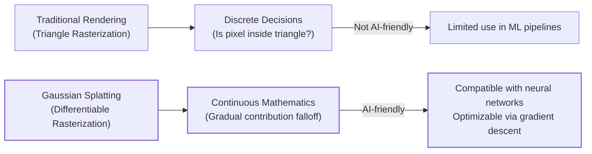
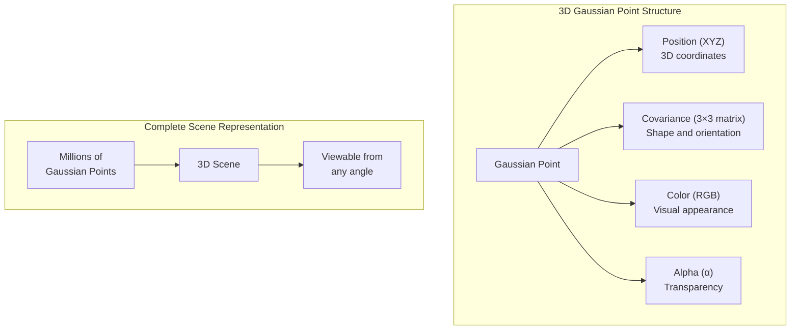
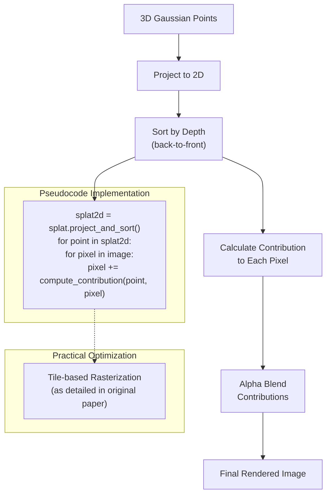
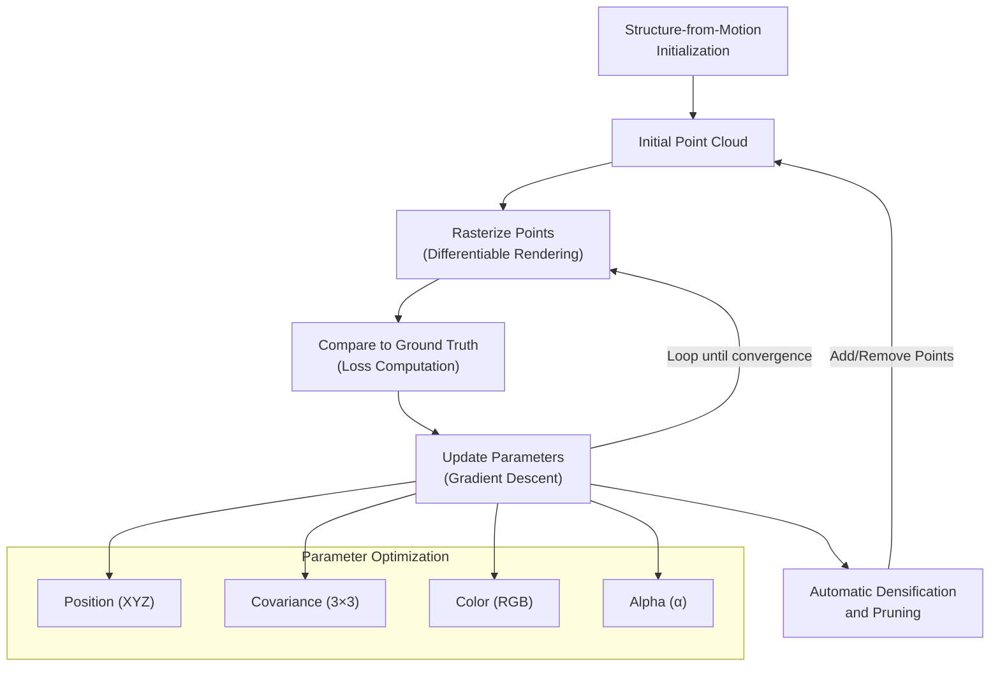
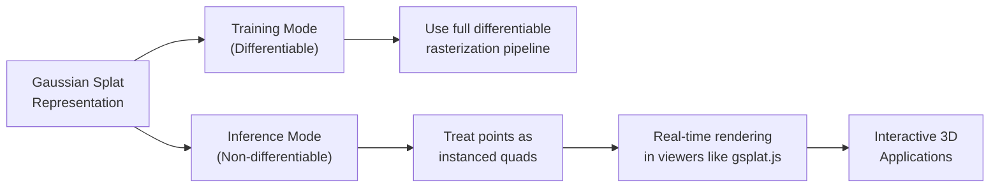
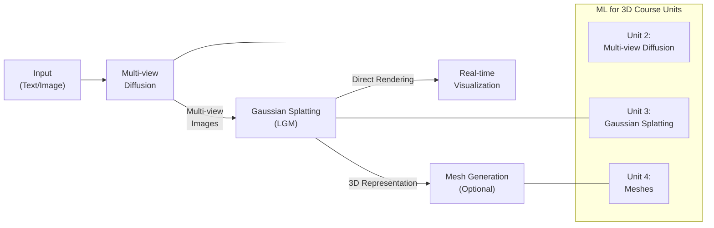
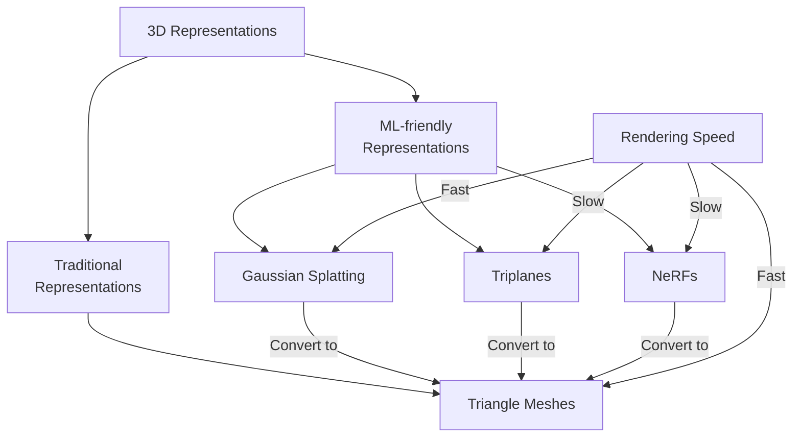

<!-- source: DeepWiki mcp.deepwiki.com · repo huggingface/ml-for-3d-course · page 4 Gaussian Splatting · fetched 2026-10-26 -->

# Gaussian Splatting

Relevant source files

The following files were used as context for generating this wiki page:

- [units/en/unit3/bonus.mdx](units/en/unit3/bonus.mdx)
- [units/en/unit3/introduction.mdx](units/en/unit3/introduction.mdx)
- [units/en/unit3/what-is-it.mdx](units/en/unit3/what-is-it.mdx)

## Purpose and Scope

This document explains Gaussian Splatting, a differentiable rasterization technique that serves as an ML-friendly 3D representation. It covers the fundamental concepts, technical implementation details, training process, and its role in generative 3D pipelines. Gaussian Splatting is notable for its real-time rendering capabilities, making it particularly suitable for end-to-end AI-compatible 3D applications.

For information about other ML-friendly 3D representations like Triplanes and NeRFs, see [Non-mesh Representations](#2.2). For details on how Gaussian Splatting fits into the broader generative pipeline, see [Generative 3D Pipelines](#2.3).

Sources: [units/en/unit3/what-is-it.mdx:1-4](). [units/en/unit3/introduction.mdx:22-27]()

## What is Gaussian Splatting?

Gaussian Splatting is a differentiable rasterization technique that represents 3D scenes using millions of 3D Gaussian points. Two key properties make it especially valuable for ML applications:

1. **Differentiable**: In ML terms, "differentiable" means "AI-compatible." Unlike traditional rasterization methods that make discrete decisions (like determining if a pixel is inside a triangle), Gaussian Splatting uses continuous mathematics that can be incorporated into neural networks and optimized through gradient descent.

2. **Rasterization**: The process of converting 3D data into 2D pixel information that can be displayed on a screen. While traditional mesh rendering uses triangle rasterization, Gaussian Splatting uses elliptical "splats" that blend together smoothly.

The differentiable nature of Gaussian Splatting enables direct optimization of the 3D representation using standard ML techniques, while also allowing real-time rendering for interactive applications.

Sources: [units/en/unit3/what-is-it.mdx:3-21]()

## Representation Structure

A Gaussian Splat consists of millions of 3D Gaussian points, each defined by four fundamental parameters:

1. **Position**: 3D coordinates (X, Y, Z) specifying the point's location in space
2. **Covariance**: A 3×3 matrix that defines how the Gaussian is stretched and oriented
3. **Color**: RGB values determining the point's color
4. **Alpha**: A scalar value controlling the point's transparency

These parameters completely define the appearance and behavior of each Gaussian point in the scene. When millions of these points are combined, they form a complete 3D representation that can be rendered from any viewpoint.

Sources: [units/en/unit3/what-is-it.mdx:26-32]()

## Rasterization Process

The rendering process of Gaussian Splatting involves projecting 3D Gaussian points into 2D and calculating their contribution to each pixel. The core process works as follows:

1. **Projection and Sorting**: 3D Gaussian points are projected onto the 2D image plane and sorted based on depth (back-to-front ordering)
2. **Contribution Calculation**: For each pixel, compute the contribution from relevant Gaussian points
3. **Blending**: Combine these contributions using alpha blending to produce the final pixel color

In theory, every point could contribute to every pixel (with diminishing effect at greater distances), but this would be computationally expensive. In practice, tile-based optimization methods are used to make the process efficient.

Sources: [units/en/unit3/what-is-it.mdx:33-46]()

## Training Process

The training process for Gaussian Splatting involves optimizing the parameters of each Gaussian point to accurately represent a 3D scene. The typical process includes:

1. **Initialization**: Points are initially created using Structure-from-Motion (SfM), a traditional 3D reconstruction algorithm
2. **Rasterization**: Points are rendered using the rasterization process described above
3. **Loss Computation**: The rendered image is compared to ground truth images
4. **Gradient Descent**: Parameters (position, covariance, color, alpha) are adjusted based on the computed loss
5. **Densification and Pruning**: Points are automatically added where detail is needed and removed where they're redundant

This process allows the representation to adaptively improve, concentrating detail where it matters most in the scene.

Sources: [units/en/unit3/what-is-it.mdx:55-66]()

## Inference and Real-time Rendering

For inference (when not training), the differentiable property of Gaussian Splatting isn't required. This allows for more efficient rendering approaches:

1. Each Gaussian point can be treated as an instanced quad
2. This approach enables real-time rendering in web viewers like gsplat.js
3. The ability to render in real-time makes Gaussian Splatting particularly valuable for interactive 3D applications

This real-time rendering capability is a key advantage over other ML-friendly 3D representations, which often require more complex and time-consuming rendering processes.

Sources: [units/en/unit3/what-is-it.mdx:48-52](). [units/en/unit3/introduction.mdx:24-27]()

## Generative 3D Applications

While the original Gaussian Splatting approach focused on reconstructing individual scenes from photos, the concept of differentiable rasterization extends to generative models:

1. The differentiable nature of Gaussian Splatting allows integration with neural networks
2. Generative models like LGM can produce Gaussian Splats from input images or text
3. Gaussian Splatting sits between multi-view diffusion and mesh generation in a typical generative 3D pipeline

This makes Gaussian Splatting valuable in end-to-end generative 3D workflows, especially when real-time rendering is needed.

Sources: [units/en/unit3/what-is-it.mdx:68-72](). [units/en/unit3/introduction.mdx:5-20]()

## Position in 3D Representation Ecosystem

Gaussian Splatting is one of several ML-friendly 3D representations, each with its own strengths:

| Representation | Strengths | Limitations | Real-time Capable |
|----------------|-----------|-------------|------------------|
| Gaussian Splatting | Real-time rendering, differentiable | Point-based limitations | Yes |
| Triplanes | State-of-the-art quality | Complex rendering process | No |
| NeRFs | High visual fidelity | Slow rendering | No |
| Traditional Meshes | Industry standard, widely supported | Not natively differentiable | Yes |

This unique combination of being both ML-friendly and capable of real-time rendering makes Gaussian Splatting particularly valuable in the current 3D representation landscape.

Sources: [units/en/unit3/introduction.mdx:14-20](). [units/en/unit3/bonus.mdx:3-5]()

## Further Resources

For those interested in exploring Gaussian Splatting further, these resources are available:

- Open-source implementations:
  - [Nerfstudio gsplat](https://github.com/nerfstudio-project/gsplat)
  - [gsplat.js](https://github.com/huggingface/gsplat.js) for web-based rendering
  - [UnityGaussianSplatting](https://github.com/aras-p/UnityGaussianSplatting) for Unity integration

- Academic resources:
  - [Original paper](https://huggingface.co/papers/2308.04079) with detailed explanation of tile-based rasterization methods

The capstone project in this course (see [Capstone Project](#6)) provides the option to work with Gaussian Splatting as the output format for a generative 3D model.

Sources: [units/en/unit3/bonus.mdx:7-14]()

---

