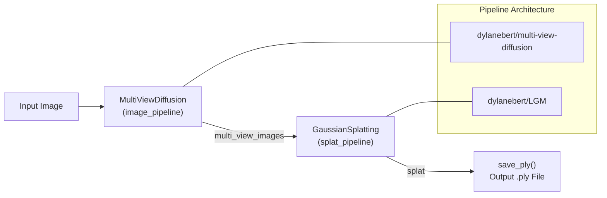
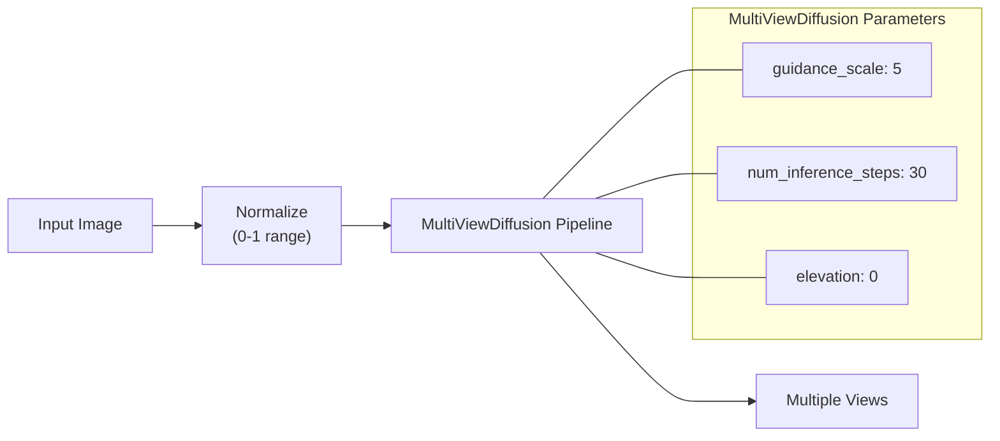
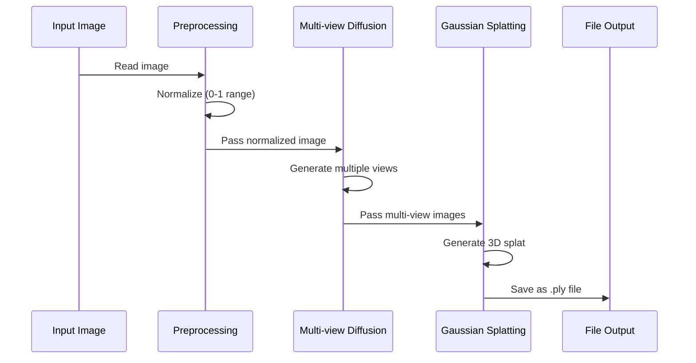
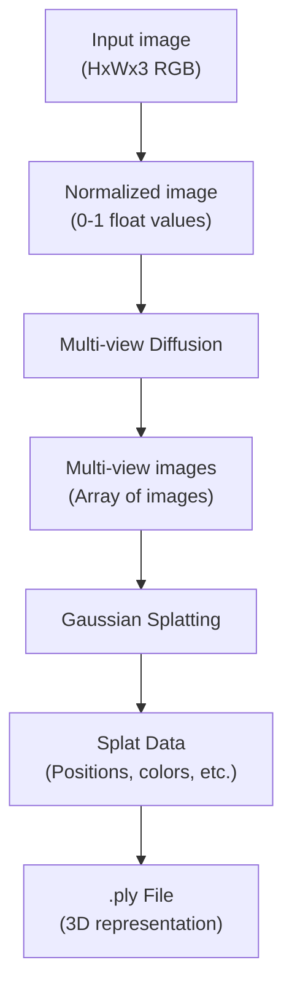
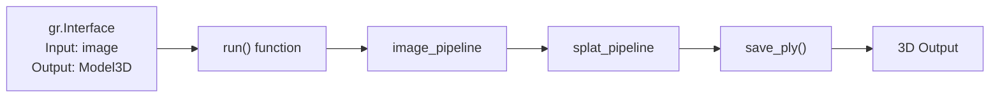
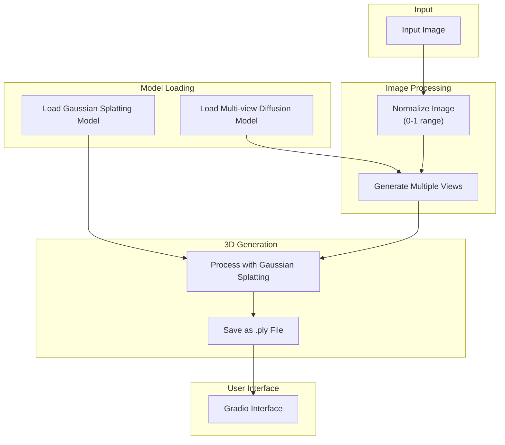

<!-- source: DeepWiki mcp.deepwiki.com · repo huggingface/ml-for-3d-course · page 4.1 Gaussian Splatting Implementation · fetched 2026-10-26 -->

# Gaussian Splatting Implementation

<details>
<summary>Relevant source files</summary>

The following files were used as context for generating this wiki page:

- [units/en/unit3/hands-on.mdx](units/en/unit3/hands-on.mdx)

</details>


## Purpose and Scope

This document covers the technical implementation of Gaussian Splatting within the ML for 3D course, focusing on how to build a text-to-splat pipeline using the Large Gaussian Model (LGM). This page specifically addresses the implementation aspects, including pipeline architecture, model loading, and processing steps. For conceptual information about Gaussian Splatting as a 3D representation technique, see [Gaussian Splatting](#4).

## Implementation Overview

Gaussian Splatting implementation in this codebase consists of a pipeline that converts images into 3D Gaussian Splats through a two-step process:

1. Multi-view diffusion to generate multiple perspectives of an input image
2. Gaussian Splatting model to create a 3D representation from these views

The implementation leverages pre-trained models from Hugging Face and provides both programmatic and UI-based interfaces.



Sources: [units/en/unit3/hands-on.mdx:5-10](), [units/en/unit3/hands-on.mdx:26-52]()

## Dependencies and Setup

The implementation requires specific dependencies, including custom wheels for differentiable Gaussian rasterization:

| Dependency | Purpose |
|------------|---------|
| `diff_gaussian_rasterization` | Enables differentiable rasterization of Gaussian Splats |
| `diffusers` | Provides the pipeline framework for both models |
| `torch` | Deep learning framework used for model inference |
| `PIL` | Image processing capabilities |
| `numpy` | Numerical operations on image data |
| `gradio` (optional) | For creating interactive demos |

Sources: [units/en/unit3/hands-on.mdx:18-21]()

## Pipeline Components

### 1. Multi-view Diffusion

The first step in the pipeline generates multiple views of an input image, providing the necessary perspectives for 3D reconstruction.



Sources: [units/en/unit3/hands-on.mdx:29-39](), [units/en/unit3/hands-on.mdx:77-79]()

### 2. Gaussian Splatting

The second step takes the multiple views and generates a 3D Gaussian Splat representation, which is then saved as a PLY file:


Sources: [units/en/unit3/hands-on.mdx:43-52](), [units/en/unit3/hands-on.mdx:84-88]()

## Implementation Steps

### 1. Loading Models

The implementation begins by loading two pre-trained models from Hugging Face:

```python
# Multi-view Diffusion Model
image_pipeline = DiffusionPipeline.from_pretrained(
    "dylanebert/multi-view-diffusion",
    custom_pipeline="dylanebert/multi-view-diffusion",
    torch_dtype=torch.float16,
    trust_remote_code=True,
).to("cuda")

# Gaussian Splatting Model
splat_pipeline = DiffusionPipeline.from_pretrained(
    "dylanebert/LGM",
    custom_pipeline="dylanebert/LGM",
    torch_dtype=torch.float16,
    trust_remote_code=True,
).to("cuda")
```

Both models are loaded as `DiffusionPipeline` objects, which provide a consistent interface for running inference. The models are moved to GPU (`cuda`) and use half-precision floating point (`torch.float16`) for efficiency.

Sources: [units/en/unit3/hands-on.mdx:29-52]()

### 2. Processing Images

Processing images through the pipeline involves these key steps:

1. Load and normalize the input image (scaling pixel values to 0-1 range)
2. Run the multi-view diffusion model to generate multiple perspectives
3. Process these views through the Gaussian Splatting model
4. Save the resulting 3D representation as a PLY file



Sources: [units/en/unit3/hands-on.mdx:58-89]()

### 3. Data Flow and Transformations

This diagram illustrates the data transformations that occur throughout the pipeline:



The critical data transformations are:
- Conversion from integer (0-255) to float (0-1) pixel values
- Generation of multiple coherent views from a single image
- Conversion of 2D views to 3D Gaussian representation

Sources: [units/en/unit3/hands-on.mdx:77-88]()

## User Interface Components

The implementation includes a Gradio interface for easy interaction with the pipeline:



The Gradio interface wraps the entire pipeline in a single function (`run`) that:
1. Takes an image as input
2. Processes it through both pipelines
3. Saves the result as a PLY file
4. Returns the file path for 3D rendering

Sources: [units/en/unit3/hands-on.mdx:96-112]()

## Complete Processing Pipeline

This diagram shows the complete implementation process from input to output:



Sources: [units/en/unit3/hands-on.mdx:5-112]()

## Code Implementation Summary

The table below summarizes the key components of the Gaussian Splatting implementation:

| Component | Purpose | Key Functions/Methods |
|-----------|---------|----------------------|
| Multi-view Diffusion Pipeline | Generate multiple views from a single image | `image_pipeline()` |
| Gaussian Splatting Pipeline | Convert multiple views to 3D representation | `splat_pipeline()` |
| PLY File Generation | Save 3D data in standard format | `save_ply()` |
| Preprocessing | Prepare images for model input | Normalization (0-1) |
| Gradio Interface | Provide user-friendly access | `gr.Interface()`, `run()` |

Sources: [units/en/unit3/hands-on.mdx:26-112]()

## Usage Example

The following steps demonstrate how to use the implementation:

1. Load the required models
2. Prepare an input image
3. Generate multiple views using the multi-view diffusion pipeline
4. Process these views with the Gaussian Splatting pipeline
5. Save the output as a PLY file

For interactive usage, the Gradio interface provides a simple web UI that abstracts these steps behind a single upload button and 3D viewer.

Sources: [units/en/unit3/hands-on.mdx:58-89](), [units/en/unit3/hands-on.mdx:96-112]()

---

