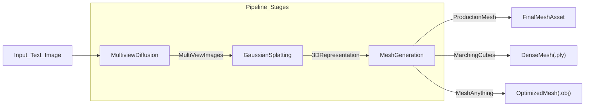
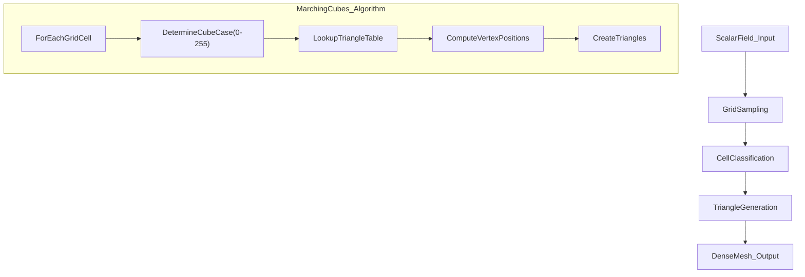
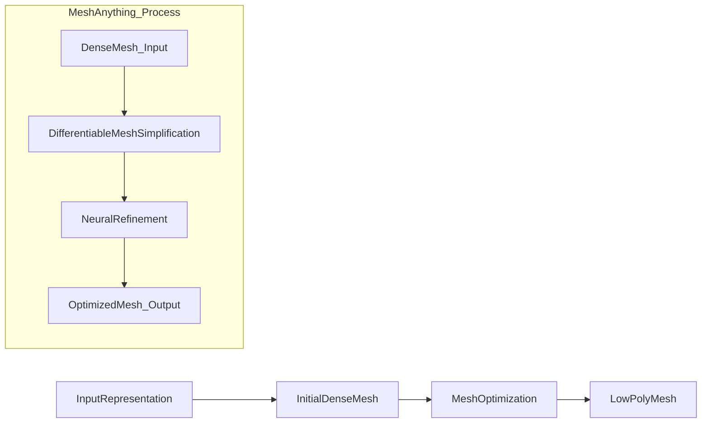
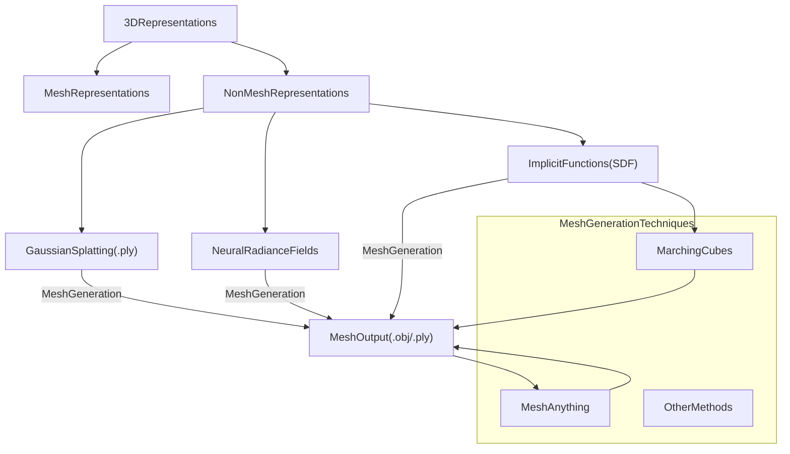
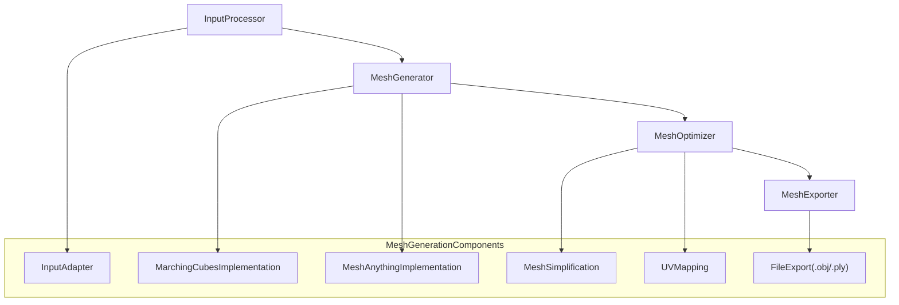

<!-- source: DeepWiki mcp.deepwiki.com · repo huggingface/ml-for-3d-course · page 5 Mesh Generation · fetched 2026-10-26 -->

# Mesh Generation

Relevant source files

The following files were used as context for generating this wiki page:

- [units/en/unit4/introduction.mdx](units/en/unit4/introduction.mdx)

## Purpose and Scope

Mesh Generation refers to the process of creating 3D meshes from other 3D representations. This document explains how mesh generation fits within the ML for 3D pipeline, covering both traditional approaches like Marching Cubes and advanced techniques like MeshAnything. For detailed information about specific algorithms, see [Marching Cubes Algorithm](#5.1) and [Advanced Mesh Generation](#5.2).

## Mesh Generation in the ML for 3D Pipeline

Mesh generation serves as the final transformation step in the ML for 3D pipeline, converting ML-friendly 3D representations (such as Gaussian Splats) into mesh formats that are suitable for mainstream 3D applications.

**Mesh Generation Pipeline Position**

Sources: units/en/unit4/introduction.mdx

In this pipeline, mesh generation takes the output from earlier stages (typically Gaussian Splatting or other implicit representations) and converts it into explicit mesh geometry consisting of vertices, edges, and faces.

**Input and Output Formats**

| Stage | Input Format | Output Format |
|-------|-------------|--------------|
| Mesh Generation | Point clouds, Gaussian Splats (.ply), Neural implicit fields | Triangular meshes (.obj, .ply, etc.) |
| Marching Cubes | Signed distance fields (SDF), Density fields | Dense triangle meshes (.ply) |
| Advanced Generation | Dense meshes, Neural fields | Optimized low-poly meshes (.obj) |

Sources: units/en/unit4/introduction.mdx

## Traditional Mesh Generation: Marching Cubes

Marching Cubes is a classic algorithm for extracting a polygonal mesh from an implicit surface, typically defined as a 3D scalar field. It works by evaluating the field at the vertices of a regular grid and generating triangles based on how the surface intersects each grid cell.

**Marching Cubes Algorithm Process**

Sources: units/en/unit4/introduction.mdx

While widely used, Marching Cubes typically produces dense and rough meshes that are not ideal for production purposes, as mentioned in the course introduction:

> Earlier in the course, we discussed the limitations of the mesh side of the pipeline, particularly with Marching Cubes, which produces dense and rough meshes unsuitable for production.

This limitation has driven the development of more advanced mesh generation techniques. For a detailed explanation of the Marching Cubes algorithm, see [Marching Cubes Algorithm](#5.1).

## Advanced Mesh Generation Techniques

Recent advancements in mesh generation have focused on creating more efficient and visually appealing meshes through differentiable processes. These techniques can convert dense meshes into low-poly meshes that are more suitable for real-time applications while preserving visual fidelity.

**Advanced Mesh Generation Workflow**

Sources: units/en/unit4/introduction.mdx

As noted in the course introduction:

> Recent advancements have emerged, allowing the conversion of dense meshes to low-poly meshes differentiably.

MeshAnything, showcased in the introduction, demonstrates how these advanced techniques can produce much more visually appealing and efficient meshes compared to traditional approaches.

**3D Representation Conversion Paths**

Sources: units/en/unit4/introduction.mdx

## Implementation Considerations

When implementing mesh generation in a 3D pipeline, several technical factors should be considered:

1. **Resolution parameters**: 
   - Grid resolution in Marching Cubes directly affects mesh density and detail
   - Higher resolutions capture finer details but produce heavier meshes

2. **Performance metrics**: 
   - Polygon count impacts rendering performance
   - Target platforms (web, mobile, desktop) have different mesh complexity constraints

3. **Pipeline integration**: 
   - Input format compatibility with upstream processes
   - Consistent coordinate systems between pipeline stages

4. **Post-processing requirements**:
   - UV mapping for texture application
   - Normal recalculation for smooth shading
   - Mesh decimation for optimization

**Mesh Generation Implementation Architecture**

Sources: units/en/unit4/introduction.mdx

## Summary

Mesh generation is a critical step in the ML for 3D pipeline, transforming ML-friendly 3D representations into production-ready mesh assets. While traditional techniques like Marching Cubes provide a reliable baseline, advanced methods like MeshAnything offer significant improvements in mesh quality and efficiency.

For more detailed information on specific techniques:
- See [Marching Cubes Algorithm](#5.1) for details on the traditional approach
- See [Advanced Mesh Generation](#5.2) for information on newer techniques like MeshAnything

In the next section of the course, we'll explore how to apply these techniques in the [Capstone Project](#6).

---

