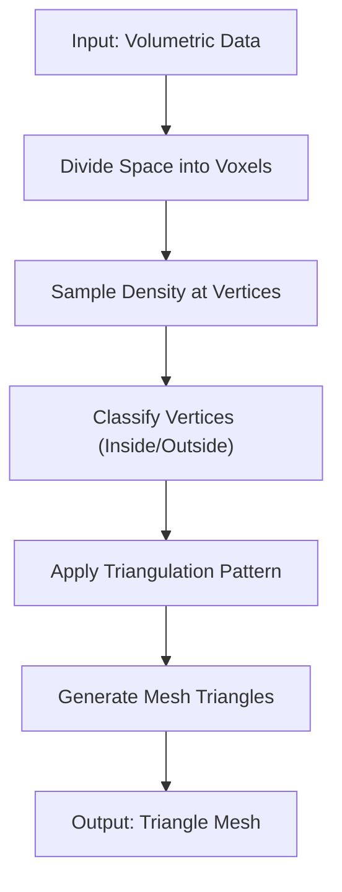
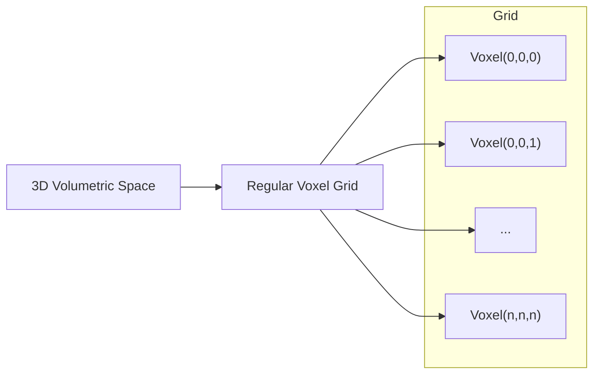
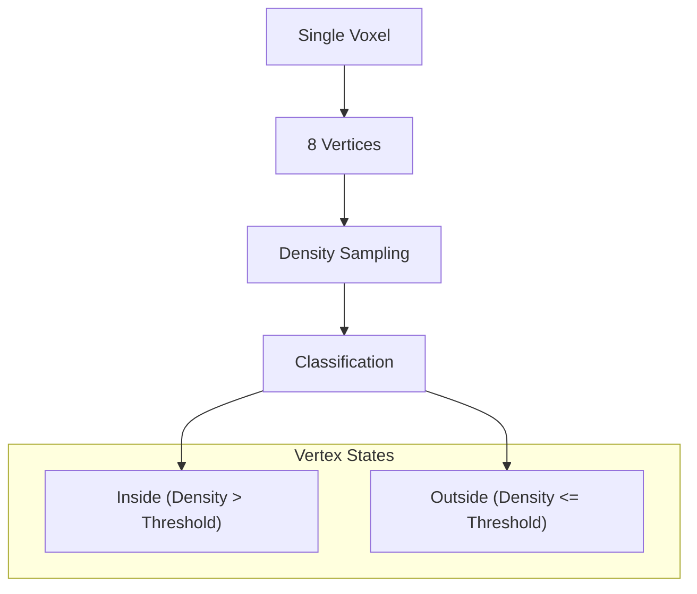
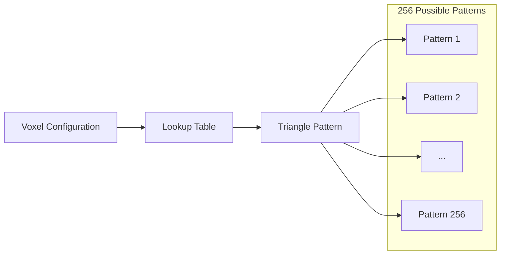
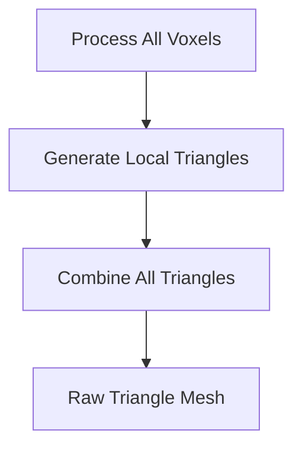
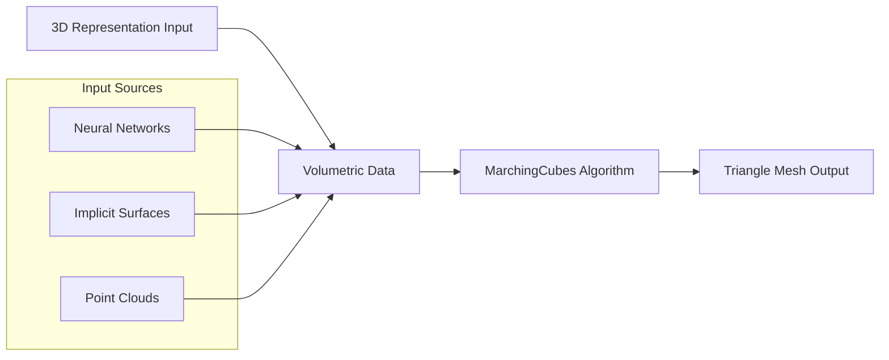
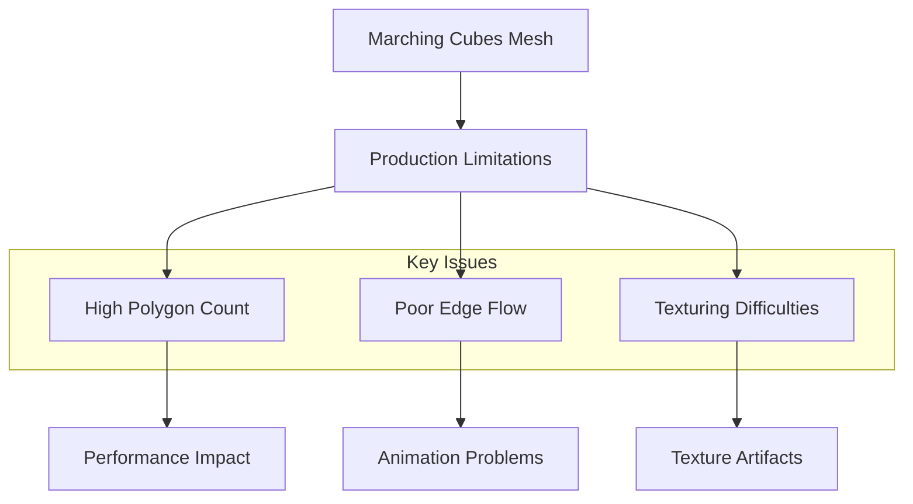
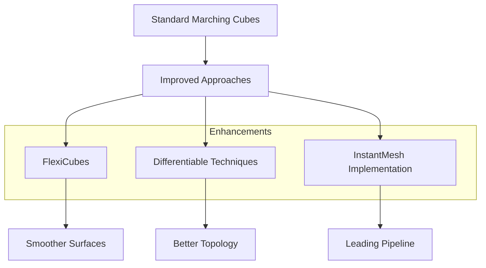
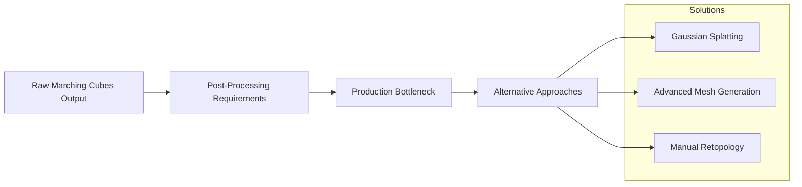

<!-- source: DeepWiki mcp.deepwiki.com · repo huggingface/ml-for-3d-course · page 5.1 Marching Cubes Algorithm · fetched 2026-10-26 -->

# Marching Cubes Algorithm

Relevant source files

The following files were used as context for generating this wiki page:

- [units/en/unit4/marching-cubes.mdx](units/en/unit4/marching-cubes.mdx)

## Purpose and Scope

This document explains the Marching Cubes algorithm, a fundamental method for converting volumetric data (such as density fields or implicit surfaces) into triangle meshes. In the ML for 3D course, Marching Cubes serves as a traditional approach to mesh generation from various 3D representations. For advanced mesh generation techniques that address some limitations of Marching Cubes, see [Advanced Mesh Generation](#5.2).

## Algorithm Overview

*Diagram: High-level workflow of the Marching Cubes algorithm*

Sources: [units/en/unit4/marching-cubes.mdx:7-9]()

The Marching Cubes algorithm processes volumetric data by examining small cubes (voxels) of the volume one at a time and determining how the surface passes through each cube. For each voxel, the algorithm creates triangles that represent the portion of the surface inside that voxel.

## Core Algorithm Steps

### 1. Divide the Space into Voxels

The first step involves dividing the 3D space into a regular grid of cubic cells (voxels). The resolution of this grid directly affects the detail level of the resulting mesh.

*Diagram: Division of 3D space into a grid of voxels*

Sources: [units/en/unit4/marching-cubes.mdx:13-15]()

### 2. Sample the Eight Vertex Positions

For each voxel, the algorithm samples the density value at each of the eight vertices (corners). Based on a threshold value, each vertex is classified as either inside or outside the surface.

*Diagram: Vertex sampling and classification process*

Sources: [units/en/unit4/marching-cubes.mdx:17-19]()

### 3. Determine the Triangle Configuration

Each voxel has eight vertices with two possible states each (inside or outside), resulting in 2^8 = 256 possible configurations. Each configuration maps to a specific triangulation pattern that approximates how the surface intersects the voxel.

*Diagram: Mapping vertex configurations to triangle patterns via lookup table*

Sources: [units/en/unit4/marching-cubes.mdx:21-25]()

### 4. Generate the Mesh

The algorithm "marches" through each voxel in the grid (hence the name), generating triangles according to the determined configuration. These triangles collectively form a mesh that approximates the surface of the volume.

*Diagram: Final mesh generation process*

Sources: [units/en/unit4/marching-cubes.mdx:27-33]()

## Marching Cubes in ML for 3D Pipeline

Marching Cubes serves as a bridge between volumetric representations and explicit mesh representations in 3D generation pipelines.

*Diagram: Role of Marching Cubes in 3D generation pipeline*

Sources: [units/en/unit4/marching-cubes.mdx:3-5]()

## Limitations of Marching Cubes Meshes

While effective for visualization, Marching Cubes meshes have several limitations that make them problematic for production environments:

| Limitation | Description | Impact |
|------------|-------------|--------|
| High Polygon Count | Generates dense meshes with many triangles | Performance issues in real-time applications |
| Poor Edge Flow | Irregular topology with suboptimal edge placement | Difficulties with animation and deformation |
| Texturing Challenges | Irregular mesh structure complicates UV mapping | Texture artifacts and inefficient texture usage |

Sources: [units/en/unit4/marching-cubes.mdx:35-43]()

*Diagram: Limitations of Marching Cubes meshes in production environments*

Sources: [units/en/unit4/marching-cubes.mdx:35-43]()

## Improvements and Alternatives

Several approaches have been developed to address the limitations of standard Marching Cubes:

### FlexiCubes

FlexiCubes, developed by NVIDIA Research, improves upon standard Marching Cubes by allowing mesh vertices to move, creating smoother surfaces. This technique is implemented in systems like InstantMesh, which is currently a leading open-source 3D pipeline.

### Differentiable Techniques

Recent research has focused on developing differentiable techniques that can directly produce low-poly meshes with higher-quality topology, addressing a major bottleneck in ML for 3D applications.

*Diagram: Improvements and alternatives to standard Marching Cubes*

Sources: [units/en/unit4/marching-cubes.mdx:46-53]()

## Practical Considerations

In practice, cleaning up the topology of Marching Cubes output often requires more time and effort than creating a mesh from scratch. This creates a significant bottleneck for ML-based 3D applications.

Alternative approaches like Gaussian Splatting (covered in [Gaussian Splatting](#4)) offer potential solutions by avoiding explicit mesh generation in certain applications. Additionally, advanced mesh generation techniques (covered in [Advanced Mesh Generation](#5.2)) are emerging to directly address this bottleneck.

*Diagram: Practical workflow challenges with Marching Cubes and alternative solutions*

Sources: [units/en/unit4/marching-cubes.mdx:49-53]()

## Visual Examples

The Marching Cubes algorithm is typically illustrated through its application to volumetric data, producing results like these examples from the course materials:

- A torus point cloud converted to a mesh using Marching Cubes
- The 256 possible triangle configurations used in the algorithm's lookup table
- A human head model generated using Marching Cubes

These visualizations demonstrate both the capability of the algorithm to create detailed surface representations and its characteristic dense, irregular topology.

Sources: [units/en/unit4/marching-cubes.mdx:5, 25, 31]()

---

