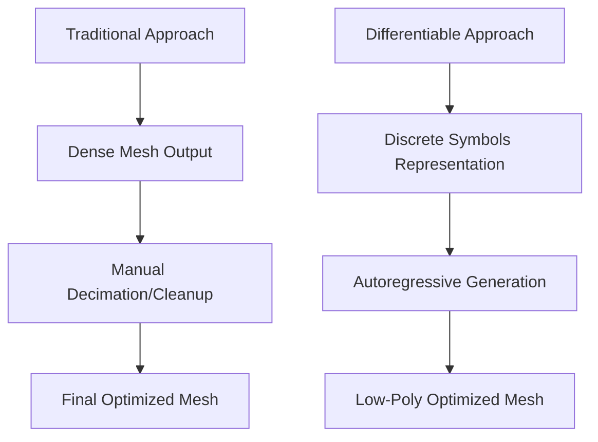
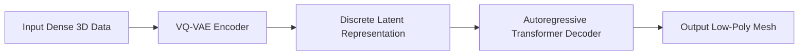
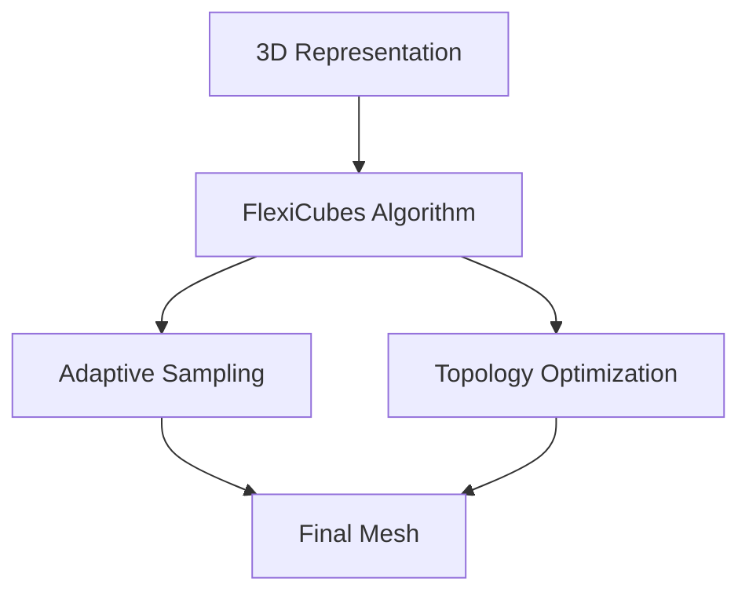
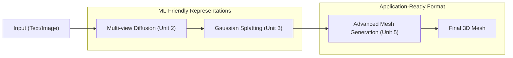

<!-- source: DeepWiki mcp.deepwiki.com · repo huggingface/ml-for-3d-course · page 5.2 Advanced Mesh Generation · fetched 2026-10-26 -->

# Advanced Mesh Generation

Relevant source files

The following files were used as context for generating this wiki page:

- [units/en/unit4/hands-on.mdx](units/en/unit4/hands-on.mdx)
- [units/en/unit4/mesh-generation.mdx](units/en/unit4/mesh-generation.mdx)

## Purpose and Scope

This document covers advanced techniques for generating 3D meshes that go beyond traditional methods like Marching Cubes. We focus on newer, differentiable approaches to mesh generation including MeshAnything, InstantMesh, and other state-of-the-art solutions. These techniques represent significant advancements in converting other 3D representations into optimized mesh models suitable for practical applications.

For information about the traditional Marching Cubes algorithm, see [Marching Cubes Algorithm](#5.1).

## Limitations of Traditional Mesh Generation

Traditional mesh generation techniques like Marching Cubes have several important limitations:

- **High polygon count**: The meshes produced are often extremely dense
- **Unoptimized topology**: Generated mesh topology isn't optimized for the underlying shape
- **Non-differentiability**: The discrete nature of mesh generation makes integration with differentiable ML pipelines difficult
- **Post-processing requirements**: Substantial manual clean-up and optimization is typically needed

Sources: [units/en/unit4/mesh-generation.mdx:1-4]()

## Differentiable Mesh Generation

Recent research has introduced differentiable approaches to mesh generation that address a fundamental challenge in 3D deep learning.

### The Non-differentiability Challenge

As noted in the course materials, mesh rendering traditionally involves discrete decisions (e.g., "Is this pixel inside the triangle?") which are non-differentiable. This has been a major roadblock for integrating mesh generation into end-to-end trainable machine learning pipelines.

### New Paradigm: Meshes as Discrete Symbols

The breakthrough approach treats mesh triangles as discrete symbols, similar to words in a language model. This enables:

- Autoregressive generation of mesh elements in sequence
- Learning from examples of existing meshes
- End-to-end differentiability in the generation pipeline

Sources: [units/en/unit4/mesh-generation.mdx:5-9]()

## MeshAnything Architecture

MeshAnything is a recent research project that converts dense meshes to low-poly meshes using techniques introduced in MeshGPT.

The architecture has two primary components:

1. **VQ-VAE Encoder**: Encodes dense 3D data into a discrete latent representation using Vector Quantization (VQ) Variational Autoencoder (VAE) techniques
2. **Autoregressive Transformer Decoder**: Generates the triangles of the mesh sequentially, treating mesh triangles as tokens in a sequence

Sources: [units/en/unit4/mesh-generation.mdx:11-19]()

### Current Limitations of MeshAnything

While MeshAnything represents a major step forward, it still has limitations:

- Results are comparable to or sometimes worse than traditional topology reduction methods like Blender's Decimate modifier
- Generated meshes often require significant manual refinement
- The approach is computationally intensive
- Non-commercial license restrictions limit widespread application

Sources: [units/en/unit4/mesh-generation.mdx:24-30]()

## Alternative Advanced Approaches

Several other advanced mesh generation techniques have emerged as alternatives to MeshAnything:

### Splat to Mesh Conversion

This approach converts Gaussian Splats directly to meshes. The process typically involves:

1. Extracting point cloud data from the Gaussian representation
2. Estimating surface normals
3. Applying surface reconstruction algorithms
4. Post-processing the resulting mesh

The Splat to Mesh tool is based on the original LGM codebase but is slow and resource-intensive.

Sources: [units/en/unit4/hands-on.mdx:9]()

### InstantMesh with FlexiCubes

InstantMesh represents another state-of-the-art approach that uses FlexiCubes for fast, high-quality mesh generation. It ranks highly on the 3D Arena leaderboard, indicating its effectiveness compared to other methods.

Sources: [units/en/unit4/hands-on.mdx:10]()

### MeshGPT and Open-Source Implementations

MeshGPT is the foundational research that MeshAnything builds upon. The open-source implementation "meshgpt-pytorch" provides the architecture (but not weights) for researchers and developers who want to experiment with differentiable mesh generation.

The key innovation in MeshGPT is treating mesh generation as a language modeling problem:
- Mesh vertices and faces are tokenized
- A transformer model predicts the next token in the sequence
- The model learns to generate coherent mesh structures

Sources: [units/en/unit4/hands-on.mdx:11]()

## Comparison of Advanced Mesh Generation Techniques

| Technique | Approach | Speed | Quality | Resource Requirements | License |
|-----------|----------|-------|---------|----------------------|---------|
| MeshAnything | Autoregressive transformer with VQ-VAE | Slow | High, but may require refinement | High | Non-commercial |
| Splat to Mesh | LGM-based conversion | Slow | Moderate | High | Open source |
| InstantMesh | FlexiCubes | Fast | High | Moderate | Commercial viability unclear |
| MeshGPT-pytorch | Autoregressive transformer | Varies | Varies (implementation only) | Moderate | Open source |

Sources: [units/en/unit4/hands-on.mdx:3-11](), [units/en/unit4/mesh-generation.mdx:26-30]()

## Integration with ML for 3D Pipeline

Advanced mesh generation represents the final step in the ML for 3D pipeline, converting ML-friendly 3D representations into practical mesh formats.

## Future Directions

The field of advanced mesh generation is rapidly evolving, with several promising research directions:

### Context-Aware Topology Reduction

Future improvements may include context-aware topology reduction that accounts for shape and deformation. This would enable more intelligent decimation of meshes, preserving detail where it matters most.

### Improved Differentiability

Research continues on making the entire pipeline more differentiable, which would enable end-to-end training and optimization of 3D generation models.

### Real-Time Performance

Many current approaches are computationally intensive. Future advancements will likely focus on improving speed while maintaining quality, making these techniques more practical for real-time applications.

Sources: [units/en/unit4/mesh-generation.mdx:24-30]()

## Practical Implementation Considerations

When implementing advanced mesh generation, consider:

1. **Resource Constraints**: Some methods like Splat to Mesh are "slow and resource-intensive." Evaluate your computational resources before choosing an approach.

2. **License Restrictions**: MeshAnything has a "non-commercial license," limiting its use in commercial projects.

3. **Quality vs. Speed Tradeoff**: Different techniques offer different balances between mesh quality and generation speed.

4. **Integration Requirements**: Consider how the mesh generation technique will integrate with your existing 3D pipeline, especially if using outputs from Multi-view Diffusion and Gaussian Splatting.

Sources: [units/en/unit4/hands-on.mdx:5-13]()

## Conclusion

Advanced mesh generation represents a significant breakthrough in 3D machine learning, addressing the limitations of traditional approaches and enabling more seamless integration with neural networks. While still evolving, these methods offer promising capabilities for creating high-quality, optimized meshes suitable for a wide range of applications.

The differentiable nature of newer approaches like MeshAnything opens up new possibilities for end-to-end trainable 3D generation pipelines, potentially revolutionizing how we create and manipulate 3D content.

---

