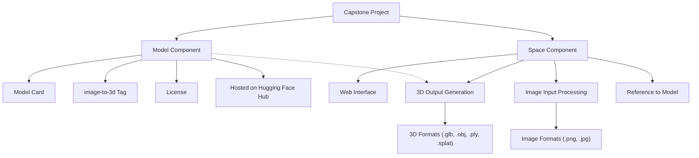
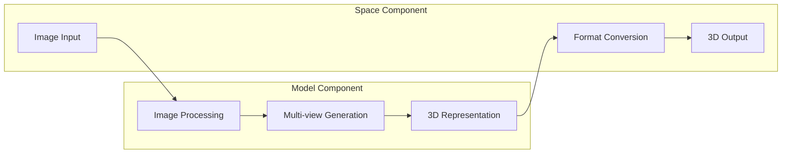
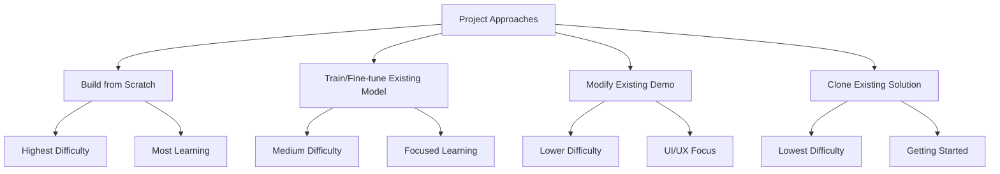
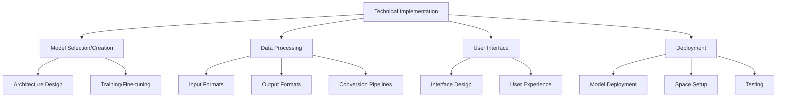

<!-- source: DeepWiki mcp.deepwiki.com · repo huggingface/ml-for-3d-course · page 6 Capstone Project · fetched 2026-10-26 -->

# Capstone Project

Relevant source files

The following files were used as context for generating this wiki page:

- [units/en/unit5/introduction.mdx](units/en/unit5/introduction.mdx)

## Purpose and Scope

The Capstone Project represents the culmination of the ML for 3D course, requiring students to create and host their own Generative 3D model and demo. This page outlines the project requirements, expected outcomes, and different approaches to completing the project. For detailed implementation steps, see [Project Implementation Guide](#6.1), and for deployment information, see [Deployment Options](#6.2).

Sources: [units/en/unit5/introduction.mdx:7-9]()

## Project Requirements

To successfully complete the Capstone Project and receive a course certificate, you must create and deploy both a model and a space on Hugging Face Hub:

### Model Requirements

| Requirement | Description |
|-------------|-------------|
| Hosting | Must be hosted under your username (e.g., `hf.co/{username}/{model_name}`) |
| Documentation | Must include a proper model card |
| Tagging | Must use the `image-to-3d` pipeline tag |
| Licensing | Must apply the correct license if applicable |

### Space Requirements

| Requirement | Description |
|-------------|-------------|
| Hosting | Must be hosted under your username (e.g., `hf.co/spaces/{username}/{space_name}`) |
| Functionality | Must convert images (`.png`, `.jpg`) to 3D formats (`.glb`, `.obj`, `.ply`, `.splat`) |
| Documentation | Must reference your model URL in the space README |

Sources: [units/en/unit5/introduction.mdx:11-21]()

## Project Architecture

The following diagram illustrates the high-level architecture of the Capstone Project components:

Sources: [units/en/unit5/introduction.mdx:11-21]()

## Image-to-3D Workflow

The following diagram shows the typical workflow for an image-to-3D model, which your project will likely implement:

Sources: [units/en/unit5/introduction.mdx:17-20]()

## Project Approaches

The Capstone Project is intentionally open-ended, allowing for multiple implementation approaches based on your skills, interests, and goals:

### Approach Comparison

| Approach | Difficulty | Focus | Recommended For |
|----------|------------|-------|-----------------|
| Build from scratch | High | Model architecture, ML fundamentals | Advanced students with ML background |
| Train/fine-tune existing model | Medium | ML training, data processing | Students with some ML experience |
| Modify existing demo | Low-Medium | User experience, interface design | Students interested in front-end |
| Clone existing solution | Low | Deployment, setup | Beginners or those with time constraints |

Sources: [units/en/unit5/introduction.mdx:22-30]()

## Starting Points and Resources

To help you get started, consider exploring these resources:

1. **3D Arena**: Browse the latest image-to-3D demos for inspiration and potential starting points at [Hugging Face's 3D Arena](https://huggingface.co/spaces/dylanebert/3d-arena).

2. **Example Implementation**: Study the example model ([LGM-full](https://huggingface.co/dylanebert/LGM-full)) and space ([LGM-tiny](https://huggingface.co/spaces/dylanebert/LGM-tiny)) to understand the expected deliverables.

3. **Community Support**: Join the Discord community to ask questions, share your work, and interact with fellow learners.

Sources: [units/en/unit5/introduction.mdx:31-45]()

## Technical Implementation Considerations

When implementing your Capstone Project, consider these key technical aspects:

### Typical Input-to-Output Process

| Stage | Input | Process | Output |
|-------|-------|---------|--------|
| 1. Initial Input | User-provided image (`.png`, `.jpg`) | Upload to space interface | Image data |
| 2. Image Processing | Image data | Pre-processing (resize, normalize, etc.) | Processed image |
| 3. Multi-view Generation | Processed image | Model inference (often diffusion-based) | Multiple views of object |
| 4. 3D Representation | Multiple views | 3D generation (e.g., Gaussian Splatting) | 3D representation data |
| 5. Format Conversion | 3D representation data | Conversion to desired format | 3D file (`.glb`, `.obj`, `.ply`, `.splat`) |
| 6. User Delivery | 3D file | Download or interactive viewing | Final 3D model for user |

Sources: [units/en/unit5/introduction.mdx:17-20]()

## Next Steps

Once you understand the requirements and have chosen your approach, you can:

1. Begin implementation by following the detailed guide in [Project Implementation Guide](#6.1)
2. Learn about hosting options in [Deployment Options](#6.2)
3. Join the community Discord for support and collaboration

Remember that this project is meant to demonstrate your understanding of the concepts covered throughout the course while giving you practical experience with generative 3D models.

Sources: [units/en/unit5/introduction.mdx:35-45]()

---

