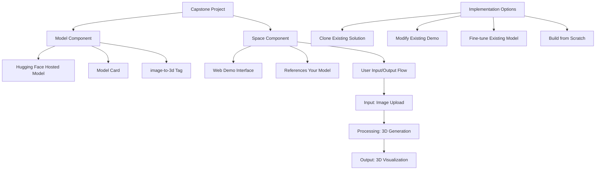
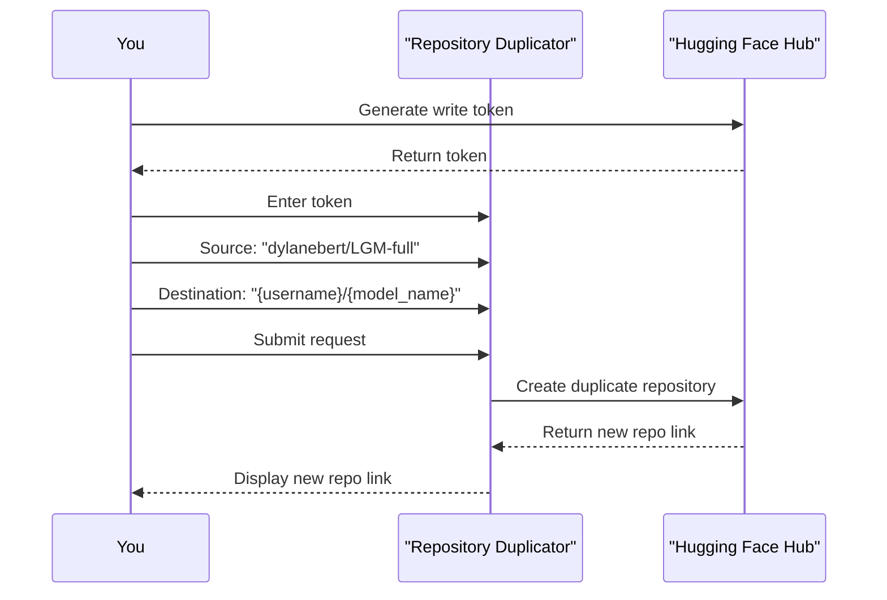
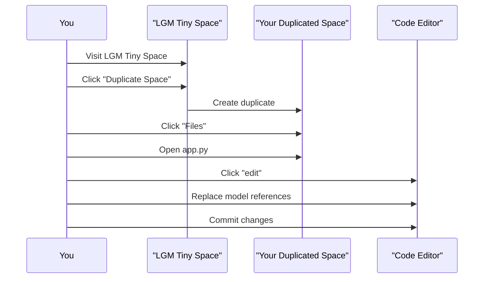
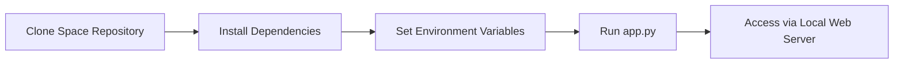
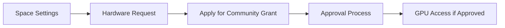

<!-- source: DeepWiki mcp.deepwiki.com · repo huggingface/ml-for-3d-course · page 6.1 Project Implementation Guide · fetched 2026-10-26 -->

# Project Implementation Guide

Relevant source files

The following files were used as context for generating this wiki page:

- [units/en/unit5/walkthrough.mdx](units/en/unit5/walkthrough.mdx)

## Purpose and Scope

This guide provides detailed, step-by-step instructions for implementing the capstone project for the ML for 3D course. It covers the process of setting up an image-to-3D conversion system by leveraging existing models and deploying them as interactive demos. For information about deployment options and advanced configurations, see [Deployment Options](#6.2).

## Capstone Project Architecture

Before diving into implementation, it's helpful to understand the overall architecture of the capstone project.

The project consists of two main components:
1. **Model** - A Hugging Face-hosted model that converts images to 3D
2. **Space** - A demo interface that allows users to interact with your model

Sources: [units/en/unit5/walkthrough.mdx:1-49]()

## Implementation Approaches

There are multiple ways to approach the capstone project, depending on your skill level and ambition:

| Approach | Difficulty | Description | Best for |
|----------|------------|-------------|----------|
| Clone Existing Solution | Beginner | Duplicate existing models and demos with minimal changes | Quick implementation |
| Modify Existing Demo | Intermediate | Customize UI and add features to existing demos | Enhancing user experience |
| Fine-tune Existing Model | Advanced | Improve performance of existing models with your own data | Better quality results |
| Build from Scratch | Expert | Create your own image-to-3D pipeline | Maximum learning |

This guide focuses on the simplest approach (Clone Existing Solution) to ensure everyone can complete the project successfully.

Sources: [units/en/unit5/walkthrough.mdx:1-49]()

## Step-by-Step Implementation Guide

Below is a detailed walkthrough of setting up your capstone project by leveraging the LGM (Learning Gaussian Mapping) model.

### 1. Duplicating the Model

The first step is to create your own copy of the pre-trained LGM model:

Detailed steps:
1. Go to the [Repository Duplicator](https://huggingface.co/spaces/huggingface-projects/repo_duplicator)
2. Generate a `write token` in your Hugging Face account settings
3. Enter `dylanebert/LGM-full` as the source repository
4. Set destination as `{username}/{model_name}` (replace with your actual username)
5. Click Submit and follow the link to your new model repository

This duplicated model will automatically appear in the Hugging Face model hub with the "image-to-3d" tag.

Sources: [units/en/unit5/walkthrough.mdx:7-21]()

### 2. Duplicating the Space

Next, create a demo interface that uses your duplicated model:

Detailed steps:
1. Go to the [LGM Tiny](https://huggingface.co/spaces/dylanebert/LGM-tiny) space
2. Click the "Duplicate Space" button
3. Select your preferred hardware (free hardware or GPU if available)
4. Navigate to the Files section and open `app.py`
5. Click "edit" to modify the code
6. Replace the two instances of `dylanebert/LGM-full` with your model path (`{username}/{model_name}`)
7. Commit your changes

After completing these steps, you'll have a functioning demo that meets the minimum requirements for the capstone project.

Sources: [units/en/unit5/walkthrough.mdx:23-37]()

## Running Options

Since the demo requires GPU resources, you have several options for running it:

### 1. Notebook Execution

You can validate your implementation by running it in a notebook environment like Google Colab.

### 2. Local Execution

Clone your space and run it on your local machine with GPU support.

### 3. Community GPU Grant

If you're building something innovative, you can apply for a community GPU grant through your space settings.

### 4. API-Based Execution

Use Hugging Face Inference API to run your model without requiring dedicated GPU hardware.

Sources: [units/en/unit5/walkthrough.mdx:39-48]()

## Enhancing Your Project

While the walkthrough provides the minimum requirements, consider these enhancements for a more impressive project:

### Model Card Documentation

Create a comprehensive model card that includes:

- Project description and purpose
- Model architecture details
- Performance metrics
- Example inputs and outputs
- Limitations and ethical considerations

### Custom User Interface

Improve the demo interface with features like:

- Multiple input methods (text, image upload, webcam)
- Camera controls for 3D visualization
- Export options for generated 3D models
- Progress indicators during generation

### Quality Improvements

Explore ways to improve the quality of your 3D generations:

- Add post-processing steps to clean up the output
- Implement texture refinement
- Add options for different levels of detail
- Support different 3D output formats

## Troubleshooting

Common issues you might encounter and their solutions:

| Problem | Possible Solution |
|---------|-------------------|
| Space fails to start | Check hardware requirements and availability |
| Model doesn't load | Verify the model path is correct in your code |
| Poor quality results | Try different input images or adjust processing parameters |
| Memory errors | Reduce batch size or model complexity |
| Slow generation | Consider optimization techniques or faster hardware |

## Conclusion

By following this implementation guide, you'll have created a complete image-to-3D conversion pipeline, hosted on Hugging Face, and accessible through a web interface. This project demonstrates your understanding of the ML for 3D concepts covered throughout the course and provides a foundation for further exploration in this exciting field.

For more advanced deployment options and configurations, refer to [Deployment Options](#6.2).

Sources: [units/en/unit5/walkthrough.mdx:1-49]()

---

