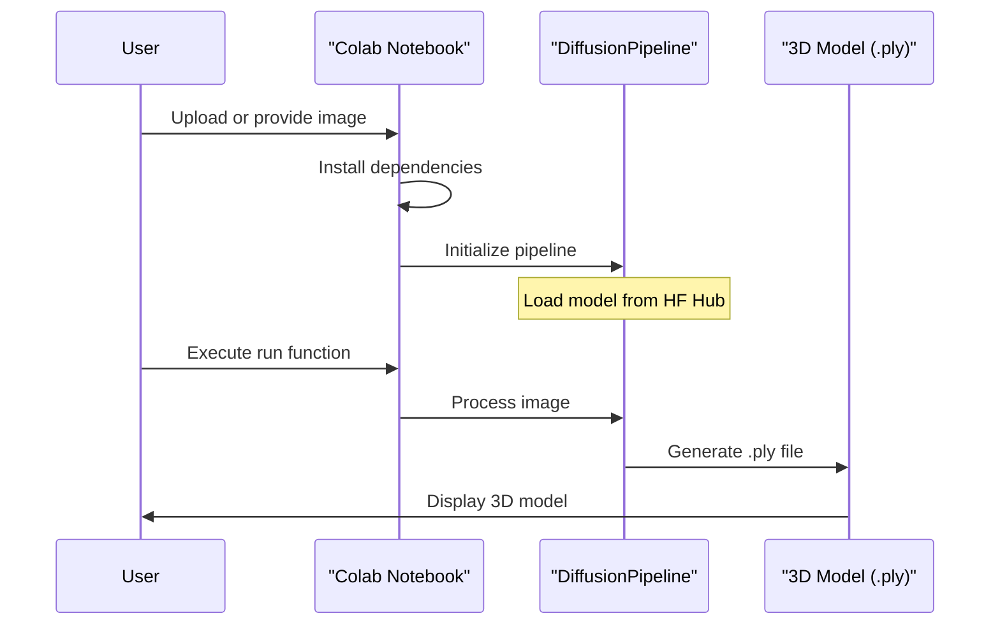
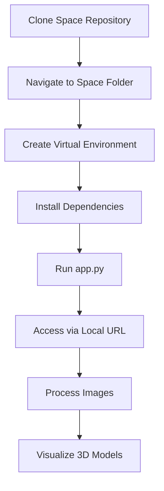
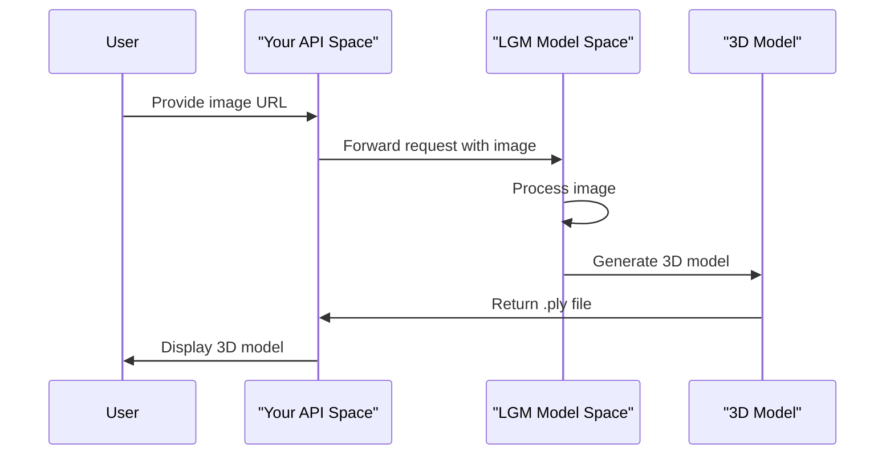
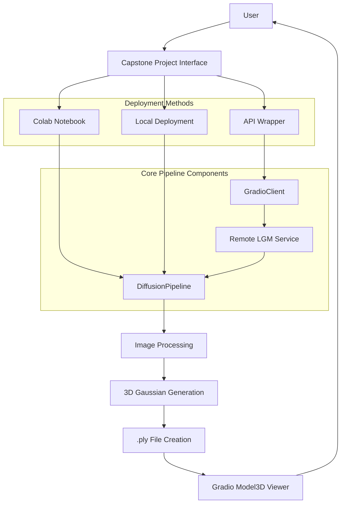

<!-- source: DeepWiki mcp.deepwiki.com · repo huggingface/ml-for-3d-course · page 6.2 Deployment Options · fetched 2026-10-26 -->

# Deployment Options

<details>
<summary>Relevant source files</summary>

The following files were used as context for generating this wiki page:

- [units/en/unit5/run-in-notebook.mdx](units/en/unit5/run-in-notebook.mdx)
- [units/en/unit5/run-locally.mdx](units/en/unit5/run-locally.mdx)
- [units/en/unit5/run-via-api.mdx](units/en/unit5/run-via-api.mdx)

</details>


## Purpose and Scope

This document outlines the available deployment methods for your capstone project in the ML for 3D course. After implementing your image-to-3D model, you'll need to make it accessible for testing and usage. This page covers three primary deployment approaches: running in a Colab notebook, running locally on your machine, and running via an API wrapper. For information about implementing the capstone project itself, see [Project Implementation Guide](#6.1).

## Overview of Deployment Methods

### Deployment Pathways Diagram

```mermaid
graph TD
    A["Capstone Project\nImage-to-3D Model"] --> B["Option 1: Run in Notebook\n(Colab)"]
    A --> C["Option 2: Run Locally\n(On your machine)"]
    A --> D["Option 3: Run via API\n(UI wrapper)"]
    
    B --> E["Benefits:\n- No local setup\n- GPU access\n- Quick validation"]
    C --> F["Benefits:\n- Full control\n- Custom hardware\n- No dependencies"]
    D --> G["Benefits:\n- Minimal code\n- CPU-only option\n- Focus on UI/UX"]
    
    H["3D Model Output\n(.ply file)"] <-- "generates" --- B
    H <-- "generates" --- C
    H <-- "generates" --- D
```

Sources: [units/en/unit5/run-in-notebook.mdx](), [units/en/unit5/run-locally.mdx](), [units/en/unit5/run-via-api.mdx]()

## 1. Run in Notebook (Colab)

This deployment option provides a convenient environment with GPU access for rapid testing and validation of your model.

### Setup Process

1. Access the notebook by clicking the "Open in Colab" button from [units/en/unit5/run-in-notebook.mdx:3]()
2. Change the runtime type to GPU
3. Install dependencies
4. Run the model code

### Implementation Workflow



Sources: [units/en/unit5/run-in-notebook.mdx:17-69]()

### Key Code Components

The implementation consists of four main functional blocks:

1. **Dependencies Installation**
   ```python
   !pip install -r https://huggingface.co/spaces/dylanebert/LGM-tiny/raw/main/requirements.txt
   ```

2. **Pipeline Setup**
   The pipeline is initialized using `DiffusionPipeline.from_pretrained()`, where you should replace the model path with your own model's path:
   
   ```python
   pipeline = DiffusionPipeline.from_pretrained(
       "YOUR_USERNAME/YOUR_MODEL_NAME",
       custom_pipeline="YOUR_USERNAME/YOUR_MODEL_NAME",
       torch_dtype=torch.float16,
       trust_remote_code=True,
   ).to("cuda")
   ```

3. **Run Function**
   The `run()` function processes the input image through the pipeline and returns a 3D model file:
   
   ```python
   def run(image):
       input_image = np.array(image, dtype=np.float32) / 255.0
       splat = pipeline("", input_image, guidance_scale=5, num_inference_steps=30, elevation=0)
       splat_file = "/tmp/output.ply"
       pipeline.save_ply(splat, splat_file)
       return splat_file
   ```

4. **Gradio Interface**
   Creates a user interface for interacting with the model:
   
   ```python
   demo = gr.Interface(
       fn=run,
       inputs="image",
       outputs=gr.Model3D(),
       # Additional configuration...
   )
   ```

Sources: [units/en/unit5/run-in-notebook.mdx:76-154]()

## 2. Run Locally

This option gives you full control over the deployment environment by running the model on your own hardware.

### System Requirements

- Python 3.10
- CUDA installation (for GPU acceleration)
- Git
- Tested on RTX 4090 with WSL2 Ubuntu 22.04 (your experience may vary)

### Setup and Execution Process



Sources: [units/en/unit5/run-locally.mdx:1-34]()

### Implementation Steps

1. **Clone your space repository**
   ```bash
   git clone https://huggingface.co/spaces/YOUR_USERNAME/YOUR_SPACE
   ```

2. **Navigate to the space folder**
   ```bash
   cd YOUR_SPACE
   ```

3. **Create and activate a virtual environment**
   ```bash
   python -m venv venv
   source venv/bin/activate
   ```

4. **Install dependencies**
   ```bash
   pip install -r requirements.txt
   ```

5. **Run the application**
   ```bash
   python app.py
   ```

Sources: [units/en/unit5/run-locally.mdx:9-34]()

## 3. Run via API

This deployment method uses an API wrapper around an existing model space, allowing you to focus on UI/UX or downstream applications without requiring a GPU.

### System Architecture



Sources: [units/en/unit5/run-via-api.mdx:7-33]()

### Implementation

The API wrapper uses the `gradio_client` library to connect to an existing model deployment:

```python
import gradio as gr
from gradio_client import Client, file

def run(image_url):
    client = Client("dylanebert/LGM-tiny")  # Use existing model space
    image = file(image_url)
    result = client.predict(image, api_name="/predict")
    return result

demo = gr.Interface(
    fn=run,
    inputs=gr.Textbox(label="Image URL"),
    outputs=gr.Model3D(),
    # Additional configuration...
)
```

This approach is CPU-friendly as it offloads the computation to a remote model. Note that it uses an existing model rather than your custom-trained one, which may be acceptable if your focus is on UI/UX or downstream applications.

Sources: [units/en/unit5/run-via-api.mdx:9-33]()

## Comparison of Deployment Options

| Feature | Run in Notebook | Run Locally | Run via API |
|---------|----------------|------------|------------|
| Hardware Requirements | None (uses Colab GPU) | Local GPU recommended | None (uses remote GPU) |
| Setup Complexity | Low | Medium | Low |
| Customization | Medium | High | Low |
| Performance | Good | Best (with proper hardware) | Depends on remote service |
| Uses Your Model | Yes | Yes | No (uses existing model) |
| Suitable for | Testing, Validation | Production, Heavy usage | UI/UX focus, Rapid prototyping |
| Dependencies | Managed by Colab | Self-managed | Minimal |

Sources: Synthesized from [units/en/unit5/run-in-notebook.mdx](), [units/en/unit5/run-locally.mdx](), [units/en/unit5/run-via-api.mdx]()

## Complete Deployment Architecture

### Integration Diagram



Sources: Synthesized from [units/en/unit5/run-in-notebook.mdx](), [units/en/unit5/run-locally.mdx](), [units/en/unit5/run-via-api.mdx]()

## Conclusion

Each deployment option offers different trade-offs in terms of setup complexity, hardware requirements, and customization potential. Choose the method that best aligns with your project goals and available resources:

- **Colab Notebook**: Ideal for quick testing and validation without local setup
- **Local Deployment**: Best for full control and customization with your own hardware
- **API Wrapper**: Suitable for focusing on UI/UX or downstream applications without GPU requirements

The recommended approach for most capstone projects is to start with Colab for initial testing and validation, then move to local deployment for final implementation and customization.

---

