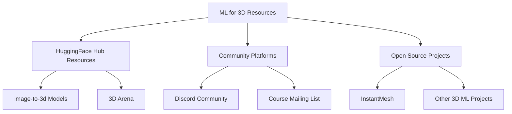
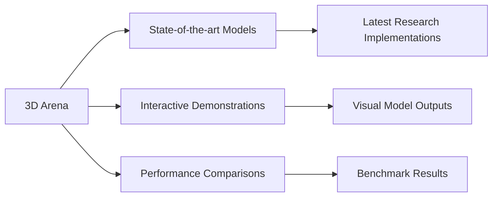
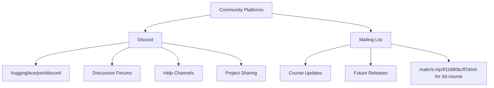
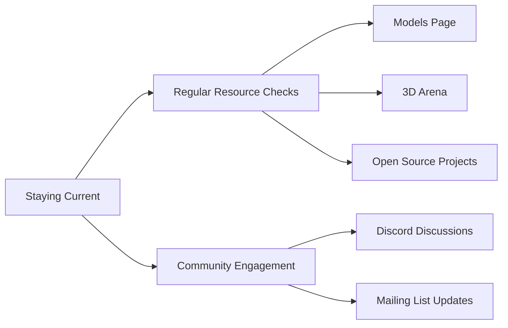

<!-- source: DeepWiki mcp.deepwiki.com · repo huggingface/ml-for-3d-course · page 7 Resources and Community · fetched 2026-10-26 -->

# Resources and Community

Relevant source files

The following files were used as context for generating this wiki page:

- [units/en/conclusion/conclusion.mdx](units/en/conclusion/conclusion.mdx)

This document catalogs the external resources and community platforms available for continuing your journey in Machine Learning for 3D. These resources will help you stay connected with the latest developments and the community as you apply what you've learned in the course.

## Overview of Available Resources

The ML for 3D ecosystem extends beyond this course with various tools, models, and community platforms that support continued learning and application development.

Sources: [units/en/conclusion/conclusion.mdx:5-9]()

## HuggingFace Hub Resources

The HuggingFace Hub provides several key resources for ML for 3D practitioners:

### Image-to-3D Models Collection

The HuggingFace models hub maintains a curated collection of image-to-3D models. These models implement various approaches to generating 3D content from images, allowing you to explore different techniques and their implementations.

### 3D Arena

3D Arena is an interactive platform that showcases the latest state-of-the-art in 3D generation. It provides a way to compare different approaches and stay informed about cutting-edge techniques in the field.

Sources: [units/en/conclusion/conclusion.mdx:7-8, 11]()

## Open Source Projects

Several open-source projects provide implementations, tools, and examples for ML in 3D:

### InstantMesh

InstantMesh is an open-source project for mesh generation that demonstrates advanced techniques for creating 3D meshes.

### Other Projects

The field is rapidly evolving with new open-source projects being released regularly. Monitoring repositories related to 3D generation can provide valuable insights and resources.

Sources: [units/en/conclusion/conclusion.mdx:9]()

## Community Engagement

### Discord Community

The HuggingFace Discord server provides a platform to connect with course instructors, fellow learners, and the broader ML community. It offers channels for discussions, troubleshooting help, and sharing your projects.

### Course Mailing List

To receive updates about future course releases and related materials, you can sign up for the dedicated ML for 3D course mailing list.

Sources: [units/en/conclusion/conclusion.mdx:15, 17]()

## Staying Current in a Rapidly Evolving Field

The field of ML for 3D is evolving at a remarkable pace, which can sometimes feel overwhelming. Here are strategies to stay informed about the latest developments:

1. **Monitor the image-to-3D models page** on HuggingFace for new models
2. **Follow 3D Arena** to track the latest state-of-the-art implementations
3. **Explore open-source projects** like InstantMesh to understand current approaches
4. **Subscribe to the course mailing list** for official updates
5. **Join the Discord community** for discussions on emerging techniques

Sources: [units/en/conclusion/conclusion.mdx:5-17]()

## Documentation System

For detailed information about how the course documentation is built and maintained, please refer to the [Documentation System](#7.1) page.

Sources: [units/en/conclusion/conclusion.mdx:1-17]()

---

