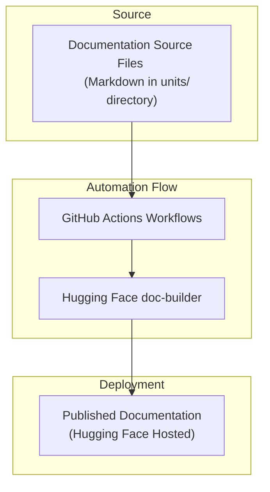
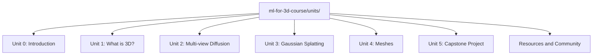
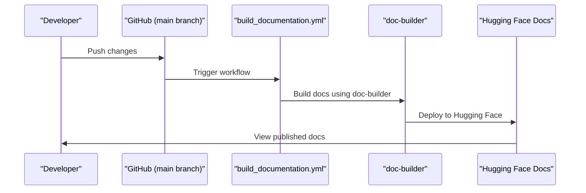
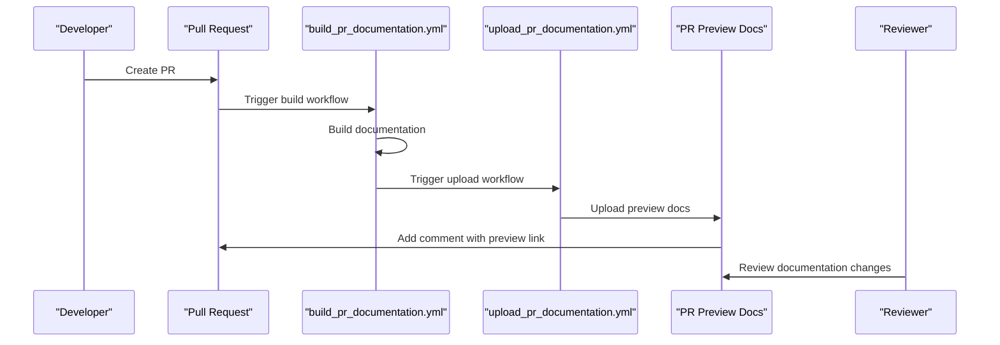
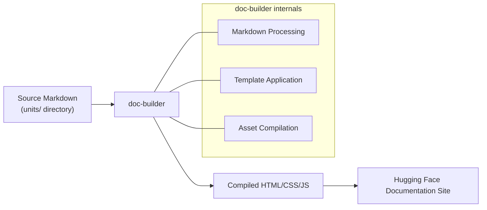

<!-- source: DeepWiki mcp.deepwiki.com · repo huggingface/ml-for-3d-course · page 7.1 Documentation System · fetched 2026-10-26 -->

# Documentation System

Relevant source files

The following files were used as context for generating this wiki page:

- [.github/workflows/build_documentation.yml](.github/workflows/build_documentation.yml)
- [.github/workflows/build_pr_documentation.yml](.github/workflows/build_pr_documentation.yml)
- [.github/workflows/upload_pr_documentation.yml](.github/workflows/upload_pr_documentation.yml)

## Purpose and Scope

This document explains the documentation system used for the ML for 3D course. It covers how the course documentation is built, maintained, and automatically deployed through GitHub workflows. The documentation system enables collaborative development of course materials while maintaining consistent, high-quality documentation for learners.

## Overview

The ML for 3D course uses Hugging Face's doc-builder system to generate and deploy documentation from markdown source files. The documentation is automatically built through GitHub Actions workflows and published to Hugging Face's documentation hosting service.

Sources: [.github/workflows/build_documentation.yml:14-17](), [.github/workflows/build_pr_documentation.yml:16-19]()

## Documentation Structure

The documentation source files are written in Markdown format and organized in the `ml-for-3d-course/units/` directory. This structure allows for logical organization of course materials into units, matching the course outline presented in the table of contents.

Sources: [.github/workflows/build_documentation.yml:16](), [.github/workflows/build_pr_documentation.yml:18]()

## Documentation Build System

The documentation is built using three GitHub Actions workflows that automate the process of generating and publishing documentation.

### Build Workflow for Main Branch

When changes are pushed to the main branch, the `build_documentation.yml` workflow is triggered, which builds the documentation and publishes it to the official documentation site.

Sources: [.github/workflows/build_documentation.yml:3-6](), [.github/workflows/build_documentation.yml:10-21]()

### Pull Request Documentation Preview

For pull requests, a two-step process is used to build and preview documentation changes:

1. The `build_pr_documentation.yml` workflow builds the documentation from the PR's branch
2. The `upload_pr_documentation.yml` workflow then uploads this documentation to a preview location

This approach allows reviewers to see documentation changes before they're merged into the main branch.

Sources: [.github/workflows/build_pr_documentation.yml:3-4](), [.github/workflows/upload_pr_documentation.yml:3-7]()

## Configuration Details

The documentation build process uses specific configuration parameters to control how the documentation is generated:

| Parameter | Value | Description |
|-----------|-------|-------------|
| package | ml-for-3d-course | Name of the package/repository |
| package_name | ml-for-3d-course | Display name of the package |
| path_to_docs | ml-for-3d-course/units/ | Location of documentation source files |
| additional_args | --not_python_module | Specifies this is not a Python module documentation |
| languages | en | Documentation language |

Sources: [.github/workflows/build_documentation.yml:13-18](), [.github/workflows/build_pr_documentation.yml:15-20]()

## Documentation Builder Integration

The documentation system leverages Hugging Face's doc-builder, a specialized tool for building and deploying documentation for Hugging Face projects. This integration provides:

1. Consistent formatting across all Hugging Face documentation
2. Automatic handling of navigation and cross-referencing
3. Support for code syntax highlighting
4. Responsive design for all devices
5. Search functionality

Sources: [.github/workflows/build_documentation.yml:11-12](), [.github/workflows/build_pr_documentation.yml:12-13](), [.github/workflows/upload_pr_documentation.yml:11-12]()

## Authentication and Deployment

The documentation system uses GitHub Secrets to securely manage authentication tokens for deploying to Hugging Face:

| Secret | Purpose |
|--------|---------|
| HUGGINGFACE_PUSH | Authentication for pushing to Hugging Face repositories |
| HF_DOC_BUILD_PUSH | Authentication for doc-builder to deploy documentation |
| COMMENT_BOT_TOKEN | Authentication for posting preview links on PRs |

Sources: [.github/workflows/build_documentation.yml:19-21](), [.github/workflows/upload_pr_documentation.yml:14-16]()

## Contributing to Documentation

When contributing to the course documentation:

1. Make changes to the Markdown files in the `units/` directory
2. Submit a pull request with your changes
3. The documentation preview will be automatically built and linked in your PR
4. After review and merge, the official documentation will be automatically updated

This automated workflow ensures that documentation remains up-to-date with the latest course content while providing a convenient preview system for reviewing changes.