# Page: ML for 3D Course Overview

# ML for 3D Course Overview

<details>
<summary>Relevant source files</summary>

The following files were used as context for generating this wiki page:

- [README.md](README.md)
- [units/en/_toctree.yml](units/en/_toctree.yml)
- [units/en/unit0/introduction.mdx](units/en/unit0/introduction.mdx)
- [units/en/unit2/hands-on-1.mdx](units/en/unit2/hands-on-1.mdx)

</details>


## Purpose and Scope

This document provides a comprehensive overview of the Machine Learning for 3D Course, which teaches students how to create and work with 3D content using state-of-the-art machine learning techniques. The course covers the full 3D generation pipeline, from creating multi-view representations to advanced mesh generation. For detailed information about prerequisites and setup requirements, see [Prerequisites and Setup](#1.2).

Sources: [units/en/unit0/introduction.mdx:18-25](), [README.md:1-7]()

## Course Structure

The ML for 3D Course follows a structured learning path, beginning with fundamental concepts and progressively advancing to specialized techniques and practical applications.

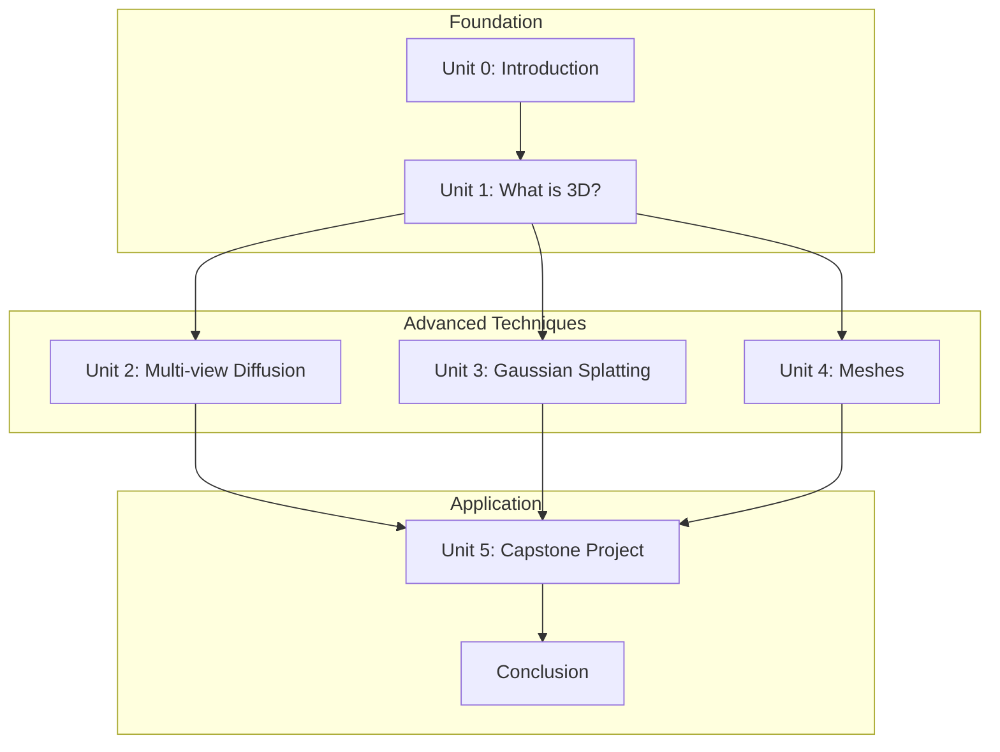

Sources: [units/en/_toctree.yml:1-72]()

## Core Units Description

### Unit 0: Introduction
Provides an overview of the current state of machine learning for 3D, explains why recent developments are significant, and introduces the course structure.

### Unit 1: What is 3D?
Covers fundamental concepts of 3D representations, distinguishing between traditional mesh-based approaches and newer non-mesh representations optimized for machine learning workflows.

### Unit 2: Multi-view Diffusion
Explores techniques for generating multiple views of 3D objects from single images or text prompts using diffusion models.

### Unit 3: Gaussian Splatting
Introduces 3D Gaussian Splatting, a real-time rendering technique that represents 3D scenes as a collection of 3D Gaussians.

### Unit 4: Meshes
Covers techniques for converting machine learning-friendly 3D representations into traditional meshes suitable for various applications.

### Unit 5: Capstone Project
Guides students through building a complete image-to-3D generation model and deploying it as a usable demo.

Sources: [units/en/_toctree.yml:1-72](), [units/en/unit0/introduction.mdx:18-25]()

## Generative 3D Pipeline Architecture

The course follows a logical progression that mirrors the typical generative 3D pipeline used in modern ML systems.

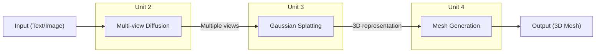

The pipeline consists of three main stages:
1. **Multi-view Diffusion**: Generating multiple 2D views of a 3D object from a text prompt or image
2. **Gaussian Splatting**: Converting multiple views into an ML-friendly 3D representation
3. **Mesh Generation**: Converting the 3D representation into a traditional mesh format

Sources: [units/en/_toctree.yml:21-56](), [units/en/unit2/hands-on-1.mdx:1-44]()

## 3D Representation Taxonomy

The course explains different approaches to representing 3D data, which is fundamental to understanding the entire ML for 3D pipeline.

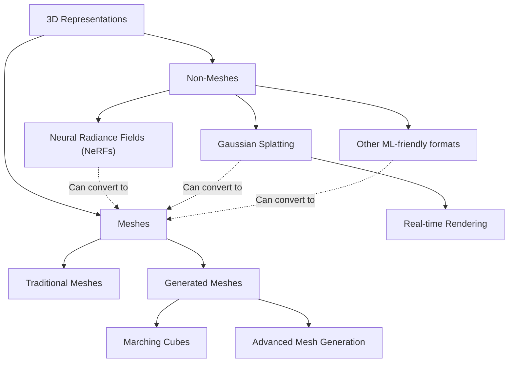

Sources: [units/en/_toctree.yml:11-20](), [units/en/_toctree.yml:47-56]()

## Learning Objectives

By completing this course, students will:

| Objective | Relevant Units |
|-----------|----------------|
| Understand different 3D representations | Unit 1 |
| Generate multiple views using diffusion models | Unit 2 |
| Create 3D scenes using Gaussian Splatting | Unit 3 |
| Convert between different 3D formats | Unit 4 |
| Build and deploy a complete image-to-3D pipeline | Unit 5 |

Sources: [units/en/unit0/introduction.mdx:18-25]()

## Course Resources

The course provides multiple learning formats to accommodate different learning styles:

- **Written tutorials**: Comprehensive documentation available on the Hugging Face course platform
- **Video content**: Available on YouTube through the [IndividualKex](https://www.youtube.com/@IndividualKex) channel
- **Code examples**: Available in the [GitHub repository](https://github.com/huggingface/ml-for-3d-course)
- **Community support**: The Hugging Face Discord server (#3d channel) provides a place to ask questions and share work

Sources: [units/en/unit0/introduction.mdx:28-35](), [README.md:1-7]()

## Course Author

The ML for 3D Course is created by [Dylan Ebert](https://twitter.com/dylan_ebert_), a developer advocate at Hugging Face specializing in 3D technologies. Dylan is also known as [IndividualKex](https://www.youtube.com/@IndividualKex) on YouTube, where he creates educational content on various technical topics.

Sources: [units/en/unit0/introduction.mdx:26-30](), [README.md:14-15]()

## Implementation Components

The course teaches students how to work with several key technologies and tools:

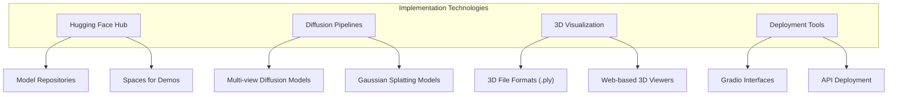

Sources: [units/en/_toctree.yml:57-68](), [units/en/unit2/hands-on-1.mdx:1-44]()

## Staying Updated

To receive updates as new course content is released, students can:

1. Sign up for the course mailing list at the link provided in the course introduction
2. Join the Hugging Face Discord community (#3d channel)
3. Watch the GitHub repository for updates

Sources: [units/en/unit0/introduction.mdx:14-16](), [units/en/unit0/introduction.mdx:32-34](), [README.md:7]()

## Citation

For academic or research purposes, the course can be cited using the following BibTeX format:

```
@misc{ml-for-3d-course,
  author = {Dylan Ebert},
  title = {Hugging Face Machine Learning for 3D Course},
  year = {2024},
  publisher = {GitHub},
  note = {GitHub repository},
  howpublished = {\url{https://github.com/huggingface/ml-for-3d-course}},
}
```

Sources: [README.md:9-22]()

---

# Page: Course Context and Motivation

# Course Context and Motivation

<details>
<summary>Relevant source files</summary>

The following files were used as context for generating this wiki page:

- [units/en/unit0/whats-going-on.mdx](units/en/unit0/whats-going-on.mdx)
- [units/en/unit0/why-does-it-matter.mdx](units/en/unit0/why-does-it-matter.mdx)

</details>


This document explains the technical context and motivation behind machine learning for 3D generation and representation. It covers the current state of ML for 3D, its importance across different domains, and the challenges in 3D representation that this course aims to address. For information on technical requirements needed to follow the course, see [Prerequisites and Setup](#1.2).

## The Current State of ML for 3D

While machine learning has reached impressive maturity in language and vision domains, the 3D domain is approaching but has not yet reached its tipping point.

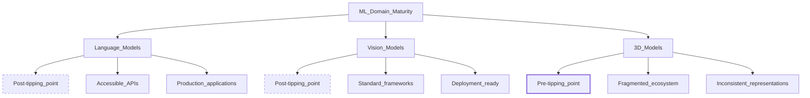

The 3D ML domain faces several technical challenges:

1. Rapid research evolution without standardization
2. Inconsistent definitions of what "3D" means in different contexts
3. Limited transparency in how research results are implemented

Sources: [units/en/unit0/whats-going-on.mdx:3-15](), [units/en/unit0/whats-going-on.mdx:18-25]()

## Why ML for 3D Matters

### As a Practical Tool

3D content is fundamental to numerous industries, with ML approaches offering potential for automation and enhancement similar to what we've seen in 2D domains.

| Industry | ML for 3D Application |
|----------|------------------------|
| Gaming | Automated asset creation |
| Film/VFX | Character/environment generation |
| E-commerce | Product visualization |
| Architecture | Design visualization |
| Manufacturing | CAD automation |

### For General Intelligence

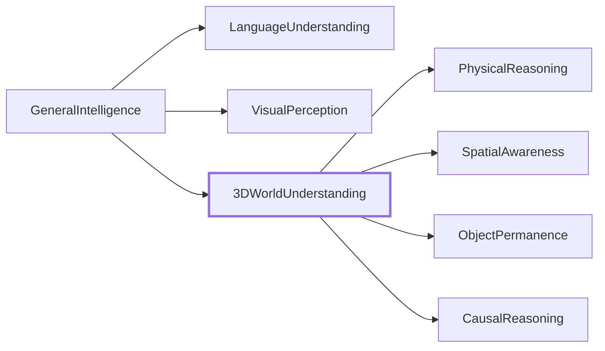

Understanding the 3D world is considered crucial for advancing artificial intelligence beyond current capabilities. As stated in the course materials: "In order to achieve general intelligence, AI needs to be grounded to the 3D world." However, there remains significant debate about how 3D should be represented and understood in AI systems.

### For Different Practitioners

The ML for 3D course serves diverse technical audiences:

| Practitioner Type | Value Proposition |
|-------------------|-------------------|
| ML Engineers | Apply ML techniques to 3D problems |
| 3D Artists/Developers | Integrate ML into 3D workflows |
| Newcomers | Build foundational knowledge in an emerging field |

Sources: [units/en/unit0/why-does-it-matter.mdx:3-29]()

## The 3D Representation Challenge

One of the core technical challenges in ML for 3D is the diversity of representation methods, each with different strengths and limitations.

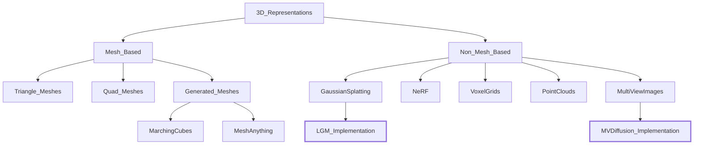

When encountering 3D results in research, it's often unclear what representation is being used:
- Is it a mesh?
- A Gaussian splat?
- A Neural Radiance Field (NeRF)?
- Multi-view diffusion?

Each representation requires different technical approaches and has different trade-offs in terms of quality, rendering speed, and ease of generation.

Sources: [units/en/unit0/whats-going-on.mdx:18-25]()

## ML for 3D Course Pipeline

This course implements an end-to-end ML for 3D pipeline with the following components:

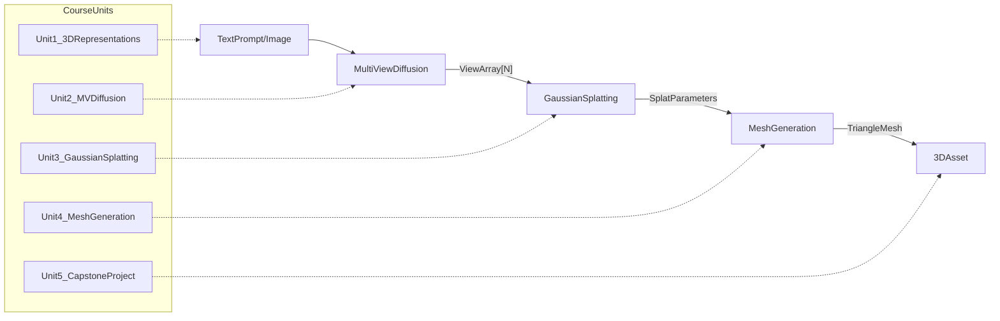

The course structure reflects the technical pipeline stages:

1. Understanding 3D representations (Unit 1)
2. Generating multiple views using diffusion models (Unit 2)
3. Converting views to 3D representation via Gaussian splatting (Unit 3)
4. Transforming to mesh format for standard 3D applications (Unit 4)
5. Building an integrated application in the capstone project (Unit 5)

Each unit provides both theoretical understanding and practical implementation knowledge of its respective component in the pipeline.

Sources: [units/en/unit0/whats-going-on.mdx:24-25](), [units/en/unit0/why-does-it-matter.mdx:21-29]()

## The Evolving Landscape of 3D Generation

The field of ML for 3D is rapidly evolving, with new research emerging constantly. This creates both challenges and opportunities for practitioners.

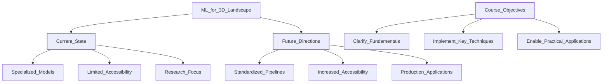

This course aims to provide clarity in this complex landscape by:

1. Explaining fundamental concepts and representation methods
2. Implementing practical techniques that bridge research and application
3. Providing a framework for evaluating new developments in the field

By understanding the current state and technical foundations of ML for 3D, learners will be better equipped to contribute to and leverage advances in this rapidly evolving field.

Sources: [units/en/unit0/whats-going-on.mdx:11-15](), [units/en/unit0/why-does-it-matter.mdx:21-29]()

---

# Page: Prerequisites and Setup

# Prerequisites and Setup

<details>
<summary>Relevant source files</summary>

The following files were used as context for generating this wiki page:

- [units/en/unit0/how-to-do-it-yourself.mdx](units/en/unit0/how-to-do-it-yourself.mdx)

</details>


This page outlines the technical requirements, knowledge prerequisites, and setup instructions needed to successfully follow the ML for 3D course. It covers the essential software, hardware requirements, and configuration steps required before starting the hands-on components of the course.

## Knowledge Prerequisites

Before beginning this course, you should have a basic understanding of:

| Prerequisite | Recommended Level | Why It's Important |
|--------------|-------------------|-------------------|
| Python programming | Intermediate | All code examples use Python |
| Machine learning concepts | Basic | Understanding of neural networks, training, and inference |
| Computer graphics terms | Familiarity | Concepts like meshes, textures, and rendering |
| Git workflows | Basic | For accessing course materials and submitting projects |

If you're lacking in any of these areas, don't worry - the course is designed to explain core concepts as they appear, but having this foundation will make following along easier.

## Software Requirements

The following software tools are essential for completing this course:

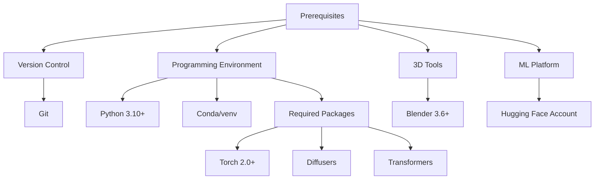

Sources: [units/en/unit0/how-to-do-it-yourself.mdx:5-10]()

### Detailed Software Requirements

1. **Git**: For version control and accessing course materials
   - Installation guide: https://git-scm.com/downloads

2. **Python**: Python 3.10 or newer is recommended
   - Installation via Anaconda is recommended for managing environments

3. **Hugging Face Hub Account**: Required for accessing models and sharing your projects
   - Create an account at https://huggingface.co/join

4. **Blender**: Required for the mesh manipulation sections (primarily Unit 4)
   - Version 3.6+ recommended
   - Only required for later units

## Hardware Requirements

To run the models and exercises in this course effectively, your system should meet:

| Component | Minimum | Recommended | Notes |
|-----------|---------|-------------|-------|
| CPU | 4 cores | 8+ cores | Multi-threading helps with data processing |
| RAM | 16GB | 32GB+ | Required for larger models |
| GPU | 4GB VRAM | 8GB+ VRAM | NVIDIA GPU with CUDA support recommended |
| Storage | 20GB free | 50GB+ free | For models, datasets, and generated content |
| Internet | Broadband | High-speed | For downloading models (can be several GB) |

**Important Note**: While a GPU is highly recommended for this course, alternative options include:
- Using Google Colab for GPU-accelerated notebooks
- Using Hugging Face Spaces for inference
- Running models with CPU-only mode (significantly slower)

## Environment Setup

Follow these steps to set up your environment for the course:

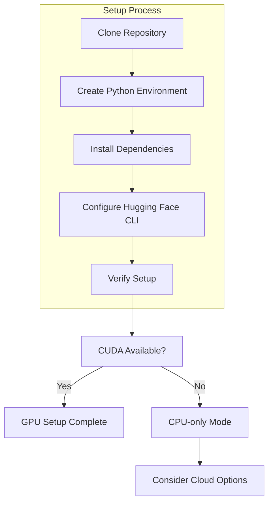

### Step 1: Clone the Course Repository

```bash
git clone https://github.com/huggingface/ml-for-3d-course.git
cd ml-for-3d-course
```

### Step 2: Create Python Environment

Using Conda (recommended):

```bash
conda create -n ml3d python=3.10
conda activate ml3d
```

Or using venv:

```bash
python -m venv ml3d-env
# On Windows
ml3d-env\Scripts\activate
# On Unix/MacOS
source ml3d-env/bin/activate
```

### Step 3: Install Dependencies

```bash
pip install -r requirements.txt
```

### Step 4: Hugging Face Configuration

```bash
# Login to Hugging Face Hub
huggingface-cli login
```

### Step 5: Verify Your Setup

Run the verification script to confirm your environment is properly configured:

```bash
python verify_setup.py
```

## Course Architecture and Components

The following diagram shows how the prerequisites relate to the different units in the course:

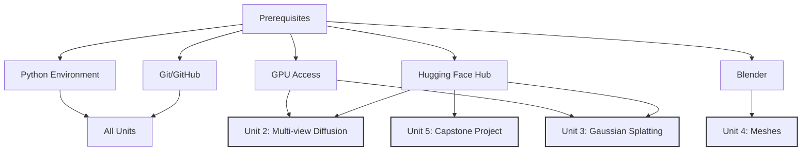

## Troubleshooting Common Issues

| Issue | Possible Solution |
|-------|-------------------|
| CUDA not found | Ensure you have installed the correct version of PyTorch for your CUDA version |
| Out of memory errors | Reduce batch size in configuration or use gradient accumulation |
| Slow generation times | Check if you're using GPU acceleration; consider cloud options |
| Package conflicts | Use a clean virtual environment; check requirements.txt for specific versions |
| Hugging Face authentication issues | Verify your token is correctly set; regenerate if necessary |

## What's Next

Once you have completed setting up your environment, you're ready to dive into the course content. The next unit will introduce you to 3D representations and the fundamentals needed to understand the generative 3D pipeline.

Proceed to [3D Representations](#2) to begin learning about the different ways to represent 3D data in machine learning contexts.

Don't forget to join the course Discord community for additional support and to connect with fellow learners.

Sources: [units/en/unit0/how-to-do-it-yourself.mdx:3-23]()

---

# Page: 3D Representations

# 3D Representations

<details>
<summary>Relevant source files</summary>

The following files were used as context for generating this wiki page:

- [units/en/unit1/introduction.mdx](units/en/unit1/introduction.mdx)
- [units/en/unit1/meshes.mdx](units/en/unit1/meshes.mdx)
- [units/en/unit1/non-meshes.mdx](units/en/unit1/non-meshes.mdx)

</details>


This document provides an overview of different approaches to representing 3D data in machine learning contexts. It covers both traditional and ML-friendly 3D representations, their relationships, and how they fit into the broader 3D generation pipeline. For specific implementations, see [Multi-view Diffusion](#3), [Gaussian Splatting](#4), and [Mesh Generation](#5).

## Overview: The 3D Representation Landscape

3D representations are methods for encoding three-dimensional objects and scenes in digital formats. In the context of machine learning for 3D, different representations offer varying tradeoffs in terms of rendering speed, ML compatibility, and ease of manipulation.

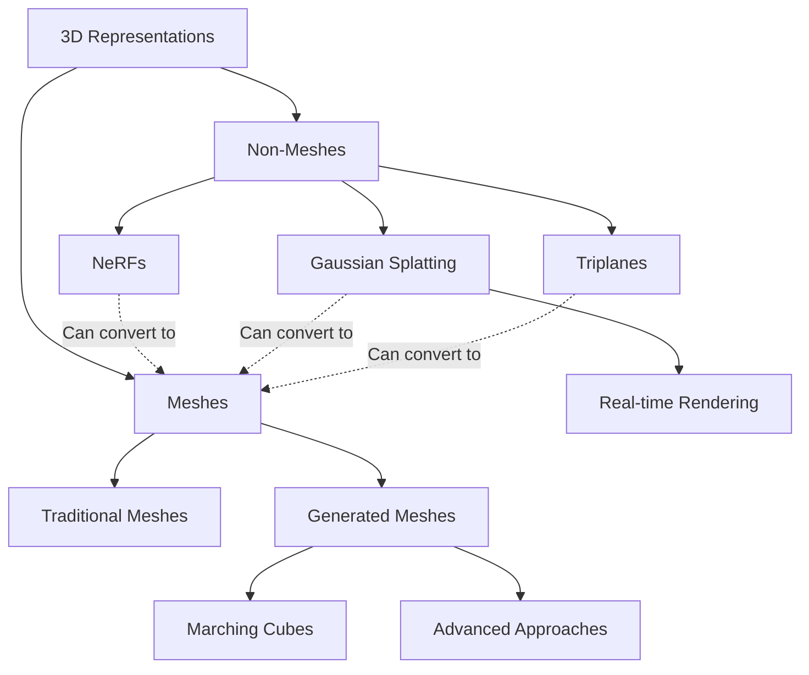

**Diagram Title: 3D Representation Taxonomy**

Sources: units/en/unit1/meshes.mdx, units/en/unit1/non-meshes.mdx

The 3D representations landscape can be broadly divided into two categories:
1. **Mesh representations**: The traditional standard for 3D applications
2. **Non-mesh representations**: More ML-friendly alternatives often used in research

## Mesh Representations

A mesh is a collection of vertices, edges, and faces that define a 3D object. They are the predominant representation in real-world 3D applications including games, animation, CAD, and virtual reality.

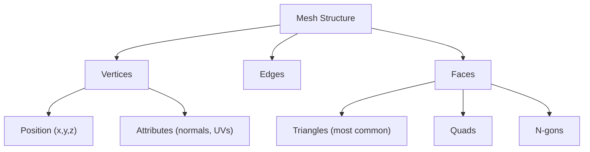

**Diagram Title: Mesh Component Structure**

Sources: units/en/unit1/meshes.mdx:5-7

### Advantages and Challenges

| Aspect | Details |
|--------|---------|
| **Advantages** | • Industry standard with established tooling<br>• Efficient for real-time rendering<br>• Intuitive for human creators |
| **ML Challenges** | • Variable topology making standardization difficult<br>• Complex structure not naturally compatible with neural networks<br>• Limited differentiability due to discrete nature |

The incompatibility with machine learning has led to a two-step approach in current 3D generation:
1. ML models generate non-mesh representations
2. These representations are converted to meshes (typically using Marching Cubes algorithm from the 1980s)

This creates a gap between 3D research (advancing non-mesh representations) and 3D applications (requiring meshes).

Sources: units/en/unit1/meshes.mdx:11-22

## Non-mesh Representations

Non-mesh representations are alternative ways to define 3D objects that are more compatible with machine learning approaches. They have gained popularity in research because they are often more suitable for neural network processing.

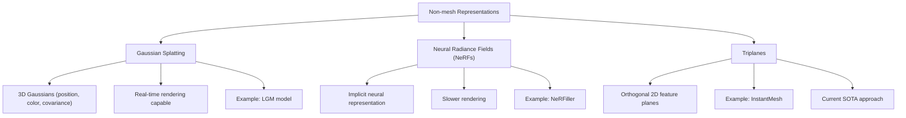

**Diagram Title: ML-Friendly 3D Representation Types**

Sources: units/en/unit1/non-meshes.mdx:5-9

### Key Non-mesh Representation Types

1. **Triplanes**: Used in state-of-the-art models like InstantMesh, triplanes represent 3D data using orthogonal 2D feature planes.

2. **Neural Radiance Fields (NeRFs)**: Implicit neural representations that encode 3D scenes as continuous functions mapping 3D coordinates to color and density. Used in models like NeRFiller.

3. **Gaussian Splatting**: A representation that models 3D scenes as collections of 3D Gaussians with associated colors, positions, and covariance matrices. Used in models like LGM.

Sources: units/en/unit1/non-meshes.mdx:5-9

### Gaussian Splatting: A Special Case

Gaussian Splatting deserves special attention because it bridges research and application:

- Capable of real-time rendering, unlike most other non-mesh representations
- Supports features like animation, physics (in hybrid approaches), and lighting
- Could potentially serve as an alternative to meshes in some applications
- Maintains compatibility with neural network architectures

However, since the existing 3D ecosystem is built around meshes, Gaussian splatting is likely to complement rather than replace meshes entirely.

Sources: units/en/unit1/non-meshes.mdx:19-25

## The 3D Generation Pipeline

The modern generative 3D pipeline builds on these different representations to create a workflow from initial input to final 3D model.

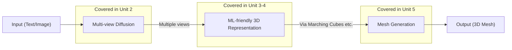

**Diagram Title: Generative 3D Pipeline**

Sources: units/en/unit1/meshes.mdx:15-18, units/en/unit1/non-meshes.mdx:29-33

### Pipeline Components

1. **Input Processing**: Starting with text or images as prompts for 3D generation
2. **Multi-view Generation**: Creating consistent 2D views of the desired 3D object
3. **Non-mesh Representation**: Converting multi-view data into an ML-friendly 3D representation (often Gaussian Splatting or Triplanes)
4. **Mesh Conversion**: Converting the non-mesh representation to a mesh for real-world applications

This pipeline reflects the current state of 3D machine learning, where there's still a gap between research (focused on steps 1-3) and applications (requiring the final output of step 4).

## Current State and Future Directions

The field of 3D representations is rapidly evolving, with several key trends:

| Representation | Current State | Future Potential |
|----------------|--------------|-----------------|
| **Meshes** | Standard for applications but challenging for ML | Improved direct generation methods |
| **NeRFs** | Popular in research but slow rendering | Better optimization for real-time use |
| **Triplanes** | Current SOTA approach for generation | Evolving rapidly with new architectures |
| **Gaussian Splatting** | Promising for real-time ML applications | Growing ecosystem for animation and interaction |

While traditional approaches have relied on Marching Cubes (from the 1980s) to convert ML-friendly representations to meshes, newer techniques are beginning to emerge that may bridge this gap more effectively.

In this course, we'll focus on both meshes and Gaussian Splatting, as they represent both the established standard and a promising emerging approach for 3D representation in machine learning.

Sources: units/en/unit1/meshes.mdx:24-28, units/en/unit1/non-meshes.mdx:29-33

## Conclusion

3D representations form the foundation of how we store, generate, and interact with 3D data. Understanding the different approaches and their tradeoffs is essential for working effectively in 3D machine learning.

This course will build on this foundation by exploring:
- How to generate multi-view images ([Multi-view Diffusion](#3))
- Working with Gaussian Splatting ([Gaussian Splatting](#4))
- Converting to and working with meshes ([Mesh Generation](#5))

These components together will enable you to build complete 3D generation pipelines from input to final 3D model.

---

# Page: Mesh Representations

# Mesh Representations

<details>
<summary>Relevant source files</summary>

The following files were used as context for generating this wiki page:

- [units/en/unit1/meshes.mdx](units/en/unit1/meshes.mdx)

</details>


## Purpose and Scope

This document explains mesh representations as the traditional approach to 3D data representation in computer graphics and their significance in machine learning for 3D applications. While meshes are the industry standard for 3D content creation and rendering, they present unique challenges in ML contexts. For information about alternative representations more suitable for ML workflows, see [Non-mesh Representations](#2.2).

## What is a Mesh?

A mesh is a collection of vertices, edges, and faces that define the shape of a 3D object. This representation is the foundation of virtually all 3D applications in gaming, visual effects, computer-aided design, and virtual reality.

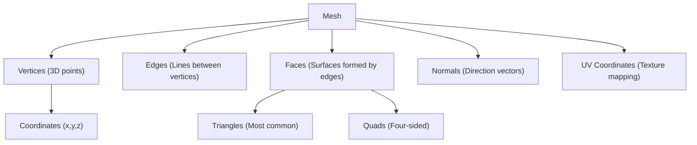

Sources: [units/en/unit1/meshes.mdx:3-9]()

### Core Components

A 3D mesh is defined by three fundamental elements:

| Component | Description | Purpose |
|-----------|-------------|---------|
| Vertices | Points in 3D space with (x,y,z) coordinates | Define the precise geometry positions |
| Edges | Lines connecting two vertices | Define the connectivity between points |
| Faces | Surfaces bounded by edges (typically triangles) | Define the actual visible surfaces |

Additional data often associated with meshes includes:

- **Normals**: Vectors perpendicular to faces that determine how light interacts with surfaces
- **UV coordinates**: 2D mapping coordinates that define how textures are applied
- **Material properties**: Surface characteristics like color, reflectivity, and roughness

## Mesh Data Structures

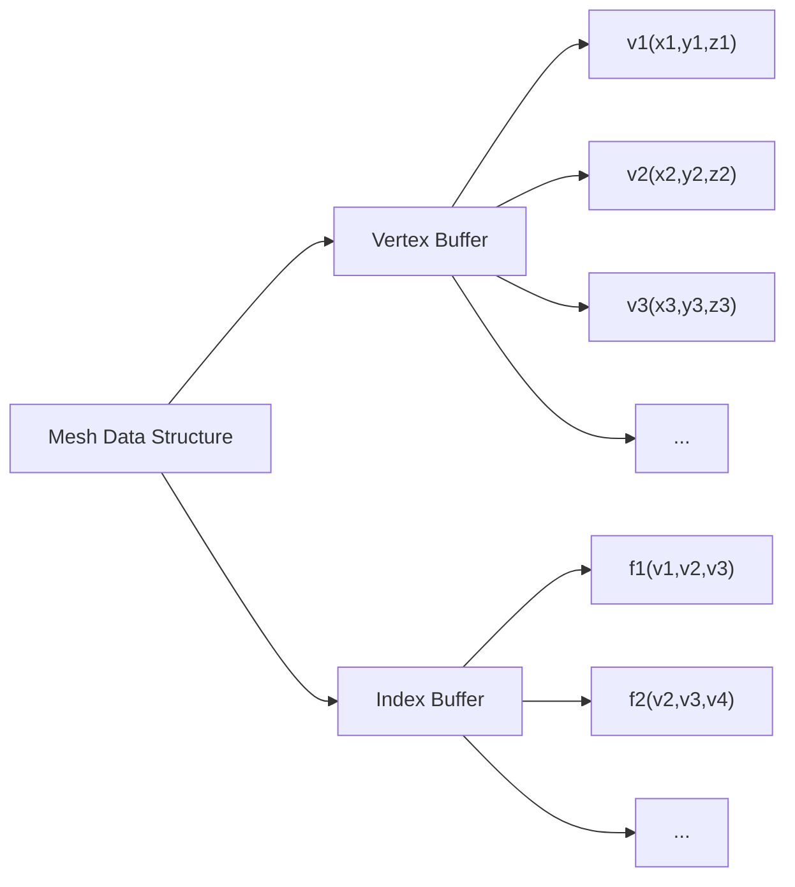

The most common data structure for meshes in computer graphics consists of:

1. **Vertex buffer**: Array of vertex coordinates and attributes
2. **Index buffer**: Array of indices that define faces by referencing vertices

This structure optimizes memory usage by allowing vertex reuse across multiple faces.

## Common Mesh File Formats

Several standard file formats are used to store and exchange mesh data:

| Format | Extension | Description | Characteristics |
|--------|-----------|-------------|----------------|
| Wavefront OBJ | .obj | Text-based format | Simple, widely supported, includes material support |
| STL | .stl | Binary or ASCII format | Triangle-only, no texture support, common in 3D printing |
| FBX | .fbx | Binary format | Complex hierarchies, animation support, proprietary |
| glTF | .gltf, .glb | JSON-based format | Modern standard, efficient, web-friendly |
| PLY | .ply | Flexible format | Supports custom properties, common in research |

## Why Meshes Matter in 3D Applications

Meshes have become the dominant 3D representation in practical applications for several key reasons:

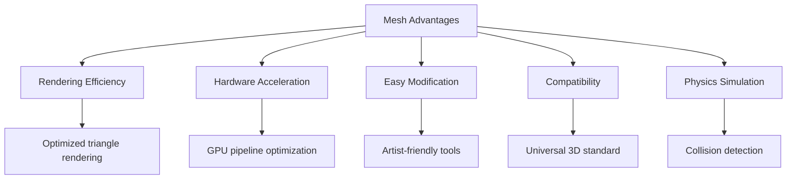

Sources: [units/en/unit1/meshes.mdx:5-7]()

## Challenges with Meshes in Machine Learning

Despite their ubiquity in production environments, meshes present significant challenges for machine learning models:

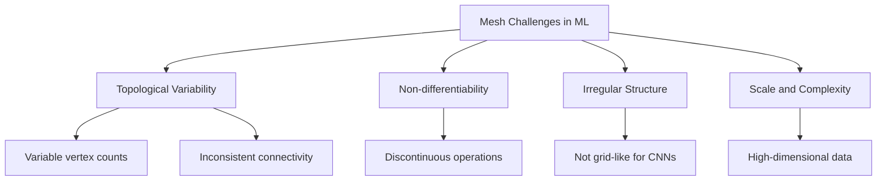

Sources: [units/en/unit1/meshes.mdx:11-15]()

The primary challenges include:

1. **Topological variability**: Meshes can have arbitrary numbers of vertices and connectivity patterns, making them difficult to process with fixed-architecture neural networks.

2. **Non-differentiability**: Many mesh operations (like boolean operations or rasterization) are not naturally differentiable, complicating gradient-based learning.

3. **Irregular structure**: Unlike images or voxels, meshes lack the regular grid structure that makes convolutional approaches effective.

4. **Complexity**: High-quality meshes can contain millions of vertices and faces, creating computational challenges.

## The Current ML for 3D Pipeline

The current approach in 3D machine learning typically follows a two-step process:

```mermaid
flowchart LR
    I["Input (Text/Image)"] --> M["ML Model"]
    M --> N["Non-mesh Representation"]
    N --> MC["Marching Cubes Algorithm"]
    MC --> MF["Final Mesh"]
    
    subgraph "Step 1: ML Generation"
        M
        N
    end
    
    subgraph "Step 2: Mesh Conversion"
        MC
        MF
    end
```

Sources: [units/en/unit1/meshes.mdx:15-20]()

1. **Step 1**: ML models generate ML-friendly non-mesh 3D representations (NeRF, Gaussian Splatting, etc.)
2. **Step 2**: These representations are converted to meshes via algorithms like Marching Cubes for practical applications

This two-step approach creates a disconnect between the rapid advancements in ML generation (Step 1) and the relatively stagnant conversion methods (Step 2) that haven't fundamentally changed since the 1980s.

## Research Gap and Future Directions

```mermaid
graph TD
    G["Research Gap"] --> A["ML Research"]
    G --> B["3D Applications"]
    
    A --> A1["Non-mesh representations"]
    A --> A2["Neural fields"]
    A --> A3["Gaussian splatting"]
    
    B --> B1["Mesh-based pipelines"]
    B --> B2["Game engines"]
    B --> B3["3D printing"]
    
    G --> S["Solution Approaches"]
    S --> S1["Better mesh conversion"]
    S --> S2["Direct mesh generation"]
    S --> S3["Application adaptation"]
```

Sources: [units/en/unit1/meshes.mdx:20-28]()

The fundamental gap in current 3D ML research is the disconnect between:

- **ML Research**: Rapidly advancing in generating high-quality 3D content using non-mesh representations
- **3D Applications**: Still predominantly requiring traditional mesh-based formats

This gap has several potential solutions:

1. **Improved conversion algorithms**: Developing better methods to convert ML-friendly representations to high-quality meshes
2. **Direct mesh generation**: Creating ML models that directly generate meshes
3. **Application adaptation**: Modifying existing 3D pipelines to work with non-mesh representations

## Relationship to Course Structure

Understanding mesh representations is fundamental to the ML for 3D course as it:

1. Establishes the industry-standard 3D representation
2. Highlights the challenges that motivated alternative approaches
3. Provides context for why conversion techniques like [Marching Cubes Algorithm](#5.1) are important
4. Sets the stage for exploring ML-friendly alternatives in [Non-mesh Representations](#2.2)

The techniques covered later in this course, including [Multi-view Diffusion](#3), [Gaussian Splatting](#4), and [Mesh Generation](#5), all relate to bridging this fundamental gap between ML research and practical 3D applications.

---

# Page: Non-mesh Representations

# Non-mesh Representations

<details>
<summary>Relevant source files</summary>

The following files were used as context for generating this wiki page:

- [units/en/unit1/non-meshes.mdx](units/en/unit1/non-meshes.mdx)

</details>


## Purpose and Scope

This document explains alternative 3D representations used in machine learning that do not rely on traditional mesh structures. While meshes are the standard for production 3D applications (see [Mesh Representations](#2.1)), non-mesh representations offer unique advantages for ML pipelines and can later be converted to meshes when needed. This page covers the main types of non-mesh representations, their properties, and their roles in ML for 3D workflows, with special attention to Gaussian Splatting.

Sources: [units/en/unit1/non-meshes.mdx:1-4]()

## Overview of Non-mesh Representations

Non-mesh representations are alternative methods for encoding 3D information that don't use the traditional vertex-edge-face structure of meshes. They are commonly used in ML research because they often provide properties that are more amenable to optimization, differentiable rendering, or neural network processing.

The main types of non-mesh representations include:

1. **Triplanes** - Orthogonal 2D feature planes encoding 3D information
2. **Neural Radiance Fields (NeRFs)** - Implicit neural representations of 3D scenes
3. **Gaussian Splatting** - Collections of 3D Gaussians that represent surfaces and volumes

These approaches continue to evolve rapidly in the research community, with new variations and improvements frequently emerging.

Sources: [units/en/unit1/non-meshes.mdx:5-11]()

## 3D Representation Taxonomy

Diagram: 3D Representation Taxonomy

```mermaid
graph TD
    A["3D Representations"] --> B["Mesh-based"]
    A --> C["Non-mesh"]
    
    B --> D["Triangle Meshes"]
    B --> E["Quad Meshes"]
    B --> F["Tetrahedral Meshes"]
    
    C --> G["Triplanes"]
    C --> H["NeRFs"]
    C --> I["Gaussian Splatting"]
    
    G -.-> |"can convert to"| B
    H -.-> |"can convert to"| B
    I -.-> |"can convert to"| B
    
    I --> J["Real-time rendering"]
    I --> K["Animation support"]
    I --> L["Physics (hybrid)"]
    I --> M["Lighting effects"]
```

The diagram illustrates the relationship between traditional mesh-based representations and non-mesh alternatives. While all non-mesh representations can eventually be converted to meshes, they each have unique characteristics that make them suitable for different ML applications.

Sources: [units/en/unit1/non-meshes.mdx:3-11]()

## Key Non-mesh Representation Types

### Triplanes

Triplanes represent 3D data using three orthogonal 2D feature planes (typically corresponding to the xy, xz, and yz planes). Each plane contains learned features that encode 3D information. Triplanes are used in systems like InstantMesh from TencentARC.

**Advantages:**
- Memory efficient compared to voxel grids
- Well-suited for neural network operations
- Faster training than NeRFs

**Limitations:**
- Less intuitive representation
- Limited resolution for fine details

Sources: [units/en/unit1/non-meshes.mdx:7]()

### Neural Radiance Fields (NeRFs)

NeRFs represent 3D scenes as continuous functions that map 3D coordinates and viewing directions to color and density values. Typically implemented as Multi-Layer Perceptrons (MLPs), NeRFs encode entire scenes implicitly.

Diagram: NeRF Structure

```mermaid
graph LR
    A["Input"] --> B["3D Position (x,y,z)"]
    A --> C["View Direction (θ,φ)"]
    
    B --> D["MLP Network"]
    C --> D
    
    D --> E["Output"]
    E --> F["Color (r,g,b)"]
    E --> G["Density (σ)"]
    
    H["Volume Rendering"] --> I["Final Image"]
    F --> H
    G --> H
```

**Advantages:**
- Continuous representation without resolution limitations
- High-quality novel view synthesis
- Compact scene representation

**Limitations:**
- Slow training and inference
- Non-real-time rendering
- Can struggle with sparse observations

Sources: [units/en/unit1/non-meshes.mdx:8]()

### Gaussian Splatting

Gaussian Splatting represents 3D scenes as a collection of 3D Gaussian primitives defined by their position, covariance matrix (shape), color, and opacity. These Gaussians are "splatted" onto the image plane during rendering.

Diagram: Gaussian Splatting Structure

```mermaid
graph TD
    A["3D Gaussian Primitive"] --> B["Position (x,y,z)"]
    A --> C["Covariance Matrix (3×3)"]
    A --> D["Color (r,g,b)"]
    A --> E["Opacity (α)"]
    
    F["Collection of Gaussians"] --> G["Rasterization"]
    A --> F
    
    G --> H["Real-time Rendering"]
    G --> I["Animation"]
    G --> J["Physics Integration"]
    G --> K["Lighting Effects"]
```

**Advantages:**
- **Real-time rendering** - Unlike other non-mesh representations
- **Animation support** - Can represent dynamic scenes
- **Hybrid physics** - Can be integrated with physics systems
- **Lighting capabilities** - Supports various lighting effects
- **High visual quality** - Excellent for complex visual details

**Limitations:**
- Larger storage requirements than some alternatives
- Less established ecosystem compared to meshes

Sources: [units/en/unit1/non-meshes.mdx:19-25]()

## Comparison of Non-mesh Representations

| Feature | Triplanes | NeRFs | Gaussian Splatting |
|---------|-----------|-------|-------------------|
| Rendering Speed | Medium | Slow | Fast (Real-time) |
| Training Speed | Fast | Slow | Medium |
| Memory Efficiency | High | High | Medium |
| Visual Quality | Good | Excellent | Excellent |
| Animation Support | Limited | Limited | Good |
| Differentiability | Yes | Yes | Yes |
| Real-world Adoption | Research | Research | Emerging practical use |

Gaussian Splatting stands out among non-mesh representations due to its ability to render in real-time while maintaining high visual quality. This makes it a potential candidate for certain real-world applications, not just as an intermediate representation in ML pipelines.

Sources: [units/en/unit1/non-meshes.mdx:21-25]()

## Integration in ML for 3D Pipelines

Diagram: Non-mesh Representations in ML Pipeline

```mermaid
flowchart LR
    A["Input"] --> B["Text/Image"]
    B --> C["Multi-view Diffusion"]
    C --> D["Non-mesh Representation"]
    D --> E1["Triplanes"]
    D --> E2["NeRFs"]
    D --> E3["Gaussian Splatting"]
    E1 --> F["Mesh Conversion"]
    E2 --> F
    E3 --> F
    F --> G["Final 3D Model"]
    E3 -.-> H["Direct Rendering"]
```

In typical ML for 3D pipelines, non-mesh representations often serve as intermediate formats that are optimized for ML operations. They're usually converted to meshes for final delivery to applications. However, Gaussian Splatting has the unique potential to be used directly for rendering without mesh conversion, particularly for real-time generative 3D applications.

Sources: [units/en/unit1/non-meshes.mdx:25-31]()

## Course Focus

While this page provides an overview of all major non-mesh representations, this course will particularly focus on:

1. Gaussian Splatting - Due to its real-time rendering capabilities and potential for real-world applications
2. Mesh representations and conversion - As the standard format for production 3D

The course will not delve deeply into the implementation details of triplanes or NeRFs, as these representations are rapidly evolving. Instead, it aims to provide a solid understanding of the building blocks of 3D machine learning and focus on representations that can be practically applied today.

Sources: [units/en/unit1/non-meshes.mdx:27-33]()

## Summary

Non-mesh representations offer powerful alternatives to traditional meshes for ML applications, with different options suited to different use cases:

- **Triplanes** excel at efficient learning of 3D features
- **NeRFs** provide high-quality novel view synthesis with implicit representation
- **Gaussian Splatting** offers real-time rendering and potential for direct application

While the field continues to evolve rapidly, understanding these alternative representations is essential for working with modern ML for 3D pipelines. Though most applications ultimately convert these representations to meshes, Gaussian Splatting in particular shows potential for direct use in real-time applications.

Sources: [units/en/unit1/non-meshes.mdx:3-33]()

---

# Page: Generative 3D Pipelines

# Generative 3D Pipelines

<details>
<summary>Relevant source files</summary>

The following files were used as context for generating this wiki page:

- [units/en/unit1/pipelines.mdx](units/en/unit1/pipelines.mdx)

</details>


## Purpose and Scope

This document explains the end-to-end pipeline for generating 3D models using machine learning techniques. It covers the overall architecture, key components, and how they interact to transform inputs (text or images) into 3D outputs. For specific details about mesh representations, see [Mesh Representations](#2.1), and for non-mesh representations, see [Non-mesh Representations](#2.2).

Sources: [units/en/unit1/pipelines.mdx:1-7]()

## Pipeline Architecture Overview

The generative 3D pipeline consists of three main stages that work together to create 3D content from simpler inputs:

```mermaid
flowchart LR
    subgraph "Pipeline Stages"
        direction LR
        A["Input\n(Text/Image)"] --> B["Stage 1:\nMulti-view Diffusion"]
        B --> |"Multiple views"| C["Stage 2:\nML-friendly 3D\n(Non-mesh representation)"]
        C --> D["Stage 3:\nMesh Generation"]
        D --> E["Output\n(3D Mesh)"]
    end
```

Sources: [units/en/unit1/pipelines.mdx:3-7]()

This pipeline transforms simple inputs like text descriptions or single images into complete 3D models through a series of increasingly complex representations. Each stage builds upon the previous one, gradually adding more 3D information until a full model is created.

## Pipeline Components

### 1. Multi-view Diffusion

Multi-view diffusion models generate multiple consistent views of an object from either text descriptions or source images. These models use diffusion techniques (similar to those in image generation) to create a set of 2D renders showing the object from different angles.

```mermaid
flowchart LR
    subgraph "Multi-view Diffusion"
        direction LR
        A["Text Prompt\nor Image"] --> B["Diffusion\nModel"]
        B --> C["Front View"]
        B --> D["Side View"]
        B --> E["Back View"]
        B --> F["Top View"]
        B --> G["..."]
    end
```

Multi-view diffusion serves as a critical bridge between 2D inputs and 3D representations, creating the necessary visual information from multiple angles that subsequent stages can use to reconstruct 3D geometry.

Sources: [units/en/unit1/pipelines.mdx:9-13]()

### 2. ML-friendly 3D Representation

The multiple views generated in the previous stage are processed to create an intermediate 3D representation that is well-suited for machine learning manipulation. These representations (like Gaussian Splatting, NeRFs, or Triplanes) are optimized for neural network processing rather than for traditional 3D workflows.

```mermaid
flowchart LR
    subgraph "ML-friendly 3D Generation"
        direction LR
        A["Multiple\nViews"] --> B["3D Reconstruction\nAlgorithm"]
        B --> C["Gaussian\nSplatting"]
        B --> D["Neural Radiance\nFields (NeRF)"]
        B --> E["Other Non-mesh\nRepresentations"]
    end
```

This intermediate representation focuses on accurately encoding the 3D structure in a format that's differentiable and can be optimized using neural networks, but may not be directly usable in traditional 3D applications.

Sources: [units/en/unit1/pipelines.mdx:7]()

### 3. Mesh Generation

The final stage converts the ML-friendly representation into a traditional polygon mesh that can be used in standard 3D applications, game engines, or for 3D printing. This often involves algorithms like Marching Cubes that extract surface geometry from volumetric or implicit representations.

```mermaid
flowchart LR
    subgraph "Mesh Generation"
        direction LR
        A["ML-friendly 3D\nRepresentation"] --> B["Surface\nExtraction"]
        B --> C["Polygon\nMesh"]
        C --> D["Post-processing\n(Simplification,\nUV unwrapping, etc)"]
    end
```

The mesh output represents the final product of the pipeline, providing a representation that's compatible with established 3D workflows and tools.

Sources: [units/en/unit1/pipelines.mdx:7]()

## Pipeline Integration and Implementation

The complete generative 3D pipeline combines these components into a coherent workflow, with each stage building upon the output of the previous one:

```mermaid
flowchart TD
    subgraph "Complete Generative 3D Pipeline"
        direction LR
        Input["Input\n(Text/Image)"] --> MVD["Multi-view Diffusion"]
        MVD --> Views["Multiple consistent views"]
        Views --> Recon["3D Reconstruction"]
        Recon --> NonMesh["Non-mesh Representation\n(Gaussian Splatting, NeRF, etc)"]
        NonMesh --> MeshConv["Mesh Conversion\n(Marching Cubes)"]
        MeshConv --> Mesh["3D Mesh"]
        Mesh --> Post["Post-processing"]
        Post --> Final["Final 3D Model"]
    end
```

### Practical Implementation Considerations

When implementing a generative 3D pipeline, several factors need to be considered:

1. **Computational requirements**: Each stage has different computational needs:
   - Multi-view diffusion is GPU-intensive but can use existing diffusion models
   - ML-friendly 3D representation may require optimization steps
   - Mesh generation can be memory-intensive for high-resolution outputs

2. **Quality vs. speed tradeoffs**: More views and higher resolution lead to better quality but slower processing.

3. **Cross-stage consistency**: Ensuring that details remain consistent across pipeline stages is crucial for high-quality output.

4. **Implementation options**:
   - Use pre-trained models from Hugging Face for each stage
   - Create custom implementations for specific use cases
   - Mix existing components with custom elements

Sources: [units/en/unit1/pipelines.mdx:15-23]()

## Course Coverage

In the ML for 3D course, each of these pipeline components is covered in dedicated units:

| Pipeline Stage | Course Unit | Focus Area |
|----------------|-------------|------------|
| Multi-view diffusion | Unit 3 | Tools and ecosystem integration |
| ML-friendly 3D | Unit 4 | Deep dive into Gaussian Splatting |
| Mesh Generation | Unit 5 | Practical applications |

Each unit includes both theoretical understanding and hands-on practical implementation, enabling you to build and customize your own generative 3D pipelines.

Sources: [units/en/unit1/pipelines.mdx:15-23]()

## Summary

Generative 3D pipelines represent a structured approach to creating 3D content using machine learning. By breaking down the complex problem of 3D generation into discrete stages (multi-view diffusion, ML-friendly 3D representation, and mesh generation), these pipelines make it possible to generate high-quality 3D models from simple inputs like text or single images. Understanding each component and how they fit together is essential for effectively working with and developing generative 3D systems.

---

# Page: Multi-view Diffusion

# Multi-view Diffusion

<details>
<summary>Relevant source files</summary>

The following files were used as context for generating this wiki page:

- [units/en/unit2/introduction.mdx](units/en/unit2/introduction.mdx)
- [units/en/unit2/what-is-it.mdx](units/en/unit2/what-is-it.mdx)

</details>


## Purpose and Scope

This document explains Multi-view Diffusion, a key technique in 3D generation pipelines that creates consistent multiple views of an object from different perspectives based on a single input (text or image). Multi-view Diffusion represents the first step in the ML for 3D pipeline, generating the raw visual data needed for subsequent 3D representation techniques. This document focuses on what Multi-view Diffusion is, its challenges, available solutions, and its implementation in the 3D generation workflow. For detailed information about implementing Multi-view Diffusion, see [Multi-view Diffusion Pipeline](#3.1) and [Implementing Multi-view Diffusion](#3.2).

Sources: [units/en/unit2/introduction.mdx:14-20](), [units/en/unit2/what-is-it.mdx:1-3]()

## What is Multi-view Diffusion?

Multi-view Diffusion is a specialized type of diffusion model that, unlike standard diffusion models like Stable Diffusion (which generate single images), is trained to generate multiple consistent views of the same object from different camera angles. This approach is crucial for 3D generation because it provides the foundational image data required to infer 3D structure.

The model takes either a text prompt or a single image as input and produces a set of images representing the same object from different viewpoints, typically arranged in a predetermined layout (often in a circular pattern around the object).

### Multi-view Diffusion in the 3D Generation Pipeline


```mermaid
flowchart LR
    subgraph "3D Generation Pipeline"
        direction LR
        A["Input (Text/Image)"] --> B["Multi-view Diffusion"]
        B --> |"Multiple consistent views"| C["3D Reconstruction"]
        C --> |"3D Representation"| D["Gaussian Splatting/Mesh"]
    end
    
    style A fill:#f5f5f5,stroke:#333,stroke-width:1px
    style B fill:#f5f5f5,stroke:#333,stroke-width:2px
    style C fill:#f5f5f5,stroke:#333,stroke-width:1px
    style D fill:#f5f5f5,stroke:#333,stroke-width:1px
```

Sources: [units/en/unit2/introduction.mdx:14-20](), [units/en/unit2/what-is-it.mdx:1-5]()

## Technical Architecture

Multi-view Diffusion models are primarily adapted diffusion models with architectural modifications and training approaches designed to ensure view consistency.

```mermaid
flowchart TD
    A["Input (Text/Image)"] --> B["Multi-view Diffusion Model"]
    B --> C["View 1"]
    B --> D["View 2"]
    B --> E["View 3"]
    B --> F["..."]
    B --> G["View N"]
    
    subgraph "Internal Architecture"
        H["Diffusion Process"]
        I["Cross-View Consistency Mechanisms"]
        J["Camera Pose Conditioning"]
    end
    
    B --- H
    B --- I
    B --- J
    
    C & D & E & G --> K["3D Reconstruction Stage"]
```

Sources: [units/en/unit2/what-is-it.mdx:1-5](), [units/en/unit2/what-is-it.mdx:16-19]()

## Challenges in Multi-view Diffusion

### The Janus Problem

The primary challenge in Multi-view Diffusion is maintaining consistency across different views of the same object, known as the "Janus problem." This issue manifests when:

- An object appears to have multiple faces when viewed from different angles
- Object features (colors, shapes, textures) change inconsistently between views
- The generated views don't represent a physically plausible 3D object


```mermaid
flowchart LR
    subgraph "Janus Problem Visualization"
        A["Front View"] --> |"Should be consistent"| B["Side View"]
        B --> |"Should be consistent"| C["Back View"]
        
        D["Inconsistent Features"]
        E["Multiple Faces"]
        F["Geometry Misalignment"]
        
        A & B & C --- D & E & F
    end
```

Sources: [units/en/unit2/what-is-it.mdx:8-13]()

## Available Solutions

State-of-the-art Multi-view Diffusion models address the Janus problem and other consistency issues through specialized architectures and training techniques:

### Key Models and Approaches

- **MVDream**: A prominent Multi-view Diffusion model available on Hugging Face that generates consistent views
- **View-Conditioned Generation**: Models that explicitly condition on camera angles
- **Cross-View Consistency Training**: Training approaches that enforce consistency between generated views

These advanced models use various techniques to ensure that the generated views maintain coherence across different perspectives of the same object.

```mermaid
flowchart TD
    subgraph "Multi-view Consistency Solutions"
        A["Training Techniques"] --> B["Cross-View Consistency Loss"]
        A --> C["View-Specific Conditioning"]
        A --> D["3D-Aware Training"]
        
        E["Architectural Approaches"] --> F["Shared Latent Space"]
        E --> G["Camera Pose Encoding"]
        E --> H["Multi-View Attention"]
    end
```

Sources: [units/en/unit2/what-is-it.mdx:15-19]()

## Integration with the ML for 3D Pipeline

Multi-view Diffusion serves as the entry point for most generative 3D pipelines covered in this course, providing the source images needed for subsequent steps:

```mermaid
flowchart LR
    A["Input (Text/Image)"] --> B["Multi-view Diffusion"]
    B --> |"Multiple views"| C["3D Representation"]
    
    subgraph "3D Representation Methods"
        C --> D["Gaussian Splatting (#4)"]
        C --> E["Mesh Generation (#5)"]
    end
    
    D & E --> F["Final 3D Model"]
    
    subgraph "Pipeline Systems"
        G["MVDream/Multi-view Diffusion Model"]
        H["LGM for Gaussian Splatting"]
        I["Mesh Generation Techniques"]
    end
    
    B --- G
    D --- H
    E --- I
```

While Multi-view Diffusion is a crucial component in many 3D generation approaches, it's worth noting that not all generative 3D pipelines use this technique. Some approaches may use other methods to infer 3D structure directly from single images or text.

Sources: [units/en/unit2/introduction.mdx:14-20](), [units/en/unit2/what-is-it.mdx:9-10](), [units/en/unit2/what-is-it.mdx:20-21]()

## Implementation Considerations

When using Multi-view Diffusion models in a practical workflow:

1. **Model Selection**: Choose a model trained specifically for multi-view generation like MVDream
2. **Input Crafting**: Detailed prompts or clear reference images provide better results
3. **View Configuration**: Consider how many views are needed for the subsequent 3D reconstruction step
4. **Consistency Checking**: Validate that generated views maintain consistency before proceeding

### Typical Workflow

```mermaid
sequenceDiagram
    participant User
    participant MVD as "Multi-view Diffusion Model"
    participant GS as "Gaussian Splatting/3D Reconstruction"
    
    User->>MVD: Text prompt or reference image
    MVD->>MVD: Generate multiple consistent views
    MVD->>GS: Transfer generated views
    GS->>GS: Reconstruct 3D representation
    GS->>User: Deliver 3D model
```

Sources: [units/en/unit2/what-is-it.mdx:19-21](), [units/en/unit2/introduction.mdx:18-20]()

## Summary

Multi-view Diffusion represents the initial step in many modern 3D generation pipelines. By generating multiple consistent views of an object from a single input prompt or image, it provides the visual foundation needed for subsequent 3D reconstruction techniques like Gaussian Splatting. While this approach faces challenges with view consistency (particularly the Janus problem), state-of-the-art models like MVDream have developed effective solutions to these issues.

The course takes a practical approach to Multi-view Diffusion, focusing on how to use existing models rather than developing them from scratch, as the technical details relate more to diffusion models than to 3D-specific techniques.

Sources: [units/en/unit2/introduction.mdx:16-20](), [units/en/unit2/what-is-it.mdx:15-21]()

---

# Page: Multi-view Diffusion Pipeline

# Multi-view Diffusion Pipeline

<details>
<summary>Relevant source files</summary>

The following files were used as context for generating this wiki page:

- [units/en/unit2/pipeline.mdx](units/en/unit2/pipeline.mdx)
- [units/en/unit2/setup.mdx](units/en/unit2/setup.mdx)

</details>


## Purpose and Scope

This document details the Multi-view Diffusion Pipeline, a critical component in the 3D generation workflow that transforms a single image into multiple consistent views of the same object. The pipeline serves as the first stage in the larger image-to-3D generation process, creating the necessary multiple perspectives that will later be processed into a 3D representation. For information about implementing this pipeline in practice, see [Implementing Multi-view Diffusion](#3.2).

Sources: [units/en/unit2/pipeline.mdx:1-21]()

## System Overview

The Multi-view Diffusion Pipeline sits at the beginning of the 3D generation workflow, converting a single image into multiple coherent views that capture the object from different angles. This is a crucial step that enables subsequent 3D modeling processes.

```mermaid
flowchart LR
    input["Input Image"] --> mvd["multi_view_diffusion_pipeline"]
    mvd --> views["Multiple Views (4 perspectives)"]
    views --> next["Next Stage: 3D Representation"]
    
    subgraph "Multi-view Diffusion Pipeline"
        mvd
    end
    
    classDef process stroke-width:2px
    class mvd process
```

Sources: [units/en/unit2/pipeline.mdx:1-21]()

## Pipeline Architecture

The Multi-view Diffusion Pipeline is implemented as a custom pipeline in the Diffusers library framework. The custom implementation is necessary because standard diffusion pipelines don't natively support 3D-oriented tasks.

```mermaid
flowchart TD
    subgraph "Multi-view Diffusion Pipeline Architecture"
        load["Load Pretrained Model"] --> prepare["Prepare Input Image"] 
        prepare --> process["Process through Diffusion Model"]
        process --> generate["Generate Multiple Views"]
    end
    
    subgraph "Implementation Details"
        model["Model: dylanebert/multi-view-diffusion"]
        custom["Custom Pipeline: dylanebert/multi-view-diffusion"]
        precision["Precision: float16"]
        device["Device: CUDA"]
    end
    
    load --- model
    load --- custom
    load --- precision
    load --- device
```

Sources: [units/en/unit2/pipeline.mdx:5-21]()

## Technical Requirements

The Multi-view Diffusion Pipeline has specific hardware and software requirements:

| Requirement | Description |
|-------------|-------------|
| Hardware | GPU (CUDA-compatible) |
| Dependencies | Specified in requirements.txt |
| Python Packages | torch, diffusers, PIL, numpy |
| Memory | Sufficient VRAM for model inference |

Sources: [units/en/unit2/setup.mdx:7-26]()

## Pipeline Components

### Model Loading

The pipeline utilizes a pretrained model from the Hugging Face Hub:

```mermaid
flowchart LR
    dp["DiffusionPipeline.from_pretrained()"] --> model["Model: dylanebert/multi-view-diffusion"]
    dp --> custom["Custom Pipeline Code"]
    dp --> dtype["torch.float16"]
    dp --> device["CUDA Device"]
```

The pipeline is initialized with the following key components:
- Model repository: `dylanebert/multi-view-diffusion`
- Custom pipeline code path: `dylanebert/multi-view-diffusion`
- Data type: `torch.float16` for efficiency
- Processing device: GPU via CUDA

Sources: [units/en/unit2/pipeline.mdx:7-17]()

### Input Processing

The pipeline accepts an input image which is preprocessed before being fed to the model:

```mermaid
flowchart LR
    input["Input Image"] --> load["Load Image (PIL)"]
    load --> convert["Convert to Normalized Array"]
    convert --> ready["Prepared Image Input"]
```

The preprocessing involves:
1. Loading the image using PIL
2. Converting to a numpy array
3. Normalizing pixel values to the range [0.0, 1.0]

Sources: [units/en/unit2/pipeline.mdx:25-71]()

### Pipeline Execution

The execution of the pipeline involves passing the prepared image through the diffusion model with specific parameters:

```mermaid
flowchart TD
    input["Prepared Image Input"] --> mvd["multi_view_diffusion_pipeline()"]
    params["Parameters:
    - text_prompt (empty)
    - image
    - guidance_scale
    - num_inference_steps
    - elevation"] --> mvd
    mvd --> output["Output: Multiple Views (Array)"]
```

Sources: [units/en/unit2/pipeline.mdx:59-76]()

## Usage Example

The following example demonstrates how to use the Multi-view Diffusion Pipeline:

1. Load the pipeline:
   [units/en/unit2/pipeline.mdx:7-17]()

2. Prepare an input image:
   [units/en/unit2/pipeline.mdx:25-35]()

3. Execute the pipeline:
   [units/en/unit2/pipeline.mdx:59-60]()

4. Display or process the resulting views:
   [units/en/unit2/pipeline.mdx:46-57]()

Sources: [units/en/unit2/pipeline.mdx:1-85]()

## Configuration Parameters

The pipeline accepts several parameters that control the generation process:

| Parameter | Description | Example Value |
|-----------|-------------|---------------|
| text_prompt | Optional text guidance (can be empty string) | `""` |
| image | Normalized input image array | `np.array(image, dtype=np.float32) / 255.0` |
| guidance_scale | Controls how closely to follow the input | `5` |
| num_inference_steps | Number of diffusion steps | `30` |
| elevation | View elevation angle | `0` |

Sources: [units/en/unit2/pipeline.mdx:60-75]()

## Output Format

The pipeline produces an array of images representing multiple views of the input object:

```mermaid
flowchart LR
    output["Output Array"] --> view1["Front View"]
    output --> view2["Right View"]
    output --> view3["Back View"]
    output --> view4["Left View"]
    
    subgraph "Output Format"
        view1
        view2
        view3
        view4
    end
```

The output consists of four views positioned at 90-degree intervals around the object. These views are returned as numpy arrays with values in the range [0.0, 1.0], which can be converted to standard image formats using libraries like PIL.

Sources: [units/en/unit2/pipeline.mdx:46-57](), [units/en/unit2/pipeline.mdx:77-79]()

## Integration with Overall 3D Generation Workflow

The Multi-view Diffusion Pipeline is the first stage in a broader 3D generation workflow:

```mermaid
flowchart LR
    input["Input Image"] --> mvdp["multi_view_diffusion_pipeline"]
    mvdp --> views["Multiple Views"]
    views --> gs["Gaussian Splatting"]
    gs --> representation["3D Representation"]
    representation --> mesh["Mesh Generation"]
    mesh --> final["Final 3D Model"]
    
    subgraph "Current Component"
        mvdp
    end
```

The multiple views generated by this pipeline serve as input to subsequent 3D representation techniques, particularly Gaussian Splatting, which can then be further processed into meshes or other 3D formats.

Sources: [units/en/unit2/pipeline.mdx:81-85]()

## Limitations and Considerations

When using the Multi-view Diffusion Pipeline, be aware of the following:

1. **GPU Requirement**: The pipeline requires a GPU to run efficiently.
2. **Memory Usage**: Large images or high inference steps may require substantial VRAM.
3. **View Consistency**: While the pipeline attempts to maintain consistency across views, complex objects may show variations.
4. **Custom Pipeline Dependency**: The pipeline relies on custom code that extends the standard diffusers library functionality.

Sources: [units/en/unit2/setup.mdx:7-15](), [units/en/unit2/pipeline.mdx:19-21]()

---

# Page: Implementing Multi-view Diffusion

# Implementing Multi-view Diffusion

<details>
<summary>Relevant source files</summary>

The following files were used as context for generating this wiki page:

- [README.md](README.md)
- [units/en/unit2/bonus.mdx](units/en/unit2/bonus.mdx)
- [units/en/unit2/hands-on-1.mdx](units/en/unit2/hands-on-1.mdx)
- [units/en/unit2/hands-on-2.mdx](units/en/unit2/hands-on-2.mdx)

</details>


## Purpose and Scope

This document provides practical guidance on implementing multi-view diffusion models for 3D generation. We focus on how to use pre-trained multi-view diffusion models, create interactive demos with Gradio, and deploy these solutions. This page covers the technical implementation aspects rather than the theoretical foundations of multi-view diffusion (for that information, see [Multi-view Diffusion Pipeline](#3.1)).

## Implementation Overview

Multi-view diffusion implementation consists of three main components: loading the model from Hugging Face, running inference to generate multiple views, and creating a user interface with Gradio. The following diagram illustrates this workflow:

```mermaid
flowchart LR
    A["Load Multi-view \nDiffusion Pipeline"] --> B["Run Inference"]
    B --> C["Generate Multiple Views"]
    C --> D["Create Gradio UI"]
    D --> E["Deploy Solution"]

    style A stroke-width:2px
    style B stroke-width:2px
    style C stroke-width:2px
    style D stroke-width:2px
    style E stroke-width:2px
```

Sources: [units/en/unit2/hands-on-2.mdx:15-25](), [units/en/unit2/hands-on-2.mdx:32-56]()

## Loading the Multi-view Diffusion Pipeline

The first step is to load a pre-trained multi-view diffusion model from the Hugging Face Hub. This is done using the `DiffusionPipeline` class from the diffusers library:

```mermaid
flowchart TD
    A["DiffusionPipeline.from_pretrained()"] --> B["Model Repository Path"]
    A --> C["Custom Pipeline Path"]
    A --> D["Device Configuration"]
    A --> E["Data Type (float16)"]
    B --> F["<username>/<model-name>"]
    C --> G["dylanebert/multi-view-diffusion"]
    D --> H["CUDA GPU"]
    
    style A stroke-width:2px
    style F stroke-width:2px
    style G stroke-width:2px
```

The code to load the pipeline requires:
- The model repository path
- The custom pipeline path (`dylanebert/multi-view-diffusion`)
- Configuration for hardware acceleration (typically CUDA)
- Floating-point precision setting (typically float16 for efficiency)

Sources: [units/en/unit2/hands-on-2.mdx:15-25]()

## Running Inference

Once the pipeline is loaded, you can generate multiple views of an object by providing either a text prompt or an input image. The pipeline processes this input and returns a set of images showing the object from different angles.

```mermaid
flowchart LR
    A["Input Image/Text"] --> B["Multi-view\nDiffusion Pipeline"]
    B --> C["Front View"]
    B --> D["Side View 1"]
    B --> E["Side View 2"]
    B --> F["Back View"]
    
    subgraph "Pipeline Parameters"
    G["guidance_scale"]
    H["num_inference_steps"]
    I["elevation"]
    end
    
    G --> B
    H --> B
    I --> B
    
    style A stroke-width:2px
    style B stroke-width:2px
    style C stroke-width:2px
    style D stroke-width:2px
    style E stroke-width:2px
    style F stroke-width:2px
```

Key inference parameters include:
- `guidance_scale`: Controls how closely the generated images match the input prompt
- `num_inference_steps`: Determines the quality and generation time
- `elevation`: Controls the viewing angle

Sources: [units/en/unit2/hands-on-2.mdx:38-42]()

## Creating a Gradio Demo

To make your multi-view diffusion model accessible to users, you can create an interactive demo using Gradio. The demo allows users to upload an image and receive the generated multi-view output.

```mermaid
flowchart TD
    A["User Uploads Image"] --> B["run() Function"]
    B --> C["Preprocess Image\n(normalize to 0-1)"]
    C --> D["Call multi_view_diffusion_pipeline"]
    D --> E["Postprocess Images\n(convert to PIL)"]
    E --> F["Create Grid Image"]
    F --> G["Return to User Interface"]
    
    style A stroke-width:2px
    style B stroke-width:2px
    style D stroke-width:2px
    style G stroke-width:2px
```

The demo implementation consists of:
1. A processing function that handles the input image
2. Pipeline call with appropriate parameters
3. Post-processing to arrange the views in a grid
4. Gradio interface setup with input and output specifications

Sources: [units/en/unit2/hands-on-2.mdx:32-56](), [units/en/unit2/hands-on-2.mdx:86-123]()

## Complete Implementation Architecture

The following diagram shows how all components fit together in the complete implementation:

```mermaid
flowchart TD
    A["User"] --> B["Gradio Interface"]
    B --> C["run() Function"]
    C --> D["Image Preprocessing"]
    D --> E["multi_view_diffusion_pipeline"]
    
    E --> F["Hugging Face Model"]
    F --> G["Custom Pipeline Code"]
    
    E --> H["Generated Images"]
    H --> I["Image Postprocessing"]
    I --> J["Grid Creation"]
    J --> B
    
    subgraph "Implementation Elements"
    K["DiffusionPipeline.from_pretrained()"]
    L["numpy for image processing"]
    M["PIL for image manipulation"]
    N["gradio.Interface()"]
    end
    
    K --> E
    L --> D
    M --> I
    N --> B
    
    style A stroke-width:2px
    style B stroke-width:2px
    style E stroke-width:2px
    style F stroke-width:2px
    style G stroke-width:2px
```

Sources: [units/en/unit2/hands-on-2.mdx:86-123]()

## Deployment Options

After implementing your multi-view diffusion demo, you have several options for deployment:

| Option | Description | Requirements | Benefits |
|--------|-------------|--------------|----------|
| Hugging Face Space | Create a Space with Gradio SDK | GPU for public hosting | Easy sharing and integration with HF ecosystem |
| Gradio Deploy | Use Gradio's deployment tools | Server for hosting | Simplified deployment process |
| Local Deployment | Run the demo on your machine | Python environment with GPU | Complete control, no hosting costs |

The repository provides complete code templates for each deployment option, including the necessary requirements and setup instructions.

Sources: [units/en/unit2/hands-on-2.mdx:62-138]()

## Local Deployment Workflow

For local deployment, you need to set up a Python virtual environment with the required dependencies:

```mermaid
flowchart LR
    A["Create Virtual\nEnvironment"] --> B["Activate\nEnvironment"]
    B --> C["Install\nRequirements"]
    C --> D["Run Python\nApplication"]
    D --> E["Access Demo\nVia Browser"]
    
    style A stroke-width:2px
    style C stroke-width:2px
    style E stroke-width:2px
```

The implementation requires:
- Python 3.10+ (tested with 3.10.12)
- CUDA-compatible GPU (tested with CUDA 12.1 on RTX 4090)
- Required packages as specified in the requirements.txt file

Sources: [units/en/unit2/hands-on-2.mdx:128-138]()

## Summary and Extensions

This implementation approach allows you to quickly set up and deploy a multi-view diffusion system without having to train models from scratch. The modular design makes it easy to:

1. Substitute different pre-trained models
2. Customize the UI with additional parameters
3. Integrate the system into larger 3D generation pipelines

For more advanced customizations, consider exploring other available models in the Hugging Face ecosystem or fine-tuning existing models for specific use cases.

Sources: [units/en/unit2/bonus.mdx:1-16]()

---

# Page: Gaussian Splatting

# Gaussian Splatting

<details>
<summary>Relevant source files</summary>

The following files were used as context for generating this wiki page:

- [units/en/unit3/bonus.mdx](units/en/unit3/bonus.mdx)
- [units/en/unit3/introduction.mdx](units/en/unit3/introduction.mdx)
- [units/en/unit3/what-is-it.mdx](units/en/unit3/what-is-it.mdx)

</details>


## Purpose and Scope

This document explains Gaussian Splatting, a differentiable rasterization technique that serves as an ML-friendly 3D representation. It covers the fundamental concepts, technical implementation details, training process, and its role in generative 3D pipelines. Gaussian Splatting is notable for its real-time rendering capabilities, making it particularly suitable for end-to-end AI-compatible 3D applications.

For information about other ML-friendly 3D representations like Triplanes and NeRFs, see [Non-mesh Representations](#2.2). For details on how Gaussian Splatting fits into the broader generative pipeline, see [Generative 3D Pipelines](#2.3).

Sources: [units/en/unit3/what-is-it.mdx:1-4](). [units/en/unit3/introduction.mdx:22-27]()

## What is Gaussian Splatting?

Gaussian Splatting is a differentiable rasterization technique that represents 3D scenes using millions of 3D Gaussian points. Two key properties make it especially valuable for ML applications:

1. **Differentiable**: In ML terms, "differentiable" means "AI-compatible." Unlike traditional rasterization methods that make discrete decisions (like determining if a pixel is inside a triangle), Gaussian Splatting uses continuous mathematics that can be incorporated into neural networks and optimized through gradient descent.

2. **Rasterization**: The process of converting 3D data into 2D pixel information that can be displayed on a screen. While traditional mesh rendering uses triangle rasterization, Gaussian Splatting uses elliptical "splats" that blend together smoothly.

The differentiable nature of Gaussian Splatting enables direct optimization of the 3D representation using standard ML techniques, while also allowing real-time rendering for interactive applications.

```mermaid
graph LR
    A["Traditional Rendering<br>(Triangle Rasterization)"] --> B["Discrete Decisions<br>(Is pixel inside triangle?)"]
    C["Gaussian Splatting<br>(Differentiable Rasterization)"] --> D["Continuous Mathematics<br>(Gradual contribution falloff)"]
    
    B -->|"Not AI-friendly"| E["Limited use in ML pipelines"]
    D -->|"AI-friendly"| F["Compatible with neural networks<br>Optimizable via gradient descent"]
    
    style A stroke-width:1
    style B stroke-width:1
    style C stroke-width:2
    style D stroke-width:2
    style E stroke-width:1
    style F stroke-width:2
```

Sources: [units/en/unit3/what-is-it.mdx:3-21]()

## Representation Structure

A Gaussian Splat consists of millions of 3D Gaussian points, each defined by four fundamental parameters:

1. **Position**: 3D coordinates (X, Y, Z) specifying the point's location in space
2. **Covariance**: A 3×3 matrix that defines how the Gaussian is stretched and oriented
3. **Color**: RGB values determining the point's color
4. **Alpha**: A scalar value controlling the point's transparency

These parameters completely define the appearance and behavior of each Gaussian point in the scene. When millions of these points are combined, they form a complete 3D representation that can be rendered from any viewpoint.

```mermaid
graph TD
    subgraph "3D Gaussian Point Structure"
        A["Gaussian Point"] --> B["Position (XYZ)<br>3D coordinates"]
        A --> C["Covariance (3×3 matrix)<br>Shape and orientation"]
        A --> D["Color (RGB)<br>Visual appearance"]
        A --> E["Alpha (α)<br>Transparency"]
    end

    subgraph "Complete Scene Representation"
        F["Millions of<br>Gaussian Points"] --> G["3D Scene"]
        G --> H["Viewable from<br>any angle"]
    end
```

Sources: [units/en/unit3/what-is-it.mdx:26-32]()

## Rasterization Process

The rendering process of Gaussian Splatting involves projecting 3D Gaussian points into 2D and calculating their contribution to each pixel. The core process works as follows:

1. **Projection and Sorting**: 3D Gaussian points are projected onto the 2D image plane and sorted based on depth (back-to-front ordering)
2. **Contribution Calculation**: For each pixel, compute the contribution from relevant Gaussian points
3. **Blending**: Combine these contributions using alpha blending to produce the final pixel color

In theory, every point could contribute to every pixel (with diminishing effect at greater distances), but this would be computationally expensive. In practice, tile-based optimization methods are used to make the process efficient.

```mermaid
flowchart TD
    A["3D Gaussian Points"] --> B["Project to 2D"]
    B --> C["Sort by Depth<br>(back-to-front)"]
    C --> D["Calculate Contribution<br>to Each Pixel"]
    D --> E["Alpha Blend<br>Contributions"]
    E --> F["Final Rendered Image"]

    subgraph "Pseudocode Implementation"
        G["splat2d = splat.project_and_sort()
for point in splat2d:
    for pixel in image:
        pixel += compute_contribution(point, pixel)"]
    end

    subgraph "Practical Optimization"
        H["Tile-based Rasterization<br>(as detailed in original paper)"]
    end

    C --> G
    G -.-> H
```

Sources: [units/en/unit3/what-is-it.mdx:33-46]()

## Training Process

The training process for Gaussian Splatting involves optimizing the parameters of each Gaussian point to accurately represent a 3D scene. The typical process includes:

1. **Initialization**: Points are initially created using Structure-from-Motion (SfM), a traditional 3D reconstruction algorithm
2. **Rasterization**: Points are rendered using the rasterization process described above
3. **Loss Computation**: The rendered image is compared to ground truth images
4. **Gradient Descent**: Parameters (position, covariance, color, alpha) are adjusted based on the computed loss
5. **Densification and Pruning**: Points are automatically added where detail is needed and removed where they're redundant

This process allows the representation to adaptively improve, concentrating detail where it matters most in the scene.

```mermaid
flowchart TD
    A["Structure-from-Motion<br>Initialization"] --> B["Initial Point Cloud"]
    B --> C["Rasterize Points<br>(Differentiable Rendering)"]
    C --> D["Compare to Ground Truth<br>(Loss Computation)"]
    D --> E["Update Parameters<br>(Gradient Descent)"]
    E --> F["Automatic Densification<br>and Pruning"]
    F --> |"Add/Remove Points"| B
    E --> |"Loop until convergence"| C

    subgraph "Parameter Optimization"
        G["Position (XYZ)"]
        H["Covariance (3×3)"]
        I["Color (RGB)"]
        J["Alpha (α)"]
    end

    E --> G
    E --> H
    E --> I
    E --> J
```

Sources: [units/en/unit3/what-is-it.mdx:55-66]()

## Inference and Real-time Rendering

For inference (when not training), the differentiable property of Gaussian Splatting isn't required. This allows for more efficient rendering approaches:

1. Each Gaussian point can be treated as an instanced quad
2. This approach enables real-time rendering in web viewers like gsplat.js
3. The ability to render in real-time makes Gaussian Splatting particularly valuable for interactive 3D applications

This real-time rendering capability is a key advantage over other ML-friendly 3D representations, which often require more complex and time-consuming rendering processes.

```mermaid
flowchart LR
    A["Gaussian Splat<br>Representation"] --> B["Training Mode<br>(Differentiable)"]
    A --> C["Inference Mode<br>(Non-differentiable)"]
    
    B --> D["Use full differentiable<br>rasterization pipeline"]
    C --> E["Treat points as<br>instanced quads"]
    
    E --> F["Real-time rendering<br>in viewers like gsplat.js"]
    F --> G["Interactive 3D<br>Applications"]
```

Sources: [units/en/unit3/what-is-it.mdx:48-52](). [units/en/unit3/introduction.mdx:24-27]()

## Generative 3D Applications

While the original Gaussian Splatting approach focused on reconstructing individual scenes from photos, the concept of differentiable rasterization extends to generative models:

1. The differentiable nature of Gaussian Splatting allows integration with neural networks
2. Generative models like LGM can produce Gaussian Splats from input images or text
3. Gaussian Splatting sits between multi-view diffusion and mesh generation in a typical generative 3D pipeline

This makes Gaussian Splatting valuable in end-to-end generative 3D workflows, especially when real-time rendering is needed.

```mermaid
flowchart LR
    A["Input<br>(Text/Image)"] --> B["Multi-view<br>Diffusion"]
    B --> |"Multi-view<br>Images"| C["Gaussian Splatting<br>(LGM)"]
    C --> |"3D Representation"| D["Mesh Generation<br>(Optional)"]
    C --> |"Direct Rendering"| E["Real-time<br>Visualization"]
    
    subgraph "ML for 3D Course Units"
        F["Unit 2:<br>Multi-view Diffusion"]
        G["Unit 3:<br>Gaussian Splatting"]
        H["Unit 4:<br>Meshes"]
    end
    
    B ---- F
    C ---- G
    D ---- H
```

Sources: [units/en/unit3/what-is-it.mdx:68-72](). [units/en/unit3/introduction.mdx:5-20]()

## Position in 3D Representation Ecosystem

Gaussian Splatting is one of several ML-friendly 3D representations, each with its own strengths:

| Representation | Strengths | Limitations | Real-time Capable |
|----------------|-----------|-------------|------------------|
| Gaussian Splatting | Real-time rendering, differentiable | Point-based limitations | Yes |
| Triplanes | State-of-the-art quality | Complex rendering process | No |
| NeRFs | High visual fidelity | Slow rendering | No |
| Traditional Meshes | Industry standard, widely supported | Not natively differentiable | Yes |

This unique combination of being both ML-friendly and capable of real-time rendering makes Gaussian Splatting particularly valuable in the current 3D representation landscape.

```mermaid
graph TD
    A["3D Representations"] --> B["ML-friendly<br>Representations"]
    A --> C["Traditional<br>Representations"]
    
    B --> D["Gaussian Splatting"]
    B --> E["Triplanes"]
    B --> F["NeRFs"]
    
    C --> G["Triangle Meshes"]
    
    D -->|"Convert to"| G
    E -->|"Convert to"| G
    F -->|"Convert to"| G
    
    H["Rendering Speed"] --> |"Fast"| D
    H --> |"Slow"| E
    H --> |"Slow"| F
    H --> |"Fast"| G
```

Sources: [units/en/unit3/introduction.mdx:14-20](). [units/en/unit3/bonus.mdx:3-5]()

## Further Resources

For those interested in exploring Gaussian Splatting further, these resources are available:

- Open-source implementations:
  - [Nerfstudio gsplat](https://github.com/nerfstudio-project/gsplat)
  - [gsplat.js](https://github.com/huggingface/gsplat.js) for web-based rendering
  - [UnityGaussianSplatting](https://github.com/aras-p/UnityGaussianSplatting) for Unity integration

- Academic resources:
  - [Original paper](https://huggingface.co/papers/2308.04079) with detailed explanation of tile-based rasterization methods

The capstone project in this course (see [Capstone Project](#6)) provides the option to work with Gaussian Splatting as the output format for a generative 3D model.

Sources: [units/en/unit3/bonus.mdx:7-14]()

---

# Page: Gaussian Splatting Implementation

# Gaussian Splatting Implementation

<details>
<summary>Relevant source files</summary>

The following files were used as context for generating this wiki page:

- [units/en/unit3/hands-on.mdx](units/en/unit3/hands-on.mdx)

</details>


## Purpose and Scope

This document covers the technical implementation of Gaussian Splatting within the ML for 3D course, focusing on how to build a text-to-splat pipeline using the Large Gaussian Model (LGM). This page specifically addresses the implementation aspects, including pipeline architecture, model loading, and processing steps. For conceptual information about Gaussian Splatting as a 3D representation technique, see [Gaussian Splatting](#4).

## Implementation Overview

Gaussian Splatting implementation in this codebase consists of a pipeline that converts images into 3D Gaussian Splats through a two-step process:

1. Multi-view diffusion to generate multiple perspectives of an input image
2. Gaussian Splatting model to create a 3D representation from these views

The implementation leverages pre-trained models from Hugging Face and provides both programmatic and UI-based interfaces.

```mermaid
flowchart LR
    I["Input Image"] --> MVD["MultiViewDiffusion\n(image_pipeline)"]
    MVD --> |"multi_view_images"| GS["GaussianSplatting\n(splat_pipeline)"]
    GS --> |"splat"| PLY["save_ply()\nOutput .ply File"]
    
    subgraph "Pipeline Architecture"
        direction TB
        MVD_Model["dylanebert/multi-view-diffusion"]
        GS_Model["dylanebert/LGM"]
    end
    
    MVD --- MVD_Model
    GS --- GS_Model
```

Sources: [units/en/unit3/hands-on.mdx:5-10](), [units/en/unit3/hands-on.mdx:26-52]()

## Dependencies and Setup

The implementation requires specific dependencies, including custom wheels for differentiable Gaussian rasterization:

| Dependency | Purpose |
|------------|---------|
| `diff_gaussian_rasterization` | Enables differentiable rasterization of Gaussian Splats |
| `diffusers` | Provides the pipeline framework for both models |
| `torch` | Deep learning framework used for model inference |
| `PIL` | Image processing capabilities |
| `numpy` | Numerical operations on image data |
| `gradio` (optional) | For creating interactive demos |

Sources: [units/en/unit3/hands-on.mdx:18-21]()

## Pipeline Components

### 1. Multi-view Diffusion

The first step in the pipeline generates multiple views of an input image, providing the necessary perspectives for 3D reconstruction.

```mermaid
flowchart LR
    I["Input Image"] --> Preprocess["Normalize\n(0-1 range)"]
    Preprocess --> MVD["MultiViewDiffusion Pipeline"]
    MVD --> Views["Multiple Views"]
    
    subgraph "MultiViewDiffusion Parameters"
        direction TB
        P1["guidance_scale: 5"]
        P2["num_inference_steps: 30"]
        P3["elevation: 0"]
    end
    
    MVD --- P1
    MVD --- P2
    MVD --- P3
```

Sources: [units/en/unit3/hands-on.mdx:29-39](), [units/en/unit3/hands-on.mdx:77-79]()

### 2. Gaussian Splatting

The second step takes the multiple views and generates a 3D Gaussian Splat representation, which is then saved as a PLY file:

```mermaid
flowchart LR
    Views["Multi-view Images"] --> GSP["GaussianSplat Pipeline"]
    GSP --> Splat["Splat Data"]
    Splat --> SavePLY["save_ply()\nMethod"]
    SavePLY --> PLY[".ply File"]
```

Sources: [units/en/unit3/hands-on.mdx:43-52](), [units/en/unit3/hands-on.mdx:84-88]()

## Implementation Steps

### 1. Loading Models

The implementation begins by loading two pre-trained models from Hugging Face:

```python
# Multi-view Diffusion Model
image_pipeline = DiffusionPipeline.from_pretrained(
    "dylanebert/multi-view-diffusion",
    custom_pipeline="dylanebert/multi-view-diffusion",
    torch_dtype=torch.float16,
    trust_remote_code=True,
).to("cuda")

# Gaussian Splatting Model
splat_pipeline = DiffusionPipeline.from_pretrained(
    "dylanebert/LGM",
    custom_pipeline="dylanebert/LGM",
    torch_dtype=torch.float16,
    trust_remote_code=True,
).to("cuda")
```

Both models are loaded as `DiffusionPipeline` objects, which provide a consistent interface for running inference. The models are moved to GPU (`cuda`) and use half-precision floating point (`torch.float16`) for efficiency.

Sources: [units/en/unit3/hands-on.mdx:29-52]()

### 2. Processing Images

Processing images through the pipeline involves these key steps:

1. Load and normalize the input image (scaling pixel values to 0-1 range)
2. Run the multi-view diffusion model to generate multiple perspectives
3. Process these views through the Gaussian Splatting model
4. Save the resulting 3D representation as a PLY file

```mermaid
sequenceDiagram
    participant I as Input Image
    participant P as Preprocessing
    participant MVD as Multi-view Diffusion
    participant GS as Gaussian Splatting
    participant F as File Output
    
    I->>P: Read image
    P->>P: Normalize (0-1 range)
    P->>MVD: Pass normalized image
    MVD->>MVD: Generate multiple views
    MVD->>GS: Pass multi-view images
    GS->>GS: Generate 3D splat
    GS->>F: Save as .ply file
```

Sources: [units/en/unit3/hands-on.mdx:58-89]()

### 3. Data Flow and Transformations

This diagram illustrates the data transformations that occur throughout the pipeline:

```mermaid
flowchart TD
    I["Input image\n(HxWx3 RGB)"] --> N["Normalized image\n(0-1 float values)"]
    N --> MVD["Multi-view Diffusion"]
    MVD --> V["Multi-view images\n(Array of images)"]
    V --> GS["Gaussian Splatting"]
    GS --> S["Splat Data\n(Positions, colors, etc.)"]
    S --> PLY[".ply File\n(3D representation)"]
```

The critical data transformations are:
- Conversion from integer (0-255) to float (0-1) pixel values
- Generation of multiple coherent views from a single image
- Conversion of 2D views to 3D Gaussian representation

Sources: [units/en/unit3/hands-on.mdx:77-88]()

## User Interface Components

The implementation includes a Gradio interface for easy interaction with the pipeline:

```mermaid
flowchart LR
    I["gr.Interface\nInput: image\nOutput: Model3D"] --> R["run() function"]
    R --> IP["image_pipeline"]
    IP --> SP["splat_pipeline"]
    SP --> S["save_ply()"]
    S --> O["3D Output"]
```

The Gradio interface wraps the entire pipeline in a single function (`run`) that:
1. Takes an image as input
2. Processes it through both pipelines
3. Saves the result as a PLY file
4. Returns the file path for 3D rendering

Sources: [units/en/unit3/hands-on.mdx:96-112]()

## Complete Processing Pipeline

This diagram shows the complete implementation process from input to output:

```mermaid
graph TD
    subgraph "Input"
        img["Input Image"]
    end

    subgraph "Model Loading"
        mvd_load["Load Multi-view Diffusion Model"]
        gs_load["Load Gaussian Splatting Model"]
    end

    subgraph "Image Processing"
        norm["Normalize Image\n(0-1 range)"]
        mvd_proc["Generate Multiple Views"]
    end

    subgraph "3D Generation"
        gs_proc["Process with Gaussian Splatting"]
        save["Save as .ply File"]
    end

    subgraph "User Interface"
        ui["Gradio Interface"]
    end

    img --> norm
    mvd_load --> mvd_proc
    gs_load --> gs_proc
    norm --> mvd_proc
    mvd_proc --> gs_proc
    gs_proc --> save
    save --> ui
```

Sources: [units/en/unit3/hands-on.mdx:5-112]()

## Code Implementation Summary

The table below summarizes the key components of the Gaussian Splatting implementation:

| Component | Purpose | Key Functions/Methods |
|-----------|---------|----------------------|
| Multi-view Diffusion Pipeline | Generate multiple views from a single image | `image_pipeline()` |
| Gaussian Splatting Pipeline | Convert multiple views to 3D representation | `splat_pipeline()` |
| PLY File Generation | Save 3D data in standard format | `save_ply()` |
| Preprocessing | Prepare images for model input | Normalization (0-1) |
| Gradio Interface | Provide user-friendly access | `gr.Interface()`, `run()` |

Sources: [units/en/unit3/hands-on.mdx:26-112]()

## Usage Example

The following steps demonstrate how to use the implementation:

1. Load the required models
2. Prepare an input image
3. Generate multiple views using the multi-view diffusion pipeline
4. Process these views with the Gaussian Splatting pipeline
5. Save the output as a PLY file

For interactive usage, the Gradio interface provides a simple web UI that abstracts these steps behind a single upload button and 3D viewer.

Sources: [units/en/unit3/hands-on.mdx:58-89](), [units/en/unit3/hands-on.mdx:96-112]()

---

# Page: Mesh Generation

# Mesh Generation

<details>
<summary>Relevant source files</summary>

The following files were used as context for generating this wiki page:

- [units/en/unit4/introduction.mdx](units/en/unit4/introduction.mdx)

</details>


## Purpose and Scope

Mesh Generation refers to the process of creating 3D meshes from other 3D representations. This document explains how mesh generation fits within the ML for 3D pipeline, covering both traditional approaches like Marching Cubes and advanced techniques like MeshAnything. For detailed information about specific algorithms, see [Marching Cubes Algorithm](#5.1) and [Advanced Mesh Generation](#5.2).

## Mesh Generation in the ML for 3D Pipeline

Mesh generation serves as the final transformation step in the ML for 3D pipeline, converting ML-friendly 3D representations (such as Gaussian Splats) into mesh formats that are suitable for mainstream 3D applications.

**Mesh Generation Pipeline Position**

```mermaid
flowchart LR
    A["Input_Text_Image"] --> B["MultiviewDiffusion"]
    B --> |"MultiViewImages"| C["GaussianSplatting"]
    C --> |"3DRepresentation"| D["MeshGeneration"]
    D --> |"ProductionMesh"| E["FinalMeshAsset"]
    
    subgraph "Pipeline_Stages"
    B
    C
    D
    end
    
    D -->|"MarchingCubes"| F["DenseMesh(.ply)"]
    D -->|"MeshAnything"| G["OptimizedMesh(.obj)"]
```

Sources: units/en/unit4/introduction.mdx

In this pipeline, mesh generation takes the output from earlier stages (typically Gaussian Splatting or other implicit representations) and converts it into explicit mesh geometry consisting of vertices, edges, and faces.

**Input and Output Formats**

| Stage | Input Format | Output Format |
|-------|-------------|--------------|
| Mesh Generation | Point clouds, Gaussian Splats (.ply), Neural implicit fields | Triangular meshes (.obj, .ply, etc.) |
| Marching Cubes | Signed distance fields (SDF), Density fields | Dense triangle meshes (.ply) |
| Advanced Generation | Dense meshes, Neural fields | Optimized low-poly meshes (.obj) |

Sources: units/en/unit4/introduction.mdx

## Traditional Mesh Generation: Marching Cubes

Marching Cubes is a classic algorithm for extracting a polygonal mesh from an implicit surface, typically defined as a 3D scalar field. It works by evaluating the field at the vertices of a regular grid and generating triangles based on how the surface intersects each grid cell.

**Marching Cubes Algorithm Process**

```mermaid
flowchart TB
    A["ScalarField_Input"] --> B["GridSampling"]
    B --> C["CellClassification"]
    C --> D["TriangleGeneration"]
    D --> E["DenseMesh_Output"]
    
    subgraph "MarchingCubes_Algorithm"
    F["ForEachGridCell"]
    F --> G["DetermineCubeCase(0-255)"]
    G --> H["LookupTriangleTable"]
    H --> I["ComputeVertexPositions"]
    I --> J["CreateTriangles"]
    end
```

Sources: units/en/unit4/introduction.mdx

While widely used, Marching Cubes typically produces dense and rough meshes that are not ideal for production purposes, as mentioned in the course introduction:

> Earlier in the course, we discussed the limitations of the mesh side of the pipeline, particularly with Marching Cubes, which produces dense and rough meshes unsuitable for production.

This limitation has driven the development of more advanced mesh generation techniques. For a detailed explanation of the Marching Cubes algorithm, see [Marching Cubes Algorithm](#5.1).

## Advanced Mesh Generation Techniques

Recent advancements in mesh generation have focused on creating more efficient and visually appealing meshes through differentiable processes. These techniques can convert dense meshes into low-poly meshes that are more suitable for real-time applications while preserving visual fidelity.

**Advanced Mesh Generation Workflow**

```mermaid
flowchart LR
    A["InputRepresentation"] --> B["InitialDenseMesh"]
    B --> C["MeshOptimization"]
    C --> D["LowPolyMesh"]
    
    subgraph "MeshAnything_Process"
    E["DenseMesh_Input"]
    E --> F["DifferentiableMeshSimplification"]
    F --> G["NeuralRefinement"]
    G --> H["OptimizedMesh_Output"]
    end
```

Sources: units/en/unit4/introduction.mdx

As noted in the course introduction:

> Recent advancements have emerged, allowing the conversion of dense meshes to low-poly meshes differentiably.

MeshAnything, showcased in the introduction, demonstrates how these advanced techniques can produce much more visually appealing and efficient meshes compared to traditional approaches.

**3D Representation Conversion Paths**

```mermaid
graph TD
    A["3DRepresentations"] --> B["MeshRepresentations"]
    A --> C["NonMeshRepresentations"]
    
    C --> D["GaussianSplatting(.ply)"]
    C --> E["NeuralRadianceFields"]
    C --> F["ImplicitFunctions(SDF)"]
    
    D -->|"MeshGeneration"| G["MeshOutput(.obj/.ply)"]
    E -->|"MeshGeneration"| G
    F -->|"MeshGeneration"| G
    
    subgraph "MeshGenerationTechniques"
    H["MarchingCubes"]
    I["MeshAnything"]
    J["OtherMethods"]
    end
    
    F --> H --> G
    G --> I --> G
```

Sources: units/en/unit4/introduction.mdx

## Implementation Considerations

When implementing mesh generation in a 3D pipeline, several technical factors should be considered:

1. **Resolution parameters**: 
   - Grid resolution in Marching Cubes directly affects mesh density and detail
   - Higher resolutions capture finer details but produce heavier meshes

2. **Performance metrics**: 
   - Polygon count impacts rendering performance
   - Target platforms (web, mobile, desktop) have different mesh complexity constraints

3. **Pipeline integration**: 
   - Input format compatibility with upstream processes
   - Consistent coordinate systems between pipeline stages

4. **Post-processing requirements**:
   - UV mapping for texture application
   - Normal recalculation for smooth shading
   - Mesh decimation for optimization

**Mesh Generation Implementation Architecture**

```mermaid
graph TD
    A["InputProcessor"] --> B["MeshGenerator"]
    B --> C["MeshOptimizer"]
    C --> D["MeshExporter"]
    
    subgraph "MeshGenerationComponents"
    E["InputAdapter"]
    F["MarchingCubesImplementation"]
    G["MeshAnythingImplementation"]
    H["MeshSimplification"]
    I["UVMapping"]
    J["FileExport(.obj/.ply)"]
    end
    
    A --> E
    B --> F
    B --> G
    C --> H
    C --> I
    D --> J
```

Sources: units/en/unit4/introduction.mdx

## Summary

Mesh generation is a critical step in the ML for 3D pipeline, transforming ML-friendly 3D representations into production-ready mesh assets. While traditional techniques like Marching Cubes provide a reliable baseline, advanced methods like MeshAnything offer significant improvements in mesh quality and efficiency.

For more detailed information on specific techniques:
- See [Marching Cubes Algorithm](#5.1) for details on the traditional approach
- See [Advanced Mesh Generation](#5.2) for information on newer techniques like MeshAnything

In the next section of the course, we'll explore how to apply these techniques in the [Capstone Project](#6).

---

# Page: Marching Cubes Algorithm

# Marching Cubes Algorithm

<details>
<summary>Relevant source files</summary>

The following files were used as context for generating this wiki page:

- [units/en/unit4/marching-cubes.mdx](units/en/unit4/marching-cubes.mdx)

</details>


## Purpose and Scope

This document explains the Marching Cubes algorithm, a fundamental method for converting volumetric data (such as density fields or implicit surfaces) into triangle meshes. In the ML for 3D course, Marching Cubes serves as a traditional approach to mesh generation from various 3D representations. For advanced mesh generation techniques that address some limitations of Marching Cubes, see [Advanced Mesh Generation](#5.2).

## Algorithm Overview

```mermaid
flowchart TD
    A["Input: Volumetric Data"] --> B["Divide Space into Voxels"]
    B --> C["Sample Density at Vertices"]
    C --> D["Classify Vertices (Inside/Outside)"]
    D --> E["Apply Triangulation Pattern"]
    E --> F["Generate Mesh Triangles"]
    F --> G["Output: Triangle Mesh"]
```

*Diagram: High-level workflow of the Marching Cubes algorithm*

Sources: [units/en/unit4/marching-cubes.mdx:7-9]()

The Marching Cubes algorithm processes volumetric data by examining small cubes (voxels) of the volume one at a time and determining how the surface passes through each cube. For each voxel, the algorithm creates triangles that represent the portion of the surface inside that voxel.

## Core Algorithm Steps

### 1. Divide the Space into Voxels

The first step involves dividing the 3D space into a regular grid of cubic cells (voxels). The resolution of this grid directly affects the detail level of the resulting mesh.

```mermaid
flowchart LR
    A["3D Volumetric Space"] --> B["Regular Voxel Grid"]
    
    subgraph "Grid"
        C["Voxel(0,0,0)"]
        D["Voxel(0,0,1)"]
        E["..."]
        F["Voxel(n,n,n)"]
    end
    
    B --> C
    B --> D
    B --> E
    B --> F
```

*Diagram: Division of 3D space into a grid of voxels*

Sources: [units/en/unit4/marching-cubes.mdx:13-15]()

### 2. Sample the Eight Vertex Positions

For each voxel, the algorithm samples the density value at each of the eight vertices (corners). Based on a threshold value, each vertex is classified as either inside or outside the surface.

```mermaid
flowchart TD
    A["Single Voxel"] --> B["8 Vertices"]
    B --> C["Density Sampling"]
    C --> D["Classification"]
    
    subgraph "Vertex States"
        E["Inside (Density > Threshold)"]
        F["Outside (Density <= Threshold)"]
    end
    
    D --> E
    D --> F
```

*Diagram: Vertex sampling and classification process*

Sources: [units/en/unit4/marching-cubes.mdx:17-19]()

### 3. Determine the Triangle Configuration

Each voxel has eight vertices with two possible states each (inside or outside), resulting in 2^8 = 256 possible configurations. Each configuration maps to a specific triangulation pattern that approximates how the surface intersects the voxel.

```mermaid
flowchart LR
    A["Voxel Configuration"] --> B["Lookup Table"]
    B --> C["Triangle Pattern"]
    
    subgraph "256 Possible Patterns"
        D["Pattern 1"]
        E["Pattern 2"]
        F["..."]
        G["Pattern 256"]
    end
    
    C --> D
    C --> E
    C --> F
    C --> G
```

*Diagram: Mapping vertex configurations to triangle patterns via lookup table*

Sources: [units/en/unit4/marching-cubes.mdx:21-25]()

### 4. Generate the Mesh

The algorithm "marches" through each voxel in the grid (hence the name), generating triangles according to the determined configuration. These triangles collectively form a mesh that approximates the surface of the volume.

```mermaid
flowchart TD
    A["Process All Voxels"] --> B["Generate Local Triangles"]
    B --> C["Combine All Triangles"]
    C --> D["Raw Triangle Mesh"]
```

*Diagram: Final mesh generation process*

Sources: [units/en/unit4/marching-cubes.mdx:27-33]()

## Marching Cubes in ML for 3D Pipeline

Marching Cubes serves as a bridge between volumetric representations and explicit mesh representations in 3D generation pipelines.

```mermaid
flowchart LR
    A["3D Representation Input"] --> B["Volumetric Data"]
    B --> C["MarchingCubes Algorithm"]
    C --> D["Triangle Mesh Output"]
    
    subgraph "Input Sources"
        E["Neural Networks"]
        F["Implicit Surfaces"]
        G["Point Clouds"]
    end
    
    E --> B
    F --> B
    G --> B
```

*Diagram: Role of Marching Cubes in 3D generation pipeline*

Sources: [units/en/unit4/marching-cubes.mdx:3-5]()

## Limitations of Marching Cubes Meshes

While effective for visualization, Marching Cubes meshes have several limitations that make them problematic for production environments:

| Limitation | Description | Impact |
|------------|-------------|--------|
| High Polygon Count | Generates dense meshes with many triangles | Performance issues in real-time applications |
| Poor Edge Flow | Irregular topology with suboptimal edge placement | Difficulties with animation and deformation |
| Texturing Challenges | Irregular mesh structure complicates UV mapping | Texture artifacts and inefficient texture usage |

Sources: [units/en/unit4/marching-cubes.mdx:35-43]()

```mermaid
graph TD
    A["Marching Cubes Mesh"] --> B["Production Limitations"]
    
    subgraph "Key Issues"
        C["High Polygon Count"]
        D["Poor Edge Flow"]
        E["Texturing Difficulties"]
    end
    
    B --> C
    B --> D
    B --> E
    
    C --> F["Performance Impact"]
    D --> G["Animation Problems"]
    E --> H["Texture Artifacts"]
```

*Diagram: Limitations of Marching Cubes meshes in production environments*

Sources: [units/en/unit4/marching-cubes.mdx:35-43]()

## Improvements and Alternatives

Several approaches have been developed to address the limitations of standard Marching Cubes:

### FlexiCubes

FlexiCubes, developed by NVIDIA Research, improves upon standard Marching Cubes by allowing mesh vertices to move, creating smoother surfaces. This technique is implemented in systems like InstantMesh, which is currently a leading open-source 3D pipeline.

### Differentiable Techniques

Recent research has focused on developing differentiable techniques that can directly produce low-poly meshes with higher-quality topology, addressing a major bottleneck in ML for 3D applications.

```mermaid
flowchart TD
    A["Standard Marching Cubes"] --> B["Improved Approaches"]
    
    subgraph "Enhancements"
        C["FlexiCubes"]
        D["Differentiable Techniques"]
        E["InstantMesh Implementation"]
    end
    
    B --> C
    B --> D
    B --> E
    
    C --> F["Smoother Surfaces"]
    D --> G["Better Topology"]
    E --> H["Leading Pipeline"]
```

*Diagram: Improvements and alternatives to standard Marching Cubes*

Sources: [units/en/unit4/marching-cubes.mdx:46-53]()

## Practical Considerations

In practice, cleaning up the topology of Marching Cubes output often requires more time and effort than creating a mesh from scratch. This creates a significant bottleneck for ML-based 3D applications.

Alternative approaches like Gaussian Splatting (covered in [Gaussian Splatting](#4)) offer potential solutions by avoiding explicit mesh generation in certain applications. Additionally, advanced mesh generation techniques (covered in [Advanced Mesh Generation](#5.2)) are emerging to directly address this bottleneck.

```mermaid
flowchart LR
    A["Raw Marching Cubes Output"] --> B["Post-Processing Requirements"]
    B --> C["Production Bottleneck"]
    
    C --> D["Alternative Approaches"]
    
    subgraph "Solutions"
        E["Gaussian Splatting"]
        F["Advanced Mesh Generation"]
        G["Manual Retopology"]
    end
    
    D --> E
    D --> F
    D --> G
```

*Diagram: Practical workflow challenges with Marching Cubes and alternative solutions*

Sources: [units/en/unit4/marching-cubes.mdx:49-53]()

## Visual Examples

The Marching Cubes algorithm is typically illustrated through its application to volumetric data, producing results like these examples from the course materials:

- A torus point cloud converted to a mesh using Marching Cubes
- The 256 possible triangle configurations used in the algorithm's lookup table
- A human head model generated using Marching Cubes

These visualizations demonstrate both the capability of the algorithm to create detailed surface representations and its characteristic dense, irregular topology.

Sources: [units/en/unit4/marching-cubes.mdx:5, 25, 31]()

---

# Page: Advanced Mesh Generation

# Advanced Mesh Generation

<details>
<summary>Relevant source files</summary>

The following files were used as context for generating this wiki page:

- [units/en/unit4/hands-on.mdx](units/en/unit4/hands-on.mdx)
- [units/en/unit4/mesh-generation.mdx](units/en/unit4/mesh-generation.mdx)

</details>


## Purpose and Scope

This document covers advanced techniques for generating 3D meshes that go beyond traditional methods like Marching Cubes. We focus on newer, differentiable approaches to mesh generation including MeshAnything, InstantMesh, and other state-of-the-art solutions. These techniques represent significant advancements in converting other 3D representations into optimized mesh models suitable for practical applications.

For information about the traditional Marching Cubes algorithm, see [Marching Cubes Algorithm](#5.1).

## Limitations of Traditional Mesh Generation

Traditional mesh generation techniques like Marching Cubes have several important limitations:

- **High polygon count**: The meshes produced are often extremely dense
- **Unoptimized topology**: Generated mesh topology isn't optimized for the underlying shape
- **Non-differentiability**: The discrete nature of mesh generation makes integration with differentiable ML pipelines difficult
- **Post-processing requirements**: Substantial manual clean-up and optimization is typically needed

Sources: [units/en/unit4/mesh-generation.mdx:1-4]()

## Differentiable Mesh Generation

Recent research has introduced differentiable approaches to mesh generation that address a fundamental challenge in 3D deep learning.

### The Non-differentiability Challenge

As noted in the course materials, mesh rendering traditionally involves discrete decisions (e.g., "Is this pixel inside the triangle?") which are non-differentiable. This has been a major roadblock for integrating mesh generation into end-to-end trainable machine learning pipelines.

### New Paradigm: Meshes as Discrete Symbols

The breakthrough approach treats mesh triangles as discrete symbols, similar to words in a language model. This enables:

- Autoregressive generation of mesh elements in sequence
- Learning from examples of existing meshes
- End-to-end differentiability in the generation pipeline

```mermaid
graph TD
    A["Traditional Approach"] --> B["Dense Mesh Output"]
    B --> C["Manual Decimation/Cleanup"]
    C --> D["Final Optimized Mesh"]
    
    E["Differentiable Approach"] --> F["Discrete Symbols Representation"]
    F --> G["Autoregressive Generation"]
    G --> H["Low-Poly Optimized Mesh"]
```

Sources: [units/en/unit4/mesh-generation.mdx:5-9]()

## MeshAnything Architecture

MeshAnything is a recent research project that converts dense meshes to low-poly meshes using techniques introduced in MeshGPT.

```mermaid
flowchart LR
    A["Input Dense 3D Data"] --> B["VQ-VAE Encoder"]
    B --> C["Discrete Latent Representation"]
    C --> D["Autoregressive Transformer Decoder"]
    D --> E["Output Low-Poly Mesh"]
```

The architecture has two primary components:

1. **VQ-VAE Encoder**: Encodes dense 3D data into a discrete latent representation using Vector Quantization (VQ) Variational Autoencoder (VAE) techniques
2. **Autoregressive Transformer Decoder**: Generates the triangles of the mesh sequentially, treating mesh triangles as tokens in a sequence

Sources: [units/en/unit4/mesh-generation.mdx:11-19]()

### Current Limitations of MeshAnything

While MeshAnything represents a major step forward, it still has limitations:

- Results are comparable to or sometimes worse than traditional topology reduction methods like Blender's Decimate modifier
- Generated meshes often require significant manual refinement
- The approach is computationally intensive
- Non-commercial license restrictions limit widespread application

Sources: [units/en/unit4/mesh-generation.mdx:24-30]()

## Alternative Advanced Approaches

Several other advanced mesh generation techniques have emerged as alternatives to MeshAnything:

### Splat to Mesh Conversion

This approach converts Gaussian Splats directly to meshes. The process typically involves:

1. Extracting point cloud data from the Gaussian representation
2. Estimating surface normals
3. Applying surface reconstruction algorithms
4. Post-processing the resulting mesh

The Splat to Mesh tool is based on the original LGM codebase but is slow and resource-intensive.

Sources: [units/en/unit4/hands-on.mdx:9]()

### InstantMesh with FlexiCubes

InstantMesh represents another state-of-the-art approach that uses FlexiCubes for fast, high-quality mesh generation. It ranks highly on the 3D Arena leaderboard, indicating its effectiveness compared to other methods.

```mermaid
graph TD
    A["3D Representation"] --> B["FlexiCubes Algorithm"]
    B --> C["Adaptive Sampling"]
    B --> D["Topology Optimization"]
    C --> E["Final Mesh"]
    D --> E
```

Sources: [units/en/unit4/hands-on.mdx:10]()

### MeshGPT and Open-Source Implementations

MeshGPT is the foundational research that MeshAnything builds upon. The open-source implementation "meshgpt-pytorch" provides the architecture (but not weights) for researchers and developers who want to experiment with differentiable mesh generation.

The key innovation in MeshGPT is treating mesh generation as a language modeling problem:
- Mesh vertices and faces are tokenized
- A transformer model predicts the next token in the sequence
- The model learns to generate coherent mesh structures

Sources: [units/en/unit4/hands-on.mdx:11]()

## Comparison of Advanced Mesh Generation Techniques

| Technique | Approach | Speed | Quality | Resource Requirements | License |
|-----------|----------|-------|---------|----------------------|---------|
| MeshAnything | Autoregressive transformer with VQ-VAE | Slow | High, but may require refinement | High | Non-commercial |
| Splat to Mesh | LGM-based conversion | Slow | Moderate | High | Open source |
| InstantMesh | FlexiCubes | Fast | High | Moderate | Commercial viability unclear |
| MeshGPT-pytorch | Autoregressive transformer | Varies | Varies (implementation only) | Moderate | Open source |

Sources: [units/en/unit4/hands-on.mdx:3-11](), [units/en/unit4/mesh-generation.mdx:26-30]()

## Integration with ML for 3D Pipeline

Advanced mesh generation represents the final step in the ML for 3D pipeline, converting ML-friendly 3D representations into practical mesh formats.

```mermaid
flowchart LR
    A["Input (Text/Image)"] --> B["Multi-view Diffusion (Unit 2)"]
    B --> C["Gaussian Splatting (Unit 3)"]
    C --> D["Advanced Mesh Generation (Unit 5)"]
    D --> E["Final 3D Mesh"]
    
    subgraph "ML-Friendly Representations"
    B
    C
    end
    
    subgraph "Application-Ready Format"
    D
    E
    end
```

## Future Directions

The field of advanced mesh generation is rapidly evolving, with several promising research directions:

### Context-Aware Topology Reduction

Future improvements may include context-aware topology reduction that accounts for shape and deformation. This would enable more intelligent decimation of meshes, preserving detail where it matters most.

### Improved Differentiability

Research continues on making the entire pipeline more differentiable, which would enable end-to-end training and optimization of 3D generation models.

### Real-Time Performance

Many current approaches are computationally intensive. Future advancements will likely focus on improving speed while maintaining quality, making these techniques more practical for real-time applications.

Sources: [units/en/unit4/mesh-generation.mdx:24-30]()

## Practical Implementation Considerations

When implementing advanced mesh generation, consider:

1. **Resource Constraints**: Some methods like Splat to Mesh are "slow and resource-intensive." Evaluate your computational resources before choosing an approach.

2. **License Restrictions**: MeshAnything has a "non-commercial license," limiting its use in commercial projects.

3. **Quality vs. Speed Tradeoff**: Different techniques offer different balances between mesh quality and generation speed.

4. **Integration Requirements**: Consider how the mesh generation technique will integrate with your existing 3D pipeline, especially if using outputs from Multi-view Diffusion and Gaussian Splatting.

Sources: [units/en/unit4/hands-on.mdx:5-13]()

## Conclusion

Advanced mesh generation represents a significant breakthrough in 3D machine learning, addressing the limitations of traditional approaches and enabling more seamless integration with neural networks. While still evolving, these methods offer promising capabilities for creating high-quality, optimized meshes suitable for a wide range of applications.

The differentiable nature of newer approaches like MeshAnything opens up new possibilities for end-to-end trainable 3D generation pipelines, potentially revolutionizing how we create and manipulate 3D content.

---

# Page: Capstone Project

# Capstone Project

<details>
<summary>Relevant source files</summary>

The following files were used as context for generating this wiki page:

- [units/en/unit5/introduction.mdx](units/en/unit5/introduction.mdx)

</details>


## Purpose and Scope

The Capstone Project represents the culmination of the ML for 3D course, requiring students to create and host their own Generative 3D model and demo. This page outlines the project requirements, expected outcomes, and different approaches to completing the project. For detailed implementation steps, see [Project Implementation Guide](#6.1), and for deployment information, see [Deployment Options](#6.2).

Sources: [units/en/unit5/introduction.mdx:7-9]()

## Project Requirements

To successfully complete the Capstone Project and receive a course certificate, you must create and deploy both a model and a space on Hugging Face Hub:

### Model Requirements

| Requirement | Description |
|-------------|-------------|
| Hosting | Must be hosted under your username (e.g., `hf.co/{username}/{model_name}`) |
| Documentation | Must include a proper model card |
| Tagging | Must use the `image-to-3d` pipeline tag |
| Licensing | Must apply the correct license if applicable |

### Space Requirements

| Requirement | Description |
|-------------|-------------|
| Hosting | Must be hosted under your username (e.g., `hf.co/spaces/{username}/{space_name}`) |
| Functionality | Must convert images (`.png`, `.jpg`) to 3D formats (`.glb`, `.obj`, `.ply`, `.splat`) |
| Documentation | Must reference your model URL in the space README |

Sources: [units/en/unit5/introduction.mdx:11-21]()

## Project Architecture

The following diagram illustrates the high-level architecture of the Capstone Project components:

```mermaid
graph TD
    A["Capstone Project"] --> B["Model Component"]
    A --> C["Space Component"]
    
    B --> D["Model Card"]
    B --> E["image-to-3d Tag"]
    B --> F["License"]
    B --> G["Hosted on Hugging Face Hub"]
    
    C --> H["Web Interface"]
    C --> I["Image Input Processing"]
    C --> J["3D Output Generation"]
    C --> K["Reference to Model"]
    
    I --> L["Image Formats (.png, .jpg)"]
    J --> M["3D Formats (.glb, .obj, .ply, .splat)"]
    
    B -.-> J
```

Sources: [units/en/unit5/introduction.mdx:11-21]()

## Image-to-3D Workflow

The following diagram shows the typical workflow for an image-to-3D model, which your project will likely implement:

```mermaid
flowchart LR
    A["Image Input"] --> B["Image Processing"]
    B --> C["Multi-view Generation"]
    C --> D["3D Representation"]
    D --> E["Format Conversion"]
    E --> F["3D Output"]
    
    subgraph "Model Component"
    B
    C
    D
    end
    
    subgraph "Space Component"
    A
    E
    F
    end
```

Sources: [units/en/unit5/introduction.mdx:17-20]()

## Project Approaches

The Capstone Project is intentionally open-ended, allowing for multiple implementation approaches based on your skills, interests, and goals:

```mermaid
graph TD
    A["Project Approaches"] --> B["Build from Scratch"]
    A --> C["Train/Fine-tune Existing Model"]
    A --> D["Modify Existing Demo"]
    A --> E["Clone Existing Solution"]
    
    B --> F["Highest Difficulty"]
    B --> G["Most Learning"]
    
    C --> H["Medium Difficulty"]
    C --> I["Focused Learning"]
    
    D --> J["Lower Difficulty"]
    D --> K["UI/UX Focus"]
    
    E --> L["Lowest Difficulty"]
    E --> M["Getting Started"]
```

### Approach Comparison

| Approach | Difficulty | Focus | Recommended For |
|----------|------------|-------|-----------------|
| Build from scratch | High | Model architecture, ML fundamentals | Advanced students with ML background |
| Train/fine-tune existing model | Medium | ML training, data processing | Students with some ML experience |
| Modify existing demo | Low-Medium | User experience, interface design | Students interested in front-end |
| Clone existing solution | Low | Deployment, setup | Beginners or those with time constraints |

Sources: [units/en/unit5/introduction.mdx:22-30]()

## Starting Points and Resources

To help you get started, consider exploring these resources:

1. **3D Arena**: Browse the latest image-to-3D demos for inspiration and potential starting points at [Hugging Face's 3D Arena](https://huggingface.co/spaces/dylanebert/3d-arena).

2. **Example Implementation**: Study the example model ([LGM-full](https://huggingface.co/dylanebert/LGM-full)) and space ([LGM-tiny](https://huggingface.co/spaces/dylanebert/LGM-tiny)) to understand the expected deliverables.

3. **Community Support**: Join the Discord community to ask questions, share your work, and interact with fellow learners.

Sources: [units/en/unit5/introduction.mdx:31-45]()

## Technical Implementation Considerations

When implementing your Capstone Project, consider these key technical aspects:

```mermaid
graph TD
    A["Technical Implementation"] --> B["Model Selection/Creation"]
    A --> C["Data Processing"]
    A --> D["User Interface"]
    A --> E["Deployment"]
    
    B --> B1["Architecture Design"]
    B --> B2["Training/Fine-tuning"]
    
    C --> C1["Input Formats"]
    C --> C2["Output Formats"]
    C --> C3["Conversion Pipelines"]
    
    D --> D1["Interface Design"]
    D --> D2["User Experience"]
    
    E --> E1["Model Deployment"]
    E --> E2["Space Setup"]
    E --> E3["Testing"]
```

### Typical Input-to-Output Process

| Stage | Input | Process | Output |
|-------|-------|---------|--------|
| 1. Initial Input | User-provided image (`.png`, `.jpg`) | Upload to space interface | Image data |
| 2. Image Processing | Image data | Pre-processing (resize, normalize, etc.) | Processed image |
| 3. Multi-view Generation | Processed image | Model inference (often diffusion-based) | Multiple views of object |
| 4. 3D Representation | Multiple views | 3D generation (e.g., Gaussian Splatting) | 3D representation data |
| 5. Format Conversion | 3D representation data | Conversion to desired format | 3D file (`.glb`, `.obj`, `.ply`, `.splat`) |
| 6. User Delivery | 3D file | Download or interactive viewing | Final 3D model for user |

Sources: [units/en/unit5/introduction.mdx:17-20]()

## Next Steps

Once you understand the requirements and have chosen your approach, you can:

1. Begin implementation by following the detailed guide in [Project Implementation Guide](#6.1)
2. Learn about hosting options in [Deployment Options](#6.2)
3. Join the community Discord for support and collaboration

Remember that this project is meant to demonstrate your understanding of the concepts covered throughout the course while giving you practical experience with generative 3D models.

Sources: [units/en/unit5/introduction.mdx:35-45]()

---

# Page: Project Implementation Guide

# Project Implementation Guide

<details>
<summary>Relevant source files</summary>

The following files were used as context for generating this wiki page:

- [units/en/unit5/walkthrough.mdx](units/en/unit5/walkthrough.mdx)

</details>


## Purpose and Scope

This guide provides detailed, step-by-step instructions for implementing the capstone project for the ML for 3D course. It covers the process of setting up an image-to-3D conversion system by leveraging existing models and deploying them as interactive demos. For information about deployment options and advanced configurations, see [Deployment Options](#6.2).

## Capstone Project Architecture

Before diving into implementation, it's helpful to understand the overall architecture of the capstone project.

```mermaid
graph TD
    A["Capstone Project"] --> B["Model Component"]
    A --> C["Space Component"]
    
    B --> D["Hugging Face Hosted Model"]
    B --> E["Model Card"]
    B --> F["image-to-3d Tag"]
    
    C --> G["Web Demo Interface"]
    C --> H["References Your Model"]
    C --> I["User Input/Output Flow"]
    
    I --> J["Input: Image Upload"]
    J --> K["Processing: 3D Generation"]
    K --> L["Output: 3D Visualization"]
    
    M["Implementation Options"] --> N["Clone Existing Solution"]
    M --> O["Modify Existing Demo"]
    M --> P["Fine-tune Existing Model"]
    M --> Q["Build from Scratch"]
```

The project consists of two main components:
1. **Model** - A Hugging Face-hosted model that converts images to 3D
2. **Space** - A demo interface that allows users to interact with your model

Sources: [units/en/unit5/walkthrough.mdx:1-49]()

## Implementation Approaches

There are multiple ways to approach the capstone project, depending on your skill level and ambition:

| Approach | Difficulty | Description | Best for |
|----------|------------|-------------|----------|
| Clone Existing Solution | Beginner | Duplicate existing models and demos with minimal changes | Quick implementation |
| Modify Existing Demo | Intermediate | Customize UI and add features to existing demos | Enhancing user experience |
| Fine-tune Existing Model | Advanced | Improve performance of existing models with your own data | Better quality results |
| Build from Scratch | Expert | Create your own image-to-3D pipeline | Maximum learning |

This guide focuses on the simplest approach (Clone Existing Solution) to ensure everyone can complete the project successfully.

Sources: [units/en/unit5/walkthrough.mdx:1-49]()

## Step-by-Step Implementation Guide

Below is a detailed walkthrough of setting up your capstone project by leveraging the LGM (Learning Gaussian Mapping) model.

### 1. Duplicating the Model

The first step is to create your own copy of the pre-trained LGM model:

```mermaid
sequenceDiagram
    participant You
    participant RepoDuplicator as "Repository Duplicator"
    participant HFHub as "Hugging Face Hub"
    
    You->>HFHub: Generate write token
    HFHub-->>You: Return token
    You->>RepoDuplicator: Enter token
    You->>RepoDuplicator: Source: "dylanebert/LGM-full"
    You->>RepoDuplicator: Destination: "{username}/{model_name}"
    You->>RepoDuplicator: Submit request
    RepoDuplicator->>HFHub: Create duplicate repository
    HFHub-->>RepoDuplicator: Return new repo link
    RepoDuplicator-->>You: Display new repo link
```

Detailed steps:
1. Go to the [Repository Duplicator](https://huggingface.co/spaces/huggingface-projects/repo_duplicator)
2. Generate a `write token` in your Hugging Face account settings
3. Enter `dylanebert/LGM-full` as the source repository
4. Set destination as `{username}/{model_name}` (replace with your actual username)
5. Click Submit and follow the link to your new model repository

This duplicated model will automatically appear in the Hugging Face model hub with the "image-to-3d" tag.

Sources: [units/en/unit5/walkthrough.mdx:7-21]()

### 2. Duplicating the Space

Next, create a demo interface that uses your duplicated model:

```mermaid
sequenceDiagram
    participant You
    participant LGMSpace as "LGM Tiny Space"
    participant YourSpace as "Your Duplicated Space"
    participant Editor as "Code Editor"
    
    You->>LGMSpace: Visit LGM Tiny Space
    You->>LGMSpace: Click "Duplicate Space"
    LGMSpace->>YourSpace: Create duplicate
    You->>YourSpace: Click "Files"
    You->>YourSpace: Open app.py
    You->>Editor: Click "edit"
    You->>Editor: Replace model references
    You->>Editor: Commit changes
```

Detailed steps:
1. Go to the [LGM Tiny](https://huggingface.co/spaces/dylanebert/LGM-tiny) space
2. Click the "Duplicate Space" button
3. Select your preferred hardware (free hardware or GPU if available)
4. Navigate to the Files section and open `app.py`
5. Click "edit" to modify the code
6. Replace the two instances of `dylanebert/LGM-full` with your model path (`{username}/{model_name}`)
7. Commit your changes

After completing these steps, you'll have a functioning demo that meets the minimum requirements for the capstone project.

Sources: [units/en/unit5/walkthrough.mdx:23-37]()

## Running Options

Since the demo requires GPU resources, you have several options for running it:

### 1. Notebook Execution

You can validate your implementation by running it in a notebook environment like Google Colab.

```mermaid
graph LR
    A["Colab Notebook"] --> B["Import Dependencies"]
    B --> C["Load Your Model"]
    C --> D["Process Test Image"]
    D --> E["Visualize Results"]
```

### 2. Local Execution

Clone your space and run it on your local machine with GPU support.

```mermaid
graph LR
    A["Clone Space Repository"] --> B["Install Dependencies"]
    B --> C["Set Environment Variables"]
    C --> D["Run app.py"]
    D --> E["Access via Local Web Server"]
```

### 3. Community GPU Grant

If you're building something innovative, you can apply for a community GPU grant through your space settings.

```mermaid
graph LR
    A["Space Settings"] --> B["Hardware Request"]
    B --> C["Apply for Community Grant"]
    C --> D["Approval Process"]
    D --> E["GPU Access if Approved"]
```

### 4. API-Based Execution

Use Hugging Face Inference API to run your model without requiring dedicated GPU hardware.

```mermaid
graph LR
    A["Client Application"] --> B["Inference API Call"]
    B --> C["Your Model Endpoint"]
    C --> D["Process Request"]
    D --> E["Return 3D Result"]
```

Sources: [units/en/unit5/walkthrough.mdx:39-48]()

## Enhancing Your Project

While the walkthrough provides the minimum requirements, consider these enhancements for a more impressive project:

### Model Card Documentation

Create a comprehensive model card that includes:

- Project description and purpose
- Model architecture details
- Performance metrics
- Example inputs and outputs
- Limitations and ethical considerations

### Custom User Interface

Improve the demo interface with features like:

- Multiple input methods (text, image upload, webcam)
- Camera controls for 3D visualization
- Export options for generated 3D models
- Progress indicators during generation

### Quality Improvements

Explore ways to improve the quality of your 3D generations:

- Add post-processing steps to clean up the output
- Implement texture refinement
- Add options for different levels of detail
- Support different 3D output formats

## Troubleshooting

Common issues you might encounter and their solutions:

| Problem | Possible Solution |
|---------|-------------------|
| Space fails to start | Check hardware requirements and availability |
| Model doesn't load | Verify the model path is correct in your code |
| Poor quality results | Try different input images or adjust processing parameters |
| Memory errors | Reduce batch size or model complexity |
| Slow generation | Consider optimization techniques or faster hardware |

## Conclusion

By following this implementation guide, you'll have created a complete image-to-3D conversion pipeline, hosted on Hugging Face, and accessible through a web interface. This project demonstrates your understanding of the ML for 3D concepts covered throughout the course and provides a foundation for further exploration in this exciting field.

For more advanced deployment options and configurations, refer to [Deployment Options](#6.2).

Sources: [units/en/unit5/walkthrough.mdx:1-49]()

---

# Page: Deployment Options

# Deployment Options

<details>
<summary>Relevant source files</summary>

The following files were used as context for generating this wiki page:

- [units/en/unit5/run-in-notebook.mdx](units/en/unit5/run-in-notebook.mdx)
- [units/en/unit5/run-locally.mdx](units/en/unit5/run-locally.mdx)
- [units/en/unit5/run-via-api.mdx](units/en/unit5/run-via-api.mdx)

</details>


## Purpose and Scope

This document outlines the available deployment methods for your capstone project in the ML for 3D course. After implementing your image-to-3D model, you'll need to make it accessible for testing and usage. This page covers three primary deployment approaches: running in a Colab notebook, running locally on your machine, and running via an API wrapper. For information about implementing the capstone project itself, see [Project Implementation Guide](#6.1).

## Overview of Deployment Methods

### Deployment Pathways Diagram

```mermaid
graph TD
    A["Capstone Project\nImage-to-3D Model"] --> B["Option 1: Run in Notebook\n(Colab)"]
    A --> C["Option 2: Run Locally\n(On your machine)"]
    A --> D["Option 3: Run via API\n(UI wrapper)"]
    
    B --> E["Benefits:\n- No local setup\n- GPU access\n- Quick validation"]
    C --> F["Benefits:\n- Full control\n- Custom hardware\n- No dependencies"]
    D --> G["Benefits:\n- Minimal code\n- CPU-only option\n- Focus on UI/UX"]
    
    H["3D Model Output\n(.ply file)"] <-- "generates" --- B
    H <-- "generates" --- C
    H <-- "generates" --- D
```

Sources: [units/en/unit5/run-in-notebook.mdx](), [units/en/unit5/run-locally.mdx](), [units/en/unit5/run-via-api.mdx]()

## 1. Run in Notebook (Colab)

This deployment option provides a convenient environment with GPU access for rapid testing and validation of your model.

### Setup Process

1. Access the notebook by clicking the "Open in Colab" button from [units/en/unit5/run-in-notebook.mdx:3]()
2. Change the runtime type to GPU
3. Install dependencies
4. Run the model code

### Implementation Workflow

```mermaid
sequenceDiagram
    participant User
    participant Colab as "Colab Notebook"
    participant Pipeline as "DiffusionPipeline"
    participant Output as "3D Model (.ply)"
    
    User->>Colab: Upload or provide image
    Colab->>Colab: Install dependencies
    Colab->>Pipeline: Initialize pipeline
    Note over Pipeline: Load model from HF Hub
    User->>Colab: Execute run function
    Colab->>Pipeline: Process image
    Pipeline->>Output: Generate .ply file
    Output->>User: Display 3D model
```

Sources: [units/en/unit5/run-in-notebook.mdx:17-69]()

### Key Code Components

The implementation consists of four main functional blocks:

1. **Dependencies Installation**
   ```python
   !pip install -r https://huggingface.co/spaces/dylanebert/LGM-tiny/raw/main/requirements.txt
   ```

2. **Pipeline Setup**
   The pipeline is initialized using `DiffusionPipeline.from_pretrained()`, where you should replace the model path with your own model's path:
   
   ```python
   pipeline = DiffusionPipeline.from_pretrained(
       "YOUR_USERNAME/YOUR_MODEL_NAME",
       custom_pipeline="YOUR_USERNAME/YOUR_MODEL_NAME",
       torch_dtype=torch.float16,
       trust_remote_code=True,
   ).to("cuda")
   ```

3. **Run Function**
   The `run()` function processes the input image through the pipeline and returns a 3D model file:
   
   ```python
   def run(image):
       input_image = np.array(image, dtype=np.float32) / 255.0
       splat = pipeline("", input_image, guidance_scale=5, num_inference_steps=30, elevation=0)
       splat_file = "/tmp/output.ply"
       pipeline.save_ply(splat, splat_file)
       return splat_file
   ```

4. **Gradio Interface**
   Creates a user interface for interacting with the model:
   
   ```python
   demo = gr.Interface(
       fn=run,
       inputs="image",
       outputs=gr.Model3D(),
       # Additional configuration...
   )
   ```

Sources: [units/en/unit5/run-in-notebook.mdx:76-154]()

## 2. Run Locally

This option gives you full control over the deployment environment by running the model on your own hardware.

### System Requirements

- Python 3.10
- CUDA installation (for GPU acceleration)
- Git
- Tested on RTX 4090 with WSL2 Ubuntu 22.04 (your experience may vary)

### Setup and Execution Process

```mermaid
flowchart TD
    A["Clone Space Repository"] --> B["Navigate to Space Folder"]
    B --> C["Create Virtual Environment"]
    C --> D["Install Dependencies"]
    D --> E["Run app.py"]
    E --> F["Access via Local URL"]
    F --> G["Process Images"]
    G --> H["Visualize 3D Models"]
```

Sources: [units/en/unit5/run-locally.mdx:1-34]()

### Implementation Steps

1. **Clone your space repository**
   ```bash
   git clone https://huggingface.co/spaces/YOUR_USERNAME/YOUR_SPACE
   ```

2. **Navigate to the space folder**
   ```bash
   cd YOUR_SPACE
   ```

3. **Create and activate a virtual environment**
   ```bash
   python -m venv venv
   source venv/bin/activate
   ```

4. **Install dependencies**
   ```bash
   pip install -r requirements.txt
   ```

5. **Run the application**
   ```bash
   python app.py
   ```

Sources: [units/en/unit5/run-locally.mdx:9-34]()

## 3. Run via API

This deployment method uses an API wrapper around an existing model space, allowing you to focus on UI/UX or downstream applications without requiring a GPU.

### System Architecture

```mermaid
sequenceDiagram
    participant User
    participant APIWrapper as "Your API Space"
    participant CoreModel as "LGM Model Space"
    participant Output as "3D Model"
    
    User->>APIWrapper: Provide image URL
    APIWrapper->>CoreModel: Forward request with image
    CoreModel->>CoreModel: Process image
    CoreModel->>Output: Generate 3D model
    Output->>APIWrapper: Return .ply file
    APIWrapper->>User: Display 3D model
```

Sources: [units/en/unit5/run-via-api.mdx:7-33]()

### Implementation

The API wrapper uses the `gradio_client` library to connect to an existing model deployment:

```python
import gradio as gr
from gradio_client import Client, file

def run(image_url):
    client = Client("dylanebert/LGM-tiny")  # Use existing model space
    image = file(image_url)
    result = client.predict(image, api_name="/predict")
    return result

demo = gr.Interface(
    fn=run,
    inputs=gr.Textbox(label="Image URL"),
    outputs=gr.Model3D(),
    # Additional configuration...
)
```

This approach is CPU-friendly as it offloads the computation to a remote model. Note that it uses an existing model rather than your custom-trained one, which may be acceptable if your focus is on UI/UX or downstream applications.

Sources: [units/en/unit5/run-via-api.mdx:9-33]()

## Comparison of Deployment Options

| Feature | Run in Notebook | Run Locally | Run via API |
|---------|----------------|------------|------------|
| Hardware Requirements | None (uses Colab GPU) | Local GPU recommended | None (uses remote GPU) |
| Setup Complexity | Low | Medium | Low |
| Customization | Medium | High | Low |
| Performance | Good | Best (with proper hardware) | Depends on remote service |
| Uses Your Model | Yes | Yes | No (uses existing model) |
| Suitable for | Testing, Validation | Production, Heavy usage | UI/UX focus, Rapid prototyping |
| Dependencies | Managed by Colab | Self-managed | Minimal |

Sources: Synthesized from [units/en/unit5/run-in-notebook.mdx](), [units/en/unit5/run-locally.mdx](), [units/en/unit5/run-via-api.mdx]()

## Complete Deployment Architecture

### Integration Diagram

```mermaid
graph TD
    A["User"] --> B["Capstone Project Interface"]
    
    subgraph "Deployment Methods"
        C["Colab Notebook"]
        D["Local Deployment"]
        E["API Wrapper"]
    end
    
    B --> C
    B --> D
    B --> E
    
    subgraph "Core Pipeline Components"
        F["DiffusionPipeline"]
        G["GradioClient"]
        H["Remote LGM Service"]
    end
    
    C --> F
    D --> F
    E --> G
    G --> H
    H --> F
    
    F --> I["Image Processing"]
    I --> J["3D Gaussian Generation"]
    J --> K[".ply File Creation"]
    
    K --> L["Gradio Model3D Viewer"]
    L --> A
```

Sources: Synthesized from [units/en/unit5/run-in-notebook.mdx](), [units/en/unit5/run-locally.mdx](), [units/en/unit5/run-via-api.mdx]()

## Conclusion

Each deployment option offers different trade-offs in terms of setup complexity, hardware requirements, and customization potential. Choose the method that best aligns with your project goals and available resources:

- **Colab Notebook**: Ideal for quick testing and validation without local setup
- **Local Deployment**: Best for full control and customization with your own hardware
- **API Wrapper**: Suitable for focusing on UI/UX or downstream applications without GPU requirements

The recommended approach for most capstone projects is to start with Colab for initial testing and validation, then move to local deployment for final implementation and customization.

---

# Page: Resources and Community

# Resources and Community

<details>
<summary>Relevant source files</summary>

The following files were used as context for generating this wiki page:

- [units/en/conclusion/conclusion.mdx](units/en/conclusion/conclusion.mdx)

</details>


This document catalogs the external resources and community platforms available for continuing your journey in Machine Learning for 3D. These resources will help you stay connected with the latest developments and the community as you apply what you've learned in the course.

## Overview of Available Resources

The ML for 3D ecosystem extends beyond this course with various tools, models, and community platforms that support continued learning and application development.

```mermaid
graph TD
    A["ML for 3D Resources"] --> B["HuggingFace Hub Resources"]
    A --> C["Community Platforms"]
    A --> D["Open Source Projects"]
    
    B --> B1["image-to-3d Models"]
    B --> B2["3D Arena"]
    
    C --> C1["Discord Community"]
    C --> C2["Course Mailing List"]
    
    D --> D1["InstantMesh"]
    D --> D2["Other 3D ML Projects"]
```

Sources: [units/en/conclusion/conclusion.mdx:5-9]()

## HuggingFace Hub Resources

The HuggingFace Hub provides several key resources for ML for 3D practitioners:

### Image-to-3D Models Collection

The HuggingFace models hub maintains a curated collection of image-to-3D models. These models implement various approaches to generating 3D content from images, allowing you to explore different techniques and their implementations.

### 3D Arena

3D Arena is an interactive platform that showcases the latest state-of-the-art in 3D generation. It provides a way to compare different approaches and stay informed about cutting-edge techniques in the field.

```mermaid
graph LR
    A["3D Arena"] --> B["State-of-the-art Models"]
    A --> C["Interactive Demonstrations"]
    A --> D["Performance Comparisons"]
    
    B --> E["Latest Research Implementations"]
    C --> F["Visual Model Outputs"]
    D --> G["Benchmark Results"]
```

Sources: [units/en/conclusion/conclusion.mdx:7-8, 11]()

## Open Source Projects

Several open-source projects provide implementations, tools, and examples for ML in 3D:

### InstantMesh

InstantMesh is an open-source project for mesh generation that demonstrates advanced techniques for creating 3D meshes.

### Other Projects

The field is rapidly evolving with new open-source projects being released regularly. Monitoring repositories related to 3D generation can provide valuable insights and resources.

Sources: [units/en/conclusion/conclusion.mdx:9]()

## Community Engagement

```mermaid
graph TD
    A["Community Platforms"] --> B["Discord"]
    A --> C["Mailing List"]
    
    B --> B1["huggingface/join/discord"]
    B --> B2["Discussion Forums"]
    B --> B3["Help Channels"]
    B --> B4["Project Sharing"]
    
    C --> C1["Course Updates"]
    C --> C2["Future Releases"]
    C --> C3["mailchi.mp/911880bcff7d/ml-for-3d-course"]
```

### Discord Community

The HuggingFace Discord server provides a platform to connect with course instructors, fellow learners, and the broader ML community. It offers channels for discussions, troubleshooting help, and sharing your projects.

### Course Mailing List

To receive updates about future course releases and related materials, you can sign up for the dedicated ML for 3D course mailing list.

Sources: [units/en/conclusion/conclusion.mdx:15, 17]()

## Staying Current in a Rapidly Evolving Field

The field of ML for 3D is evolving at a remarkable pace, which can sometimes feel overwhelming. Here are strategies to stay informed about the latest developments:

1. **Monitor the image-to-3D models page** on HuggingFace for new models
2. **Follow 3D Arena** to track the latest state-of-the-art implementations
3. **Explore open-source projects** like InstantMesh to understand current approaches
4. **Subscribe to the course mailing list** for official updates
5. **Join the Discord community** for discussions on emerging techniques

```mermaid
graph LR
    A["Staying Current"] --> B["Regular Resource Checks"]
    A --> C["Community Engagement"]
    
    B --> D["Models Page"]
    B --> E["3D Arena"]
    B --> F["Open Source Projects"]
    
    C --> G["Discord Discussions"]
    C --> H["Mailing List Updates"]
```

Sources: [units/en/conclusion/conclusion.mdx:5-17]()

## Documentation System

For detailed information about how the course documentation is built and maintained, please refer to the [Documentation System](#7.1) page.

Sources: [units/en/conclusion/conclusion.mdx:1-17]()

---

# Page: Documentation System

# Documentation System

<details>
<summary>Relevant source files</summary>

The following files were used as context for generating this wiki page:

- [.github/workflows/build_documentation.yml](.github/workflows/build_documentation.yml)
- [.github/workflows/build_pr_documentation.yml](.github/workflows/build_pr_documentation.yml)
- [.github/workflows/upload_pr_documentation.yml](.github/workflows/upload_pr_documentation.yml)

</details>


## Purpose and Scope

This document explains the documentation system used for the ML for 3D course. It covers how the course documentation is built, maintained, and automatically deployed through GitHub workflows. The documentation system enables collaborative development of course materials while maintaining consistent, high-quality documentation for learners.

## Overview

The ML for 3D course uses Hugging Face's doc-builder system to generate and deploy documentation from markdown source files. The documentation is automatically built through GitHub Actions workflows and published to Hugging Face's documentation hosting service.

```mermaid
flowchart TD
    A["Documentation Source Files 
    (Markdown in units/ directory)"] --> B["GitHub Actions Workflows"]
    B --> C["Hugging Face doc-builder"]
    C --> D["Published Documentation 
    (Hugging Face Hosted)"]
    
    subgraph "Automation Flow"
    B
    C
    end
    
    subgraph "Source"
    A
    end
    
    subgraph "Deployment"
    D
    end
```

Sources: [.github/workflows/build_documentation.yml:14-17](), [.github/workflows/build_pr_documentation.yml:16-19]()

## Documentation Structure

The documentation source files are written in Markdown format and organized in the `ml-for-3d-course/units/` directory. This structure allows for logical organization of course materials into units, matching the course outline presented in the table of contents.

```mermaid
graph TD
    A["ml-for-3d-course/units/"] --> B["Unit 0: Introduction"]
    A --> C["Unit 1: What is 3D?"]
    A --> D["Unit 2: Multi-view Diffusion"]
    A --> E["Unit 3: Gaussian Splatting"]
    A --> F["Unit 4: Meshes"]
    A --> G["Unit 5: Capstone Project"]
    A --> H["Resources and Community"]
```

Sources: [.github/workflows/build_documentation.yml:16](), [.github/workflows/build_pr_documentation.yml:18]()

## Documentation Build System

The documentation is built using three GitHub Actions workflows that automate the process of generating and publishing documentation.

### Build Workflow for Main Branch

When changes are pushed to the main branch, the `build_documentation.yml` workflow is triggered, which builds the documentation and publishes it to the official documentation site.

```mermaid
sequenceDiagram
    participant D as "Developer"
    participant G as "GitHub (main branch)"
    participant W as "build_documentation.yml"
    participant B as "doc-builder"
    participant H as "Hugging Face Docs"
    
    D->>G: Push changes
    G->>W: Trigger workflow
    W->>B: Build docs using doc-builder
    B->>H: Deploy to Hugging Face
    H->>D: View published docs
```

Sources: [.github/workflows/build_documentation.yml:3-6](), [.github/workflows/build_documentation.yml:10-21]()

### Pull Request Documentation Preview

For pull requests, a two-step process is used to build and preview documentation changes:

1. The `build_pr_documentation.yml` workflow builds the documentation from the PR's branch
2. The `upload_pr_documentation.yml` workflow then uploads this documentation to a preview location

This approach allows reviewers to see documentation changes before they're merged into the main branch.

```mermaid
sequenceDiagram
    participant D as "Developer"
    participant P as "Pull Request"
    participant B as "build_pr_documentation.yml"
    participant U as "upload_pr_documentation.yml"
    participant H as "PR Preview Docs"
    participant R as "Reviewer"
    
    D->>P: Create PR
    P->>B: Trigger build workflow
    B->>B: Build documentation
    B->>U: Trigger upload workflow
    U->>H: Upload preview docs
    H->>P: Add comment with preview link
    R->>H: Review documentation changes
```

Sources: [.github/workflows/build_pr_documentation.yml:3-4](), [.github/workflows/upload_pr_documentation.yml:3-7]()

## Configuration Details

The documentation build process uses specific configuration parameters to control how the documentation is generated:

| Parameter | Value | Description |
|-----------|-------|-------------|
| package | ml-for-3d-course | Name of the package/repository |
| package_name | ml-for-3d-course | Display name of the package |
| path_to_docs | ml-for-3d-course/units/ | Location of documentation source files |
| additional_args | --not_python_module | Specifies this is not a Python module documentation |
| languages | en | Documentation language |

Sources: [.github/workflows/build_documentation.yml:13-18](), [.github/workflows/build_pr_documentation.yml:15-20]()

## Documentation Builder Integration

The documentation system leverages Hugging Face's doc-builder, a specialized tool for building and deploying documentation for Hugging Face projects. This integration provides:

1. Consistent formatting across all Hugging Face documentation
2. Automatic handling of navigation and cross-referencing
3. Support for code syntax highlighting
4. Responsive design for all devices
5. Search functionality

```mermaid
flowchart LR
    A["Source Markdown 
    (units/ directory)"] --> B["doc-builder"]
    B --> C["Compiled HTML/CSS/JS"]
    C --> D["Hugging Face Documentation Site"]
    
    subgraph "doc-builder internals"
    B1["Markdown Processing"]
    B2["Template Application"]
    B3["Asset Compilation"]
    end
    
    B --- B1
    B --- B2
    B --- B3
```

Sources: [.github/workflows/build_documentation.yml:11-12](), [.github/workflows/build_pr_documentation.yml:12-13](), [.github/workflows/upload_pr_documentation.yml:11-12]()

## Authentication and Deployment

The documentation system uses GitHub Secrets to securely manage authentication tokens for deploying to Hugging Face:

| Secret | Purpose |
|--------|---------|
| HUGGINGFACE_PUSH | Authentication for pushing to Hugging Face repositories |
| HF_DOC_BUILD_PUSH | Authentication for doc-builder to deploy documentation |
| COMMENT_BOT_TOKEN | Authentication for posting preview links on PRs |

Sources: [.github/workflows/build_documentation.yml:19-21](), [.github/workflows/upload_pr_documentation.yml:14-16]()

## Contributing to Documentation

When contributing to the course documentation:

1. Make changes to the Markdown files in the `units/` directory
2. Submit a pull request with your changes
3. The documentation preview will be automatically built and linked in your PR
4. After review and merge, the official documentation will be automatically updated

This automated workflow ensures that documentation remains up-to-date with the latest course content while providing a convenient preview system for reviewing changes.