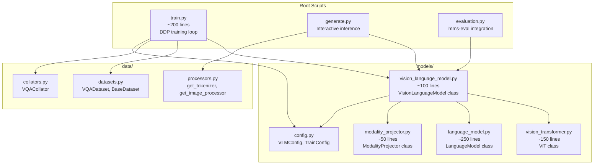
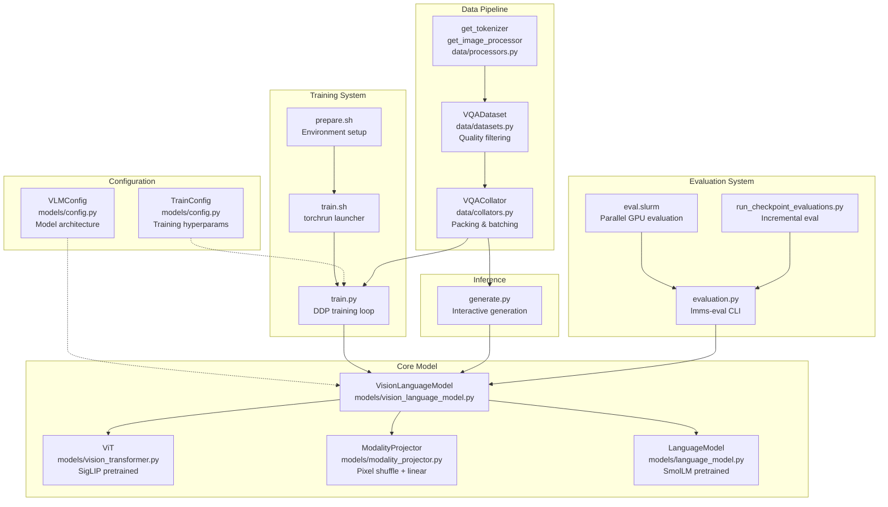
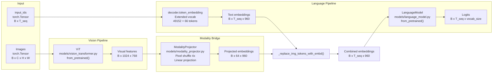
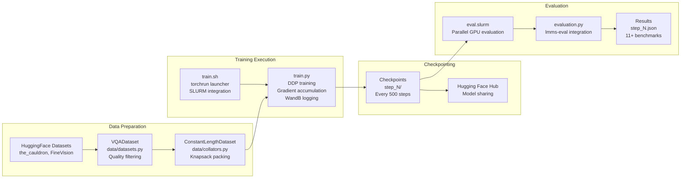

<!-- source: DeepWiki mcp.deepwiki.com · repo huggingface/nanoVLM · page 1 Overview · fetched 2026-10-26 -->

# Overview

<details>
<summary>Relevant source files</summary>

The following files were used as context for generating this wiki page:

- [README.md](README.md)
- [models/vision_language_model.py](models/vision_language_model.py)

</details>


nanoVLM is a minimal Vision-Language Model implementation in pure PyTorch designed for education and experimentation. The entire model definition and training logic fits in approximately 750 lines of code, making it highly accessible for researchers who want to understand VLMs without navigating complex frameworks.

## What is nanoVLM?

nanoVLM provides a complete pipeline for training, evaluating, and deploying small Vision-Language Models. Similar to Andrej Karpathy's nanoGPT, it focuses on simplicity and readability while delivering functional performance. The implementation uses pretrained backbones (SigLIP for vision, SmolLM for language) connected through a learned modality projection layer.

**Key Characteristics:**
- **Pure PyTorch**: No external training frameworks like `transformers.Trainer`, `accelerate`, or `deepspeed`
- **Minimal Dependencies**: `torch`, `numpy`, `torchvision`, `pillow`, `datasets`, `huggingface-hub`, `transformers`, `wandb`
- **Modular Architecture**: Clear separation between vision, language, and projection components
- **~750 Lines**: Model definition and training logic is compact and readable
- **Educational Focus**: Code is written for understanding, not production optimization

**nanoVLM Repository Structure**


Sources: [README.md:26-28](), [README.md:244-247]()

## System Architecture

nanoVLM is organized into six major subsystems that handle model definition, training, evaluation, inference, data processing, and configuration.

**High-Level System Architecture**


| Subsystem | Key Files | Purpose |
|-----------|-----------|---------|
| **Core Model** | `models/vision_language_model.py`, `models/vision_transformer.py`, `models/language_model.py`, `models/modality_projector.py` | Multimodal model architecture |
| **Training** | `train.py`, `train.sh`, `prepare.sh` | Distributed training with DDP |
| **Evaluation** | `evaluation.py`, `eval.slurm`, `run_checkpoint_evaluations.py` | Benchmark evaluation via lmms-eval |
| **Data Pipeline** | `data/datasets.py`, `data/processors.py`, `data/collators.py` | Data loading, filtering, and batching |
| **Configuration** | `models/config.py` | Model and training configuration |
| **Inference** | `generate.py` | Interactive text generation |

Sources: [README.md:26-28](), Diagram 1 from high-level architecture

## Core Model Components

The `VisionLanguageModel` class in [models/vision_language_model.py:21-81]() orchestrates three specialized components to process multimodal inputs and generate text.

**VisionLanguageModel Architecture**


**Key Methods:**

| Method | File Location | Purpose |
|--------|---------------|---------|
| `VisionLanguageModel.forward()` | [models/vision_language_model.py:62-80]() | Training forward pass with loss calculation |
| `VisionLanguageModel.generate()` | [models/vision_language_model.py:82-183]() | Autoregressive generation with KV caching |
| `VisionLanguageModel.from_pretrained()` | [models/vision_language_model.py:185-233]() | Load model from Hub or local path |
| `VisionLanguageModel.push_to_hub()` | [models/vision_language_model.py:252-280]() | Upload model to Hugging Face Hub |
| `_replace_img_tokens_with_embd()` | [models/vision_language_model.py:36-49]() | Replace image token placeholders with visual embeddings |

**Component Details:**

1. **ViT** (`models/vision_transformer.py`): Processes images into 1024 visual tokens (32×32 grid) using pretrained SigLIP-B/16-512 weights
2. **ModalityProjector** (`models/modality_projector.py`): Reduces sequence length 16× via pixel shuffle (32×32→8×8), then projects 12,288→960 dimensions
3. **LanguageModel** (`models/language_model.py`): SmolLM2-360M with grouped query attention (15 Q heads, 5 KV heads) and RMSNorm

Sources: [models/vision_language_model.py:1-311](), Diagram 4 from high-level architecture

## Training and Evaluation Workflow

nanoVLM provides a complete workflow for training models on multimodal datasets and evaluating them on standardized benchmarks.

**Training Pipeline**


**Training Features:**
- **Distributed Training**: PyTorch DDP with NCCL backend, launched via `torchrun` in [train.sh]()
- **Data Quality Filtering**: Four quality metrics (relevance, image correspondence, visual dependency, formatting) in `VQADataset`
- **Efficient Packing**: Greedy knapsack algorithm in `ConstantLengthDataset` packs variable-length samples into fixed 4096-token sequences
- **Gradient Accumulation**: 8 accumulation steps for larger effective batch sizes
- **Differentiated Learning Rates**: MP layer trains at 0.00512, pretrained backbones at 5e-5

**Evaluation Features:**
- **lmms-eval Integration**: Standardized evaluation via `NanoVLMWrapper` adapter in [evaluation.py]()
- **11+ Benchmarks**: MME, MMMU, MMStar, DocVQA, TextVQA, OCRBench, ScienceQA, ChartQA, AI2D, InfoVQA, SeedBench
- **Incremental Evaluation**: `run_checkpoint_evaluations.py` discovers checkpoints and only evaluates missing tasks
- **Parallel Execution**: [eval.slurm]() launches one task per GPU for efficient benchmarking

Sources: [train.py](), [evaluation.py](), Diagram 2 and Diagram 3 from high-level architecture

## Model Variants and Performance

nanoVLM supports multiple model configurations with different performance characteristics.

| Model | Vision Backbone | Language Model | Total Params | Training Time | MMStar Accuracy |
|-------|----------------|----------------|--------------|---------------|-----------------|
| **nanoVLM-222M** | SigLIP-B/16-224 (85M) | SmolLM2-135M | 222M | ~6h on H100 | 35.3% |
| **nanoVLM-450M** | SigLIP2-B/16-512 (107M) | SmolLM2-360M | 450M | - | - |

**Training Configuration:**
- **Dataset**: ~1.7M samples from `the_cauldron` (HuggingFaceM4)
- **Sequence Length**: 4096 tokens with knapsack packing
- **Effective Batch Size**: `batch_size × gradient_accumulation_steps` (typically 8×8=64)
- **Training Steps**: Up to 40,000 steps
- **Hardware**: Single H100 GPU (nanoVLM-222M) or multi-node DDP (larger models)

**Benchmark Results (nanoVLM-222M):**
- MMStar: 35.3% accuracy on challenging multi-modal reasoning
- Training completes in ~6 hours on single H100 GPU
- Model can recognize objects, scenes, and answer visual questions

Sources: [README.md:33-38](), [README.md:193-214]()

## Key Features

**Simplicity and Accessibility**
- **~750 Lines**: Complete model and training implementation
- **Pure PyTorch**: No external training frameworks
- **Readable Code**: Educational focus with clear variable names and comments
- **Minimal Dependencies**: Only essential packages (torch, numpy, transformers, wandb)

**Training Capabilities**
- **Distributed Training**: PyTorch DDP with SLURM integration via [train.sh]() and [prepare.sh]()
- **Quality Filtering**: Four-metric quality assessment in `VQADataset` (relevance, image correspondence, visual dependency, formatting)
- **Efficient Packing**: Greedy knapsack algorithm in `ConstantLengthDataset` maximizes GPU utilization
- **Gradient Accumulation**: 8-step accumulation for larger effective batch sizes
- **WandB Integration**: Comprehensive experiment tracking and logging

**Evaluation System**
- **lmms-eval Integration**: Standardized evaluation framework via `NanoVLMWrapper`
- **11+ Benchmarks**: MME, MMMU, MMStar, DocVQA, TextVQA, OCRBench, and more
- **Incremental Evaluation**: Only evaluate missing checkpoints/tasks for efficiency
- **Parallel Execution**: One task per GPU via [eval.slurm]()

**Hub Integration**
- **Load from Hub**: `VisionLanguageModel.from_pretrained("lusxvr/nanoVLM-450M")`
- **Push to Hub**: `model.push_to_hub("my-awesome-nanovlm")` with automatic model card generation
- **Local Save/Load**: `save_pretrained()` and `from_pretrained()` for local storage

**Generation Features**
- **Interactive Inference**: [generate.py]() for quick testing
- **KV Caching**: Efficient autoregressive generation in `VisionLanguageModel.generate()`
- **Flexible Sampling**: Greedy, top-k, top-p sampling strategies
- **Chat Templates**: Built-in chat template support for instruction following

Sources: [README.md:26-28](), [README.md:140-168](), [README.md:244-247]()

## Getting Started

To use nanoVLM, you can:

1. **Clone the repository and set up environment**:
   ```bash
   git clone https://github.com/huggingface/nanoVLM.git
   cd nanoVLM
   # Install dependencies
   pip install torch numpy torchvision pillow datasets huggingface-hub transformers
   ```

2. **Train a model**:
   ```bash
   python train.py
   ```

3. **Generate text from images**:
   ```bash
   python generate.py
   ```

4. **Use the interactive notebook**:
   - Open the provided Colab notebook for a guided experience

For detailed setup instructions, see [Development and Environment Setup](#8).
For usage examples, see [Examples and Usage](#7).

Sources: [README.md:22-52](https://github.com/huggingface/nanoVLM/blob/main/README.md), [README.md:53-78](https://github.com/huggingface/nanoVLM/blob/main/README.md)

---

