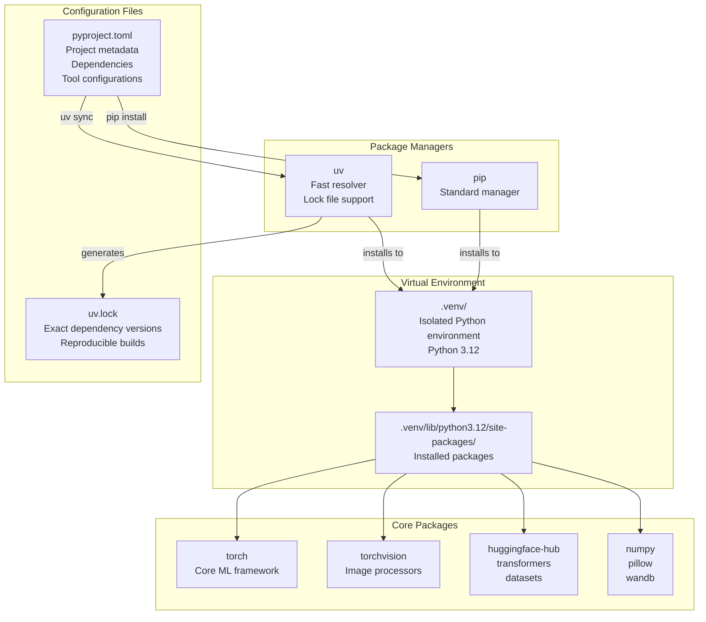
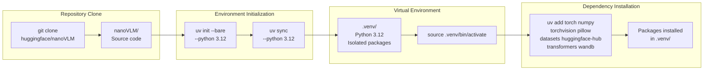
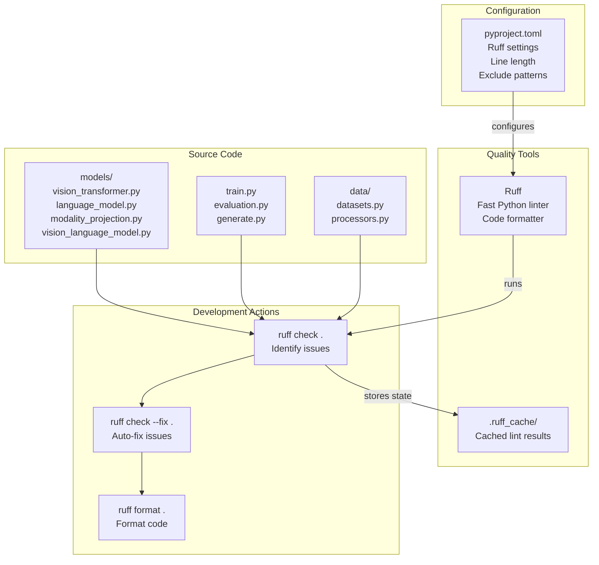
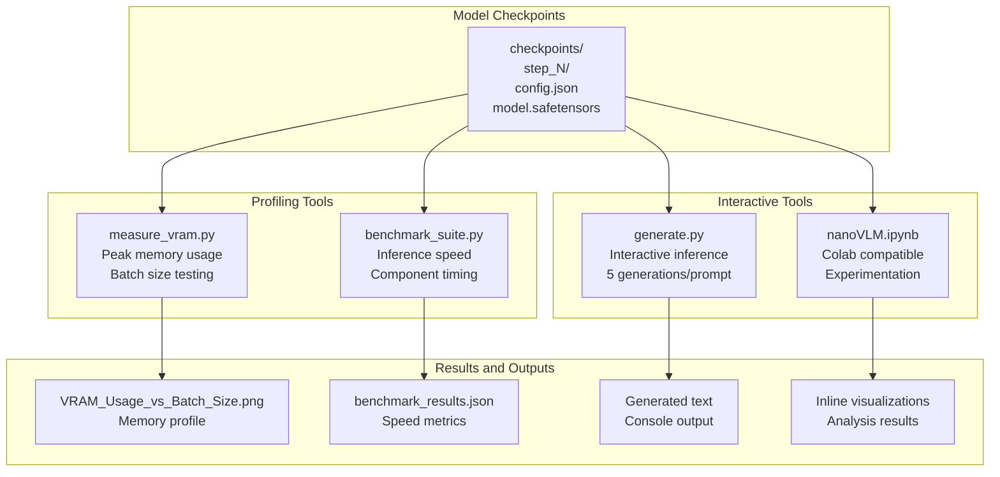

<!-- source: DeepWiki mcp.deepwiki.com · repo huggingface/nanoVLM · page 10 Development Environment · fetched 2026-10-26 -->

# Development Environment

<details>
<summary>Relevant source files</summary>

The following files were used as context for generating this wiki page:

- [.gitignore](.gitignore)
- [README.md](README.md)

</details>


## Purpose and Scope

This document describes the development environment setup, tooling, and workflows for contributing to nanoVLM. It covers package management, virtual environment configuration, code quality tools, authentication requirements, and typical development workflows. For information about the training infrastructure and distributed execution, see [Distributed Training Infrastructure](#6.2). For deployment and model sharing, see [Inference and Generation](#8).

---

## Package Management and Dependencies

nanoVLM supports two package management approaches: `uv` (recommended) and standard `pip`. The `uv` package manager offers faster dependency resolution and reproducible builds through lock files.

### Core Dependencies

The project requires the following core packages:

| Package | Purpose |
|---------|---------|
| `torch` | Deep learning framework |
| `numpy` | Numerical computations |
| `torchvision` | Image preprocessing utilities |
| `pillow` | Image loading and manipulation |
| `datasets` | HuggingFace datasets integration |
| `huggingface-hub` | Model storage and sharing |
| `transformers` | Pretrained backbone loading |
| `wandb` | Experiment tracking and logging |

### Optional Dependencies

| Package | Purpose | Installation |
|---------|---------|--------------|
| `lmms-eval` | Comprehensive evaluation framework | `uv pip install git+https://github.com/EvolvingLMMs-Lab/lmms-eval.git` |

**Diagram: Dependency Management Flow**



Sources: [README.md:45-78]()

---

## Environment Setup Process

### Using uv (Recommended)

The `uv` package manager provides faster dependency resolution and reproducible environments through lock files.

**Setup Steps:**

```bash
# Clone repository
git clone https://github.com/huggingface/nanoVLM.git
cd nanoVLM

# Initialize uv environment
uv init --bare --python 3.12
uv sync --python 3.12

# Activate virtual environment
source .venv/bin/activate

# Install core dependencies
uv add torch numpy torchvision pillow datasets huggingface-hub transformers wandb
```

### Using pip (Alternative)

```bash
# Clone repository
git clone https://github.com/huggingface/nanoVLM.git
cd nanoVLM

# Create virtual environment
python3.12 -m venv .venv
source .venv/bin/activate

# Install dependencies
pip install torch numpy torchvision pillow datasets huggingface-hub transformers wandb
```

### Virtual Environment Isolation

The `.venv/` directory contains an isolated Python environment with project-specific packages. This directory is excluded from version control via [.gitignore:11]().

**Diagram: Environment Setup Workflow**



Sources: [README.md:49-62]()

---

## Project Configuration

### Configuration Files

The project uses standard Python configuration files for managing metadata, dependencies, and tool settings:

| File | Purpose | Version Control |
|------|---------|-----------------|
| `pyproject.toml` | Project metadata, dependencies, tool configurations | Excluded ([.gitignore:20]()) |
| `uv.lock` | Exact dependency versions for reproducible builds | Excluded ([.gitignore:21]()) |
| `.gitignore` | Files to exclude from version control | Tracked |
| `.python-version` | Python version specification | Excluded ([.gitignore:19]()) |

### Excluded Directories and Files

The following are excluded from version control to maintain a clean repository:

**Python Artifacts:**
- `__pycache__/` - Compiled Python bytecode
- `*.py[oc]` - Compiled modules
- `build/`, `dist/`, `wheels/` - Distribution artifacts
- `*.egg-info` - Package metadata

**Development Artifacts:**
- `.venv/` - Virtual environment
- `.ruff_cache/` - Linter cache
- `wandb/` - WandB logging data
- `logs/` - Training logs
- `.vscode/` - Editor configuration

**Training Artifacts:**
- `checkpoints/` - Model checkpoints
- `eval_results*/` - Evaluation results
- `results/` - Experiment results
- `plots*/` - Generated plots
- `shards/*` - Data shards

Sources: [.gitignore:1-32]()

---

## Code Quality Tools

### Ruff Linter

nanoVLM uses Ruff for fast Python linting and code formatting. Ruff is configured via `pyproject.toml` (though the file is excluded from version control, the `.ruff_cache/` directory shows it's in use).

**Ruff Cache:**
The `.ruff_cache/` directory ([.gitignore:13]()) stores linter state for faster subsequent runs. This cache is excluded from version control.

**Typical Usage:**

```bash
# Run linter on entire codebase
ruff check .

# Auto-fix issues where possible
ruff check --fix .

# Format code
ruff format .
```

**Diagram: Code Quality Workflow**



Sources: [.gitignore:13](), [README.md:244-249]()

---

## Authentication and API Keys

### Required Authentication

nanoVLM requires authentication with two external services:

#### WandB (Weights & Biases)

Used for experiment tracking, metrics logging, and training visualization.

```bash
wandb login --relogin
```

This command prompts for a WandB API key, which is stored locally. The `wandb/` directory ([.gitignore:14]()) contains local logging data and is excluded from version control.

#### HuggingFace Hub

Used for loading pretrained backbones, pushing trained models, and accessing datasets.

```bash
huggingface-cli login
```

This command prompts for a HuggingFace API token. The token is stored in the HuggingFace cache directory (specified via `HF_HOME` environment variable).

### Environment Variables

| Variable | Purpose | Example |
|----------|---------|---------|
| `HF_HOME` | HuggingFace cache directory | `export HF_HOME="/path/to/cache"` |
| `WANDB_PROJECT` | WandB project name | Set in training scripts |
| `WANDB_ENTITY` | WandB entity/team | Set in training scripts |

Sources: [README.md:83-84](), [README.md:122-123]()

---

## Development Workflow

### Typical Development Cycle

**Diagram: Developer Workflow**

```mermaid
graph TB
    subgraph "Setup Phase"
        Clone["Clone Repository<br/>git clone"]
        EnvSetup["Environment Setup<br/>uv sync or pip install"]
        Auth["Authentication<br/>wandb login<br/>huggingface-cli login"]
        
        Clone --> EnvSetup
        EnvSetup --> Auth
    end
    
    subgraph "Development Phase"
        EditCode["Edit Source Files<br/>models/*.py<br/>data/*.py<br/>train.py"]
        Lint["Code Quality Check<br/>ruff check ."]
        Test["Local Testing<br/>python train.py<br/>python generate.py"]
        
        EditCode --> Lint
        Lint --> Test
    end
    
    subgraph "Training Phase"
        PrepData["Data Preparation<br/>prepare.sh"]
        TrainLocal["Local Training<br/>python train.py"]
        TrainDist["Distributed Training<br/>train.sh on SLURM"]
        
        PrepData --> TrainLocal
        TrainLocal --> TrainDist
    end
    
    subgraph "Evaluation Phase"
        EvalLocal["Local Evaluation<br/>python evaluation.py"]
        EvalDist["Distributed Evaluation<br/>eval.slurm"]
        PlotResults["Visualization<br/>plot_eval_results.py"]
        
        EvalLocal --> EvalDist
        EvalDist --> PlotResults
    end
    
    subgraph "Deployment Phase"
        Checkpoint["Local Checkpoint<br/>checkpoints/step_N/"]
        PushHub["Push to Hub<br/>model.push_to_hub()"]
        GenTest["Interactive Testing<br/>python generate.py"]
        
        Checkpoint --> PushHub
        PushHub --> GenTest
    end
    
    Auth --> EditCode
    Test --> PrepData
    TrainDist --> EvalLocal
    PlotResults --> Checkpoint
```



### Common Development Tasks

#### 1. Code Modification and Testing

```bash
# Edit model code
vim models/vision_language_model.py

# Check code quality
ruff check .

# Test changes locally
python train.py --max_steps 100  # Quick test run
```

#### 2. Experiment Iteration

```bash
# Modify configuration
vim models/config.py

# Run training with WandB tracking
python train.py

# Evaluate checkpoint
python evaluation.py --model checkpoints/step_500 --tasks mmstar
```

#### 3. Interactive Development

```bash
# Launch Jupyter notebook for exploration
jupyter notebook nanoVLM.ipynb

# Interactive generation testing
python generate.py --checkpoint checkpoints/step_1000
```

#### 4. Performance Analysis

```bash
# Measure VRAM usage for different batch sizes
python measure_vram.py --batch_sizes "1 2 4 8 16"

# Benchmark inference speed
python benchmark_suite.py
```

Sources: [README.md:79-98](), [README.md:221-239]()

---

## Contribution Guidelines

### Contribution Philosophy

nanoVLM maintains a focus on **simplicity** and **pure PyTorch implementation**. The codebase intentionally avoids dependencies like `transformers.Trainer`, `accelerate`, or `deepspeed` to maintain educational clarity.

### Contribution Process

#### 1. Before Contributing

**For New Features:**
- Open an issue to discuss scope and implementation
- Ensure alignment with project goals (simplicity, pure PyTorch)
- Get maintainer feedback before implementation

**For Bug Fixes:**
- Submit pull requests directly
- Include clear description of the bug and fix

#### 2. Code Standards

```bash
# Ensure code quality before submitting
ruff check .
ruff format .
```

#### 3. Testing

```bash
# Test training pipeline
python train.py --max_steps 10

# Test inference
python generate.py

# Test evaluation (if applicable)
python evaluation.py --model lusxvr/nanoVLM-450M --tasks mmstar
```

### Project Roadmap

The following areas are prioritized for contributions:

| Area | Priority | Description |
|------|----------|-------------|
| Evaluations | High | More benchmarks or improved implementations |
| Data Packing | Medium | Optimize training with better packing |
| Multi-GPU Training | Medium | Efficient distributed training |
| Multi-Image Support | Medium | Training with multiple images per sample |
| Image Splitting | Medium | Higher resolution support |
| VLMEvalKit | Low | Integration with additional evaluation framework |

**Note:** Several items from this roadmap have been implemented (multi-GPU, image splitting) as noted in [README.md:16-18]().

### Restrictions

The following will **not be accepted**:

- Dependencies on `transformers.Trainer`
- Dependencies on `accelerate`
- Dependencies on `deepspeed`
- Contributions that significantly increase code complexity
- Features that deviate from pure PyTorch implementation

Sources: [README.md:242-260]()

---

## Development Tools and Scripts

### Memory Profiling

**Script:** `measure_vram.py`

Measures peak GPU memory usage across different batch sizes to guide hardware selection and training configuration.

```bash
# Test default model with various batch sizes
python measure_vram.py --batch_sizes "1 2 4 8 16 32"

# Test specific checkpoint
python measure_vram.py --vlm_checkpoint_path checkpoints/step_1000 --batch_sizes "8 16 32"
```

**Output:** Peak VRAM allocation for each batch size, helping determine feasible configurations for available hardware.

### Inference Benchmarking

**Scripts:** `benchmark_suite.py`, `benchmark-inference.py`

Measure inference speed, time to first token, and component-level timing.

```bash
# Run comprehensive benchmark
python benchmark_suite.py

# Benchmark specific model
python benchmark-inference.py --model lusxvr/nanoVLM-450M
```

### Jupyter Notebooks

**Location:** `notebooks/` (excluded from version control via [.gitignore:26]())

Interactive Jupyter notebooks for:
- Exploratory data analysis
- Model architecture visualization
- Quick prototyping
- Result analysis

```bash
# Launch notebook interface
jupyter notebook nanoVLM.ipynb
```

**Diagram: Development Tools Integration**



Sources: [README.md:192-239](), [.gitignore:26]()

---

## Summary

The nanoVLM development environment emphasizes simplicity and reproducibility:

- **Package Management:** `uv` recommended for fast resolution and lock files, `pip` supported as alternative
- **Virtual Environment:** Isolated `.venv/` with Python 3.12
- **Code Quality:** Ruff linter for consistent code style
- **Authentication:** WandB and HuggingFace Hub integration
- **Development Workflow:** Iterative development with local testing and distributed training
- **Contribution Guidelines:** Focus on simplicity, pure PyTorch, and educational value
- **Development Tools:** Memory profiling, benchmarking, and interactive notebooks

For training infrastructure details, see [Distributed Training Infrastructure](#6.2). For evaluation workflows, see [Evaluation System](#7).