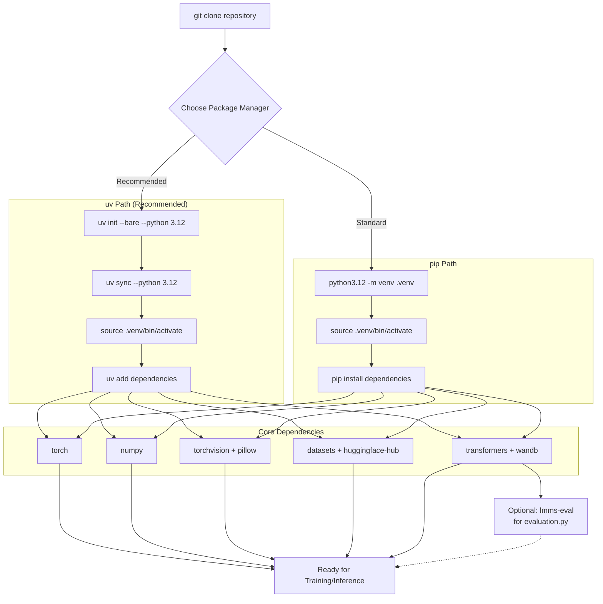
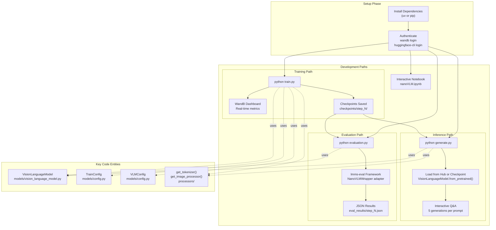

<!-- source: DeepWiki mcp.deepwiki.com · repo huggingface/nanoVLM · page 2 Getting Started · fetched 2026-10-26 -->

# Getting Started

<details>
<summary>Relevant source files</summary>

The following files were used as context for generating this wiki page:

- [.gitignore](.gitignore)
- [README.md](README.md)

</details>


This page provides step-by-step instructions for installing nanoVLM, configuring authentication, and running your first training and inference examples. For details on the model architecture, see [Architecture](#3). For comprehensive training configuration options, see [Configuration System](#4). For distributed training setup on SLURM clusters, see [Distributed Training Infrastructure](#6.2).

---

## Prerequisites

Before installing nanoVLM, ensure you have:

| Requirement | Minimum Version | Purpose |
|------------|----------------|---------|
| Python | 3.12 | Core runtime environment |
| CUDA | 11.8+ | GPU acceleration for training/inference |
| Git | Any | Repository cloning |
| GPU VRAM | 4.5 GB | Minimum for batch_size=1 training |

**Recommended Hardware:**
- Single H100 GPU (80GB VRAM) for full training runs
- 8GB+ VRAM for inference and small-scale experimentation
- For VRAM profiling guidance, see [VRAM Profiling](#9.1)

Sources: [README.md:193-219]()

---

## Installation

### Step 1: Clone the Repository

```bash
git clone https://github.com/huggingface/nanoVLM.git
cd nanoVLM
```

### Step 2: Choose Your Package Manager

nanoVLM supports two installation methods: **uv** (recommended for speed) and **pip** (standard).

#### Option A: Installation with uv (Recommended)

The `uv` package manager provides faster dependency resolution and improved reproducibility through `uv.lock`.

```bash
# Initialize uv environment with Python 3.12
uv init --bare --python 3.12

# Sync dependencies from uv.lock
uv sync --python 3.12

# Activate virtual environment
source .venv/bin/activate

# Install core dependencies
uv add torch numpy torchvision pillow datasets huggingface-hub transformers wandb
```

#### Option B: Installation with pip

```bash
# Create virtual environment
python3.12 -m venv .venv
source .venv/bin/activate

# Install core dependencies
pip install torch numpy torchvision pillow datasets huggingface-hub transformers wandb
```

### Core Dependencies

| Package | Purpose | Used By |
|---------|---------|---------|
| `torch` | Core deep learning framework | All model components |
| `numpy` | Numerical operations | Data processing |
| `torchvision` | Image preprocessing transforms | `processors/image_processor.py` |
| `pillow` | Image loading and manipulation | `datasets/base_dataset.py` |
| `datasets` | HuggingFace dataset loading | `train.py`, data pipeline |
| `huggingface-hub` | Model/dataset downloads | `VisionLanguageModel.from_pretrained()` |
| `transformers` | Pretrained backbone loading | Vision and language model initialization |
| `wandb` | Experiment tracking and logging | `train.py` metrics logging |

### Optional: lmms-eval Integration

For benchmark evaluation support, install `lmms-eval` from source:

```bash
# With uv
uv pip install git+https://github.com/EvolvingLMMs-Lab/lmms-eval.git

# With pip
pip install git+https://github.com/EvolvingLMMs-Lab/lmms-eval.git
```

This enables evaluation via `evaluation.py`. See [Evaluation System](#7) for details.

Sources: [README.md:45-78](), [README.md:113-119]()

---

## Environment Setup Diagram



Sources: [README.md:45-78]()

---

## Authentication

nanoVLM requires authentication to two services for full functionality:

### WandB (Weights & Biases)

WandB is used for experiment tracking during training. The training script logs metrics, hyperparameters, and system statistics to WandB.

```bash
wandb login --relogin
```

You'll be prompted to enter your API key, which can be found at https://wandb.ai/authorize. The key is cached in `~/.netrc` for future sessions.

**Usage in code:**
- Training metrics logged via `wandb.log()` in [train.py:140-160]()
- Experiment configuration tracked in `wandb.init()` call
- Optional: disable with `WANDB_MODE=offline` environment variable

### Hugging Face Hub

The Hub is used for:
1. **Downloading pretrained backbones** (SigLIP vision encoder, SmolLM language model)
2. **Loading trained nanoVLM checkpoints** via `VisionLanguageModel.from_pretrained()`
3. **Uploading trained models** via `model.push_to_hub()`

```bash
huggingface-cli login
```

You'll be prompted to enter your token from https://huggingface.co/settings/tokens. The token is cached in `~/.huggingface/token`.

**Environment Variables:**

| Variable | Purpose | Default |
|----------|---------|---------|
| `HF_HOME` | Cache location for downloaded models/datasets | `~/.cache/huggingface` |
| `HF_TOKEN` | Alternative to `huggingface-cli login` | None |

Example with custom cache:
```bash
export HF_HOME="/scratch/user/hf_cache"
huggingface-cli login
```

Sources: [README.md:82-85](), [README.md:121-123]()

---

## Quick Start Examples

### Interactive Notebook (Fastest Start)

The quickest way to explore nanoVLM is through the provided Jupyter notebook:

```bash
# Launch notebook
jupyter notebook nanoVLM.ipynb

# Or open in Google Colab (no local setup required)
# Visit: https://colab.research.google.com/github/huggingface/nanoVLM/blob/main/nanoVLM.ipynb
```

The notebook includes:
- Pretrained model loading and inference examples
- Step-by-step architecture walkthrough
- Interactive generation with custom images

Sources: [README.md:42](), [README.md:5-7]()

---

### Training Your First Model

The training script [train.py]() implements distributed data parallel training with gradient accumulation and WandB logging.

#### Basic Training Command

```bash
python train.py
```

This uses the default configuration from [models/config.py]() with:
- `VLMConfig`: Model architecture parameters (SigLIP-B + SmolLM2-360M)
- `TrainConfig`: Training hyperparameters (learning rates, batch size, max steps)

#### Training with Custom Configuration

```bash
python train.py \
    --max_steps 10000 \
    --batch_size 16 \
    --gradient_accumulation_steps 4 \
    --eval_interval 500 \
    --checkpoint_dir "./my_checkpoints"
```

**Key Training Parameters:**

| Parameter | Default | Description |
|-----------|---------|-------------|
| `max_steps` | 40000 | Total training iterations |
| `batch_size` | 8 | Per-GPU batch size |
| `gradient_accumulation_steps` | 8 | Effective batch size = batch_size × this value |
| `learning_rate_mp` | 0.00512 | Modality projector LR (100× higher than backbones) |
| `learning_rate_vision` | 5e-5 | Vision encoder LR |
| `learning_rate_language` | 5e-5 | Language model LR |
| `eval_interval` | 500 | Steps between checkpoint saves |

For complete parameter documentation, see [Configuration System](#4).

#### Training Output

During training, you'll see:

1. **Console logs** with step number, loss, and learning rates
2. **WandB dashboard** with real-time metrics at https://wandb.ai
3. **Checkpoint saves** in `checkpoints/step_N/` every `eval_interval` steps
4. **Final model push** to Hugging Face Hub (if configured)

Example console output:
```
Step 100/40000 | Loss: 2.3451 | LR_MP: 0.00512 | LR_Vision: 5e-05 | LR_Language: 5e-05
Step 200/40000 | Loss: 2.1234 | LR_MP: 0.00498 | LR_Vision: 4.8e-05 | LR_Language: 4.8e-05
```

Sources: [README.md:79-87]()

---

### Running Inference

The generation script [generate.py]() provides interactive text generation from images.

#### Using Pretrained Model from Hub

```bash
python generate.py
```

This loads the default pretrained model `lusxvr/nanoVLM-450M` from the Hub.

#### Using Your Trained Checkpoint

```bash
python generate.py --checkpoint ./checkpoints/step_5000
```

#### Using a Specific Hub Model

```bash
python generate.py --checkpoint username/my-nanovlm-model
```

#### Example Interaction

When you run `generate.py`, it prompts for an image path and question:

```
Enter image path: assets/image.png
Enter question: What is this?

Generation 1: This is a cat sitting on the ground. I think this is a cat sitting on the ground.
Generation 2: This picture is clicked outside. In the center there is a brown color cat seems to be sitting on
Generation 3: This is a cat sitting on the ground, which is of white and brown in color. This cat
Generation 4: This is a cat sitting on the ground. I think this is a cat sitting on the ground.
Generation 5: This is a cat sitting on the ground, which is covered with a mat. I think this is
```

The script generates 5 completions by default. See [Inference and Generation](#8) for programmatic usage.

Sources: [README.md:89-111]()

---

### Evaluating Models

The evaluation system integrates with `lmms-eval` for standardized benchmarking.

#### Single Task Evaluation

```bash
python evaluation.py --model lusxvr/nanoVLM-450M --tasks mmstar
```

#### Multi-Task Evaluation

```bash
python evaluation.py \
    --model ./checkpoints/step_5000 \
    --tasks mmstar,mme,ocrbench \
    --batch_size 128
```

#### Supported Benchmark Tasks

The system supports 11+ vision-language benchmarks:

| Task | Description | Metric |
|------|-------------|--------|
| `mmstar` | Multi-modal reasoning | Accuracy |
| `mme` | Perception + cognition | Aggregate score |
| `mmmu_val`, `mmmu_test` | College-level QA | Accuracy |
| `docvqa_val`, `docvqa_test` | Document understanding | ANLS |
| `textvqa_val`, `textvqa_test` | Scene text reading | Accuracy |
| `ocrbench` | OCR capabilities | F1 score |
| `ai2d`, `chartqa`, `infovqa` | Domain-specific tasks | Various |

#### Evaluation Output

Results are saved in `eval_results/`:

```
eval_results/
├── step_5000.json          # Aggregated metrics
└── step_5000/              # Per-sample outputs
    ├── mmstar.json
    ├── mme.json
    └── ocrbench.json
```

For automated checkpoint evaluation and result visualization, see [Evaluation System](#7).

Sources: [README.md:113-138]()

---

## Quick Start Workflow Diagram



Sources: [README.md:40-189]()

---

## Hub Integration Examples

nanoVLM provides seamless integration with the Hugging Face Hub for model loading and sharing.

### Loading Pretrained Models

```python
from models.vision_language_model import VisionLanguageModel

# Load from Hub
model = VisionLanguageModel.from_pretrained("lusxvr/nanoVLM-450M")

# Load from local checkpoint
model = VisionLanguageModel.from_pretrained("./checkpoints/step_5000")
```

The `from_pretrained()` method:
1. Downloads `config.json` and `model.safetensors` from the Hub
2. Initializes model architecture from config
3. Loads weights with strict checking
4. Returns ready-to-use `VisionLanguageModel` instance

### Pushing Trained Models

```python
# After training
model.push_to_hub("my-awesome-nanovlm-model")

# With custom options
model.push_to_hub(
    "my-awesome-nanovlm-model",
    private=True,
    commit_message="Training run with FineVision dataset"
)
```

This creates a Hub repository containing:
- `config.json` - Model architecture configuration
- `model.safetensors` - Model weights in SafeTensors format
- `README.md` - Auto-generated model card

### Local Save/Load

For offline workflows:

```python
# Save locally
model.save_pretrained("./my_models/nanovlm_v1")

# Load from local path
model = VisionLanguageModel.from_pretrained("./my_models/nanovlm_v1")
```

For implementation details, see [Vision Language Model](#3.1).

Sources: [README.md:140-189]()

---

## File Structure Reference

After setup, your directory structure will look like:

```
nanoVLM/
├── .venv/                          # Virtual environment
├── models/
│   ├── vision_language_model.py   # VisionLanguageModel class
│   ├── vision_transformer.py      # ViT implementation
│   ├── language_model.py          # LM implementation
│   ├── modality_projection.py     # Projection layer
│   └── config.py                  # VLMConfig, TrainConfig
├── processors/
│   ├── image_processor.py         # Image preprocessing
│   └── tokenizer.py               # Text tokenization
├── datasets/
│   ├── base_dataset.py           # BaseDataset, VQADataset
│   └── constant_length_dataset.py # Packing algorithm
├── train.py                       # Training script
├── generate.py                    # Inference script
├── evaluation.py                  # lmms-eval integration
└── nanoVLM.ipynb                 # Interactive notebook
```

Sources: [README.md:26](), [.gitignore:1-32]()

---

## Next Steps

Now that you have nanoVLM installed and authenticated:

1. **Explore the Architecture**: Read [Architecture](#3) to understand how the vision, language, and projection components work together

2. **Understand the Data Pipeline**: See [Data Pipeline](#5) for details on dataset loading, quality filtering, and efficient packing

3. **Configure Your Training**: Review [Configuration System](#4) for complete parameter documentation and learning rate strategies

4. **Scale to Multiple GPUs**: See [Distributed Training Infrastructure](#6.2) for SLURM cluster setup with torchrun

5. **Run Comprehensive Evaluations**: Explore [Evaluation System](#7) for automated checkpoint evaluation and result visualization

6. **Profile Performance**: Use [Performance Analysis](#9) tools to measure VRAM usage and inference speed for your configuration

Sources: [README.md:1-274]()

---

