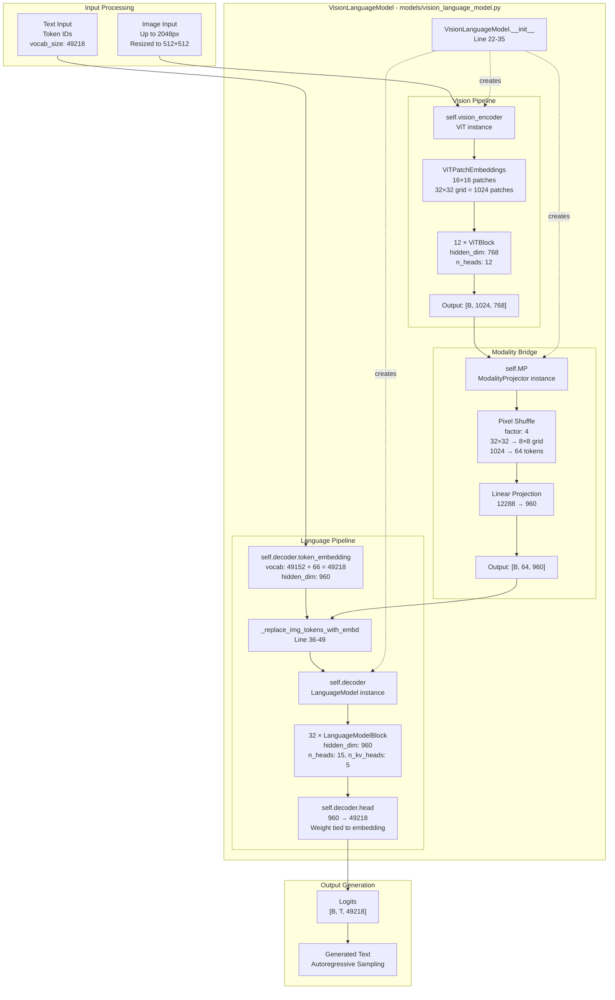
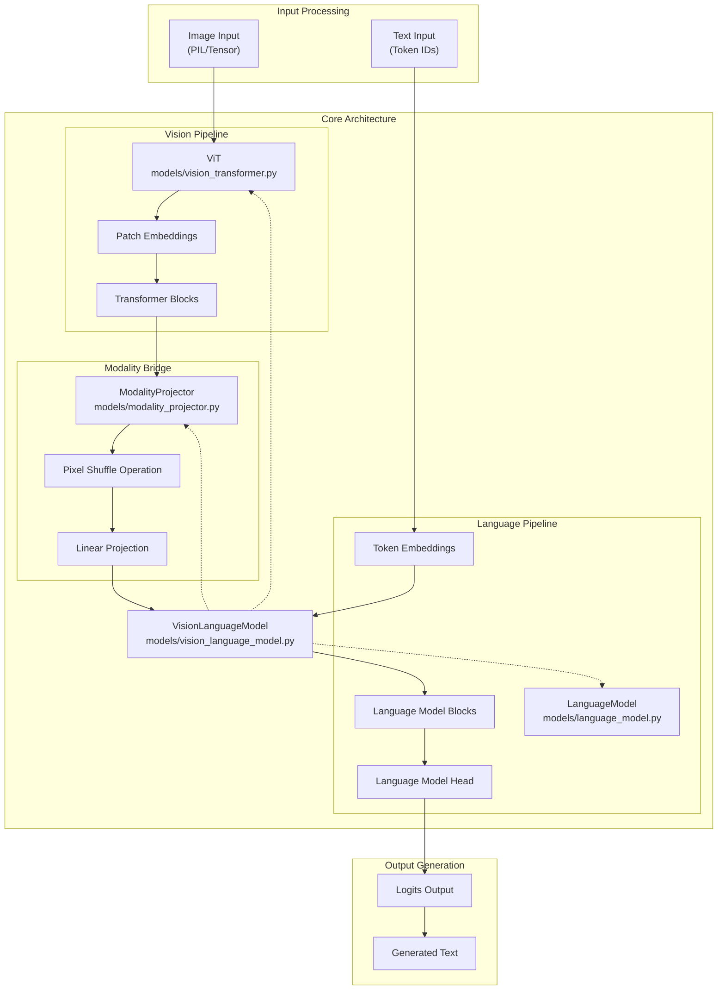
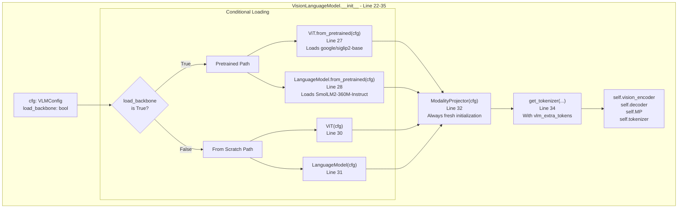
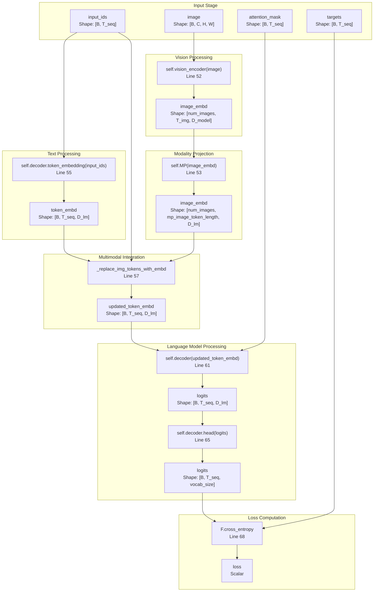
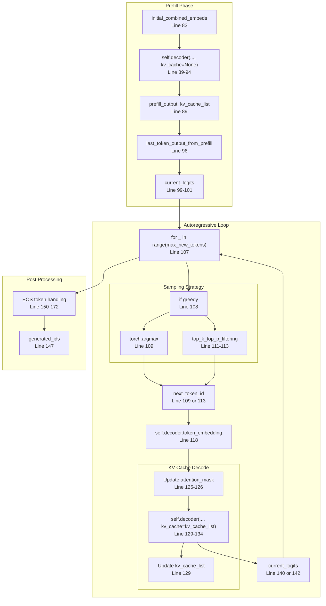
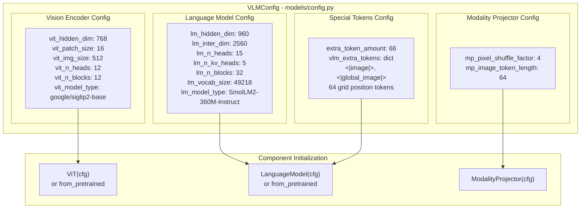
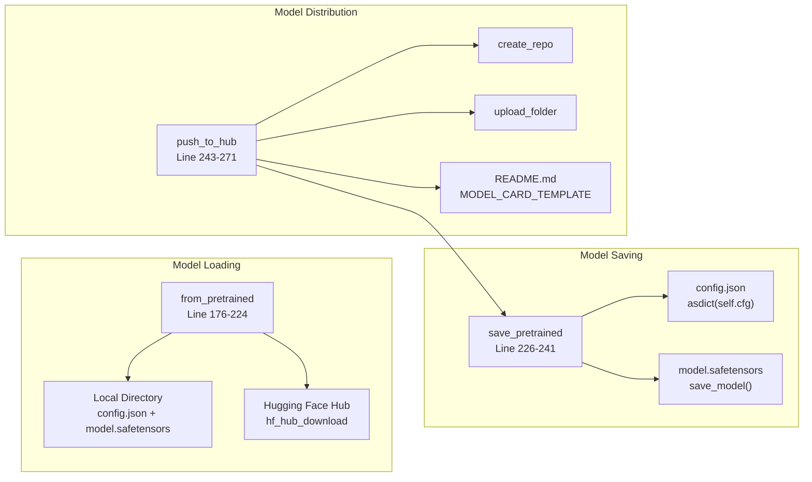

<!-- source: DeepWiki mcp.deepwiki.com · repo huggingface/nanoVLM · page 3 Architecture · fetched 2026-10-26 -->

# Architecture

Relevant source files

The following files were used as context for generating this wiki page:

- [models/config.py](models/config.py)
- [models/language_model.py](models/language_model.py)
- [models/modality_projector.py](models/modality_projector.py)
- [models/vision_language_model.py](models/vision_language_model.py)
- [models/vision_transformer.py](models/vision_transformer.py)

This document provides a high-level overview of the nanoVLM system architecture, covering the core components and their relationships. The architecture implements a Vision-Language Model that combines a Vision Transformer for image processing with a decoder-only language model for text generation, connected through a modality projection layer.

For detailed implementation of individual components, see [Vision Language Model](#3.1), [Vision Transformer](#3.2), [Language Model](#3.3), and [Modality Projector](#3.4). For configuration details, see [Configuration System](#4).

## System Overview

The nanoVLM architecture follows a modular design with three primary components orchestrated by the `VisionLanguageModel` class defined in [models/vision_language_model.py:21-35](). The system processes multimodal inputs (images and text) through separate encoders and projects them into a shared embedding space for unified processing by the language model.

**Key Components:**
- **Vision Encoder**: `ViT` processes images up to 2048px, producing 768-dimensional features
- **Modality Projector**: `ModalityProjector` reduces spatial dimensions via pixel shuffle and projects to language model dimension (960)
- **Language Model**: `LanguageModel` (SmolLM2-360M) generates text with 960-dimensional hidden states
</thinking>

Sources: [models/vision_language_model.py:21-35](), [models/config.py:5-55](), [models/vision_transformer.py:131-169](), [models/language_model.py:390-418](), [models/modality_projector.py:4-45]()

Sources: [models/vision_language_model.py:21-35](), [models/README.md:1-24]()

## Component Initialization and Integration

The `VisionLanguageModel.__init__` method in [models/vision_language_model.py:22-35]() orchestrates component initialization with conditional backbone loading.

**Initialization Flow:**

**Component Specifications:**

| Component | Initialization Method | Pretrained Source | Parameters |
|-----------|----------------------|-------------------|------------|
| `self.vision_encoder` | `ViT.from_pretrained(cfg)` or `ViT(cfg)` | `google/siglip2-base-patch16-512` | ~85M |
| `self.decoder` | `LanguageModel.from_pretrained(cfg)` or `LanguageModel(cfg)` | `SmolLM2-360M-Instruct` | ~360M |
| `self.MP` | `ModalityProjector(cfg)` | Always random init | ~11M |
| `self.tokenizer` | `get_tokenizer(...)` | Matches language model | Extended vocab: 49218 |

Sources: [models/vision_language_model.py:22-35](), [models/config.py:15](), [models/config.py:33]()

## Tensor Shape Transformations

The following table documents the tensor shape transformations through each component of the architecture:

| Stage | Component | Input Shape | Output Shape | Notes |
|-------|-----------|-------------|--------------|-------|
| **Vision Processing** |
| Patch Embedding | `ViTPatchEmbeddings` | `[B, 3, 512, 512]` | `[B, 1024, 768]` | 16×16 patches → 32×32 grid |
| Vision Blocks | `12 × ViTBlock` | `[B, 1024, 768]` | `[B, 1024, 768]` | Bidirectional attention |
| Layer Norm | `ViT.layer_norm` | `[B, 1024, 768]` | `[B, 1024, 768]` | Final normalization |
| **Modality Projection** |
| Pixel Shuffle | `ModalityProjector.pixel_shuffle` | `[B, 1024, 768]` | `[B, 64, 12288]` | 4× spatial reduction, 16× channel expansion |
| Linear Projection | `ModalityProjector.proj` | `[B, 64, 12288]` | `[B, 64, 960]` | Maps to language hidden dim |
| **Text Processing** |
| Token Embedding | `self.decoder.token_embedding` | `[B, T_seq]` | `[B, T_seq, 960]` | Vocab size: 49218 |
| Image Token Replace | `_replace_img_tokens_with_embd` | `[B, T_seq, 960]` + image embeddings | `[B, T_seq, 960]` | Replaces `<\|image\|>` tokens |
| **Language Generation** |
| Language Blocks | `32 × LanguageModelBlock` | `[B, T_seq, 960]` | `[B, T_seq, 960]` | Causal attention with KV cache |
| RMS Norm | `LanguageModel.norm` | `[B, T_seq, 960]` | `[B, T_seq, 960]` | Final normalization |
| LM Head | `self.decoder.head` | `[B, T_seq, 960]` | `[B, T_seq, 49218]` | Weight tied to embedding |

Sources: [models/vision_transformer.py:7-44](), [models/modality_projector.py:23-44](), [models/language_model.py:397-403](), [models/vision_language_model.py:36-49]()

## Data Flow Architecture

The system processes multimodal inputs through distinct pathways that converge at the modality projection layer, enabling unified processing in the language model's embedding space. The architecture supports two execution modes: training (forward pass with loss computation) and inference (autoregressive generation with KV caching).

### Training Forward Pass

The `VisionLanguageModel.forward` method in [models/vision_language_model.py:62-80]() processes batched multimodal inputs for training:

Sources: [models/vision_language_model.py:51-70]()

### Inference Generation Pipeline

The `VisionLanguageModel.generate` method in [models/vision_language_model.py:82-183]() implements two-phase generation: multimodal prefill followed by autoregressive decoding with KV caching.

Sources: [models/vision_language_model.py:72-174]()

## Configuration System Integration

The system uses `VLMConfig` from [models/config.py:4-55]() to centralize all architectural parameters. This configuration drives component initialization and defines cross-component compatibility.

**Key Configuration Parameters:**

**Vocabulary Extension:**

The vocabulary is extended from the base language model to include vision-specific tokens:
- Base vocabulary: `lm_base_vocab_size = 49152` (from SmolLM2)
- Extra tokens: `extra_token_amount = 66`
  - 1 × `<|image|>` token (standard image placeholder)
  - 1 × `<|global_image|>` token (global image context)
  - 64 × grid position tokens (`<row_X_col_Y>`) for spatial reasoning
- Extended vocabulary: `lm_vocab_size = 49218`

The token embedding matrix and LM head are extended to accommodate these tokens in [models/language_model.py:538-682]().

Sources: [models/config.py:4-55](), [models/config.py:23-24](), [models/config.py:43-51]()

## Model Persistence and Distribution

The architecture includes built-in support for model serialization and distribution through standardized methods:

Sources: [models/vision_language_model.py:176-301]()

## Image Token Integration Strategy

The architecture implements a flexible image token replacement mechanism that supports variable numbers of images per sample through the `_replace_img_tokens_with_embd` method.

The system uses special image token placeholders (`self.tokenizer.image_token_id`) in the input sequence, which are dynamically replaced with projected image embeddings during forward pass. This approach enables:

- **Variable Image Count**: Different samples in a batch can contain different numbers of images
- **Flexible Positioning**: Image tokens can appear anywhere in the input sequence
- **Unified Processing**: Image and text embeddings are processed together in the language model

The replacement operation creates a boolean mask for image token positions and uses tensor indexing to substitute embeddings in-place, maintaining the original sequence structure while incorporating visual information.

Sources: [models/vision_language_model.py:36-49](), [models/vision_language_model.py:46-47]()

---

