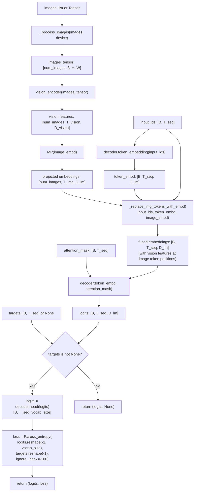
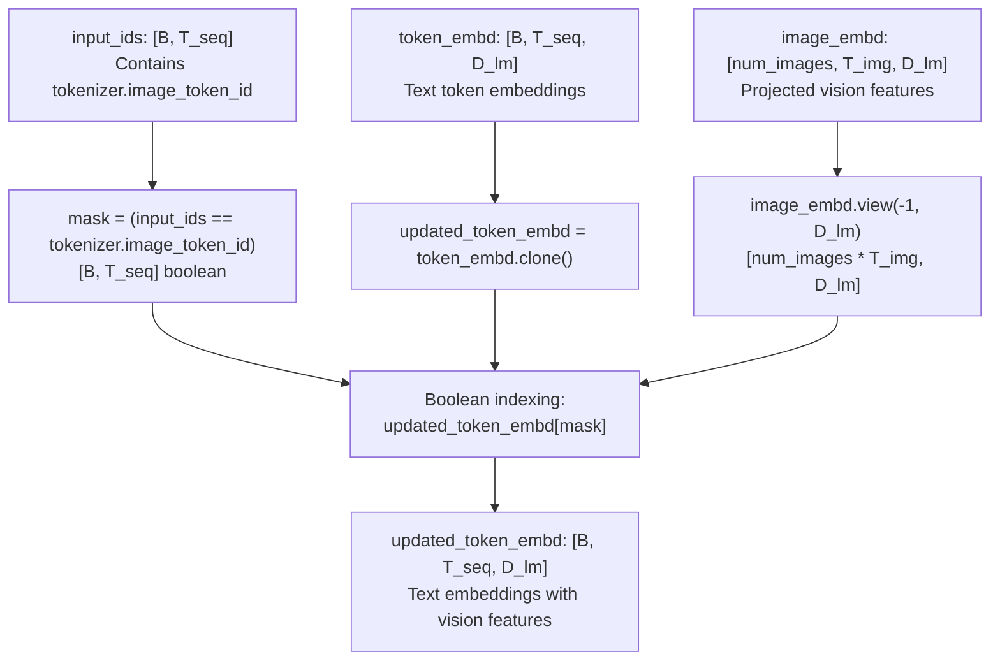
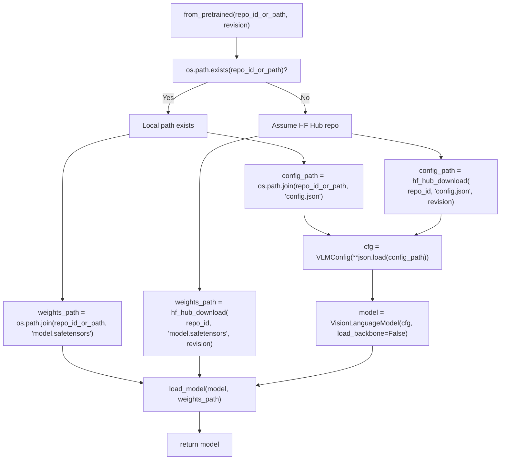
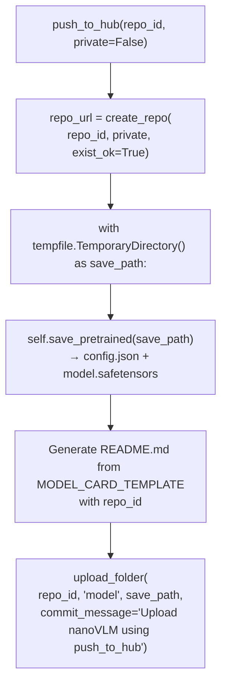

<!-- source: DeepWiki mcp.deepwiki.com · repo huggingface/nanoVLM · page 3.1 Vision Language Model · fetched 2026-10-26 -->

# Vision Language Model

<details>
<summary>Relevant source files</summary>

The following files were used as context for generating this wiki page:

- [models/vision_language_model.py](models/vision_language_model.py)

</details>


## Purpose and Scope

This document covers the `VisionLanguageModel` class, which serves as the main orchestrator for the nanoVLM multimodal architecture. The `VisionLanguageModel` integrates vision and language processing components to enable text generation conditioned on both images and text inputs.

For detailed information about the individual components, see [Vision Transformer](#3.2), [Language Model](#3.3), and [Modality Projector](#3.4). For configuration details, see [Configuration System](#4). For inference usage patterns, see [Inference and Generation](#7).

## Architecture Overview

The `VisionLanguageModel` class acts as the central coordinator that combines three specialized components into a unified multimodal system. It inherits from `nn.Module` and orchestrates the vision encoder, language decoder, and modality projector.

### VisionLanguageModel Class Structure

```mermaid
graph TB
    VLM["VisionLanguageModel(nn.Module)"]
    
    subgraph "Attributes"
        cfg["cfg: VLMConfig"]
        vision_encoder["vision_encoder: ViT"]
        decoder["decoder: LanguageModel"]
        MP["MP: ModalityProjector"]
        tokenizer["tokenizer: AutoTokenizer"]
        load_backbone["load_backbone: bool"]
    end
    
    subgraph "Public Methods"
        init["__init__(cfg, load_backbone=True)"]
        forward["forward(input_ids, images, attention_mask, targets)"]
        generate["generate(input_ids, images, attention_mask, max_new_tokens, ...)"]
        from_pretrained["from_pretrained(repo_id_or_path, revision)"]
        save_pretrained["save_pretrained(save_directory)"]
        push_to_hub["push_to_hub(repo_id, private)"]
    end
    
    subgraph "Private Methods"
        replace_img["_replace_img_tokens_with_embd(input_ids, token_embd, image_embd)"]
        process_images["_process_images(images, device)"]
    end
    
    VLM --> cfg
    VLM --> vision_encoder
    VLM --> decoder
    VLM --> MP
    VLM --> tokenizer
    VLM --> load_backbone
    
    VLM --> init
    VLM --> forward
    VLM --> generate
    VLM --> from_pretrained
    VLM --> save_pretrained
    VLM --> push_to_hub
    VLM --> replace_img
    VLM --> process_images
```



Sources: [models/vision_language_model.py:21-34]()
</thinking>

## Core Functionality

### Component Initialization

The `VisionLanguageModel` constructor handles the setup of all three core components and the tokenizer:

| Component | Type | Purpose | Loading Method |
|-----------|------|---------|----------------|
| `vision_encoder` | `ViT` | Image feature extraction | `ViT.from_pretrained(cfg)` or `ViT(cfg)` |
| `decoder` | `LanguageModel` | Text generation | `LanguageModel.from_pretrained(cfg)` or `LanguageModel(cfg)` |
| `MP` | `ModalityProjector` | Vision-language alignment | `ModalityProjector(cfg)` |
| `tokenizer` | `AutoTokenizer` | Text tokenization | `get_tokenizer()` |

The `load_backbone` parameter controls whether pretrained weights are loaded for the vision and language components.

Sources: [models/vision_language_model.py:22-34]()
</old_str>

<new_str>
## Core Functionality

### Component Initialization

The `VisionLanguageModel.__init__` method initializes all components based on the `load_backbone` flag:

| Component | Type | Purpose | Initialization Path |
|-----------|------|---------|---------------------|
| `self.vision_encoder` | `ViT` | Extracts visual features from images | `ViT.from_pretrained(cfg)` if `load_backbone=True`, else `ViT(cfg)` |
| `self.decoder` | `LanguageModel` | Generates text autoregressively | `LanguageModel.from_pretrained(cfg)` if `load_backbone=True`, else `LanguageModel(cfg)` |
| `self.MP` | `ModalityProjector` | Projects vision features to language space | `ModalityProjector(cfg)` (always initialized from scratch) |
| `self.tokenizer` | `AutoTokenizer` | Tokenizes text and manages special tokens | `get_tokenizer(cfg.lm_tokenizer, cfg.vlm_extra_tokens, cfg.lm_chat_template)` |

When `load_backbone=True`, the vision encoder loads pretrained SigLIP weights and the decoder loads pretrained SmolLM weights. When `False`, both components are initialized with random weights.

Sources: [models/vision_language_model.py:22-34]()

### Image Processing

The `_process_images` method normalizes image inputs to a consistent tensor format:

**Input handling:**
- **Nested lists**: Flattens `[[img1, img2], [img3]]` → `[img1, img2, img3]`
- **Empty lists**: Returns `None` when no images present
- **Tensors**: Returns input directly if already a tensor

**Output:** Single concatenated tensor on target device or `None`

This method ensures the forward pass and generation methods receive uniform image tensor format regardless of input structure.

Sources: [models/vision_language_model.py:51-60]()

### Data Flow During Forward Pass



Sources: [models/vision_language_model.py:62-80]()

## Core Functionality

### Component Initialization

The `VisionLanguageModel` constructor handles the setup of all three core components and the tokenizer:

| Component | Type | Purpose | Loading Method |
|-----------|------|---------|----------------|
| `vision_encoder` | `ViT` | Image feature extraction | `ViT.from_pretrained(cfg)` or `ViT(cfg)` |
| `decoder` | `LanguageModel` | Text generation | `LanguageModel.from_pretrained(cfg)` or `LanguageModel(cfg)` |
| `MP` | `ModalityProjector` | Vision-language alignment | `ModalityProjector(cfg)` |
| `tokenizer` | `AutoTokenizer` | Text tokenization | `get_tokenizer()` |

The `load_backbone` parameter controls whether pretrained weights are loaded for the vision and language components.

Sources: [models/vision_language_model.py:22-34]()

### Image Token Replacement

The `_replace_img_tokens_with_embd` method performs multimodal fusion by substituting image token placeholders with vision embeddings:

#### Multimodal Embedding Fusion



**Key behaviors:**
- **Clone operation**: Prevents in-place modification issues (line 43)
- **Automatic flattening**: PyTorch flattens `image_embd` before assignment to match the masked positions
- **Dtype casting**: Ensures vision features match language model dtype via `.to(updated_token_embd.dtype)`
- **Variable image counts**: Supports different numbers of images per batch sample

Sources: [models/vision_language_model.py:36-49]()

## Training vs Inference Modes

### Training Mode: Forward Pass

The `forward` method processes batched multimodal inputs and computes cross-entropy loss when targets are provided:

**Execution flow:**

1. **Image normalization**: `images_tensor = self._process_images(images, input_ids.device)`
2. **Text embedding**: `token_embd = self.decoder.token_embedding(input_ids)` → `[B, T_seq, D_lm]`
3. **Vision processing** (if images present):
   - `image_embd = self.vision_encoder(images_tensor)` → vision features
   - `image_embd = self.MP(image_embd)` → `[num_images, T_img, D_lm]`
   - `token_embd = self._replace_img_tokens_with_embd(input_ids, token_embd, image_embd)`
4. **Language forward**: `logits, _ = self.decoder(token_embd, attention_mask)` → `[B, T_seq, D_lm]`
5. **Loss computation** (if `targets` provided):
   - Apply language head: `logits = self.decoder.head(logits)` → `[B, T_seq, vocab_size]`
   - Compute loss: `loss = F.cross_entropy(logits.reshape(-1, vocab_size), targets.reshape(-1), ignore_index=-100)`

**Key details:**
- Returns `(logits, loss)` tuple
- Loss ignores positions with `targets=-100` (used for padding and non-answer tokens)
- Language head only applied when computing loss, not during intermediate representations

Sources: [models/vision_language_model.py:62-80]()

### Inference Mode: Generation

The `generate` method implements two-phase autoregressive generation with KV caching:

#### Two-Phase Generation Pipeline

```mermaid
graph TB
    subgraph "Setup Phase"
        process_img["images_tensor = _process_images(images, device)"]
        embed_text["token_embd = decoder.token_embedding(input_ids)"]
        process_vision["image_embd = vision_encoder(images_tensor)"]
        project["image_embd = MP(image_embd)"]
        fuse["token_embd = _replace_img_tokens_with_embd(...)"]
    end
    
    subgraph "Prefill Phase"
        prefill_call["prefill_output, kv_cache_list = decoder(<br/>token_embd, attention_mask, kv_cache=None, start_pos=0)"]
        extract_last["last_token_output = prefill_output[:, -1, :]"]
        apply_head["current_logits = decoder.head(last_token_output)<br/>if not decoder.lm_use_tokens"]
    end
    
    subgraph "Decode Loop (max_new_tokens iterations)"
        sample["next_token_id = argmax(logits) if greedy<br/>else multinomial(top_k_top_p_filtering(logits))"]
        append["newly_generated_ids_list.append(next_token_id)"]
        embed_new["next_token_embed = decoder.token_embedding(next_token_id)"]
        update_pos["current_token_start_pos = current_total_seq_len<br/>current_total_seq_len += 1"]
        update_mask["attention_mask = cat([attention_mask, ones([B, 1])])"]
        decode_call["decode_output, kv_cache_list = decoder(<br/>next_token_embed, attention_mask,<br/>kv_cache=kv_cache_list, start_pos=current_token_start_pos)"]
        get_logits["current_logits = decoder.head(decode_output[:, -1, :])"]
    end
    
    subgraph "Post-processing"
        concat["generated_ids = cat(newly_generated_ids_list, dim=1)"]
        eos_handling["Find first EOS token per sample<br/>Replace all tokens after EOS with EOS"]
        return_result["Return generated_ids: [B, num_generated]"]
    end
    
    process_img --> embed_text
    embed_text --> process_vision
    process_vision --> project
    project --> fuse
    fuse --> prefill_call
    prefill_call --> extract_last
    extract_last --> apply_head
    apply_head --> sample
    
    sample --> append
    append --> embed_new
    embed_new --> update_pos
    update_pos --> update_mask
    update_mask --> decode_call
    decode_call --> get_logits
    get_logits --> sample
    
    get_logits --> concat
    concat --> eos_handling
    eos_handling --> return_result
```



**Generation parameters:**

| Parameter | Type | Default | Purpose |
|-----------|------|---------|---------|
| `max_new_tokens` | int | 5 | Maximum tokens to generate |
| `top_k` | int | 50 | Top-k sampling parameter |
| `top_p` | float | 0.9 | Nucleus sampling threshold |
| `temperature` | float | 0.5 | Sampling temperature for diversity |
| `greedy` | bool | False | Use greedy decoding (argmax) |

**KV cache mechanics:**
- **Prefill phase** (line 98-103): Processes full multimodal prompt, returns initial `kv_cache_list` with keys/values for all transformer blocks
- **Decode phase** (lines 116-151): Each iteration processes one new token using cached keys/values
- **Cache structure**: List of tuples `[(key, value)]` per transformer block
- **Position tracking**: `start_pos` parameter tells each block where to insert new cache entries

**EOS token handling** (lines 159-181):
- Finds first EOS token position per sample using vectorized operations
- Replaces all tokens after first EOS with `tokenizer.eos_token_id`
- Uses masking approach to avoid loops over batch dimension

Sources: [models/vision_language_model.py:82-183]()

## Model Lifecycle Management

### Loading Models

The `from_pretrained` classmethod supports loading from both local directories and Hugging Face Hub:

#### Model Loading Flow



**Key implementation details:**
- **No backbone loading**: Initializes with `load_backbone=False` since weights are loaded from checkpoint
- **SafeTensors format**: Uses `safetensors.torch.load_model()` for efficient weight loading
- **Revision support**: Hub downloads support specific model revisions/commits
- **Error handling**: Raises `ValueError` if `config.json` or `model.safetensors` not found in local path

Sources: [models/vision_language_model.py:185-233]()

### Saving Models

The `save_pretrained` method persists the complete model state to disk:

**Checkpoint structure:**
```
save_directory/
├── config.json          # VLMConfig serialized as JSON
└── model.safetensors    # Model weights in SafeTensors format
```

**Implementation steps:**
1. Create directory: `os.makedirs(save_directory, exist_ok=True)`
2. Save configuration: `json.dumps(asdict(self.cfg), indent=4)` → `config.json`
3. Save weights: `save_model(self, "model.safetensors")` (SafeTensors format)

**Note:** The `asdict()` function converts the `VLMConfig` dataclass to a dictionary for JSON serialization.

Sources: [models/vision_language_model.py:235-250]()

### Hub Integration

The `push_to_hub` method uploads the model to Hugging Face Hub with automated model card generation:

#### Hub Upload Pipeline



**Model card metadata** (lines 284-294):
- `library_name: nanovlm`
- `license: mit`
- `pipeline_tag: image-text-to-text`
- `tags: vision-language, multimodal, research`

**Model card contents** (lines 296-309):
- Description of nanoVLM architecture
- Parameter counts (222M total)
- Link to base model on Hub
- Usage instructions with code example

**Temporary directory usage:** Model is saved to a temporary directory, then entire directory is uploaded atomically and cleaned up automatically.

Sources: [models/vision_language_model.py:252-310]()

## Configuration Integration

The `VisionLanguageModel` uses `VLMConfig` to coordinate all component configurations:

| Component | Configuration Source |
|-----------|---------------------|
| Vision Encoder | `cfg.vision_*` parameters |
| Language Model | `cfg.lm_*` parameters |
| Modality Projector | `cfg.mp_*` parameters |
| Tokenizer | `cfg.lm_tokenizer`, `cfg.vlm_extra_tokens` |

This unified configuration approach ensures consistent parameter sharing across all components.

Sources: [models/vision_language_model.py:24-34]()

---

