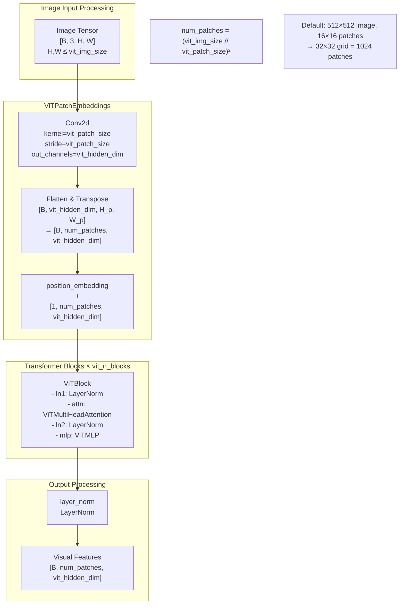
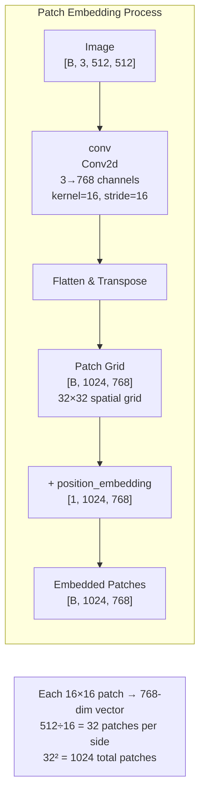
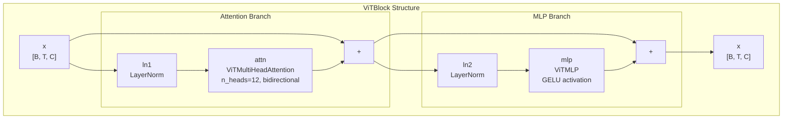
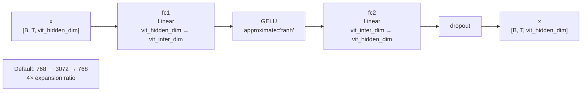
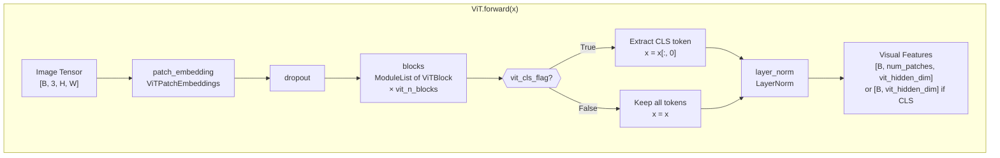
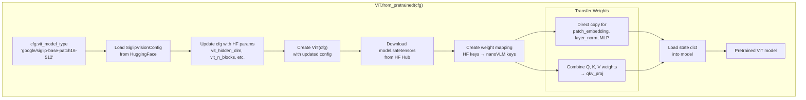
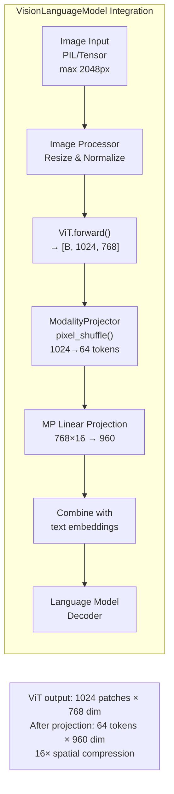

<!-- source: DeepWiki mcp.deepwiki.com · repo huggingface/nanoVLM · page 3.2 Vision Transformer · fetched 2026-10-26 -->

# Vision Transformer

Relevant source files

The following files were used as context for generating this wiki page:

- [models/language_model.py](models/language_model.py)
- [models/modality_projector.py](models/modality_projector.py)
- [models/vision_transformer.py](models/vision_transformer.py)

This document describes the Vision Transformer (ViT) implementation in nanoVLM, which serves as the visual encoder for processing images into feature representations. The ViT extracts patch-based embeddings from input images and processes them through bidirectional transformer blocks to produce visual features that are subsequently projected into the language model's embedding space.

For information about how these visual features are projected to the language model dimension, see [Modality Projector](#3.4). For the overall multimodal architecture, see [Vision Language Model](#3.1).

## Architecture Overview

The ViT implementation follows the standard Vision Transformer architecture with modifications from SigLIP, consisting of patch embeddings, positional encodings, and a stack of transformer blocks with bidirectional attention.

**Key Configuration Parameters:**

| Parameter | Default (SigLIP-B/16-512) | Description |
|-----------|---------------------------|-------------|
| `vit_img_size` | 512 | Maximum image dimension (height/width) |
| `vit_patch_size` | 16 | Size of each image patch |
| `vit_hidden_dim` | 768 | Hidden dimension of transformer |
| `vit_inter_dim` | 3072 | Intermediate MLP dimension (4× hidden) |
| `vit_n_heads` | 12 | Number of attention heads |
| `vit_n_blocks` | 12 | Number of transformer blocks |
| `vit_dropout` | 0.0 | Dropout rate |
| `vit_ln_eps` | 1e-6 | LayerNorm epsilon |
| `vit_cls_flag` | False | Whether to use CLS token |

Sources: [models/vision_transformer.py:131-169](), [models/vision_transformer.py:172-186]()

## Patch Embeddings

The `ViTPatchEmbeddings` class converts 2D images into sequences of patch embeddings using a convolutional layer. This effectively divides the image into non-overlapping patches and linearly projects each patch to the hidden dimension.

### Implementation Details

The patch embedding uses a `nn.Conv2d` layer with kernel size and stride equal to the patch size, effectively implementing non-overlapping patch extraction:

[models/vision_transformer.py:17-24]()

**Position Embeddings:** Learnable position embeddings are added to each patch embedding to inject spatial information:

[models/vision_transformer.py:29-30]()

**CLS Token (Optional):** When `vit_cls_flag=True`, a learnable CLS token is prepended to the sequence. However, the default SigLIP configuration does not use a CLS token:

[models/vision_transformer.py:26-28](), [models/vision_transformer.py:38-42]()

**Forward Pass:**

[models/vision_transformer.py:33-43]()

The convolution extracts patches, which are then flattened from `[B, C, H_p, W_p]` to `[B, num_patches, C]` and combined with position embeddings.

Sources: [models/vision_transformer.py:7-43]()

## Transformer Blocks

Each `ViTBlock` consists of LayerNorm, multi-head attention, and an MLP with residual connections. The architecture follows the "Pre-LN" variant where normalization occurs before each sub-layer.

### Block Components

**LayerNorm:** Standard LayerNorm with epsilon `vit_ln_eps=1e-6`:

[models/vision_transformer.py:120](), [models/vision_transformer.py:122]()

**Residual Connections:** Both attention and MLP outputs are added to their inputs:

[models/vision_transformer.py:125-128]()

**Block Forward Pass:**

The block applies the standard transformer architecture with pre-normalization:

[models/vision_transformer.py:125-128]()

Sources: [models/vision_transformer.py:117-128]()

## Multi-Head Attention Mechanism

The `ViTMultiHeadAttention` class implements bidirectional self-attention with multiple heads, using a combined QKV projection for efficiency.

```mermaid
graph TB
    subgraph Attention["ViTMultiHeadAttention"]
        Input["x [B, T, C]"]
        
        QKV["qkv_proj<br/>Linear: C → 3C<br/>Combined Q,K,V projection"]
        Split["Split into Q, K, V<br/>each [B, T, C]"]
        Reshape["Reshape & Transpose<br/>[B, T, n_heads, head_dim]<br/>→ [B, n_heads, T, head_dim]"]
        
        subgraph SDPA["Scaled Dot-Product Attention"]
            Scale["Q @ K^T / √head_dim"]
            Softmax["Softmax"]
            Value["@ V"]
            AttnOut["[B, n_heads, T, head_dim]"]
        end
        
        Concat["Transpose & Reshape<br/>→ [B, T, C]"]
        OutProj["out_proj<br/>Linear: C → C"]
        Dropout["resid_dropout"]
        Output["y [B, T, C]"]
        
        Input --> QKV
        QKV --> Split
        Split --> Reshape
        Reshape --> Scale
        Scale --> Softmax
        Softmax --> Value
        Value --> AttnOut
        AttnOut --> Concat
        Concat --> OutProj
        OutProj --> Dropout
        Dropout --> Output
    end
    
    Config["n_heads=12<br/>head_dim=768÷12=64<br/>is_causal=False<br/>bidirectional"]
```

### Key Differences from Language Model Attention

| Aspect | ViT Attention | Language Model Attention |
|--------|---------------|--------------------------|
| **Directionality** | Bidirectional (`is_causal=False`) | Causal/autoregressive |
| **QKV Projection** | Combined `qkv_proj` | Separate Q, K, V projections |
| **Attention Pattern** | All tokens attend to all | Tokens only attend to past |
| **KV Heads** | Same as Q heads (standard MHA) | Grouped Query Attention (GQA) |
| **Rotary Embeddings** | Not used | Applied to Q and K |
| **KV Cache** | Not used | Used during generation |

### Implementation Details

**Combined QKV Projection:**

[models/vision_transformer.py:58]()

The combined projection is more efficient than separate projections and is split into Q, K, V after projection:

[models/vision_transformer.py:73-74]()

**Scaled Dot-Product Attention:**

The implementation uses PyTorch's `scaled_dot_product_attention` when available for efficiency:

[models/vision_transformer.py:80-86]()

With fallback to manual computation:

[models/vision_transformer.py:88-91]()

**Bidirectional Attention:** Note that `is_causal=False` allows each token to attend to all other tokens, unlike the causal attention in the language model:

[models/vision_transformer.py:85]()

Sources: [models/vision_transformer.py:47-98]()

## MLP Block

The `ViTMLP` implements a two-layer feed-forward network with GELU activation. The intermediate dimension is typically 4× the hidden dimension.

**Forward Pass:**

[models/vision_transformer.py:109-114]()

The GELU activation with tanh approximation is used for compatibility with the pretrained SigLIP weights:

[models/vision_transformer.py:104]()

Sources: [models/vision_transformer.py:101-114]()

## ViT Main Class

The `ViT` class orchestrates the complete vision encoding pipeline, from patch embeddings through transformer blocks to final normalization.

### Architecture Flow

### Forward Pass Implementation

[models/vision_transformer.py:156-168]()

**Key Points:**

1. **Patch Embedding:** Converts image to sequence of patch embeddings
2. **Dropout:** Applied after patch embedding
3. **Transformer Blocks:** Process embeddings through all blocks sequentially
4. **CLS Token Handling:** If `vit_cls_flag=True`, only the CLS token is extracted; otherwise all patch tokens are kept
5. **Final LayerNorm:** Applied to the output features

**In nanoVLM's default configuration:** `vit_cls_flag=False`, so all 1024 patch tokens are preserved and passed to the modality projector, which reduces them to 64 tokens via pixel shuffle.

Sources: [models/vision_transformer.py:131-168]()

## Loading Pretrained Weights

The `from_pretrained` class method loads pretrained SigLIP weights from Hugging Face Hub, mapping them to the nanoVLM ViT architecture.

### Weight Loading Process

### Configuration Mapping

The method first loads the SigLIP configuration and updates the nanoVLM config:

[models/vision_transformer.py:177-186]()

### Weight Mapping

A mapping dictionary translates HuggingFace weight names to nanoVLM's naming convention:

[models/vision_transformer.py:191-214]()

**Example mappings:**

| HuggingFace Key | nanoVLM Key |
|-----------------|-------------|
| `vision_model.embeddings.patch_embedding.weight` | `patch_embedding.conv.weight` |
| `vision_model.embeddings.position_embedding.weight` | `patch_embedding.position_embedding` |
| `vision_model.encoder.layers.{i}.layer_norm1.weight` | `blocks.{i}.ln1.weight` |
| `vision_model.encoder.layers.{i}.mlp.fc1.weight` | `blocks.{i}.mlp.fc1.weight` |
| `vision_model.post_layernorm.weight` | `layer_norm.weight` |

### QKV Weight Concatenation

Since nanoVLM uses a combined `qkv_proj` layer while SigLIP has separate Q, K, V projections, the weights must be concatenated:

[models/vision_transformer.py:234-247]()

This concatenation is performed for both weights and biases for each transformer block.

### Position Embedding Shape Handling

The position embedding in SigLIP may have a different shape, requiring reshaping:

[models/vision_transformer.py:223-224]()

Sources: [models/vision_transformer.py:171-251]()

## Integration with VisionLanguageModel

The ViT serves as the visual encoder in the multimodal pipeline. The integration flow is:

**Key Integration Points:**

1. **Image Processing:** Images are resized and normalized before being fed to ViT (see [Data Processing](#5.2))
2. **Feature Extraction:** ViT produces 1024 patch features at 768 dimensions
3. **Modality Projection:** Features are compressed 16× spatially (1024→64) and projected to language dimension (768→960) (see [Modality Projector](#3.4))
4. **Sequence Construction:** Visual embeddings are inserted into text token sequences using special image tokens
5. **Frozen vs. Fine-tuned:** ViT weights can be frozen or fine-tuned with a low learning rate (`lr_vision=5e-5`)

The ViT's pretrained weights from SigLIP provide strong visual representations, which are then adapted to the language model's embedding space through the modality projector. This design allows the model to leverage both pretrained visual and language understanding.

Sources: [models/vision_transformer.py:1-251]()

---

