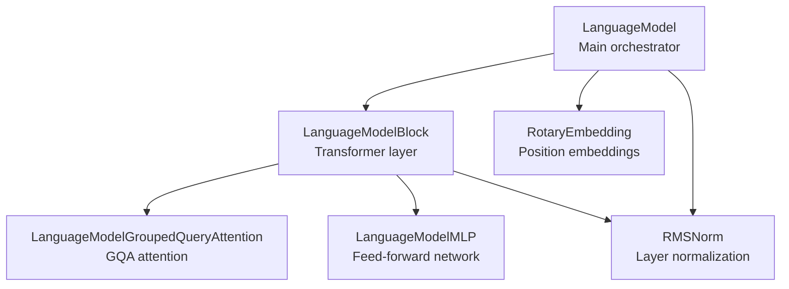
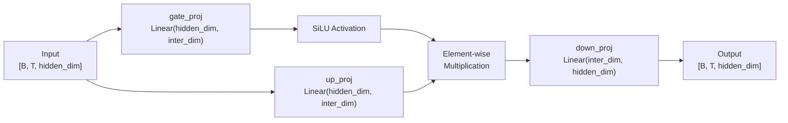
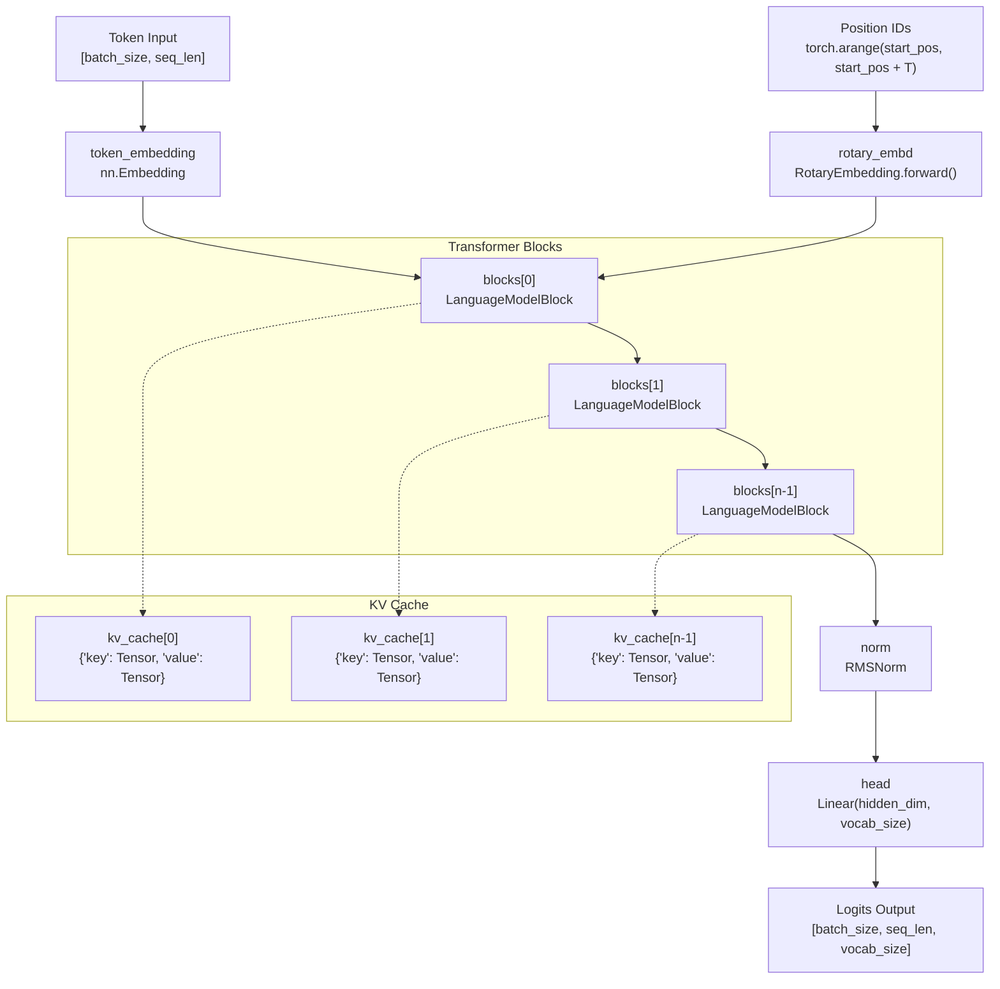
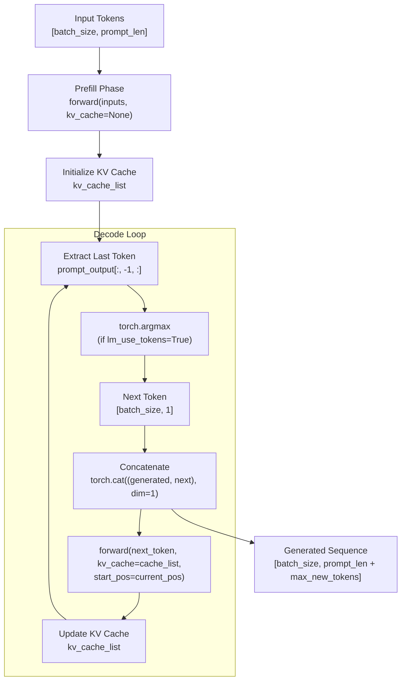

<!-- source: DeepWiki mcp.deepwiki.com · repo huggingface/nanoVLM · page 3.3 Language Model · fetched 2026-10-26 -->

# Language Model

<details>
<summary>Relevant source files</summary>

The following files were used as context for generating this wiki page:

- [models/language_model.py](models/language_model.py)
- [models/modality_projector.py](models/modality_projector.py)
- [models/vision_transformer.py](models/vision_transformer.py)

</details>


This document covers the transformer-based language model component of nanoVLM, implemented in the `LanguageModel` class. This component handles text processing, autoregressive generation, and serves as the text backbone of the multimodal system.

For information about the overall vision-language integration, see [Vision Language Model](#3.1). For details about the vision processing component, see [Vision Transformer](#3.2).

## Architecture Overview

The language model implements a decoder-only transformer architecture with several modern optimizations including Grouped Query Attention (GQA), Rotary Position Embeddings (RoPE), and KV caching for efficient generation.

### Class Hierarchy



Sources: [models/language_model.py:390-481]()

## Core Components

### Grouped Query Attention

The `LanguageModelGroupedQueryAttention` class implements GQA, which reduces computational overhead by using fewer key-value heads than query heads. Multiple query heads share the same key-value heads, maintaining performance while improving efficiency.

| Parameter | Description | Configuration Field |
|-----------|-------------|-------------------|
| Query heads | Number of query attention heads | `lm_n_heads` |
| KV heads | Number of key-value heads | `lm_n_kv_heads` |
| Head dimension | Dimension per attention head | `lm_hidden_dim // lm_n_heads` |
| Groups | Query heads per KV head | `lm_n_heads // lm_n_kv_heads` |

The attention mechanism supports both prefill (initial forward pass) and decode (autoregressive generation) phases with KV caching.

Sources: [models/language_model.py:166-299]()

### Rotary Position Embeddings

The `RotaryEmbedding` class implements RoPE, which encodes positional information by rotating query and key vectors in the complex plane. This approach provides better length extrapolation compared to absolute positional embeddings.

Key features:
- Base frequency scaling via `lm_re_base` parameter
- Dynamic scaling for sequences longer than training length
- Attention scaling factor via `lm_attn_scaling`

The rotation is applied using the `apply_rotary_pos_embd` function, which combines cosine and sine embeddings with the `rotate_half` helper function.

Sources: [models/language_model.py:43-162]()

### Feed-Forward Network

The `LanguageModelMLP` implements a gated MLP architecture:



Sources: [models/language_model.py:302-348]()

### RMS Normalization

`RMSNorm` provides a lightweight alternative to LayerNorm by normalizing using root mean square without subtracting the mean:

```
RMSNorm(x) = x * rsqrt(mean(x²) + ε) * weight
```

Sources: [models/language_model.py:7-39]()

## Model Structure and Data Flow



Sources: [models/language_model.py:419-480]()

## Key Features

### KV Caching

The model implements efficient KV caching for autoregressive generation. Each `LanguageModelBlock` maintains cached key and value tensors to avoid recomputing attention states for previous tokens.

Cache structure per block:
```python
block_kv_cache = {
    'key': torch.Tensor,    # [batch_size, n_kv_heads, seq_len, head_dim]
    'value': torch.Tensor   # [batch_size, n_kv_heads, seq_len, head_dim]
}
```

During generation, the cache is updated incrementally by concatenating new key-value pairs with existing cached states.

Sources: [models/language_model.py:238-252]()

### Pretrained Model Loading

The `from_pretrained` class method enables loading weights from HuggingFace transformer models while supporting vocabulary extension:

| HuggingFace Weight | nanoVLM Weight | Purpose |
|-------------------|----------------|---------|
| `model.embed_tokens.weight` | `token_embedding.weight` | Input embeddings |
| `model.layers.{i}.self_attn.q_proj.weight` | `blocks.{i}.attn.q_proj.weight` | Query projection |
| `model.layers.{i}.input_layernorm.weight` | `blocks.{i}.norm1.weight` | Pre-attention norm |
| `lm_head.weight` | `head.weight` | Output projection |

The method handles vocabulary extension by initializing new token embeddings with normal distribution when `lm_vocab_size` exceeds the pretrained model's vocabulary size.

Sources: [models/language_model.py:538-657]()

### Generation Process

The `generate` method implements autoregressive text generation with two phases:

1. **Prefill Phase**: Process the entire input prompt and initialize KV cache
2. **Decode Phase**: Generate tokens one by one using cached key-value states



Sources: [models/language_model.py:483-535]()

### Attention Masking

The model supports attention masking for handling variable-length sequences and padding tokens. The attention mask format is `[batch_size, total_kv_length]` with 1 for valid tokens and 0 for padding.

For causal attention during training, the model automatically applies causal masking when `T_curr == T_kv` and sequence length > 1.

Sources: [models/language_model.py:260-290]()

---

