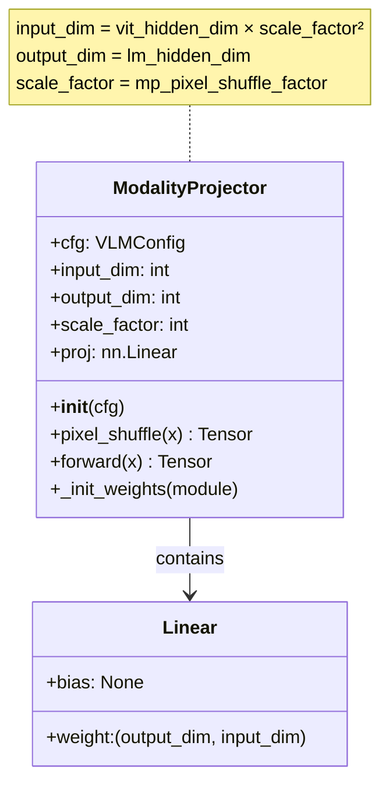
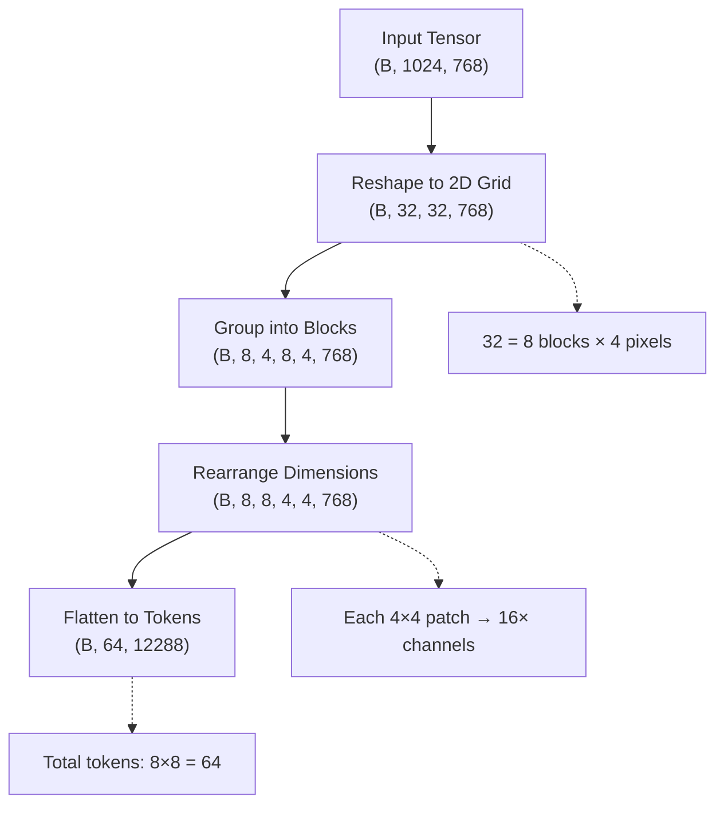
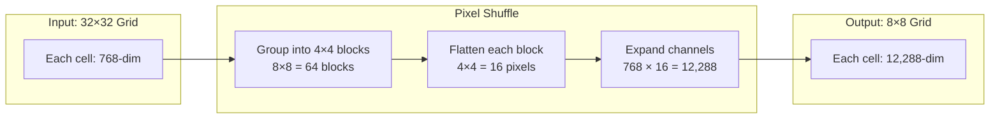
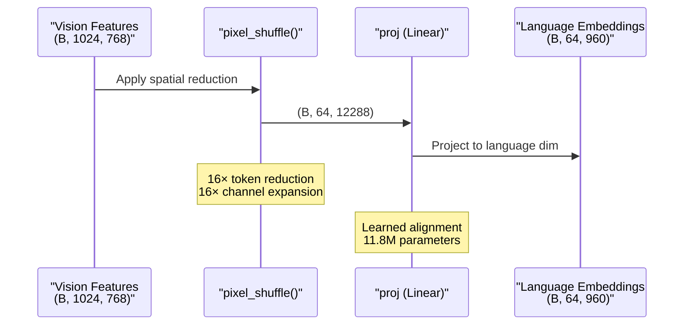
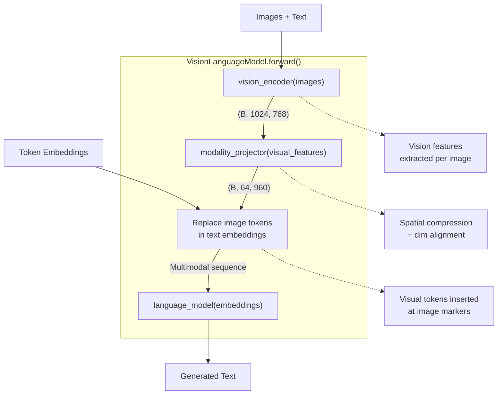

<!-- source: DeepWiki mcp.deepwiki.com · repo huggingface/nanoVLM · page 3.4 Modality Projector · fetched 2026-10-26 -->

# Modality Projector

<details>
<summary>Relevant source files</summary>

The following files were used as context for generating this wiki page:

- [models/language_model.py](models/language_model.py)
- [models/modality_projector.py](models/modality_projector.py)
- [models/vision_transformer.py](models/vision_transformer.py)

</details>


## Purpose and Scope

The Modality Projector is a learned cross-modal bridge that transforms visual feature representations from the Vision Transformer into embeddings compatible with the Language Model's representation space. This component addresses the semantic and dimensional mismatch between vision and language modalities while dramatically reducing the number of visual tokens to make multimodal processing computationally feasible.

For the overall VisionLanguageModel architecture and how components interact, see [Vision Language Model](#3.1). For details on the Vision Transformer that produces the input features, see [Vision Transformer](#3.2). For the Language Model that consumes the projected embeddings, see [Language Model](#3.3).

## Architecture Overview

The `ModalityProjector` consists of two sequential operations that together reduce spatial dimensions while preserving semantic information:


**Sources**: [models/modality_projector.py:1-46](), Diagram 1 (Overall System Architecture), Diagram 4 (Model Component Architecture)

### Component Breakdown

| Component | Input Shape | Output Shape | Parameters | Operation |
|-----------|-------------|--------------|------------|-----------|
| Pixel Shuffle | `(B, 1024, 768)` | `(B, 64, 12288)` | 0 | Spatial rearrangement |
| Linear Projection | `(B, 64, 12288)` | `(B, 64, 960)` | 11.8M | Learned transformation |

The total parameter count is dominated by the linear projection layer: `12,288 × 960 = 11,796,480` parameters.

**Sources**: [models/modality_projector.py:4-14]()

## Class Implementation

The `ModalityProjector` class is defined in `models/modality_projector.py`:



**Sources**: [models/modality_projector.py:4-44]()

### Configuration Parameters

The projector's behavior is controlled by three configuration parameters from `VLMConfig`:

| Parameter | Typical Value | Purpose |
|-----------|---------------|---------|
| `vit_hidden_dim` | 768 | ViT output dimension |
| `lm_hidden_dim` | 960 | Language model hidden dimension |
| `mp_pixel_shuffle_factor` | 4 | Spatial compression ratio |

**Sources**: [models/modality_projector.py:7-10]()

## Pixel Shuffle Operation

The pixel shuffle operation performs spatial downsampling by rearranging spatial information into the channel dimension. This technique, borrowed from super-resolution architectures but applied in reverse, achieves a 16× reduction in sequence length (from 1024 to 64 tokens) without information loss.

### Mathematical Formulation

Given an input tensor of shape `(batch_size, height × width, channels)`:
- Input: `(B, H×W, C)` where `H = W = 32`, `C = 768`
- Output: `(B, H'×W', C')` where `H' = W' = 8`, `C' = 12,288`

The transformation satisfies: `H' × W' × C' = H × W × C` (preserves total information capacity)

### Implementation Details



**Sources**: [models/modality_projector.py:23-38]()

### Step-by-Step Process

The `pixel_shuffle()` method at [models/modality_projector.py:23-38]() implements this transformation:

1. **Validate Input**: Assert that sequence length is a perfect square and divisible by scale factor
   - `seq_root = int(seq**0.5)` computes spatial dimension (32)
   - Ensures `seq_root % scale_factor == 0` for valid partitioning

2. **Reshape to 2D Grid**: `x.view(bsz, height, width, embed_dim)`
   - Converts flat sequence into spatial grid: `(B, 1024, 768) → (B, 32, 32, 768)`

3. **Partition into Blocks**: `x.reshape(bsz, h_out, scale_factor, w_out, scale_factor, embed_dim)`
   - Groups spatial dimensions: `(B, 32, 32, 768) → (B, 8, 4, 8, 4, 768)`
   - Creates `8×8` output grid with `4×4` blocks

4. **Rearrange Dimensions**: `x.permute(0, 1, 3, 2, 4, 5).contiguous()`
   - Moves block dimensions adjacent to channel dimension

5. **Collapse to Tokens**: `x.reshape(bsz, h_out * w_out, embed_dim * scale_factor**2)`
   - Final shape: `(B, 64, 12288)`

**Sources**: [models/modality_projector.py:23-38]()

### Visual Example

For a single 32×32 feature map being compressed to 8×8:



**Sources**: [models/modality_projector.py:23-38]()

## Linear Projection

After pixel shuffle increases the channel dimension to accommodate spatial information, a linear projection maps these expanded features to the language model's hidden dimension.

### Projection Layer

The `proj` layer at [models/modality_projector.py:12]() is defined as:
```python
self.proj = nn.Linear(self.input_dim, self.output_dim, bias=False)
```

Where:
- `input_dim = cfg.vit_hidden_dim * (cfg.mp_pixel_shuffle_factor**2) = 768 * 16 = 12,288`
- `output_dim = cfg.lm_hidden_dim = 960`
- No bias term for simplicity

### Weight Initialization

Weights are initialized using normal distribution at [models/modality_projector.py:16-20]():
```python
nn.init.normal_(self.proj.weight, mean=0.0, std=0.02)
```

This initialization is critical because the modality projector is **randomly initialized** (not pretrained), unlike the Vision Transformer and Language Model which load pretrained weights.

**Sources**: [models/modality_projector.py:12-20]()

## Forward Pass

The complete forward pass is implemented at [models/modality_projector.py:40-44]():



**Sources**: [models/modality_projector.py:40-44]()

## Training Strategy

The Modality Projector employs a specialized training strategy that differs significantly from the pretrained backbone components.

### Learning Rate Differential

From the training configuration and Diagram 2 (Training Pipeline Data Flow):

| Component | Learning Rate | Ratio | Rationale |
|-----------|---------------|-------|-----------|
| Modality Projector | 0.00512 | 100× | Randomly initialized, needs aggressive updates |
| Vision Transformer | 5e-5 | 1× | Pretrained, requires gentle fine-tuning |
| Language Model | 5e-5 | 1× | Pretrained, requires gentle fine-tuning |

The 100× higher learning rate for the projector reflects its role as the only randomly initialized component. It must learn the cross-modal alignment from scratch while the pretrained backbones adapt their existing representations.

**Sources**: Diagram 2 (Training Pipeline Data Flow), Diagram 4 (Model Component Architecture)

### Parameter Optimization

The projector's 11.8M parameters are optimized using:
- **Optimizer**: AdamW with weight decay
- **Learning Rate Schedule**: Cosine annealing with warmup
- **Gradient Accumulation**: 8 steps (shared with full model)

This aggressive learning rate enables rapid convergence of the cross-modal mapping while the pretrained components evolve slowly to maintain their learned representations.

**Sources**: Diagram 2 (Training Pipeline Data Flow)

## Integration with VisionLanguageModel

The `ModalityProjector` is instantiated and used within the `VisionLanguageModel` class:



**Sources**: [models/modality_projector.py:1-46](), Diagram 1 (Overall System Architecture)

### Token Replacement Flow

1. **Vision Encoding**: Images processed through ViT producing `(B, N_images, 1024, 768)` features
2. **Modality Projection**: Each image's features compressed and projected to `(B, N_images, 64, 960)`
3. **Token Replacement**: 64 projected visual tokens replace special image marker tokens in the text sequence
4. **Language Processing**: Combined multimodal sequence fed to language model

The 64-token representation per image (down from 1024) is a key design choice that balances semantic richness with computational efficiency, enabling sequences with up to 18 images within the 4096-token context window.

**Sources**: Diagram 1 (Overall System Architecture), Diagram 2 (Training Pipeline Data Flow)

## Design Rationale

### Why Pixel Shuffle?

Alternative approaches for reducing visual tokens include:

| Approach | Token Count | Information Loss | Computational Cost |
|----------|-------------|------------------|-------------------|
| Pooling (avg/max) | 64 | High (irreversible) | Low |
| Strided Convolution | 64 | Medium | Medium |
| **Pixel Shuffle** | **64** | **None (lossless rearrangement)** | **Low** |
| Cross-Attention | Variable | Low | Very High |

Pixel shuffle is chosen for its **lossless** spatial compression property—all visual information is preserved in the channel dimension before projection, allowing the learned linear layer to decide what to preserve or discard.

### Why High Learning Rate?

The 100× learning rate differential reflects an asymmetric initialization strategy:
- **Pretrained components** (ViT, LM): Already encode useful representations, need preservation
- **Random projector**: Has no useful initial mapping, needs rapid learning

This strategy avoids catastrophic forgetting in pretrained models while enabling efficient learning of the cross-modal bridge.

**Sources**: [models/modality_projector.py:1-46](), Diagram 2 (Training Pipeline Data Flow), Diagram 4 (Model Component Architecture)

## Computational Characteristics

### Memory Footprint

| Tensor | Shape | Elements | Memory (FP32) |
|--------|-------|----------|---------------|
| Input Features | `(8, 1024, 768)` | 6.3M | 25 MB |
| After Pixel Shuffle | `(8, 64, 12288)` | 6.3M | 25 MB |
| Output Embeddings | `(8, 64, 960)` | 0.49M | 2 MB |
| Projection Weights | `(960, 12288)` | 11.8M | 47 MB |

The pixel shuffle operation is memory-neutral (pure rearrangement), while the projection reduces memory by 10× due to dimensionality reduction.

### Inference Speed

The modality projector adds minimal overhead to inference:
- **Pixel Shuffle**: O(N) with no learned parameters, ~0.1ms for typical batch
- **Linear Projection**: Single matrix multiplication, ~1-2ms for typical batch
- **Total Overhead**: < 2% of end-to-end latency

**Sources**: [models/modality_projector.py:1-46]()

## Configuration Examples

### Standard Configuration (SmolLM2-360M + SigLIP)

```python
cfg.vit_hidden_dim = 768           # SigLIP output dimension
cfg.lm_hidden_dim = 960            # SmolLM2 hidden dimension
cfg.mp_pixel_shuffle_factor = 4    # 32×32 → 8×8 compression
```

Result: `768 * 16 = 12,288` → `960` dimensions, 11.8M parameters

### Alternative Configuration (Larger Models)

For scaling to larger language models:
```python
cfg.vit_hidden_dim = 1024          # Larger ViT
cfg.lm_hidden_dim = 2048           # Larger LM
cfg.mp_pixel_shuffle_factor = 4    # Same compression
```

Result: `1024 * 16 = 16,384` → `2048` dimensions, 33.6M parameters

**Sources**: [models/modality_projector.py:7-10]()

---

