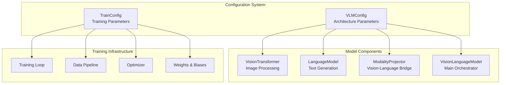
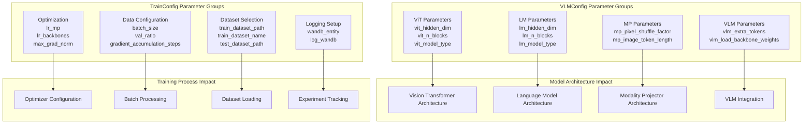

<!-- source: DeepWiki mcp.deepwiki.com · repo huggingface/nanoVLM · page 4 Configuration System · fetched 2026-10-26 -->

# Configuration System

<details>
<summary>Relevant source files</summary>

The following files were used as context for generating this wiki page:

- [models/config.py](models/config.py)
- [train.py](train.py)

</details>


The Configuration System provides centralized parameter management for the nanoVLM architecture and training process through two main dataclasses: `VLMConfig` and `TrainConfig`. These classes define all configurable aspects of the vision-language model architecture, training hyperparameters, and system behavior.

For information about model architecture components, see [Architecture](#3). For training pipeline details, see [Training](#6).

## Overview

The configuration system separates architectural parameters from training parameters, enabling flexible model experimentation and deployment scenarios. The `VLMConfig` class defines the structure and behavior of the vision-language model components, while `TrainConfig` specifies training-specific parameters such as learning rates, batch sizes, and dataset configurations.



**Configuration System Architecture**

Sources: [models/config.py:1-67]()

## VLMConfig Class

The `VLMConfig` dataclass defines architectural parameters for all model components. It is organized into logical groups corresponding to the main model components.

### Vision Transformer Parameters

The ViT-related parameters control the image processing component:

| Parameter | Default | Description |
|-----------|---------|-------------|
| `vit_hidden_dim` | 768 | Hidden dimension size for ViT layers |
| `vit_inter_dim` | 3072 | Intermediate dimension in ViT MLP blocks |
| `vit_patch_size` | 16 | Size of image patches in pixels |
| `vit_img_size` | 256 | Input image resolution |
| `vit_n_heads` | 12 | Number of attention heads |
| `vit_dropout` | 0.0 | Dropout rate |
| `vit_n_blocks` | 12 | Number of transformer blocks |
| `vit_ln_eps` | 1e-6 | Layer normalization epsilon |
| `vit_cls_flag` | False | Whether to use CLS token |
| `vit_model_type` | 'google/siglip2-base-patch16-256' | Pretrained model identifier |

### Language Model Parameters

The LM-related parameters configure the text generation component:

| Parameter | Default | Description |
|-----------|---------|-------------|
| `lm_hidden_dim` | 576 | Hidden dimension size for LM layers |
| `lm_inter_dim` | 1536 | Intermediate dimension in LM MLP blocks |
| `lm_rms_eps` | 1e-5 | RMS normalization epsilon |
| `lm_re_base` | 100000 | RoPE base frequency |
| `lm_max_position_embeddings` | 8192 | Maximum sequence length |
| `lm_base_vocab_size` | 49152 | Base vocabulary size |
| `extra_token_amount` | 1 | Number of VLM-specific tokens |
| `lm_vocab_size` | 49153 | Total vocabulary size |
| `lm_n_heads` | 9 | Number of attention heads |
| `lm_n_kv_heads` | 3 | Number of key-value heads (GQA) |
| `lm_dropout` | 0.0 | Dropout rate |
| `lm_n_blocks` | 30 | Number of transformer blocks |
| `lm_attn_scaling` | 1.0 | Attention scaling factor |
| `lm_max_length` | 512 | Maximum generation length |
| `lm_use_tokens` | False | Whether LM expects tokens or embeddings |
| `lm_tie_weights` | True | Whether to tie embedding/output weights |
| `lm_model_type` | 'HuggingFaceTB/SmolLM2-360M-Instruct' | Pretrained model identifier |
| `lm_tokenizer` | 'HuggingFaceTB/SmolLM2-360M-Instruct' | Tokenizer identifier |
| `lm_chat_template` | ChatML format | Chat formatting template |
| `lm_eos_token_id` | 0 | End-of-sequence token ID |

### Modality Projector Parameters

The MP-related parameters control vision-language integration:

| Parameter | Default | Description |
|-----------|---------|-------------|
| `mp_pixel_shuffle_factor` | 2 | Pixel shuffle downsampling factor |
| `mp_image_token_length` | 64 | Number of image tokens after projection |

### VLM Integration Parameters

System-level parameters for model integration:

| Parameter | Default | Description |
|-----------|---------|-------------|
| `vlm_extra_tokens` | {"image_token": "<\|image\|>"} | Special token definitions |
| `vlm_load_backbone_weights` | True | Whether to load pretrained weights |
| `vlm_checkpoint_path` | 'checkpoints' | Local checkpoint directory |
| `hf_repo_name` | 'nanoVLM' | Hugging Face repository name |

Sources: [models/config.py:4-45]()

## TrainConfig Class

The `TrainConfig` dataclass specifies training-specific parameters and dataset configurations.

### Optimization Parameters

| Parameter | Default | Description |
|-----------|---------|-------------|
| `lr_mp` | 0.00512 | Learning rate for modality projector |
| `lr_backbones` | 5e-5 | Learning rate for backbone components |
| `max_grad_norm` | 1.0 | Gradient clipping threshold |

### Data Configuration

| Parameter | Default | Description |
|-----------|---------|-------------|
| `data_cutoff_idx` | None | Training data size limit |
| `val_ratio` | 0.025 | Validation split ratio |
| `batch_size` | 32 | Training batch size |
| `gradient_accumulation_steps` | 4 | Gradient accumulation steps |
| `mmstar_batch_size` | 32 | Evaluation batch size |

### Training Control

| Parameter | Default | Description |
|-----------|---------|-------------|
| `eval_in_epochs` | True | Whether to evaluate per epoch |
| `eval_interval` | 250 | Evaluation step interval |
| `epochs` | 5 | Number of training epochs |
| `compile` | False | Whether to use torch.compile |
| `resume_from_vlm_checkpoint` | False | Resume from VLM checkpoint |

### Dataset Specification

| Parameter | Default | Description |
|-----------|---------|-------------|
| `train_dataset_path` | 'HuggingFaceM4/the_cauldron' | Training dataset identifier |
| `train_dataset_name` | 42 dataset tuple | Specific dataset subset names |
| `test_dataset_path` | "Lin-Chen/MMStar" | Evaluation dataset identifier |

### Logging Configuration

| Parameter | Default | Description |
|-----------|---------|-------------|
| `wandb_entity` | "HuggingFace" | Weights & Biases entity |
| `log_wandb` | False | Enable W&B logging |

Sources: [models/config.py:47-67]()

## Parameter Relationships

The configuration parameters create dependencies between model components and training behavior:



**Configuration Parameter Dependencies**

The dual learning rate configuration (`lr_mp` and `lr_backbones`) allows differential training of the modality projector versus pretrained backbone components. The `mp_image_token_length` parameter must align with the language model's expected input sequence length, while `vlm_extra_tokens` defines special tokens that must be added to the tokenizer vocabulary.

Sources: [models/config.py:23-24](), [models/config.py:49-50]()

## Configuration Usage Patterns

The configuration classes are typically instantiated with default values and modified for specific experiments:

```python
# Default configuration
vlm_config = VLMConfig()
train_config = TrainConfig()

# Architecture customization
vlm_config.lm_n_blocks = 20  # Smaller language model
vlm_config.vit_img_size = 224  # Different input resolution

# Training customization
train_config.batch_size = 16  # Smaller batch for memory constraints
train_config.lr_mp = 0.001  # Lower learning rate for projector
```

The `extra_token_amount` and `lm_vocab_size` parameters demonstrate a computed dependency where the vocabulary size automatically includes VLM-specific tokens defined in `vlm_extra_tokens`.

Sources: [models/config.py:23-24](), [models/config.py:41]()

---

