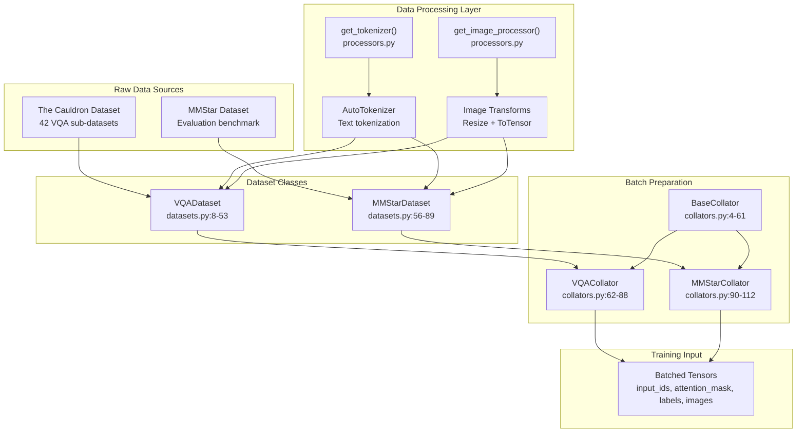
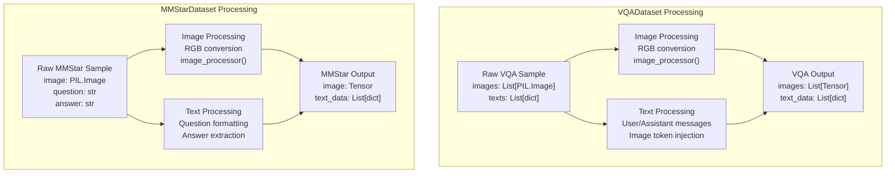
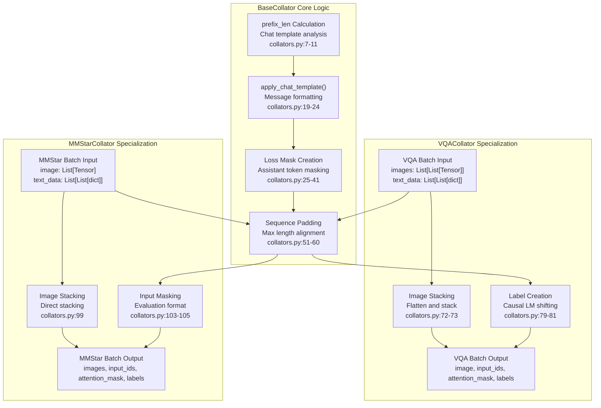

<!-- source: DeepWiki mcp.deepwiki.com · repo huggingface/nanoVLM · page 5 Data Pipeline · fetched 2026-10-26 -->

# Data Pipeline

Relevant source files

The following files were used as context for generating this wiki page:

- [data/collators.py](data/collators.py)
- [data/custom_transforms.py](data/custom_transforms.py)
- [data/datasets.py](data/datasets.py)
- [data/processors.py](data/processors.py)

The data pipeline system handles data loading, preprocessing, and batch preparation for training and inference in nanoVLM. This system transforms raw multimodal datasets into properly formatted batches that can be consumed by the vision-language model during training and evaluation.

For information about the specific dataset implementations, see [Datasets](#5.1). For details about data processing utilities and collators, see [Data Processing](#5.2).

## Overview

The data pipeline consists of three main components that work together to prepare multimodal data for model consumption:

**Sources:** [data/processors.py:1-23](), [data/datasets.py:1-90](), [data/collators.py:1-112]()

## Data Processing Components

The data processing layer provides utilities for initializing tokenizers and image processors that are shared across dataset implementations:

| Component | Function | Purpose |
|-----------|----------|---------|
| `get_tokenizer()` | Tokenizer initialization | Handles caching and special token configuration |
| `get_image_processor()` | Image preprocessing | Creates transform pipeline for image normalization |
| `TOKENIZERS_CACHE` | Tokenizer caching | Prevents redundant tokenizer loading |

The `get_tokenizer()` function supports extra special tokens and chat templates, which are essential for multimodal conversation formatting. The image processor applies standard transformations including resizing to a fixed size and tensor conversion.

**Sources:** [data/processors.py:4-16](), [data/processors.py:18-22]()

## Dataset Processing Flow

The dataset classes handle the conversion from raw data samples to processed multimodal inputs:

**Sources:** [data/datasets.py:18-53](), [data/datasets.py:66-89]()

### Image Token Injection

Both dataset classes inject special image tokens into the text content to indicate where visual features should be integrated. The number of image tokens is determined by `mp_image_token_length`, which corresponds to the modality projector's output sequence length:

- **VQADataset**: Multiplies image tokens by the number of images in the sample [data/datasets.py:48]()
- **MMStarDataset**: Uses a fixed number of image tokens for single-image samples [data/datasets.py:84]()

## Batch Preparation Architecture

The collator system transforms individual dataset samples into properly formatted training batches:

**Sources:** [data/collators.py:4-61](), [data/collators.py:62-88](), [data/collators.py:90-112]()

### Loss Masking Strategy

The `BaseCollator` implements sophisticated loss masking to ensure only assistant tokens contribute to training loss:

1. **Prefix Length Calculation**: Determines the number of tokens before assistant content in chat templates [data/collators.py:7-11]()
2. **Assistant Token Identification**: Locates assistant responses in the conversation flow [data/collators.py:35-38]()
3. **Mask Application**: Sets mask values to 1 for assistant tokens, 0 for all other tokens [data/collators.py:25-41]()

### Batch Output Formats

The collators produce different output formats optimized for their specific use cases:

| Collator | Output Keys | Purpose |
|----------|-------------|---------|
| `VQACollator` | `image`, `input_ids`, `attention_mask`, `labels` | Training with causal language modeling loss |
| `MMStarCollator` | `images`, `input_ids`, `attention_mask`, `labels` | Evaluation with masked inputs |

**Sources:** [data/collators.py:83-88](), [data/collators.py:107-112]()

## Integration Points

The data pipeline integrates with other system components through well-defined interfaces:

- **Training Loop**: Consumes batched tensors from collators for model forward passes
- **Model Architecture**: Receives properly formatted image tensors and tokenized text sequences
- **Configuration System**: Uses parameters like `mp_image_token_length` to coordinate with model components
- **Evaluation Framework**: Provides formatted batches for benchmark testing

**Sources:** [data/datasets.py:9-13](), [data/datasets.py:57-61](), [data/collators.py:63-65](), [data/collators.py:91-92]()

---

