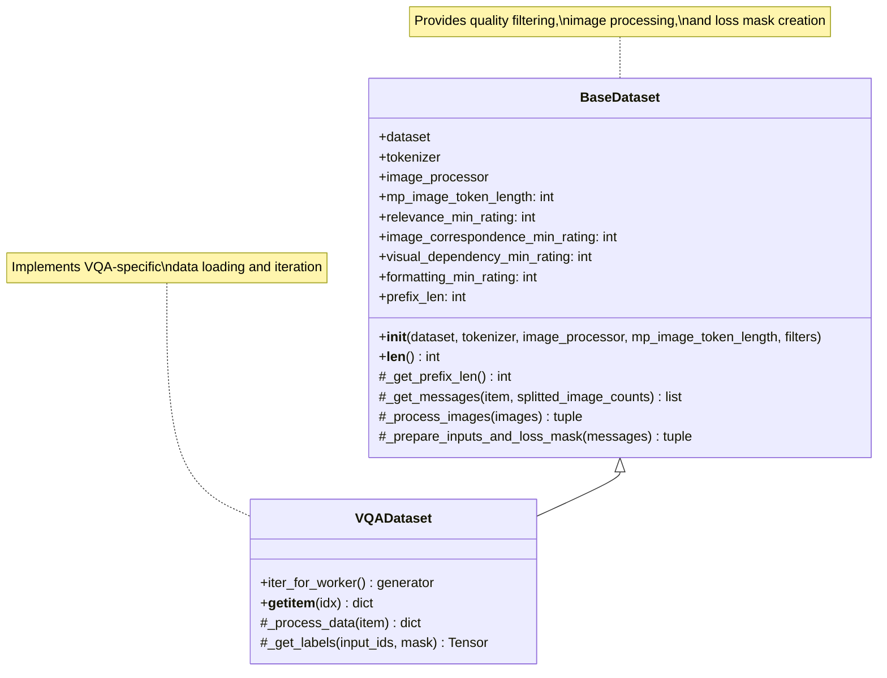
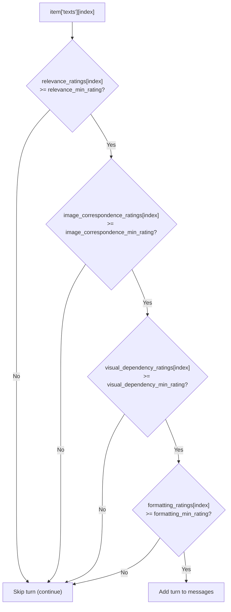
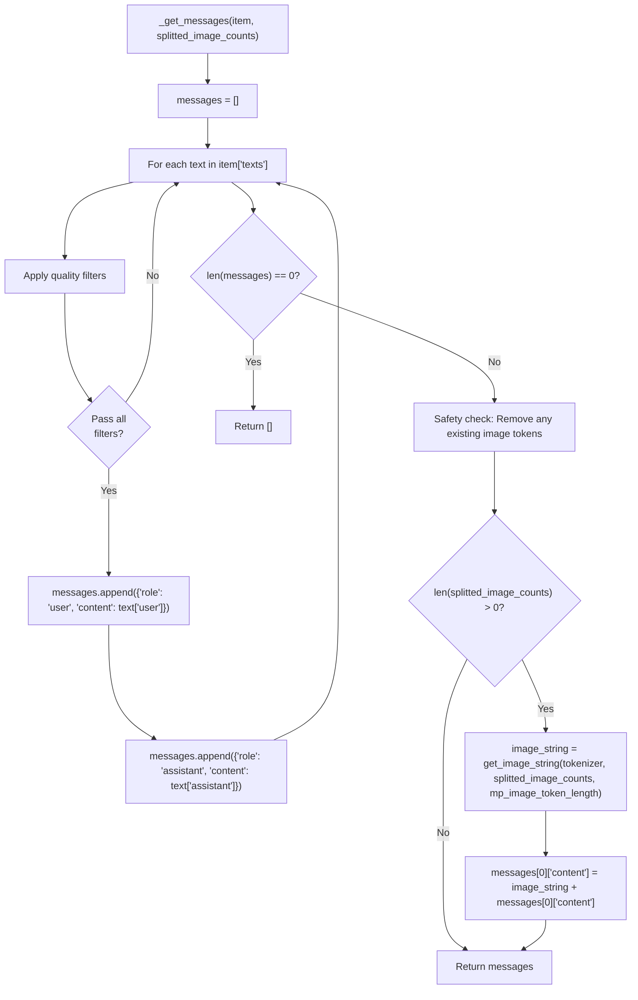
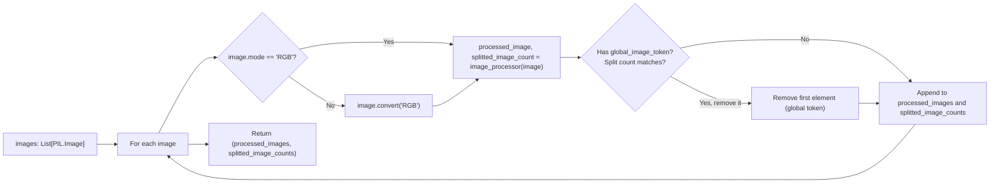
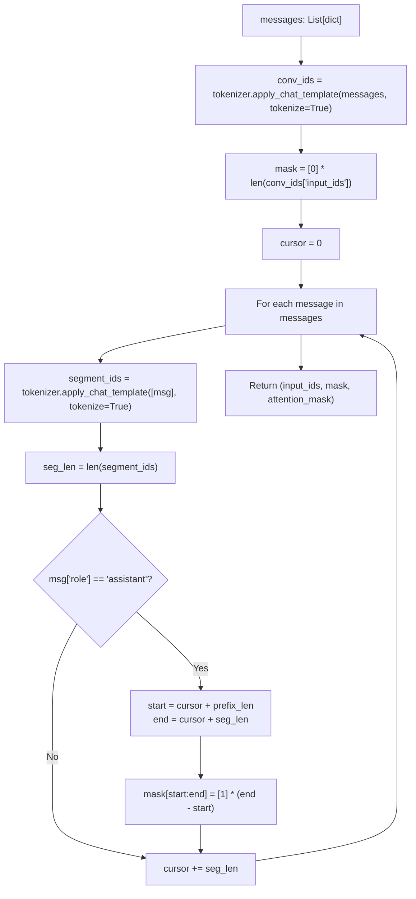
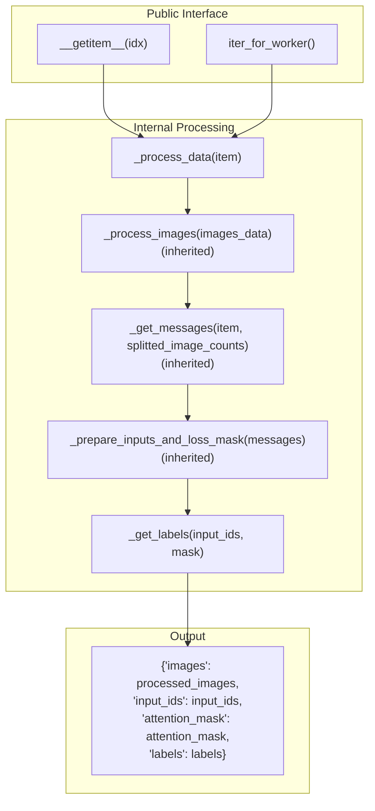
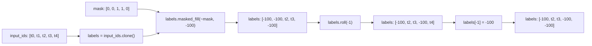
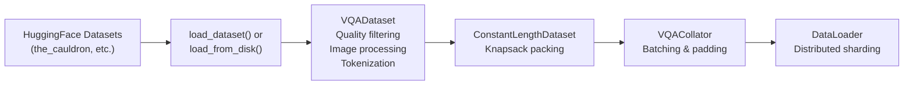

<!-- source: DeepWiki mcp.deepwiki.com · repo huggingface/nanoVLM · page 5.1 Datasets · fetched 2026-10-26 -->

# Datasets

Relevant source files

The following files were used as context for generating this wiki page:

- [data/datasets.py](data/datasets.py)

## Purpose and Scope

This page documents the dataset classes that load and process raw data samples for training and evaluation. The datasets handle quality filtering, image processing, tokenization, and loss mask generation. For information about image processors and tokenizers, see [Data Processing](#5.2). For information about batching and packing into fixed-length sequences, see [Data Processing](#5.2).

The dataset layer sits between raw data sources and the collator/dataloader, transforming individual samples into model-ready tensors with appropriate attention masks and training labels.

---

## Class Architecture

The dataset system uses a two-tier class hierarchy with `BaseDataset` providing core functionality and `VQADataset` implementing task-specific logic for Visual Question Answering datasets.

### Class Hierarchy Diagram

**Sources:** [data/datasets.py:8-105]()

---

## BaseDataset Class

`BaseDataset` provides the foundational functionality for all dataset types, including quality filtering, image processing, and tokenization.

### Initialization Parameters

| Parameter | Type | Default | Description |
|-----------|------|---------|-------------|
| `dataset` | Dataset | - | Raw dataset (HuggingFace or iterable) |
| `tokenizer` | Tokenizer | - | Text tokenizer with chat template |
| `image_processor` | ImageProcessor | - | Processes PIL images into tensors |
| `mp_image_token_length` | int | - | Number of tokens per image after modality projection |
| `relevance_min_rating` | int | 1 | Minimum relevance score threshold |
| `image_correspondence_min_rating` | int | 1 | Minimum image-text correspondence threshold |
| `visual_dependency_min_rating` | int | 1 | Minimum visual dependency threshold |
| `formatting_min_rating` | int | 1 | Minimum formatting quality threshold |

**Sources:** [data/datasets.py:8-18]()

### Quality Filtering System

The dataset applies four independent quality filters to each conversation turn, skipping turns that fall below the configured thresholds. This ensures training data meets minimum quality standards.

#### Quality Filter Flow

#### Filter Descriptions

| Filter | Field | Purpose |
|--------|-------|---------|
| **Relevance** | `relevance_ratings` | Filters out off-topic or irrelevant responses |
| **Image Correspondence** | `image_correspondence_ratings` | Ensures text accurately describes the image |
| **Visual Dependency** | `visual_dependency_ratings` | Requires answers that depend on visual information |
| **Formatting** | `formatting_ratings` | Enforces proper formatting and structure |

**Sources:** [data/datasets.py:33-40]()

---

## Message Construction and Image Token Insertion

The `_get_messages` method constructs chat-formatted messages from raw data, applying quality filters and inserting image tokens at the beginning of the first user turn.

### Message Construction Flow

**Key Implementation Details:**

1. **Filter Application**: Each conversation turn is evaluated against all four quality thresholds [data/datasets.py:33-40]()
2. **Role Structure**: User and assistant messages alternate [data/datasets.py:44-45]()
3. **Safety Check**: Removes any pre-existing image tokens to prevent duplication [data/datasets.py:51-54]()
4. **Image Token Insertion**: Image tokens are prepended to the first user message [data/datasets.py:56-58]()
5. **Empty Handling**: Returns empty list if all turns are filtered out [data/datasets.py:47-48]()

**Sources:** [data/datasets.py:29-60]()

---

## Image Processing Pipeline

The `_process_images` method converts PIL images into processor-ready tensors and tracks image split counts for token generation.

### Image Processing Steps

**Key Features:**

- **RGB Conversion**: Ensures all images are in RGB mode [data/datasets.py:67-68]()
- **Image Processing**: Delegates to `image_processor` which handles dynamic resizing and splitting [data/datasets.py:69]()
- **Global Token Handling**: Conditionally removes global image tokens based on tokenizer configuration [data/datasets.py:70-72]()
- **Split Tracking**: Returns split counts (e.g., `[2, 3]` for a 2×3 grid) used for generating position-aware tokens [data/datasets.py:74]()

**Sources:** [data/datasets.py:62-77]()

---

## Input Preparation and Loss Masking

The `_prepare_inputs_and_loss_mask` method tokenizes messages and creates binary masks indicating which tokens should contribute to the training loss.

### Loss Mask Generation Logic

**Masking Strategy:**

1. **Default to Ignore**: All tokens initially masked out (`mask[i] = 0`) [data/datasets.py:87]()
2. **Assistant Prefix Exclusion**: Skips the chat template prefix (e.g., `"<|im_start|>assistant\n"`) using `prefix_len` [data/datasets.py:18](), [data/datasets.py:23-27](), [data/datasets.py:98]()
3. **Assistant Content Inclusion**: Only assistant response content is marked for training (`mask[i] = 1`) [data/datasets.py:97-100]()
4. **Segmented Processing**: Each message is tokenized separately to locate role boundaries [data/datasets.py:92-95]()

**Sources:** [data/datasets.py:80-104]()

---

## VQADataset Class

`VQADataset` extends `BaseDataset` for Visual Question Answering tasks, implementing data loading and label generation.

### Data Processing Method Mapping

**Sources:** [data/datasets.py:107-150]()

### Data Access Patterns

`VQADataset` supports two data access patterns for different training scenarios:

| Method | Use Case | Description |
|--------|----------|-------------|
| `__getitem__(idx)` | Map-style datasets | Direct indexing for shuffled training with `DataLoader` [data/datasets.py:112-114]() |
| `iter_for_worker()` | Iterable datasets | Worker-based iteration for distributed streaming [data/datasets.py:108-110]() |

Both methods delegate to `_process_data(item)` for unified processing logic [data/datasets.py:116-143]().

### Label Generation

The `_get_labels` method transforms input IDs into training labels using causal language modeling conventions:

**Label Transformation Steps:**

1. **Clone Input**: Start with a copy of input IDs [data/datasets.py:146]()
2. **Apply Mask**: Set non-assistant tokens to `-100` (ignored by cross-entropy loss) [data/datasets.py:146]()
3. **Shift Left**: Roll labels by -1 for next-token prediction [data/datasets.py:147]()
4. **Terminal Padding**: Set final token to `-100` (no prediction target) [data/datasets.py:148]()

**Sources:** [data/datasets.py:145-150]()

---

## Output Format

Each dataset sample returns a dictionary with the following structure:

| Key | Type | Shape | Description |
|-----|------|-------|-------------|
| `images` | `List[List[Tensor]]` | Variable | List of processed images, each potentially split into sub-images |
| `input_ids` | `Tensor` | `[seq_len]` | Tokenized conversation with image tokens |
| `attention_mask` | `Tensor` | `[seq_len]` | Binary mask for valid tokens (vs. padding) |
| `labels` | `Tensor` | `[seq_len]` | Training targets with `-100` for ignored positions |

**Sources:** [data/datasets.py:138-143]()

---

## Integration with Data Pipeline

The dataset classes integrate with the broader data pipeline as shown below:

**Upstream:** Raw datasets from HuggingFace Hub or local storage
**Downstream:** `ConstantLengthDataset` for sequence packing (see [Data Processing](#5.2))

**Sources:** [data/datasets.py:1-151]()

---

