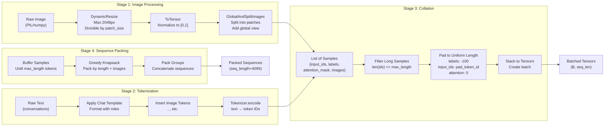
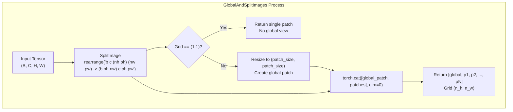
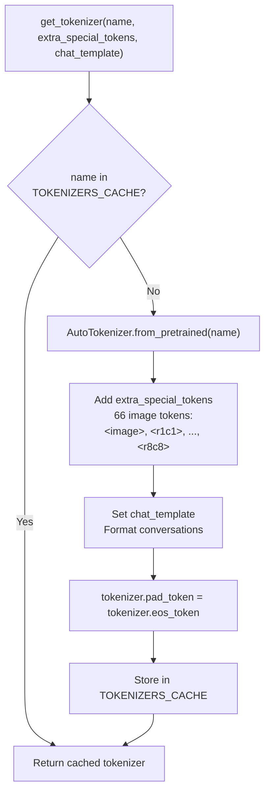
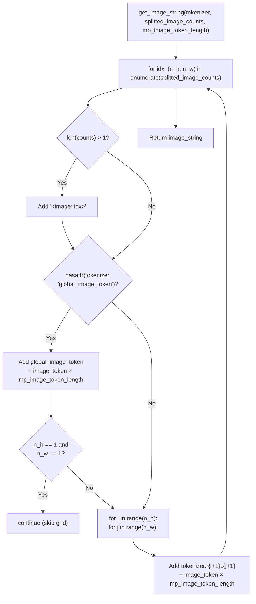
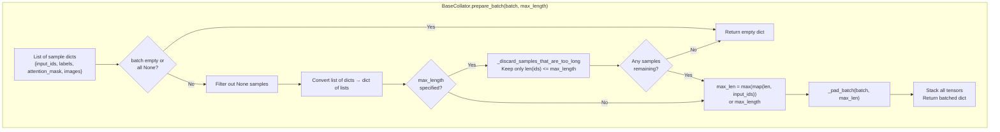
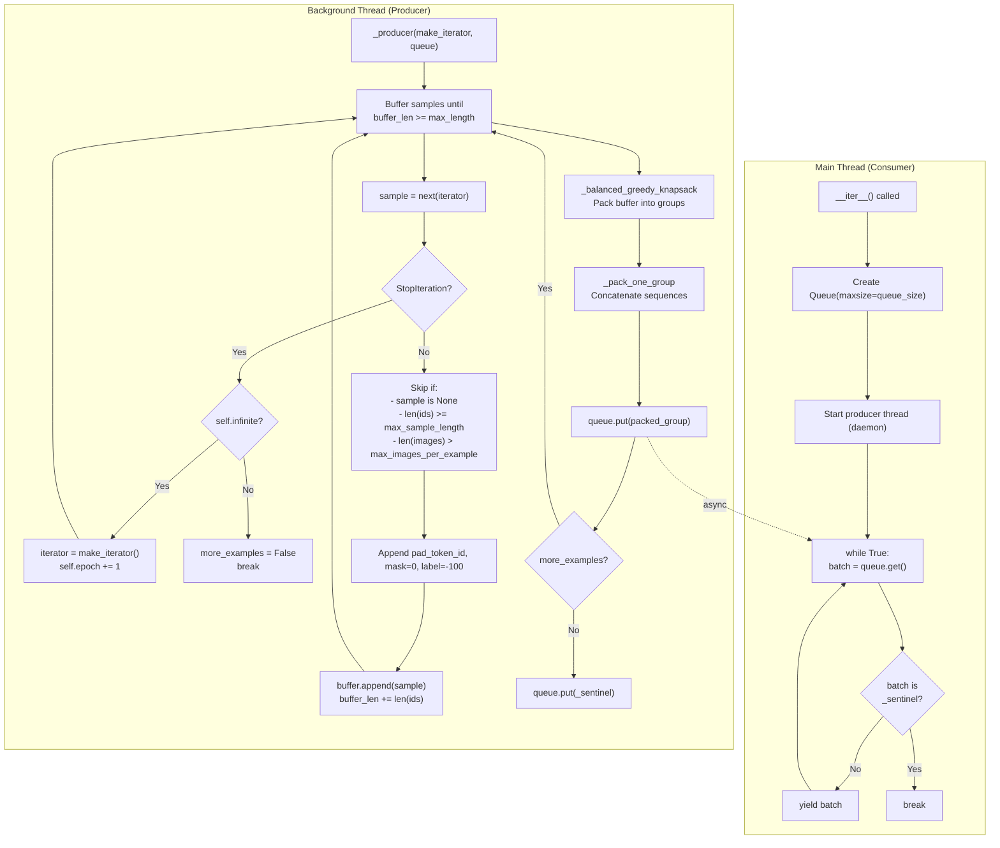
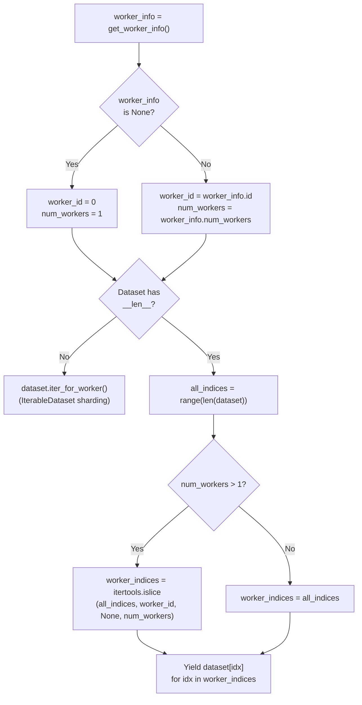
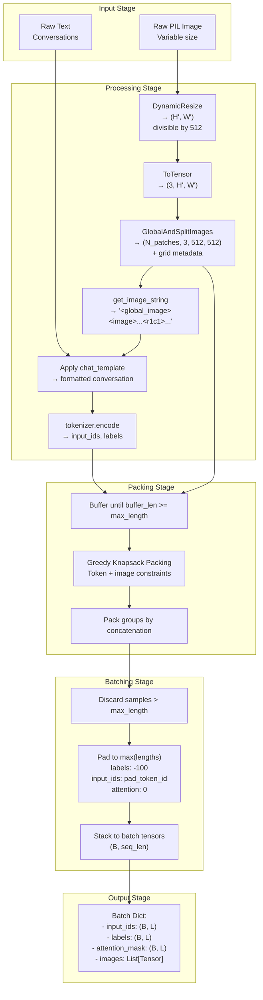

<!-- source: DeepWiki mcp.deepwiki.com · repo huggingface/nanoVLM · page 5.2 Data Processing · fetched 2026-10-26 -->

# Data Processing

<details>
<summary>Relevant source files</summary>

The following files were used as context for generating this wiki page:

- [data/advanced_datasets.py](data/advanced_datasets.py)
- [data/collators.py](data/collators.py)
- [data/custom_transforms.py](data/custom_transforms.py)
- [data/processors.py](data/processors.py)

</details>


This page documents the data processing pipeline that transforms raw images and text into batched tensor inputs for model training and inference. It covers image preprocessing with dynamic resizing and splitting, tokenization with special tokens, batching with padding, and efficient sequence packing using knapsack algorithms.

For information about dataset classes and quality filtering, see [Datasets](#5.1). For the complete training data flow, see [Training Pipeline](#6.1).

---

## Overview

The data processing pipeline consists of four main stages:

1. **Image Processing**: Resizing images to maintain aspect ratio while ensuring dimensions are divisible by patch size, then splitting into patches
2. **Tokenization**: Converting text to token IDs with special tokens for images and chat formatting
3. **Collation**: Batching samples with padding and label masking
4. **Sequence Packing**: Efficiently packing variable-length samples into fixed-length sequences using greedy knapsack algorithms



**Sources**: [data/processors.py:1-43](), [data/custom_transforms.py:1-121](), [data/collators.py:1-72](), [data/advanced_datasets.py:1-238]()

---

## Image Processing Pipeline

### DynamicResize Transform

The `DynamicResize` class resizes images while maintaining aspect ratio and ensuring dimensions are divisible by the patch size (typically 512px). This is critical for the Vision Transformer which operates on fixed-size patches.

**Key Features**:
- Resizes longer side to ≤ `max_side_len` (default 2048px)
- Ensures both dimensions divisible by `patch_size` (default 512px)
- Maintains aspect ratio by scaling shorter side proportionally
- Optional: Prevents upscaling small images when `resize_to_max_side_len=False`
- Supports PIL Images, `(C, H, W)` tensors, and `(B, C, H, W)` tensors

**Implementation Details** [data/custom_transforms.py:9-78]():

| Parameter | Default | Description |
|-----------|---------|-------------|
| `patch_size` | 512 | Images must be divisible by this value |
| `max_side_len` | 2048 | Maximum dimension for longer side |
| `resize_to_max_side_len` | `False` | If `False`, prevents upscaling |
| `interpolation` | `BICUBIC` | Interpolation mode for resize |

The resize logic computes new dimensions as:
1. Identify longer and shorter sides
2. Scale longer side to target: `target_long = min(max_side_len, ceil(long / patch_size) * patch_size)`
3. Compute scale factor: `scale = target_long / long`
4. Scale shorter side with ceiling rounding: `target_short = ceil(short * scale / patch_size) * patch_size`

**Sources**: [data/custom_transforms.py:9-78]()

### Image Splitting Strategy

After resizing, images are split into patches and combined with a global view using `GlobalAndSplitImages`.



**Example**: A 1024×1024 image with `patch_size=512`:
- Split into 2×2 = 4 patches
- Create 1 global patch (resized to 512×512)
- Output: 5 patches total (1 global + 4 splits)
- Grid metadata: `(2, 2)`

**Special Case**: If image is already ≤ `patch_size`, returns single patch without global view to avoid duplication [data/custom_transforms.py:117-118]().

**Sources**: [data/custom_transforms.py:80-121]()

### Image Processor Construction

The `get_image_processor` function composes these transforms into a pipeline:

```python
# From data/processors.py:20-25
transforms.Compose([
    DynamicResize(splitted_image_size, max_img_size, resize_to_max_side_len),
    transforms.ToTensor(),  # PIL → tensor, normalize to [0,1]
    GlobalAndSplitImages(splitted_image_size),
])
```

**Common Configuration**:
- `splitted_image_size` (patch_size): 512
- `max_img_size`: 2048
- `resize_to_max_side_len`: False (no upscaling)

**Sources**: [data/processors.py:20-26]()

---

## Tokenization

### Tokenizer Setup

The `get_tokenizer` function initializes tokenizers with caching and special token extension:



**Key Implementation Details** [data/processors.py:8-18]():

1. **Global Cache**: `TOKENIZERS_CACHE` dict prevents reloading same tokenizer
2. **Fast Tokenizers**: Uses `use_fast=True` for Rust-based tokenizers (10-100× faster)
3. **Padding Token**: Sets `pad_token = eos_token` since base LMs don't have pad tokens
4. **Extended Vocabulary**: Base vocab (49,152) + 66 special tokens = 49,218 total

**Special Tokens** (typical configuration):
- `<image>`: Global image token
- `<r{i}c{j}>`: Grid position tokens (r1c1, r1c2, ..., r8c8) for 8×8 max grid

**Sources**: [data/processors.py:6-18]()

### Image String Construction

The `get_image_string` function generates the text representation of images with positional tokens:



**Example Output** (for 2×2 grid with `mp_image_token_length=64`):
```
<global_image><image><image>...<image><r1c1><image><image>...<image><r1c2><image>...<r2c1>...<r2c2>...
```
- Global image: 1 `<global_image>` + 64 `<image>` tokens
- Grid patches: 4 position tokens (r1c1, r1c2, r2c1, r2c2) each followed by 64 `<image>` tokens
- Total: 1 + 64 + 4×(1+64) = 325 tokens

**Sources**: [data/processors.py:27-42]()

---

## Batching and Collation

### BaseCollator

The `BaseCollator` class provides core batching functionality with padding and filtering [data/collators.py:4-57]().



**Padding Implementation** [data/collators.py:8-11]():
| Field | Pad Value | Purpose |
|-------|-----------|---------|
| `input_ids` | `tokenizer.pad_token_id` | Typically EOS token |
| `labels` | `tokenizer.pad_token_id` | Overridden to -100 in VQACollator |
| `attention_mask` | `0` | Padded positions ignored |

**Note**: Padding is **left-padded** using `torch.nn.functional.pad` with syntax `(left, right)` where `left = max_length - len(ids)` and `right = 0`.

**Sources**: [data/collators.py:4-57]()

### VQACollator

The `VQACollator` extends `BaseCollator` with label masking for Visual Question Answering tasks [data/collators.py:59-72]().

**Key Difference**: Labels are padded with `-100` instead of `pad_token_id` [data/collators.py:64-67]():

```python
def _pad_batch(self, batch, max_length):
    batch["input_ids"] = [torch.nn.functional.pad(ids, (max_length - len(ids), 0), 
                         value=self.tokenizer.pad_token_id) for ids in batch["input_ids"]]
    batch["labels"] = [torch.nn.functional.pad(labels, (max_length - len(labels), 0), 
                       value=-100) for labels in batch["labels"]]  # Loss ignores -100
    batch["attention_mask"] = [torch.nn.functional.pad(attention_mask, 
                               (max_length - len(attention_mask), 0), value=0) 
                               for attention_mask in batch["attention_mask"]]
```

**Why -100?** PyTorch's `CrossEntropyLoss` uses `ignore_index=-100` by default, so padded positions don't contribute to gradient computation.

**Usage** [data/collators.py:69-71]():
```python
def __call__(self, batch):
    batch = self.prepare_batch(batch, max_length=self.max_length)
    return batch
```

**Sources**: [data/collators.py:59-72]()

---

## Sequence Packing with ConstantLengthDataset

The `ConstantLengthDataset` class implements efficient sequence packing using a greedy knapsack algorithm to maximize GPU utilization [data/advanced_datasets.py:11-238]().

### Design Pattern: Producer-Consumer



**Configuration Parameters** [data/advanced_datasets.py:12-36]():

| Parameter | Default | Description |
|-----------|---------|-------------|
| `seq_length` | 4096 | Target sequence length (tokens) |
| `num_of_sequences` | 1024 | Buffer size = `seq_length * num_of_sequences` |
| `max_sample_length` | 1024 | Skip samples longer than this |
| `max_images_per_example` | 4 | Skip samples with more images |
| `max_images_per_knapsack` | 18 | Max images per packed sequence |
| `queue_size` | 2 | Producer-consumer queue depth |
| `infinite` | False | Whether to loop dataset indefinitely |

**Sources**: [data/advanced_datasets.py:42-98]()

### Greedy Knapsack Packing Algorithm

The `_balanced_greedy_knapsack` method packs variable-length samples into fixed-length knapsacks while respecting both token length and image count constraints [data/advanced_datasets.py:173-222]().

```mermaid
graph TB
    Start["_balanced_greedy_knapsack(buffer, L, delta, max_images_per_knapsack)"]
    Extract["Extract lengths and image_counts from buffer"]
    Sort["Sort items by length (descending)<br/>Keep original indices"]
    CalcMin["min_knapsacks = (sum(lengths) + L - 1) // L + delta"]
    InitKS["Initialize min_knapsacks empty knapsacks"]
    LoopItems["for idx, (item_len, item_image_count) in items:"]
    FindKS["Find suitable knapsack<br/>sorted by current load"]
    CheckFit{"knapsack_load[ks] + item_len <= L<br/>AND<br/>knapsack_images[ks] + item_images <= max?"}
    AssignKS["Assign to knapsack ks"]
    CreateNew["Create new knapsack"]
    UpdateKS["Update knapsack_load and knapsack_image_counts"]
    CheckMore{"More items?"}
    Shuffle["random.shuffle(knapsack_groups)"]
    FilterEmpty["Remove empty knapsacks"]
    ReturnGroups["Return list of groups (each group = list of indices)"]
    
    Start --> Extract
    Extract --> Sort
    Sort --> CalcMin
    CalcMin --> InitKS
    InitKS --> LoopItems
    LoopItems --> FindKS
    FindKS --> CheckFit
    CheckFit -->|Yes| AssignKS
    CheckFit -->|No (all full)| CreateNew
    AssignKS --> UpdateKS
    CreateNew --> UpdateKS
    UpdateKS --> CheckMore
    CheckMore -->|Yes| LoopItems
    CheckMore -->|No| Shuffle
    Shuffle --> FilterEmpty
    FilterEmpty --> ReturnGroups
```

**Algorithm Details**:

1. **Sorting**: Items sorted by length in descending order (largest first) for better packing efficiency
2. **Greedy Assignment**: For each item, find the knapsack with minimum load that satisfies constraints:
   - `knapsack_load + item_len <= L` (token length constraint)
   - `knapsack_image_count + item_image_count <= max_images_per_knapsack` (image constraint)
3. **Dynamic Creation**: If no existing knapsack fits, create a new one [data/advanced_datasets.py:209-214]()
4. **Shuffling**: Randomize knapsack order to avoid semi-sorted patterns [data/advanced_datasets.py:221]()
5. **Delta Heuristic**: `+delta` creates extra empty knapsacks initially for better load balancing

**Example Packing**:
```
Inputs: [600, 550, 500, 400, 300, 200, 100] tokens, L=1024

Pack 1: [600, 400] = 1000 tokens (97.7% utilization)
Pack 2: [550, 300, 100] = 950 tokens (92.8% utilization)
Pack 3: [500, 200] = 700 tokens (68.4% utilization)
```

**Sources**: [data/advanced_datasets.py:173-222]()

### Sequence Packing Implementation

After knapsack assignment, `_pack_one_group` concatenates samples within each group [data/advanced_datasets.py:224-237]():

```python
def _pack_one_group(self, group_indices, batch, max_len):
    ids, lbl, am, ims = [], [], [], []
    
    for i in group_indices:
        ids.extend(batch[i]["input_ids"])
        lbl.extend(batch[i]["labels"])
        am.extend(batch[i]["attention_mask"])
        ims.extend(batch[i]["images"])
    
    # Safety check
    if len(ids) > max_len:
        raise ValueError(f"Packed length {len(ids)} > max_len {max_len}")
    
    return torch.stack(ids), torch.stack(lbl), torch.stack(am), ims
```

**Key Points**:
- Samples concatenated **without** separator tokens (pad token already appended [data/advanced_datasets.py:132-141]())
- Images from all samples combined into single list
- Packed sequence typically < `seq_length` (padded later by collator)
- Safety assertion prevents overflow (should never trigger with correct knapsack)

**Sources**: [data/advanced_datasets.py:224-237]()

### Worker Sharding

For distributed training with multiple DataLoader workers, the dataset automatically shards data [data/advanced_datasets.py:59-83]():



**Sharding Strategy**:
- **Map-style datasets**: Shard indices using stride pattern: `indices[worker_id::num_workers]`
- **Iterable datasets**: Use built-in `iter_for_worker()` method for proper sharding
- **Single worker**: Process all data in order

**Example** (4 workers, 8 samples):
```
Worker 0: [0, 4]
Worker 1: [1, 5]
Worker 2: [2, 6]
Worker 3: [3, 7]
```

**Sources**: [data/advanced_datasets.py:59-83]()

---

## Processing Flow Summary

The complete data processing pipeline from raw inputs to batched tensors:



**Typical Token Counts** (for 512×512 image with 2×2 split, `mp_image_token_length=64`):
- Global image: 1 + 64 = 65 tokens
- Grid patches: 4 × (1 + 64) = 260 tokens
- Total image tokens: **325 tokens**
- Text tokens: Variable (50-500 typical)
- **Total per sample: 375-825 tokens**

**Packing Efficiency**:
- Target `seq_length`: 4096 tokens
- Typical packing: 5-10 samples per sequence
- Utilization: 85-95% with greedy knapsack

**Sources**: All files in this section

---

