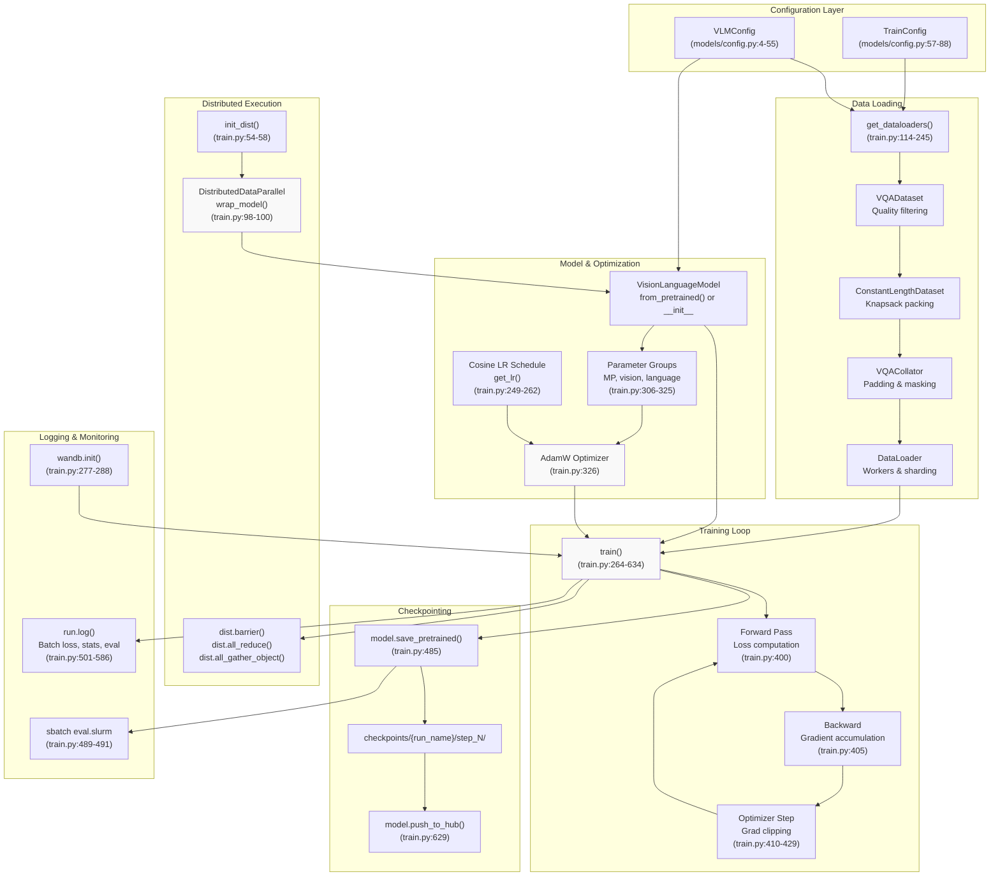

<!-- source: DeepWiki mcp.deepwiki.com · repo huggingface/nanoVLM · page 6 Training · fetched 2026-10-26 -->

# Training

<details>
<summary>Relevant source files</summary>

The following files were used as context for generating this wiki page:

- [models/config.py](models/config.py)
- [train.py](train.py)

</details>


This document provides an overview of the nanoVLM training system. It covers the core training loop, distributed training with PyTorch DistributedDataParallel (DDP), gradient accumulation strategies, differentiated learning rates for model components, checkpointing mechanisms, and experiment tracking with Weights & Biases.

For detailed information about the training pipeline execution flow, see [Training Pipeline](#6.1). For SLURM and distributed infrastructure setup, see [Distributed Training Infrastructure](#6.2). For validation and checkpoint-triggered evaluation, see [Training Evaluation](#6.3). For data loading and processing details, see [Data Pipeline](#5).

## Training System Architecture

The training system is orchestrated by [train.py:1-703]() and configured through the `TrainConfig` dataclass in [models/config.py:57-88](). The system integrates data loading, model training, distributed execution, and experiment tracking into a unified pipeline.



**Sources:** [train.py:1-703](), [models/config.py:57-88]()

## Distributed Training Setup

The training system supports single-GPU and multi-GPU/multi-node execution via PyTorch Distributed Data Parallel (DDP). Distributed initialization occurs when environment variables `RANK` and `WORLD_SIZE` are set, typically by the `torchrun` launcher.

### Initialization and Utilities

The distributed backend is initialized with NCCL for GPU communication and a timeout of 30 minutes:

```python
# train.py:54-58
def init_dist():
    dist.init_process_group(backend='nccl', timeout=timedelta(minutes=30))
    local_rank = int(os.environ["LOCAL_RANK"])
    torch.cuda.set_device(local_rank)
```

A global CPU process group `PG_CPU` is created using the Gloo backend for host-RAM operations that don't require GPU allocation [train.py:26](), [train.py:688]().

Key distributed utility functions:

| Function | Purpose | Location |
|----------|---------|----------|
| `is_dist()` | Check if distributed is initialized | [train.py:63-64]() |
| `is_master()` | Check if current rank is 0 | [train.py:66-67]() |
| `get_world_size()` | Return total number of processes | [train.py:69-70]() |
| `get_rank()` | Return current process rank | [train.py:72-73]() |
| `dist_gather(obj)` | Gather picklable objects from all ranks | [train.py:75-87]() |
| `dist_mean_scalar(x)` | Compute mean of scalar across ranks | [train.py:89-96]() |
| `wrap_model(model)` | Wrap model with DDP | [train.py:98-100]() |

The model is wrapped with `DistributedDataParallel` after being moved to the GPU device [train.py:343-346]():

```python
if is_dist():
    print("Wrapping model for DDP")
    model = wrap_model(model)
```

**Sources:** [train.py:54-100](), [train.py:343-346](), [train.py:686-688]()

## Training Configuration

Training behavior is controlled by the `TrainConfig` dataclass, which can be overridden via command-line arguments.

### Key Training Parameters

| Parameter | Default | Description |
|-----------|---------|-------------|
| `lr_mp` | 0.00512 | Learning rate for modality projection layer |
| `lr_vision_backbone` | 5e-5 | Learning rate for vision transformer |
| `lr_language_backbone` | 5e-5 | Learning rate for language model |
| `batch_size` | 2 | Per-device batch size |
| `gradient_accumulation_steps` | 8 | Number of steps to accumulate gradients |
| `max_grad_norm` | 1.0 | Maximum gradient norm for clipping |
| `max_training_steps` | 40000 | Total training steps |
| `eval_interval` | 500 | Steps between validation runs |
| `stats_log_interval` | 100 | Steps between logging statistics |

The effective global batch size is computed as: `batch_size × world_size × gradient_accumulation_steps` [train.py:103](), [train.py:619]().

### Data Filtering Parameters

| Parameter | Default | Description |
|-----------|---------|-------------|
| `relevance_min_rating` | 1 | Minimum relevance score (1-5) |
| `image_correspondence_min_rating` | 1 | Minimum image-text correspondence (1-5) |
| `visual_dependency_min_rating` | 1 | Minimum visual dependency (1-5) |
| `formatting_min_rating` | 1 | Minimum formatting quality (1-5) |
| `max_images_per_example` | 4 | Maximum images per training sample |
| `max_images_per_knapsack` | 18 | Maximum images per packed sequence |

These parameters control the quality filtering in `VQADataset` [train.py:178-197]().

### Experiment Tracking Parameters

| Parameter | Default | Description |
|-----------|---------|-------------|
| `log_wandb` | True | Enable Weights & Biases logging |
| `wandb_entity` | "HuggingFace" | WandB entity name |
| `use_lmms_eval` | True | Submit SLURM jobs for lmms-eval |
| `lmms_eval_tasks` | (see below) | Comma-separated evaluation tasks |
| `lmms_eval_batch_size` | 64 | Batch size for evaluation |

Default evaluation tasks: `'mmstar,mmmu_val,ocrbench,textvqa_val,docvqa_val,scienceqa,mme,infovqa_val,chartqa'` [models/config.py:85]().

**Sources:** [models/config.py:57-88](), [train.py:102-112](), [train.py:636-682]()

## Training Loop Structure

The main training loop in the `train()` function [train.py:264-634]() implements the following flow:

```mermaid
graph TD
    Start["Start Training Loop<br/>global_step = 0"]
    LoadData["Load Batch<br/>synchronized_dataloader_step()<br/>(train.py:374)"]
    MoveDevice["Move tensors to device<br/>(train.py:378-380)"]
    
    CheckSync{"Gradient sync needed?<br/>is_update_step<br/>(train.py:375, 386-391)"}
    NoSync["model.no_sync()<br/>Skip gradient sync"]
    NormalSync["Normal forward/backward<br/>Sync gradients"]
    
    Forward["Forward Pass<br/>model(input_ids, images, ...)<br/>(train.py:400)"]
    ScaleLoss["Scale loss by<br/>gradient_accumulation_steps<br/>(train.py:402-403)"]
    Backward["loss.backward()<br/>(train.py:405)"]
    
    CheckUpdate{"Is update step?<br/>(i+1) % grad_accum == 0<br/>(train.py:409)"}
    
    ClipGrad["Clip Gradients<br/>clip_grad_norm_()<br/>(train.py:410-411)"]
    UpdateLR["Update Learning Rates<br/>get_lr() for each group<br/>(train.py:414-426)"]
    OptimStep["optimizer.step()<br/>optimizer.zero_grad()<br/>(train.py:428-429)"]
    IncrStep["global_step += 1<br/>(train.py:589)"]
    
    CheckEval{"Eval interval?<br/>step % eval_interval == 0<br/>(train.py:453)"}
    RunEval["Run Validation<br/>Save checkpoint<br/>Submit eval.slurm<br/>(train.py:454-502)"]
    
    CheckLog{"Log interval?<br/>step % stats_log_interval == 0<br/>(train.py:506)"}
    LogStats["Gather & log stats<br/>wandb.log()<br/>(train.py:507-571)"]
    
    CheckMaxSteps{"global_step >= max_steps?<br/>(train.py:590)"}
    End["End Training<br/>Push to Hub<br/>(train.py:626-629)"]
    
    Start --> LoadData
    LoadData --> MoveDevice
    MoveDevice --> CheckSync
    CheckSync -->|No| NoSync
    CheckSync -->|Yes| NormalSync
    NoSync --> Forward
    NormalSync --> Forward
    Forward --> ScaleLoss
    ScaleLoss --> Backward
    Backward --> CheckUpdate
    
    CheckUpdate -->|Yes| ClipGrad
    CheckUpdate -->|No| LoadData
    ClipGrad --> UpdateLR
    UpdateLR --> OptimStep
    OptimStep --> IncrStep
    IncrStep --> CheckEval
    
    CheckEval -->|Yes| RunEval
    CheckEval -->|No| CheckLog
    RunEval --> CheckLog
    
    CheckLog -->|Yes| LogStats
    CheckLog -->|No| CheckMaxSteps
    LogStats --> CheckMaxSteps
    
    CheckMaxSteps -->|Yes| End
    CheckMaxSteps -->|No| LoadData
```



**Sources:** [train.py:264-634]()

### Gradient Accumulation with DDP

When using gradient accumulation with DDP, gradient synchronization is skipped on intermediate steps to avoid unnecessary communication overhead. The `model.no_sync()` context manager disables gradient synchronization [train.py:386-391]():

```python
if (is_dist()
    and train_cfg.gradient_accumulation_steps > 1
    and not is_update_step):
    context = model.no_sync()
else:
    context = contextlib.nullcontext()
```

This pattern ensures gradients are only synchronized once per effective batch (every `gradient_accumulation_steps` iterations), significantly reducing communication costs in multi-GPU training.

**Sources:** [train.py:383-405]()

## Differentiated Learning Rates

The training system uses separate learning rates for different model components, reflecting their initialization states:

- **Modality Projection (MP)**: Randomly initialized → high learning rate (default: 0.00512)
- **Vision Transformer**: Pretrained from SigLIP → low learning rate (default: 5e-5)
- **Language Model**: Pretrained from SmolLM2 → low learning rate (default: 5e-5)

Parameter groups are constructed based on non-zero learning rates [train.py:306-325]():

```python
param_groups = []
if train_cfg.lr_mp > 0:
    param_groups.append({'params': list(model.MP.parameters()), 'lr': train_cfg.lr_mp})
else:
    for p in list(model.MP.parameters()):
        p.requires_grad = False
# Similar logic for vision_encoder and decoder
```

This design allows selective freezing by setting learning rates to 0, which also sets `requires_grad=False` to save memory.

### Learning Rate Schedule

Each parameter group uses a cosine annealing schedule with linear warmup, implemented in `get_lr()` [train.py:249-262]():

1. **Warmup Phase** (first 3% of steps): Linear increase from 0 to `max_lr`
2. **Cosine Decay**: Smooth decrease from `max_lr` to `min_lr` (10% of `max_lr`)
3. **Minimum Phase**: Constant at `min_lr` after `max_steps`

Learning rates are updated at each optimizer step [train.py:414-426]():

```python
if train_cfg.lr_mp > 0:
    adj_lr_mp = get_lr(global_step, train_cfg.lr_mp, train_cfg.max_training_steps)
    optimizer.param_groups[param_group_idx]['lr'] = adj_lr_mp
```

**Sources:** [train.py:249-262](), [train.py:306-327](), [train.py:414-426]()

## Model Checkpointing

Checkpoints are saved every `eval_interval` steps (default: 500) on the master rank [train.py:480-486]():

```python
checkpoint_path_step = os.path.join(vlm_cfg.vlm_checkpoint_path, run_name, f"step_{global_step}")
save_model = model.module if is_dist() else model  # Unwrap DDP
save_model.save_pretrained(save_directory=checkpoint_path_step)
```

The checkpoint directory structure follows:
```
checkpoints/
└── {run_name}/
    ├── step_500/
    │   ├── config.json
    │   └── model.safetensors
    ├── step_1000/
    │   ├── config.json
    │   └── model.safetensors
    └── ...
```

### Run Name Generation

The run name encodes key training configuration parameters [train.py:102-112]():

```
nanoVLM_{vit}_{mp}_{llm}_{num_gpus}_{batch_size}_{max_steps}_{learning_rate}_{timestamp}
```

Example: `nanoVLM_siglip2-base-patch16-512_2048_mp4_SmolLM2-360M-Instruct_8xGPU_bs128_40000_lr_vision_5e-05-language_5e-05-0.00512_1201-143022`

### Best Model Selection and Hub Upload

The best model based on validation loss is tracked [train.py:349-350](), [train.py:493-496](). After training completes, the best checkpoint is pushed to the Hugging Face Hub [train.py:626-629]():

```python
if vlm_cfg.hf_repo_name is not None and best_model_path:
    print(f"Training complete. Pushing best model from {best_model_path} to Hugging Face Hub...")
    hf_model = VisionLanguageModel.from_pretrained(best_model_path)
    hf_model.push_to_hub(vlm_cfg.hf_repo_name)
```

**Sources:** [train.py:102-112](), [train.py:349-350](), [train.py:480-496](), [train.py:626-629]()

## Logging and Monitoring

### Weights & Biases Integration

WandB is initialized on the master rank with comprehensive configuration logging [train.py:276-288]():

```python
run = wandb.init(
    entity=train_cfg.wandb_entity,
    project="nanoVLM",
    config={
        "VLMConfig": asdict(vlm_cfg),
        "TrainConfig": asdict(train_cfg)
    },
    name=run_name,
)
```

A custom x-axis metric `<lmms-eval-step>` is defined for evaluation results [train.py:287-288]().

### Training Metrics

The following metrics are logged during training:

**Batch Metrics** (every update step) [train.py:582-586]():
- `batch_loss`: Cross-entropy loss (gathered across ranks if DDP)
- `grad_norm`: Gradient norm after clipping (if enabled)

**Training Statistics** (every `stats_log_interval` steps) [train.py:506-571]():
- `avg_tokens_per_second`: Average throughput across ranks
- `avg_data_load_time`: Average time spent loading data
- `avg_fw_bw_time`: Average forward/backward pass time
- `avg_post_process_time`: Average optimizer step time
- `avg_images_per_sample`: Average images per training sample
- `max_*`: Maximum values for timing metrics across ranks
- `min_images_per_sample`: Minimum images per sample

**Epoch Metrics** [train.py:608-611]():
- `epoch_loss`: Average loss for the epoch
- `epoch_duration`: Total epoch time
- `epoch_tokens_per_second`: Epoch-level throughput

**Validation Metrics** [train.py:501]():
- `val_loss`: Validation loss computed over 64 batches

### LMMS-Eval Results Logging

Evaluation results from checkpoint-triggered SLURM jobs are automatically discovered and logged to WandB [train.py:538-567]():

1. Check `eval_results/{run_name}/` directory for new JSON files
2. Match files with pattern `step_\d+.json` (exact pattern, no extra text)
3. Parse results and log to WandB with custom x-axis
4. Track logged steps to avoid duplicate logging

This integration enables monitoring of benchmark performance alongside training metrics in a unified WandB dashboard.

**Sources:** [train.py:276-288](), [train.py:501-502](), [train.py:506-571](), [train.py:582-586](), [train.py:608-611]()

## Training Statistics and Performance

The training loop tracks detailed performance statistics using accumulators that are reset every logging interval [train.py:356-362](), [train.py:569-571]():

```python
accumulated_stats = {
    'tokens_per_second': [],
    'data_load_time': [],
    'fw_bw_time': [],
    'post_process_time': [],
    'images_per_sample': [],
}
```

Statistics are gathered across all ranks using collective operations [train.py:508-530]():

```python
for key in ['tokens_per_second', 'data_load_time', 'fw_bw_time', 'post_process_time', 'images_per_sample']:
    if is_dist():
        all_values = dist_gather(accumulated_stats[key])
        all_values_flat = [item for sublist in all_values for item in sublist]
        stats[f'avg_{key}'] = mean(all_values_flat)
    else:
        stats[f'avg_{key}'] = mean(accumulated_stats[key])
```

### Training Summary

After training completes, summary statistics are computed and logged [train.py:616-634]():

- `avg_epoch_time`: Average duration per epoch
- `avg_time_per_sample`: Average time per training sample
- Total training time
- Total samples processed

**Sources:** [train.py:356-362](), [train.py:436-451](), [train.py:506-571](), [train.py:616-634]()

## Command-Line Interface

The training script accepts command-line arguments to override configuration defaults [train.py:636-682]():

| Argument | Type | Purpose |
|----------|------|---------|
| `--lr_mp` | float | Override MP learning rate |
| `--lr_vision_backbone` | float | Override vision encoder learning rate |
| `--lr_language_backbone` | float | Override language model learning rate |
| `--vlm_checkpoint_path` | str | Path for saving/loading checkpoints |
| `--compile` | bool | Enable torch.compile optimization |
| `--log_wandb` | bool | Enable WandB logging |
| `--no_log_wandb` | flag | Disable WandB logging |
| `--resume_from_vlm_checkpoint` | bool | Resume from full VLM checkpoint |
| `--train_dataset_path` | str | Path to training dataset |
| `--relevance_min_rating` | int | Minimum relevance filter threshold |
| `--image_correspondence_min_rating` | int | Minimum image correspondence threshold |
| `--visual_dependency_min_rating` | int | Minimum visual dependency threshold |
| `--formatting_min_rating` | int | Minimum formatting quality threshold |

Example usage:
```bash
python train.py --lr_mp 0.01 --train_dataset_path "path/to/dataset" --no_log_wandb
```

For distributed training, the script is typically launched via `torchrun`. See [Distributed Training Infrastructure](#6.2) for details.

**Sources:** [train.py:636-682]()

## Mixed Precision Training

The training loop uses automatic mixed precision (AMP) with bfloat16 on CUDA/CPU and float16 on other devices [train.py:394-398]():

```python
autocast_context = torch.autocast(
    device_type=device.type,
    dtype=torch.bfloat16 if device.type in ['cuda', 'cpu'] else torch.float16
)
```

This reduces memory usage and accelerates training on hardware with Tensor Cores (e.g., NVIDIA A100, H100) while maintaining numerical stability through bfloat16's larger dynamic range compared to float16.

**Sources:** [train.py:394-398]()

## Reproducibility

Random seeds are set for reproducibility [train.py:22-24](), [train.py:208-209](), [train.py:221-222]():

```python
torch.manual_seed(0)
if torch.cuda.is_available():
    torch.cuda.manual_seed_all(0)

# DataLoader with seeded generator
g = torch.Generator()
g.manual_seed(0)
DataLoader(..., generator=g, worker_init_fn=seed_worker)
```

Worker processes are also seeded via `seed_worker()` [train.py:49-52]() to ensure deterministic data loading.

**Sources:** [train.py:22-24](), [train.py:49-52](), [train.py:208-209](), [train.py:221-222]()

---

