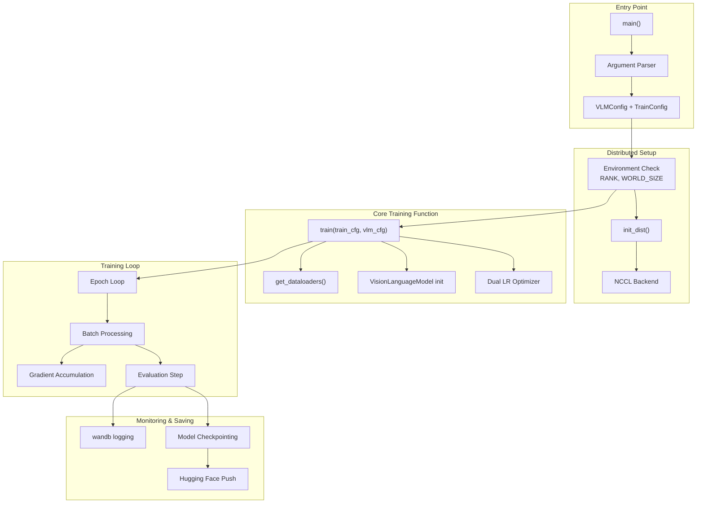
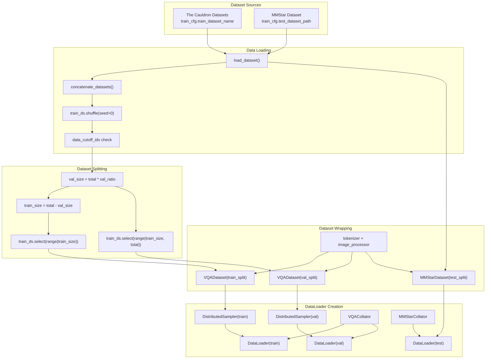
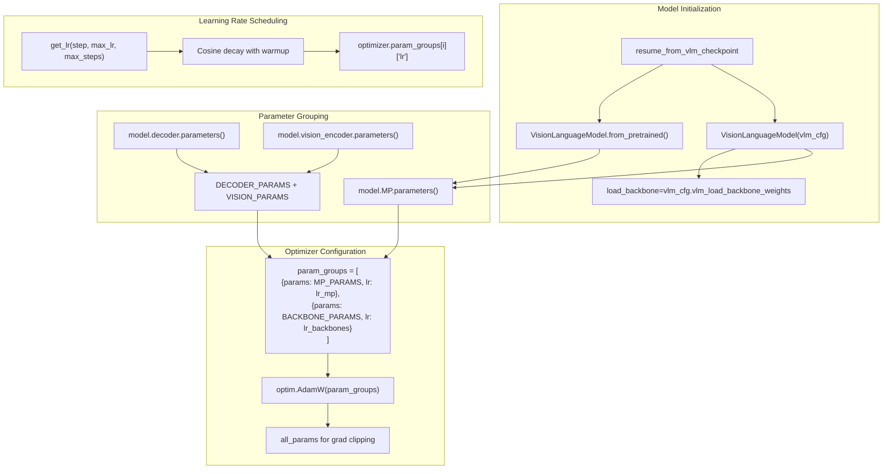
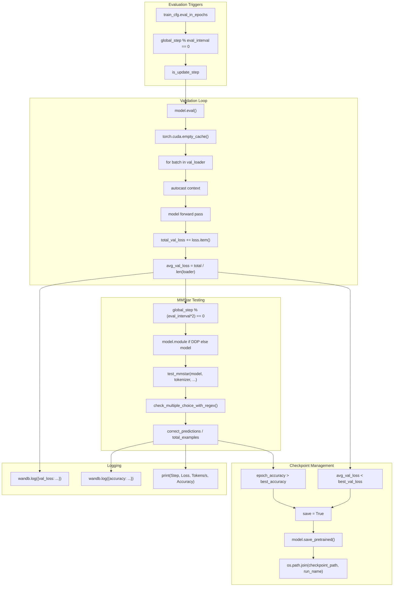

<!-- source: DeepWiki mcp.deepwiki.com · repo huggingface/nanoVLM · page 6.1 Training Pipeline · fetched 2026-10-26 -->

# Training Pipeline

Relevant source files

The following files were used as context for generating this wiki page:

- [train.py](train.py)

This document covers the main training pipeline implementation for nanoVLM, focusing on the distributed training system, data loading, optimization, and evaluation workflows. The training pipeline is primarily implemented in `train.py`, which serves as the main entry point for training vision-language models.

For information about interactive training using Jupyter notebooks, see [Interactive Training](#6.2). For evaluation methodologies and metrics, see [Evaluation](#6.3).

## Overview

The training pipeline implements a comprehensive system for training vision-language models with support for distributed training, gradient accumulation, mixed precision, and continuous evaluation. The pipeline handles multi-dataset training, dual learning rate optimization, and integration with external monitoring tools.

**Sources:** [train.py:422-467](), [train.py:201-421]()

## Distributed Training Infrastructure

The training pipeline includes comprehensive distributed training support using PyTorch's DistributedDataParallel (DDP) with NCCL backend for multi-GPU training.

### Distributed Setup Functions

| Function | Purpose | Key Implementation |
|----------|---------|-------------------|
| `init_dist()` | Initialize distributed process group | Uses NCCL backend, sets CUDA device |
| `is_dist()` | Check if distributed training is active | Checks `dist.is_available()` and `dist.is_initialized()` |
| `is_master()` | Determine if current process is rank 0 | Returns `dist.get_rank() == 0` |
| `wrap_model()` | Wrap model for DDP | Creates `DistributedDataParallel` instance |

```mermaid
graph TD
    subgraph "Process Initialization"
        ENV_CHECK["Environment Variables<br/>RANK, WORLD_SIZE"]
        INIT_DIST_FUNC["init_dist()"]
        NCCL_BACKEND["NCCL Backend"]
        SET_DEVICE["torch.cuda.set_device(rank)"]
    end
    
    subgraph "Model Wrapping"
        MODEL_INIT["VisionLanguageModel"]
        COMPILE_CHECK["torch.compile check"]
        DDP_WRAP["DistributedDataParallel"]
        DEVICE_IDS["device_ids=[rank]"]
    end
    
    subgraph "Data Distribution"
        DIST_SAMPLER["DistributedSampler"]
        TRAIN_SAMPLER["train_sampler"]
        VAL_SAMPLER["val_sampler"]
        NO_SHUFFLE["shuffle=False for val"]
    end
    
    subgraph "Gradient Synchronization"
        GRAD_ACC_CHECK["gradient_accumulation_steps > 1"]
        NO_SYNC["model.no_sync()"]
        SYNC_GRADS["Gradient Synchronization"]
    end
    
    ENV_CHECK --> INIT_DIST_FUNC
    INIT_DIST_FUNC --> NCCL_BACKEND
    NCCL_BACKEND --> SET_DEVICE
    
    MODEL_INIT --> COMPILE_CHECK
    COMPILE_CHECK --> DDP_WRAP
    DDP_WRAP --> DEVICE_IDS
    
    DIST_SAMPLER --> TRAIN_SAMPLER
    DIST_SAMPLER --> VAL_SAMPLER
    VAL_SAMPLER --> NO_SHUFFLE
    
    GRAD_ACC_CHECK --> NO_SYNC
    NO_SYNC --> SYNC_GRADS
```

**Sources:** [train.py:37-63](), [train.py:113-117](), [train.py:131-136](), [train.py:257-258](), [train.py:282-287]()

## Data Loading Pipeline

The training pipeline supports multi-dataset training with sophisticated data loading, processing, and batching capabilities.

### Dataset Loading and Preparation

The `get_dataloaders()` function orchestrates the complete data pipeline:

1. **Multi-dataset Loading**: Concatenates multiple training datasets from The Cauldron
2. **Train/Validation Split**: Applies configurable validation ratio
3. **Test Dataset**: Loads MMStar dataset for evaluation
4. **Distributed Sampling**: Creates appropriate samplers for multi-GPU training

**Sources:** [train.py:77-160](), [train.py:82-103](), [train.py:113-158]()

## Model and Optimizer Initialization

The training pipeline implements a sophisticated dual learning rate optimization strategy to handle the different components of the vision-language model.

### Parameter Grouping Strategy

The optimizer groups parameters into two categories with different learning rates:
- **Modality Projector**: Higher learning rate (`lr_mp`) for newly initialized parameters
- **Backbone Networks**: Lower learning rate (`lr_backbones`) for pretrained Vision Transformer and Language Model

**Sources:** [train.py:221-241](), [train.py:235-241](), [train.py:184-199](), [train.py:307-312]()

## Training Loop Implementation

The training loop implements gradient accumulation, mixed precision training, and periodic evaluation with comprehensive logging.

### Core Training Mechanics

| Component | Implementation | Purpose |
|-----------|----------------|---------|
| Gradient Accumulation | `gradient_accumulation_steps` | Scale effective batch size |
| Mixed Precision | `torch.autocast()` | Memory efficiency and speed |
| Gradient Clipping | `torch.nn.utils.clip_grad_norm_()` | Training stability |
| DDP Synchronization | `model.no_sync()` context | Optimize gradient sync timing |

```mermaid
flowchart TD
    subgraph "Epoch Loop"
        EPOCH_START["epoch in range(epochs)"]
        MODEL_TRAIN["model.train()"]
        ZERO_GRAD["optimizer.zero_grad()"]
        BATCH_LOOP["for batch in train_loader"]
    end
    
    subgraph "Batch Processing"
        BATCH_START["batch_start_time"]
        TO_DEVICE["batch tensors .to(device)"]
        UPDATE_CHECK["is_update_step calculation"]
        SYNC_CONTEXT["DDP sync context check"]
    end
    
    subgraph "Forward Pass"
        AUTOCAST["torch.autocast() context"]
        MODEL_FORWARD["model(input_ids, images, ...)"]
        LOSS_CALC["loss calculation"]
        LOSS_SCALE["loss / gradient_accumulation_steps"]
    end
    
    subgraph "Backward Pass"
        LOSS_BACKWARD["loss.backward()"]
        GRAD_CLIP_CHECK["max_grad_norm check"]
        GRAD_NORM["clip_grad_norm_()"]
        LR_SCHEDULE["get_lr() and update"]
        OPTIMIZER_STEP["optimizer.step()"]
    end
    
    subgraph "Logging & Metrics"
        TOKEN_COUNT["torch.sum(attention_mask)"]
        TOKENS_PER_SEC["tokens / batch_duration"]
        DIST_GATHER["dist_gather() for metrics"]
        WANDB_LOG["wandb logging"]
    end
    
    subgraph "Evaluation"
        EVAL_INTERVAL_CHECK["global_step % eval_interval"]
        MODEL_EVAL["model.eval()"]
        VAL_LOOP["validation loop"]
        MMSTAR_TEST["test_mmstar()"]
        CHECKPOINT_SAVE["save_pretrained()"]
    end
    
    EPOCH_START --> MODEL_TRAIN
    MODEL_TRAIN --> ZERO_GRAD
    ZERO_GRAD --> BATCH_LOOP
    
    BATCH_LOOP --> BATCH_START
    BATCH_START --> TO_DEVICE
    TO_DEVICE --> UPDATE_CHECK
    UPDATE_CHECK --> SYNC_CONTEXT
    
    SYNC_CONTEXT --> AUTOCAST
    AUTOCAST --> MODEL_FORWARD
    MODEL_FORWARD --> LOSS_CALC
    LOSS_CALC --> LOSS_SCALE
    
    LOSS_SCALE --> LOSS_BACKWARD
    LOSS_BACKWARD --> GRAD_CLIP_CHECK
    GRAD_CLIP_CHECK --> GRAD_NORM
    GRAD_NORM --> LR_SCHEDULE
    LR_SCHEDULE --> OPTIMIZER_STEP
    
    OPTIMIZER_STEP --> TOKEN_COUNT
    TOKEN_COUNT --> TOKENS_PER_SEC
    TOKENS_PER_SEC --> DIST_GATHER
    DIST_GATHER --> WANDB_LOG
    
    WANDB_LOG --> EVAL_INTERVAL_CHECK
    EVAL_INTERVAL_CHECK --> MODEL_EVAL
    MODEL_EVAL --> VAL_LOOP
    VAL_LOOP --> MMSTAR_TEST
    MMSTAR_TEST --> CHECKPOINT_SAVE
```

**Sources:** [train.py:264-380](), [train.py:271-329](), [train.py:330-369](), [train.py:289-296]()

## Evaluation and Checkpointing

The training pipeline includes continuous evaluation on validation and test sets with intelligent checkpointing based on performance metrics.

### Evaluation Strategy

The evaluation system runs at configurable intervals during training:
- **Validation Loss**: Computed on validation split of training data
- **MMStar Accuracy**: Multiple-choice question answering evaluation
- **Best Model Tracking**: Saves checkpoints when validation loss improves or accuracy increases

**Sources:** [train.py:330-369](), [train.py:162-182](), [train.py:355-364](), [train.py:410-420]()

## Command Line Interface

The training script provides a command line interface for overriding key configuration parameters without modifying config files.

### Available Arguments

| Argument | Type | Purpose |
|----------|------|---------|
| `--lr_mp` | float | Learning rate for modality projector |
| `--lr_backbones` | float | Learning rate for backbone networks |
| `--vlm_checkpoint_path` | str | Path for loading/saving checkpoints |
| `--compile` | bool | Enable `torch.compile` optimization |
| `--resume_from_vlm_checkpoint` | bool | Resume from existing checkpoint |
| `--log_wandb` | bool | Enable Weights & Biases logging |

The script automatically detects distributed training environment through `RANK` and `WORLD_SIZE` environment variables and initializes the distributed process group accordingly.

**Sources:** [train.py:422-467](), [train.py:452-453](), [train.py:436-450]()

---

