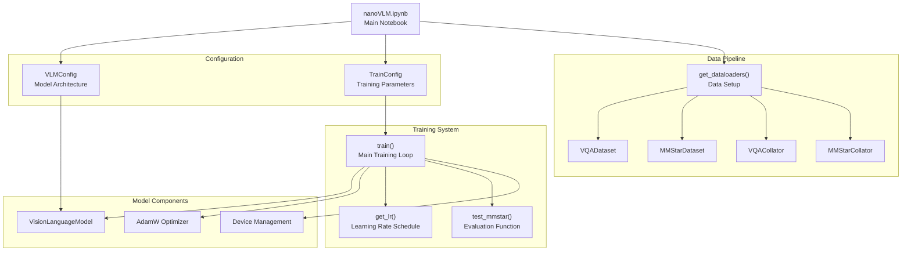
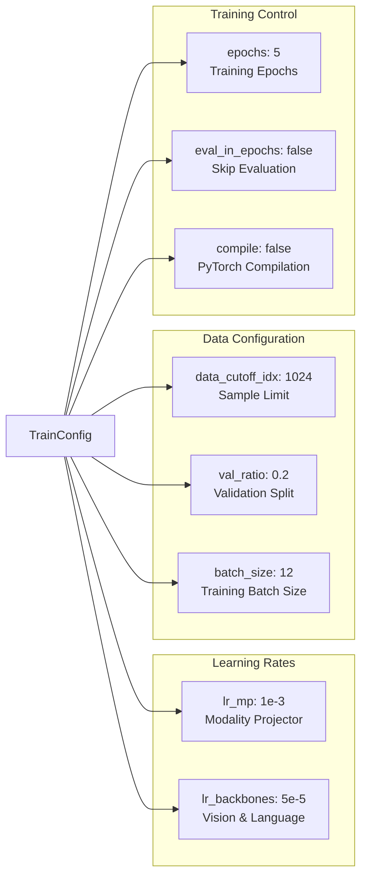
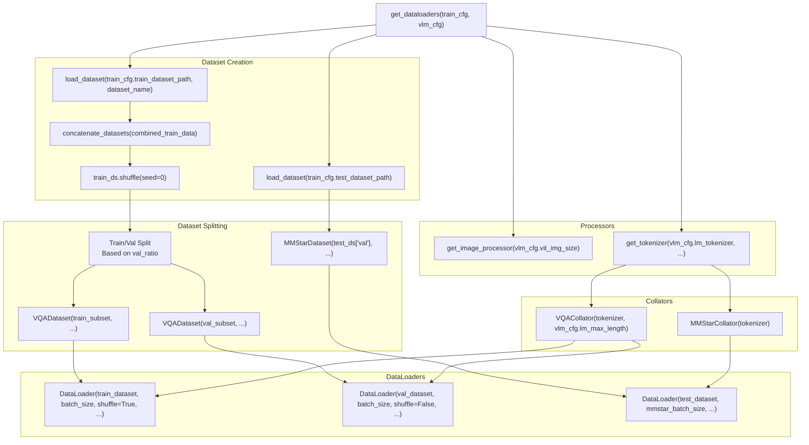
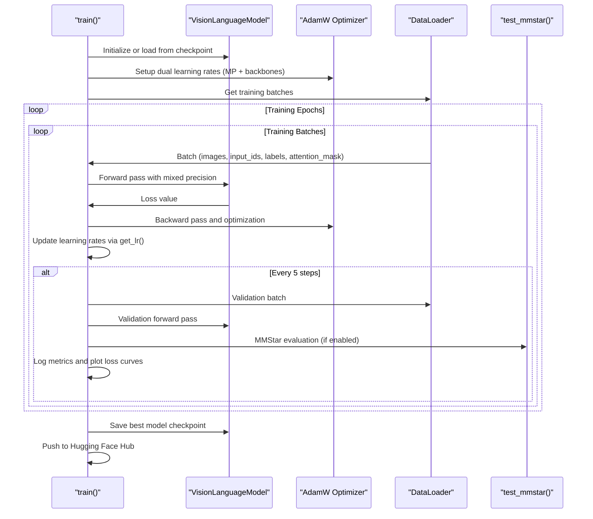
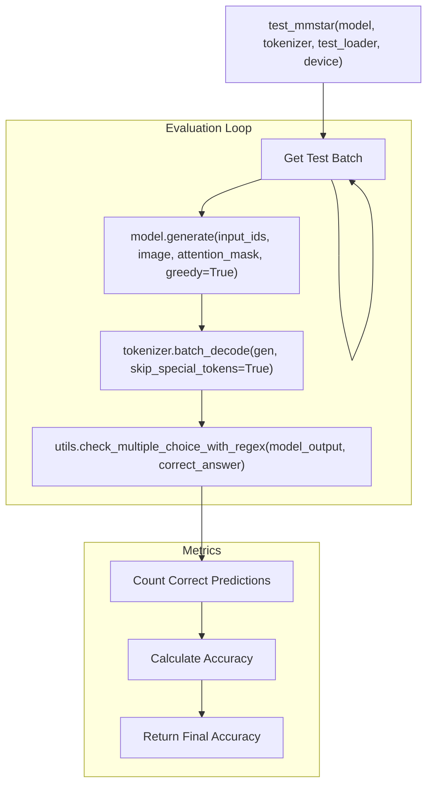

<!-- source: DeepWiki mcp.deepwiki.com · repo huggingface/nanoVLM · page 6.2 Distributed Training Infrastructure · fetched 2026-10-26 -->

# Interactive Training

Relevant source files

The following files were used as context for generating this wiki page:

- [prepare.sh](prepare.sh)
- [train.py](train.py)
- [train.sh](train.sh)
- [utils/plot_eval_results.py](utils/plot_eval_results.py)
- [utils/plot_experiments.sh](utils/plot_experiments.sh)
- [utils/run_checkpoint_evaluations.py](utils/run_checkpoint_evaluations.py)

This document covers the interactive training system provided by the nanoVLM Jupyter notebook, which enables experimentation and model training in environments like Google Colab. For information about the main training pipeline used for production training, see [Training Pipeline](#6.1). For details about the underlying model architecture, see [Vision Language Model](#3.1).

## Purpose and Scope

The interactive training system provides a user-friendly notebook interface for training nanoVLM models with configurable parameters, real-time visualization, and integrated evaluation. It is designed for educational purposes, experimentation, and rapid prototyping in resource-constrained environments like Google Colab.

## System Overview

The interactive training system is implemented as a comprehensive Jupyter notebook that encapsulates the entire training workflow from environment setup to model deployment.

Sources: [nanoVLM.ipynb:1-757]()

## Configuration System

The interactive training uses inline configuration classes that override the main repository's configuration system for easier experimentation.

### VLMConfig Class

The `VLMConfig` dataclass defines model architecture parameters with defaults optimized for Colab environments:

| Parameter Category | Key Parameters | Purpose |
|-------------------|----------------|---------|
| Vision Transformer | `vit_hidden_dim: 768`, `vit_n_blocks: 12` | Controls vision encoder size |
| Language Model | `lm_hidden_dim: 576`, `lm_n_blocks: 30` | Defines language decoder architecture |
| Modality Projection | `mp_pixel_shuffle_factor: 2`, `mp_image_token_length: 49` | Vision-language integration |
| Tokenization | `vlm_extra_tokens: {"image_token": "<\|image\|>"}` | Special token definitions |

### TrainConfig Class

The `TrainConfig` dataclass specifies training hyperparameters with conservative defaults:

Sources: [nanoVLM.ipynb:470-527]()

## Data Pipeline Setup

The `get_dataloaders()` function orchestrates the complete data pipeline setup, handling dataset loading, processing, and collation.

### Dataset Loading and Processing

The function supports multiple training datasets from The Cauldron collection, with configurable data cutoffs for faster experimentation.

Sources: [nanoVLM.ipynb:170-232]()

## Training Loop Implementation

The `train()` function implements a comprehensive training loop with mixed precision, learning rate scheduling, and periodic validation.

### Learning Rate Scheduling

The `get_lr()` function implements a cosine decay schedule with linear warmup:

1. **Warmup Phase**: Linear increase for first 3% of steps
2. **Decay Phase**: Cosine decay to 10% of max learning rate
3. **Minimum Phase**: Constant minimum learning rate after decay

### Training Process Flow

### Optimization Strategy

The training uses dual learning rates optimized for different model components:

| Component | Learning Rate | Rationale |
|-----------|---------------|-----------|
| Modality Projector | `1e-3` | New component requiring faster adaptation |
| Vision & Language Backbones | `5e-5` | Pre-trained components needing fine-tuning |

Sources: [nanoVLM.ipynb:299-448]()

## Evaluation and Testing

The `test_mmstar()` function provides automated evaluation on the MMStar benchmark during training.

### Evaluation Process

The evaluation uses greedy generation and regex-based answer matching for multiple-choice questions, providing reliable accuracy metrics for model performance tracking.

Sources: [nanoVLM.ipynb:253-278]()

## Model Persistence and Sharing

The interactive training system includes integrated model saving and sharing capabilities.

### Checkpoint Management

The system automatically saves the best-performing model based on validation accuracy:

1. **Local Saving**: `model.save_pretrained(save_directory=vlm_cfg.vlm_checkpoint_path)`
2. **Hub Upload**: `model.push_to_hub(hf_model_name)` for sharing via Hugging Face Hub
3. **Resume Support**: `VisionLanguageModel.from_pretrained()` for continuing training

### Visualization and Monitoring

The notebook provides real-time training visualization through matplotlib plots showing:

- Training loss curves
- Validation loss tracking
- Performance metrics (tokens/second, accuracy)
- Training time statistics

Sources: [nanoVLM.ipynb:422-447]()

## Environment Setup and Dependencies

The notebook includes comprehensive environment setup for Google Colab:

| Component | Purpose | Installation |
|-----------|---------|--------------|
| PyTorch | Deep learning framework | `pip install torch` |
| Datasets | Data loading | `pip install datasets==3.5.0` |
| Hugging Face Hub | Model sharing | `pip install huggingface_hub` |
| Authentication | Hub access | `notebook_login()` |

The system automatically detects available hardware (CUDA, MPS, CPU) and configures training accordingly.

Sources: [nanoVLM.ipynb:67-148]()

---

