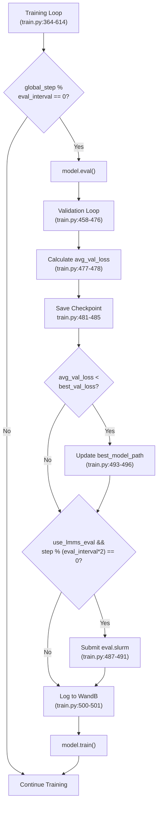
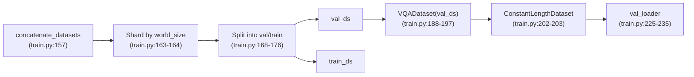
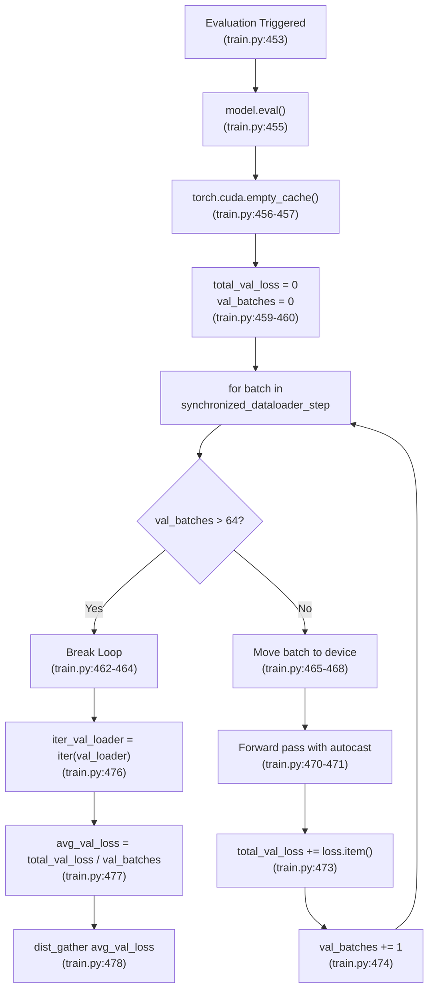
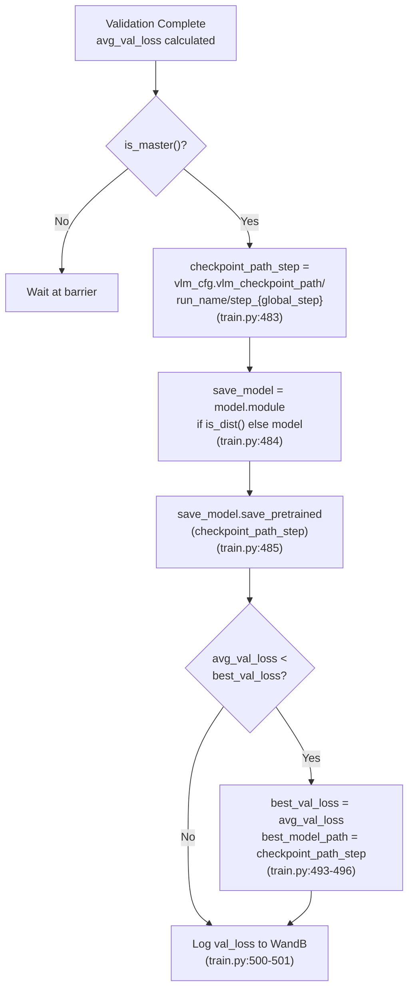
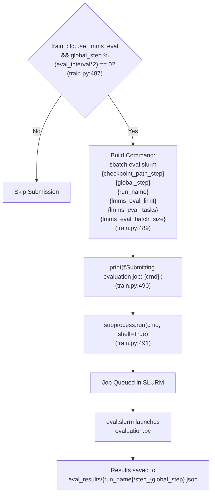

<!-- source: DeepWiki mcp.deepwiki.com · repo huggingface/nanoVLM · page 6.3 Training Evaluation · fetched 2026-10-26 -->

# Training Evaluation

<details>
<summary>Relevant source files</summary>

The following files were used as context for generating this wiki page:

- [evaluation.py](evaluation.py)
- [train.py](train.py)

</details>


This page documents the inline evaluation mechanisms integrated into the training loop in nanoVLM. Training evaluation serves two purposes: tracking model performance through validation loss during training, and triggering comprehensive benchmark evaluations at checkpoint intervals. For detailed information about the comprehensive evaluation system using lmms-eval, see page 7.

## 1. Overview of Training Evaluation

Training evaluation in nanoVLM operates on two levels:

1. **Inline Validation Loss**: Computed at regular intervals during training to monitor convergence and select the best checkpoint
2. **Checkpoint-Triggered Benchmarking**: Submits SLURM jobs for comprehensive lmms-eval benchmarking when checkpoints are saved



Sources: [train.py:453-503]()

## 2. Validation Data Pipeline

The validation data pipeline mirrors the training data pipeline but uses a separate validation split. The validation set is created by taking the first `val_size` samples from each shard of the training data.

### Validation Data Creation



The validation dataset uses the same quality filters and packing algorithm as the training dataset:

| Component | Configuration |
|-----------|---------------|
| `VQADataset` | Applies relevance, image correspondence, visual dependency, and formatting filters |
| `ConstantLengthDataset` | Packs samples into `seq_length=4096` sequences with knapsack algorithm |
| `VQACollator` | Pads to uniform length, masks labels with -100 |
| `DataLoader` | `batch_size=train_cfg.batch_size`, 1 worker, persistent workers disabled |

Sources: [train.py:168-235]()

## 3. Inline Validation Loop

The inline validation loop executes when `train_cfg.eval_in_epochs=True` and `global_step % train_cfg.eval_interval == 0`. This provides regular feedback on model generalization during training.

### Validation Execution Flow



Key implementation details:

- **Batch Limit**: Validation is limited to 64 batches to avoid excessive evaluation time [train.py:462-464]()
- **No Gradient Computation**: All validation happens inside `torch.no_grad()` context [train.py:458]()
- **Mixed Precision**: Uses the same `autocast_context` as training for consistency [train.py:470]()
- **Distributed Averaging**: Validation loss is averaged across all ranks using `dist_gather` [train.py:478]()

Sources: [train.py:453-478]()

## 4. Checkpoint Saving and Best Model Tracking

After validation completes, checkpoints are saved and the best model is tracked based on validation loss.

### Checkpoint Management



**Checkpoint Directory Structure:**
```
{vlm_cfg.vlm_checkpoint_path}/
└── {run_name}/
    ├── step_500/
    │   ├── config.json
    │   ├── model.safetensors
    │   └── ...
    ├── step_1000/
    └── step_1500/
```

The `best_model_path` is used at the end of training to push the best checkpoint to Hugging Face Hub [train.py:626-629]().

Sources: [train.py:481-501]()

## 5. Checkpoint-Triggered lmms-eval Submission

When comprehensive benchmarking is enabled (`train_cfg.use_lmms_eval=True`), the training script submits SLURM jobs for full lmms-eval evaluation at checkpoint intervals.

### SLURM Job Submission



**Command Example:**
```bash
sbatch eval.slurm \
  /path/to/checkpoint/step_1000 \
  1000 \
  nanoVLM_siglip_mp4_SmolLM2-360M_8xGPU_bs32_40000_lr... \
  500 \
  "mmstar,mme,mmmu_val" \
  4
```

The evaluation job runs independently from training, allowing training to continue while comprehensive benchmarks execute on separate GPU resources. See page 7 for details on the evaluation system.

Sources: [train.py:487-491]()

## 6. Logging lmms-eval Results to WandB

As lmms-eval jobs complete, their results are automatically detected and logged to WandB during subsequent training steps.

### Result Detection and Logging

```mermaid
flowchart TD
    StatsLog["Training Stats Logging<br/>(train.py:506)"} --> CheckDir{"eval_results/{run_name}/<br/>exists?<br/>(train.py:539-540)"}
    CheckDir -->|"No"| SkipLog["Skip lmms-eval logging"]
    CheckDir -->|"Yes"| ListFiles["List files in directory<br/>(train.py:542)"]
    
    ListFiles --> MatchFile["Match step_N.json pattern<br/>(train.py:544-546)"]
    MatchFile --> CheckLogged{"step in<br/>logged_eval_steps?<br/>(train.py:550)"}
    CheckLogged -->|"Yes"| NextFile["Next file"]
    CheckLogged -->|"No"| ReadFile["Read JSON file<br/>(train.py:551-552)"]
    
    ReadFile --> ExtractResults["Extract results dict<br/>(train.py:554)"]
    ExtractResults --> BuildMetrics["metrics = {<br/>  f'lmms_eval/{key}': value<br/>  for key, value in results.items()<br/>}<br/>(train.py:556)"]
    BuildMetrics --> AddStep["metrics[lmms_eval_step] =<br/>eval_data['global_step']<br/>(train.py:557)"]
    
    AddStep --> LogWandB["run.log(metrics, step=global_step)<br/>(train.py:560)"]
    LogWandB --> MarkLogged["logged_eval_steps.add(step)<br/>(train.py:564)"]
    MarkLogged --> NextFile
```

**Result File Format** (`eval_results/{run_name}/step_{N}.json`):
```json
{
  "global_step": 1000,
  "results": {
    "mmstar": 0.3530,
    "mme": 1245.67,
    "mmmu_val": 0.4123,
    "average_score": 0.3891
  },
  "config": { ... }
}
```

The custom WandB metric `lmms_eval_step` allows lmms-eval results from different training steps to be plotted correctly in WandB, even if they arrive out of order [train.py:286-288]().

Sources: [train.py:538-567]()

## 7. Configuration Parameters

Training evaluation behavior is controlled by parameters in `TrainConfig`:

| Parameter | Type | Default | Purpose |
|-----------|------|---------|---------|
| `eval_in_epochs` | bool | True | Enable inline validation during training |
| `eval_interval` | int | 500 | Number of steps between validation runs |
| `val_size` | int | 1000 | Number of validation samples per rank |
| `use_lmms_eval` | bool | True | Submit SLURM jobs for comprehensive evaluation |
| `lmms_eval_tasks` | str | "mmstar,mme,..." | Comma-separated list of benchmark tasks |
| `lmms_eval_limit` | int | 500 | Limit samples per task (for faster testing) |
| `lmms_eval_batch_size` | int | 4 | Batch size for lmms-eval jobs |

**Validation Frequency:**
- Validation loss: Every `eval_interval` steps
- lmms-eval submission: Every `eval_interval * 2` steps (to reduce SLURM queue load)

Sources: [models/config.py](), [train.py:453](), [train.py:487]()

## 7. Evaluating Your Own Models

To evaluate a model on the MMStar dataset, you can use the provided testing function:

```python
# Load your model
model = VisionLanguageModel(vlm_cfg)
model.load_checkpoint(checkpoint_path)

# Get the tokenizer
tokenizer = get_tokenizer(vlm_cfg.lm_tokenizer)

# Create test loader
test_loader = create_test_loader()  # See get_dataloaders function

# Run evaluation
accuracy = test_mmstar(model, tokenizer, test_loader, device)
print(f"MMStar Accuracy: {accuracy:.4f}")
```

The resulting accuracy score represents the proportion of multiple-choice questions the model answered correctly.

Sources: [train.py:162-182](), [nanoVLM.ipynb:253-277]()

## 8. Performance Metrics and Interpretation

The primary metric used to evaluate nanoVLM is accuracy on multiple-choice questions. This metric provides a straightforward interpretation: the percentage of questions the model answers correctly.

During model development, consider:
- Tracking accuracy over training epochs to identify overfitting
- Comparing accuracy across model configurations to select optimal architectures
- Using accuracy as a criterion for early stopping or model selection

The `test_mmstar` function is designed to be efficient and can process the entire validation set quickly to provide an overall accuracy score.

Sources: [train.py:81-105](), [nanoVLM.ipynb:202-227]()

---

