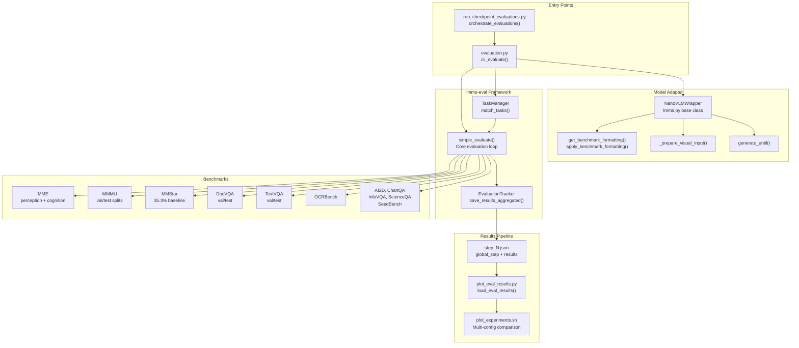
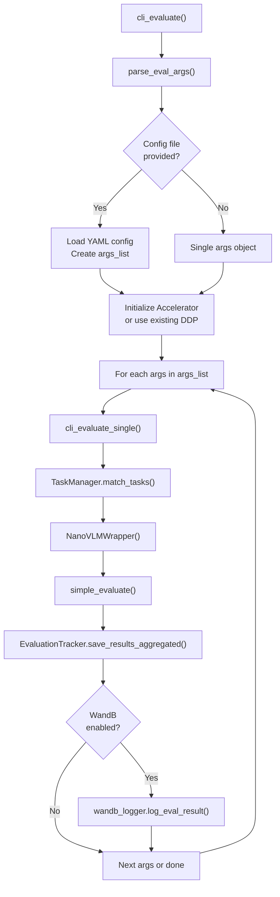
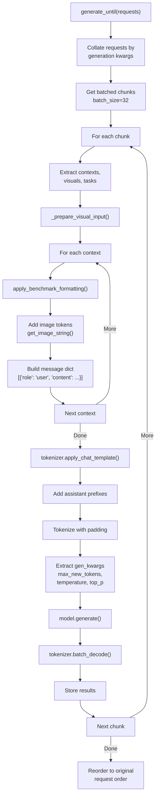
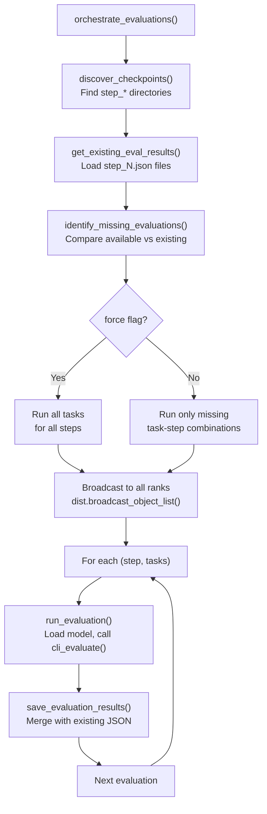
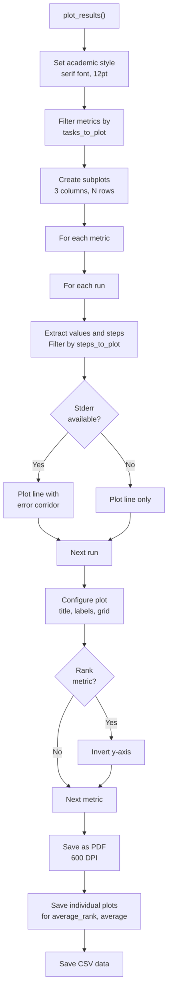

<!-- source: DeepWiki mcp.deepwiki.com · repo huggingface/nanoVLM · page 7 Evaluation System · fetched 2026-10-26 -->

# Evaluation System

<details>
<summary>Relevant source files</summary>

The following files were used as context for generating this wiki page:

- [eval/lmms_eval_wrapper.py](eval/lmms_eval_wrapper.py)
- [evaluation.py](evaluation.py)
- [prepare.sh](prepare.sh)
- [train.sh](train.sh)
- [utils/plot_eval_results.py](utils/plot_eval_results.py)
- [utils/plot_experiments.sh](utils/plot_experiments.sh)
- [utils/run_checkpoint_evaluations.py](utils/run_checkpoint_evaluations.py)

</details>


## Purpose and Scope

This document describes the evaluation infrastructure for nanoVLM, which integrates with the [lmms-eval framework](https://github.com/EvolvingLMMs-Lab/lmms-eval) to benchmark models across standardized vision-language tasks. The evaluation system provides checkpoint discovery, incremental evaluation, benchmark-specific formatting, distributed execution, and result visualization.

For information about training-time evaluation, see [Training Evaluation](#6.3). For interactive inference, see [Inference and Generation](#8).

---

## Architecture Overview

The evaluation system consists of four major components: a CLI interface that handles argument parsing and orchestration, a wrapper layer that adapts nanoVLM to the lmms-eval API, the lmms-eval framework itself which executes benchmarks, and a results pipeline that saves and visualizes metrics.



**Sources:** [evaluation.py:1-562](), [eval/lmms_eval_wrapper.py:1-346](), [utils/run_checkpoint_evaluations.py:1-399](), [utils/plot_eval_results.py:1-598]()

---

## CLI Interface

### evaluation.py

The `evaluation.py` script serves as the main entrypoint for running evaluations. It provides a comprehensive CLI interface with support for YAML configuration files, distributed execution, and WandB logging.

#### Key Functions

| Function | Purpose | Location |
|----------|---------|----------|
| `parse_eval_args()` | Parse command-line arguments | [evaluation.py:89-284]() |
| `cli_evaluate()` | Main orchestration function | [evaluation.py:286-384]() |
| `cli_evaluate_single()` | Single evaluation execution | [evaluation.py:386-551]() |

#### Command-Line Arguments

```python
# Core arguments
--model: str              # Model name or path (default: "hf")
--tasks: str              # Comma-separated task list or "list"
--model_args: str         # Model initialization arguments
--checkpoint_path: str    # Path to checkpoint directory
--global_step: int        # Global step number

# Execution control
--batch_size: str         # Batch size (auto|auto:N|N)
--limit: float            # Limit examples per task (<1 = percentage)
--device: str             # Device (cuda, cuda:0, cpu)
--num_fewshot: int        # Number of few-shot examples

# Output control
--output_path: str        # Output directory for results
--log_samples: bool       # Save per-sample outputs
--predict_only: bool      # Skip metric computation

# Distributed execution (nanoVLM-specific)
--checkpoints_dir: str    # Checkpoints directory
--steps: List[int]        # Specific steps to evaluate
--eval_tasks: List[str]   # Evaluation tasks
--eval_results_dir: str   # Results directory
--force: bool             # Force re-run evaluations
```

#### Configuration File Support

The system supports YAML configuration files for batch evaluation:

```yaml
# Example config.yaml
model: "lusxvr/nanoVLM-450M"
tasks: "mmstar,docvqa_val,textvqa_val"
batch_size: 32
limit: null
output_path: "results/"
log_samples: true
```

The config is loaded and merged with CLI arguments at [evaluation.py:319-333]().

#### Evaluation Flow



**Sources:** [evaluation.py:89-551]()

---

## Model Wrapper

### NanoVLMWrapper

The `NanoVLMWrapper` class adapts nanoVLM to the lmms-eval API by implementing the `lmms` base class interface. It handles model loading, visual input preparation, benchmark-specific formatting, and text generation.

#### Class Structure

```python
class NanoVLMWrapper(lmms):
    def __init__(self, model, device, batch_size, **kwargs)
    def _prepare_visual_input(self, visual_list) -> (images, ratios)
    def get_benchmark_formatting(self, task_name) -> dict
    def apply_benchmark_formatting(self, context, prompt, task) -> (str, str)
    def generate_until(self, requests) -> List[str]
    def loglikelihood(self, requests) -> NotImplementedError
    def generate_until_multi_round(self, requests) -> NotImplementedError
```

#### Initialization and Model Loading

The wrapper supports both string paths and model objects:

```python
# From Hub or checkpoint path
wrapper = NanoVLMWrapper(model="lusxvr/nanoVLM-450M", device="cuda", batch_size=32)

# From existing model object
model = VisionLanguageModel.from_pretrained(checkpoint_path)
wrapper = NanoVLMWrapper(model=model, device="cuda", batch_size=32)
```

The initialization at [eval/lmms_eval_wrapper.py:26-55]() handles distributed setup, tokenizer loading, and image processor configuration.

#### Visual Input Preparation

The `_prepare_visual_input()` method handles diverse input formats:

| Input Type | Handling | Location |
|------------|----------|----------|
| `PIL.Image` | Direct processing | [eval/lmms_eval_wrapper.py:66-68]() |
| `str` (path) | Load and convert to PIL | [eval/lmms_eval_wrapper.py:69]() |
| `np.ndarray` | Convert to PIL | [eval/lmms_eval_wrapper.py:70-71]() |

The method returns processed image tensors and splitting ratios for multi-image inputs.

#### Benchmark-Specific Formatting

Different benchmarks require specific text formatting. The `get_benchmark_formatting()` method at [eval/lmms_eval_wrapper.py:102-183]() returns formatting rules:

```python
{
    "text_replacements": dict,  # String replacements
    "assistant_prefix": str,    # Prefix for model output
    "user_prefix": str,         # Prefix for user input
    "user_suffix": str          # Suffix for user input
}
```

**Benchmark Formatting Rules:**

| Benchmark(s) | Key Modifications | Rationale |
|--------------|-------------------|-----------|
| `ai2d`, `mmstar`, `seedbench`, `scienceqa` | Replace "Options:" with "Choices:", add "Answer with the letter" | Standardize multiple-choice format |
| `docvqa_val`, `docvqa_test` | Add OCR-specific instructions: "Do not paraphrase or reformat" | Prevent text reformatting in answers |
| `chartvqa` | Detailed formatting rules: no units, binary Yes/No, decimal ratios | Match expected answer format |
| `textvqa_val`, `textvqa_test` | "As few words as possible", "Do not apply common sense" | Encourage concise, image-based answers |
| `mmmu_val`, `mmmu_test` | Simplify prompt, move choices marker | Clean up verbose instructions |
| `infovqa_val`, `mme`, `ocrbench` | Add "Give a very brief answer" | Reduce verbosity |

**Sources:** [eval/lmms_eval_wrapper.py:102-206]()

#### Generation Pipeline

The `generate_until()` method implements the core evaluation loop:



**Sources:** [eval/lmms_eval_wrapper.py:207-333]()

---

## Benchmark Tasks

The evaluation system supports 11+ standardized vision-language benchmarks covering diverse capabilities:

### Supported Benchmarks

| Task | Full Name | Metrics | Description |
|------|-----------|---------|-------------|
| `mme` | MME | `perception_score`, `cognition_score`, `total_score` | Perception and cognition benchmark |
| `mmmu_val`, `mmmu_test` | MMMU | `mmmu_acc` | College-level multimodal understanding |
| `mmstar` | MMStar | `average` | Challenging VQA (35.3% baseline) |
| `docvqa_val`, `docvqa_test` | DocVQA | `anls` | Document understanding |
| `textvqa_val`, `textvqa_test` | TextVQA | `exact_match` | Scene text reading |
| `ocrbench` | OCRBench | `ocrbench_accuracy` | OCR capabilities |
| `infovqa_val` | InfoVQA | `anls` | Infographic understanding |
| `chartqa` | ChartQA | `relaxed_overall` | Chart comprehension |
| `ai2d` | AI2D | `exact_match` | Diagram understanding |
| `scienceqa` | ScienceQA | `exact_match` | Science question answering |
| `seedbench` | SeedBench | `seed_all` | General vision-language |

### Task Discovery

The `TaskManager` discovers and loads tasks at [evaluation.py:391]():

```python
task_manager = TaskManager(verbosity, include_path, model_name)
task_names = task_manager.match_tasks(task_list)  # Supports wildcards
```

**Sources:** [evaluation.py:386-488](), [eval/lmms_eval_wrapper.py:102-171]()

---

## Orchestration System

### run_checkpoint_evaluations.py

This script orchestrates large-scale evaluation campaigns across multiple checkpoints and tasks. It implements incremental evaluation by detecting missing results and running only what's needed.

#### Core Functions



#### Checkpoint Discovery

The `discover_checkpoints()` function scans for checkpoint directories:

```python
def discover_checkpoints(checkpoints_dir: str) -> Dict[str, List[int]]:
    """
    Discover all checkpoint steps in a directory.
    Returns: Dict mapping run_name to list of step numbers
    """
    # Scans for step_* subdirectories
    # Extracts step numbers from directory names
    # Returns sorted list per run
```

**Sources:** [utils/run_checkpoint_evaluations.py:82-114]()

#### Missing Evaluation Detection

The `identify_missing_evaluations()` function compares available checkpoints with existing results:

```python
def identify_missing_evaluations(
    run_steps: Dict[str, List[int]], 
    existing_results: Dict[int, Dict[str, Set[str]]], 
    tasks: List[str],
    specific_steps: Optional[List[int]] = None,
    force: bool = False
) -> List[Tuple[int, str]]:
    """
    Returns list of (step_number, missing_tasks_string) tuples
    """
    # For each step in run_steps:
    #   - If specific_steps provided, check if step in list
    #   - If force=True, run all tasks
    #   - Otherwise, check which tasks are missing from existing_results
```

**Example output:**
```python
[
    (1000, "mmstar,docvqa_val"),  # Step 1000 missing these tasks
    (2000, "textvqa_val"),        # Step 2000 missing this task
    (3000, "mmstar,docvqa_val,textvqa_val")  # Step 3000 missing all
]
```

**Sources:** [utils/run_checkpoint_evaluations.py:163-211]()

#### Result Merging

The `save_evaluation_results()` function merges new results with existing:

```python
# Load existing step_N.json if it exists
if result_file.exists():
    existing_data = json.load(f)
else:
    existing_data = {'global_step': step, 'results': {}}

# Merge new results
existing_data['results'].update(new_results['results'])
existing_data['global_step'] = step

# Save updated results
json.dump(existing_data, f, indent=4)
```

This allows incremental evaluation where each task's results are added independently.

**Sources:** [utils/run_checkpoint_evaluations.py:214-251]()

#### Distributed Execution

The orchestrator supports distributed execution across multiple GPUs:

```python
if "RANK" in os.environ and "WORLD_SIZE" in os.environ:
    init_dist()  # Initialize PyTorch DDP

# Broadcast missing evaluations from rank 0 to all ranks
if is_dist():
    object_list = [missing_evaluations]
    dist.broadcast_object_list(object_list, src=0)
    missing_evaluations = object_list[0]

# Each rank runs evaluations
for step, tasks_to_run in missing_evaluations:
    results = run_evaluation(checkpoint_path, step, tasks_to_run, limit, batch_size)
    if is_master():
        save_evaluation_results(eval_results_dir, run_name, step, results)
```

**Sources:** [utils/run_checkpoint_evaluations.py:253-396]()

---

## Results Management

### JSON Format

Evaluation results are saved in a standardized JSON format at `eval_results/{run_name}/step_{N}.json`:

```json
{
    "global_step": 1000,
    "results": {
        "mmstar_average": 35.7,
        "mmstar_average_stderr": 0.5,
        "docvqa_val_anls": 42.3,
        "docvqa_val_anls_stderr": 0.8,
        "textvqa_val_exact_match": 38.9,
        "textvqa_val_exact_match_stderr": 0.6,
        "mme_mme_perception_score": 1245.0,
        "mme_mme_cognition_score": 325.5,
        "mme_total_score": 1570.5
    }
}
```

### EvaluationTracker

The lmms-eval `EvaluationTracker` handles result persistence:

```python
evaluation_tracker = EvaluationTracker(
    output_path=args.output_path,
    token=os.environ.get('HF_TOKEN')
)

# After evaluation
evaluation_tracker.save_results_aggregated(
    results=results, 
    samples=samples if args.log_samples else None,
    datetime_str=datetime_str
)

# Per-task sample saving
for task_name, config in results["configs"].items():
    evaluation_tracker.save_results_samples(
        task_name=task_name, 
        samples=samples[task_name]
    )
```

**Sources:** [evaluation.py:399-548]()

---

## Visualization Pipeline

### plot_eval_results.py

The plotting script generates publication-quality visualizations comparing multiple experimental runs.

#### Loading Results

```python
def load_eval_results(eval_folder, tasks_to_plot=None):
    """Load all step_*.json files and extract metrics"""
    json_files = glob.glob(os.path.join(eval_folder, "step_*.json"))
    
    results = []
    for json_file in json_files:
        data = json.load(f)
        result = {'step': data['global_step']}
        result.update(data['results'])
        
        # Compute derived metrics
        if 'mme_total_score' in tasks_to_plot:
            result['mme_total_score'] = (
                result['mme_mme_perception_score'] + 
                result['mme_mme_cognition_score']
            )
        
        if 'average' in tasks_to_plot:
            # Average across specified tasks, normalize MME by 2800
            metrics_to_average = [...]
            result['average'] = sum(metrics_to_average) / len(metrics_to_average)
        
        results.append(result)
    
    return sorted(results, key=lambda x: x['step'])
```

**Sources:** [utils/plot_eval_results.py:108-157]()

#### Ranking Summary

The `compute_ranking_summary()` function computes average rank across tasks:

```python
# For each step:
#   1. Get all runs that have this step
#   2. For each metric, rank runs (higher value = better rank)
#   3. Compute average rank for each run
#   4. Add 'average_rank' to results

# Example: If 3 runs have scores [35.7, 42.1, 38.9] on MMStar:
#   Ranks: [3, 1, 2]  (42.1 is best, so rank 1)
```

This enables fair comparison across diverse benchmarks with different scales.

**Sources:** [utils/plot_eval_results.py:26-106]()

#### Plot Generation



The script generates three outputs:
1. **Combined plot**: All metrics in subplots (`plots_final/{output}.pdf`)
2. **Individual plots**: High-resolution PDFs for key metrics (`plots_final/{output}_{metric}.pdf`)
3. **CSV data**: Raw data for further analysis (`plots_final/{output}.csv`)

**Sources:** [utils/plot_eval_results.py:166-501]()

#### Multi-Experiment Comparison

The `plot_experiments.sh` script orchestrates batch plotting for systematic comparisons:

```bash
# Example: Compare data quality filtering levels
python plot_eval_results.py \
    Baseline:'/path/to/unfiltered' \
    '≥2':'/path/to/rating_2' \
    '≥3':'/path/to/rating_3' \
    '≥4':'/path/to/rating_4' \
    '≥5':'/path/to/rating_5' \
    --tasks 'mmstar_average' 'docvqa_val_anls' 'average_rank' 'average' \
    --output all_ratings/all_ratings \
    --steps 1000 2000 3000 4000 5000
```

The script at [utils/plot_experiments.sh:1-234]() contains pre-configured comparisons for:
- Global image token ablations
- LM head tying experiments
- Dataset comparisons (FineVision, Cauldron, Cambrian, LLaVa)
- Data quality filters (relevance, image correspondence, visual dependency, formatting)
- Multi-stage training strategies

**Sources:** [utils/plot_experiments.sh:1-234]()

---

## Usage Examples

### Basic Evaluation

Evaluate a model on specific tasks:

```bash
python evaluation.py \
    --model lusxvr/nanoVLM-450M \
    --tasks mmstar,docvqa_val,textvqa_val \
    --batch_size 32 \
    --device cuda \
    --output_path results/
```

### Checkpoint Evaluation

Evaluate a specific checkpoint:

```bash
python evaluation.py \
    --checkpoint_path checkpoints/step_5000 \
    --global_step 5000 \
    --tasks mmstar,docvqa_val \
    --batch_size 32 \
    --output_path results/
```

### Orchestrated Evaluation

Run evaluations across all checkpoints:

```bash
torchrun --nproc_per_node=8 utils/run_checkpoint_evaluations.py \
    --checkpoints_dir checkpoints/run_name \
    --eval_tasks "mmstar,docvqa_val,textvqa_val,mme,mmmu_val,ocrbench" \
    --eval_results_dir eval_results \
    --batch_size 64
```

With specific steps:

```bash
python utils/run_checkpoint_evaluations.py \
    --checkpoints_dir checkpoints/run_name \
    --eval_tasks "mmstar,docvqa_val" \
    --steps 1000 2000 5000 10000 \
    --eval_results_dir eval_results
```

Force re-evaluation:

```bash
python utils/run_checkpoint_evaluations.py \
    --checkpoints_dir checkpoints/run_name \
    --eval_tasks "mmstar,docvqa_val" \
    --force \
    --eval_results_dir eval_results
```

### Visualization

Plot results from a single run:

```bash
python utils/plot_eval_results.py \
    eval_results/run_name \
    --tasks mmstar_average docvqa_val_anls textvqa_val_exact_match average \
    --output run_name_results
```

Compare multiple runs:

```bash
python utils/plot_eval_results.py \
    Baseline:eval_results/baseline \
    'Filtered ≥3':eval_results/filtered_3 \
    'Filtered ≥5':eval_results/filtered_5 \
    --tasks mmstar_average docvqa_val_anls average_rank average \
    --steps 1000 2000 3000 5000 10000 \
    --output comparison/quality_filters
```

### YAML Configuration

Create a config file for batch evaluation:

```yaml
# eval_config.yaml
model: "lusxvr/nanoVLM-450M"
tasks: "mmstar,docvqa_val,textvqa_val,mme"
batch_size: 32
limit: null
output_path: "results/batch_eval"
log_samples: true
device: "cuda"
```

Run with config:

```bash
python evaluation.py --config eval_config.yaml
```

### Distributed Evaluation with SLURM

Example SLURM script for parallel evaluation:

```bash
#!/bin/bash
#SBATCH --job-name=eval_nanoVLM
#SBATCH --nodes=1
#SBATCH --gpus-per-node=8
#SBATCH --time=4:00:00

# Launch evaluation across 8 GPUs, one task per GPU
srun --ntasks-per-node=8 python utils/run_checkpoint_evaluations.py \
    --checkpoints_dir checkpoints/run_name \
    --eval_tasks "mmstar,docvqa_val,textvqa_val,mme,mmmu_val,ocrbench,chartqa,ai2d" \
    --eval_results_dir eval_results \
    --batch_size 64
```

**Sources:** [evaluation.py:1-562](), [utils/run_checkpoint_evaluations.py:253-399](), [utils/plot_eval_results.py:502-598]()

---

## Integration with Training

The evaluation system integrates with the training pipeline through checkpoint-triggered evaluation jobs. After saving a checkpoint, the training script can submit an evaluation job:

```python
# In train.py (conceptual - actual implementation may vary)
if global_step % eval_interval == 0:
    checkpoint_path = save_checkpoint(model, global_step)
    
    # Submit evaluation job
    submit_eval_job(
        checkpoint_path=checkpoint_path,
        global_step=global_step,
        tasks=eval_tasks
    )
```

This enables continuous monitoring of model performance throughout training. For details on the training loop, see [Training Pipeline](#6.1).

**Sources:** [evaluation.py:1-562](), [utils/run_checkpoint_evaluations.py:1-399]()

---

