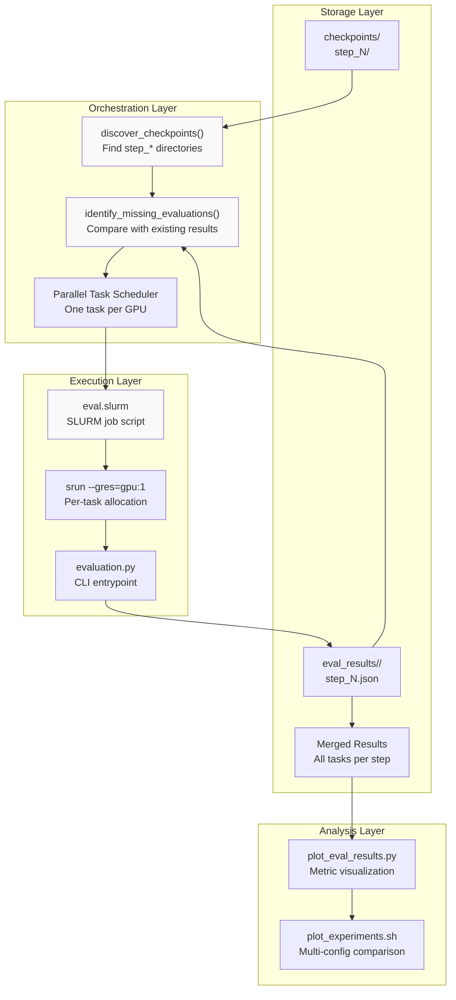
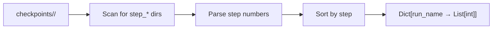
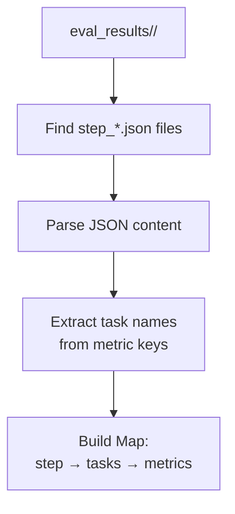
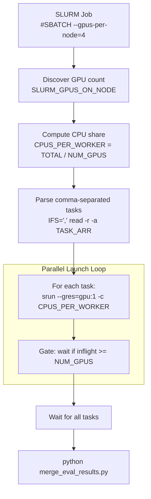
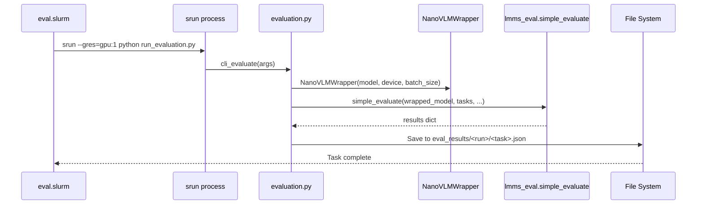
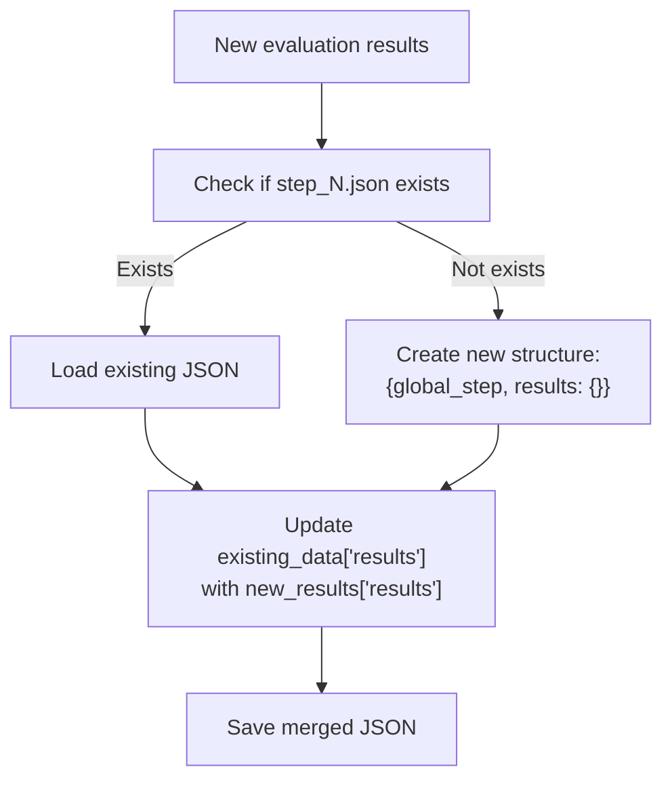
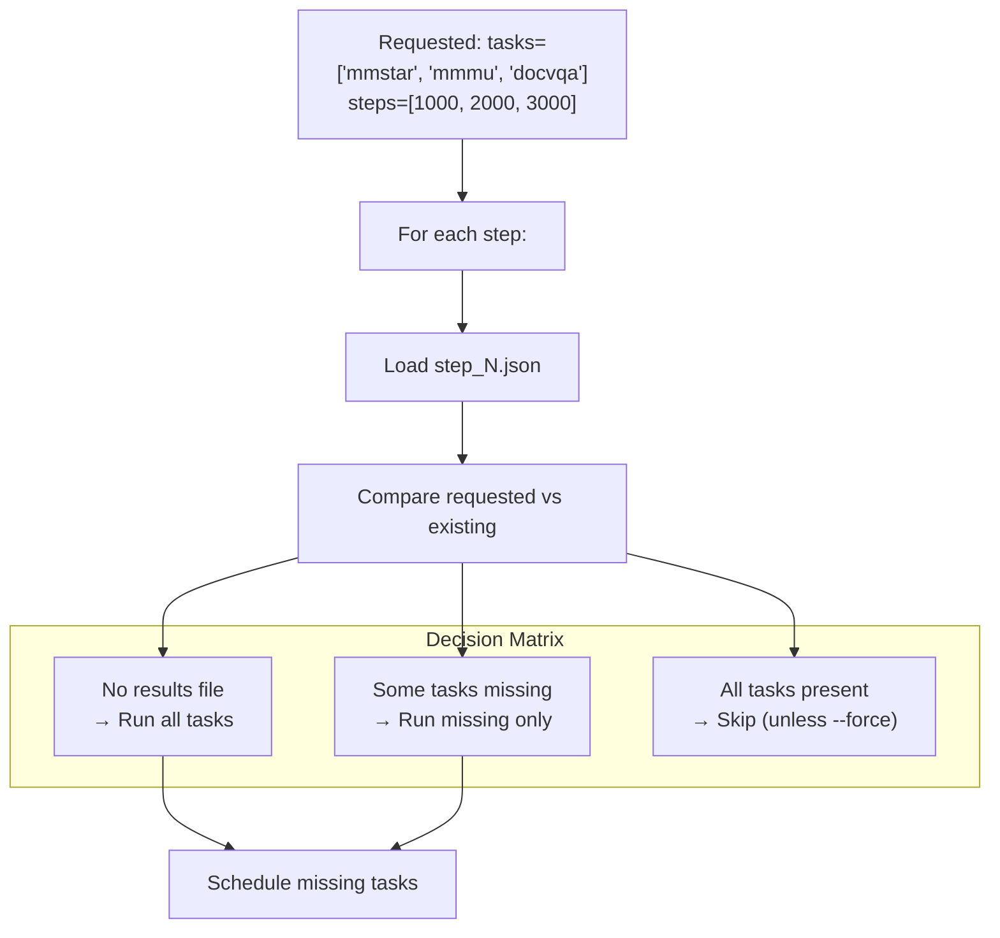
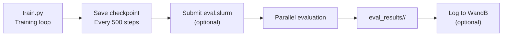

<!-- source: DeepWiki mcp.deepwiki.com · repo huggingface/nanoVLM · page 7.1 Evaluation Orchestration · fetched 2026-10-26 -->

# Evaluation Orchestration

<details>
<summary>Relevant source files</summary>

The following files were used as context for generating this wiki page:

- [eval.slurm](eval.slurm)
- [evaluation.py](evaluation.py)
- [prepare.sh](prepare.sh)
- [train.sh](train.sh)
- [utils/plot_eval_results.py](utils/plot_eval_results.py)
- [utils/plot_experiments.sh](utils/plot_experiments.sh)
- [utils/run_checkpoint_evaluations.py](utils/run_checkpoint_evaluations.py)

</details>


## Purpose and Scope

This document describes the evaluation orchestration system in nanoVLM, which manages the automated discovery, scheduling, and execution of evaluation tasks across multiple checkpoints. The orchestration layer handles checkpoint discovery, incremental evaluation (running only missing tasks), parallel GPU allocation, and result aggregation.

For details about the actual integration with the lmms-eval framework and model wrapping, see [LMMS-Eval Integration](#7.2). For information about inline evaluation during training, see [Training Evaluation](#6.3).

**Sources:** [eval.slurm:1-100](), [utils/run_checkpoint_evaluations.py:1-399]()

## System Architecture

The evaluation orchestration system consists of three main components that work together to automate benchmark evaluation:



**Key Components:**

| Component | File | Purpose |
|-----------|------|---------|
| Checkpoint Discovery | `run_checkpoint_evaluations.py` | Find all `step_*` directories in checkpoint folder |
| Missing Task Detection | `run_checkpoint_evaluations.py` | Compare requested tasks against existing results |
| SLURM Orchestrator | `eval.slurm` | Manage parallel GPU allocation and task execution |
| Evaluation Runner | `evaluation.py` | Execute single evaluation task via lmms-eval |
| Result Aggregation | `merge_eval_results.py` | Combine per-task results into unified JSON |
| Visualization | `plot_eval_results.py` | Generate plots with error corridors |

**Sources:** [eval.slurm:1-100](), [utils/run_checkpoint_evaluations.py:82-399]()

## Checkpoint Discovery and Management

### Discovery Process

The `discover_checkpoints()` function scans a checkpoint directory to identify all available training steps:



**Implementation details:**
- Searches for directories matching pattern `step_*` [utils/run_checkpoint_evaluations.py:100]()
- Extracts step numbers using `int(step_dir.name.split('_')[1])` [utils/run_checkpoint_evaluations.py:105]()
- Returns sorted list of step numbers per run [utils/run_checkpoint_evaluations.py:112]()
- Handles parsing errors gracefully with warnings [utils/run_checkpoint_evaluations.py:108]()

### Existing Results Detection

The `get_existing_eval_results()` function checks which evaluations have already been completed:



**Key features:**
- Locates result files using glob pattern `step_*.json` [utils/run_checkpoint_evaluations.py:135]()
- Parses task names from metric keys (e.g., `"mmmu_val_mmmu_acc"` → `"mmmu"`) [utils/run_checkpoint_evaluations.py:149]()
- Returns `Dict[int, Dict[str, Set[str]]]` mapping steps to tasks and their metrics [utils/run_checkpoint_evaluations.py:154]()
- Handles malformed JSON with error messages [utils/run_checkpoint_evaluations.py:156-158]()

**Sources:** [utils/run_checkpoint_evaluations.py:82-160]()

## Task Scheduling and Parallelization

### Missing Evaluation Identification

The `identify_missing_evaluations()` function determines which evaluations need to be run:

| Mode | Behavior | Use Case |
|------|----------|----------|
| **Normal** | Run only missing tasks | Incremental evaluation during training |
| **Force** | Re-run all tasks regardless | Debugging, parameter changes |
| **Filtered Steps** | Only specified steps | Selective re-evaluation |

**Algorithm:**
1. For each checkpoint step:
   - Check if step is in `specific_steps` filter (if provided) [utils/run_checkpoint_evaluations.py:189]()
   - If `force=True`: schedule all tasks [utils/run_checkpoint_evaluations.py:192-194]()
   - If `force=False`: compare requested tasks against existing results [utils/run_checkpoint_evaluations.py:196-209]()
2. Return list of `(step_number, comma_separated_tasks)` tuples [utils/run_checkpoint_evaluations.py:209]()

**Sources:** [utils/run_checkpoint_evaluations.py:163-211]()

### SLURM-Based Parallel Execution

The `eval.slurm` script orchestrates parallel evaluation across multiple GPUs:



**Resource Allocation:**

```bash
# eval.slurm configuration
#SBATCH --gpus-per-node=4      # Request 4 GPUs
#SBATCH --cpus-per-task=44     # Total CPUs for allocation
```

**Key mechanisms:**

1. **GPU Discovery** [eval.slurm:39-44]():
   ```bash
   NUM_GPUS=${SLURM_GPUS_ON_NODE:-$(nvidia-smi -L | wc -l)}
   ```

2. **CPU Distribution** [eval.slurm:47-50]():
   ```bash
   TOTAL_CPUS=${SLURM_CPUS_PER_TASK:-$(nproc)}
   CPUS_PER_WORKER=$(( TOTAL_CPUS / NUM_GPUS ))
   ```

3. **Task Parallelization** [eval.slurm:69-88]():
   - One `srun` process per task
   - Each gets exclusive access to 1 GPU
   - CPU binding ensures core affinity
   - Concurrency gate limits to `NUM_GPUS` simultaneous tasks

4. **Distributed Variables Cleanup** [eval.slurm:17]():
   ```bash
   unset RANK LOCAL_RANK WORLD_SIZE MASTER_ADDR MASTER_PORT
   ```
   This prevents confusion with training-time distributed environment variables.

**Sources:** [eval.slurm:1-100]()

## Evaluation Execution Flow

### Single Task Execution

Each evaluation task executes through this pipeline:



**Arguments passed per task:**

| Argument | Source | Example |
|----------|--------|---------|
| `checkpoint_path` | Discovered by orchestrator | `checkpoints/run_name/step_5000` |
| `global_step` | Extracted from checkpoint path | `5000` |
| `run_name` | Parent directory name | `nanoVLM_siglip2-base_...` |
| `tasks` | Single task from comma-separated list | `mmstar` |
| `batch_size` | SLURM argument | `64` |
| `limit` | Optional test limit | `None` or `100` |

**Sources:** [eval.slurm:54-79](), [evaluation.py:386-551]()

### Orchestrate Evaluations Main Loop

The `orchestrate_evaluations()` function coordinates the entire process:

```python
def orchestrate_evaluations(
    checkpoints_dir: str,
    tasks: str,                    # Comma-separated task list
    eval_results_dir: str,
    specific_steps: Optional[List[int]],
    limit: Optional[int],
    batch_size: int,
    force: bool
) -> None
```

**Execution phases:**

1. **Discovery Phase** [utils/run_checkpoint_evaluations.py:282-292]():
   - Call `discover_checkpoints(checkpoints_dir)`
   - Print found steps

2. **Comparison Phase** [utils/run_checkpoint_evaluations.py:299-301]():
   - Call `get_existing_eval_results()` (skipped if `force=True`)
   - Identify missing evaluations

3. **Execution Phase** [utils/run_checkpoint_evaluations.py:336-358]():
   - For each missing evaluation:
     - Build checkpoint path
     - Call `run_evaluation(checkpoint_path, step, tasks, limit, batch_size)`
     - Save results via `save_evaluation_results()`

4. **Distributed Coordination** [utils/run_checkpoint_evaluations.py:322-333]():
   - Master rank performs discovery and planning
   - Results broadcast to all ranks via `dist.broadcast_object_list()`
   - Barrier synchronization ensures coordination

**Sources:** [utils/run_checkpoint_evaluations.py:253-362]()

## Result Persistence and Aggregation

### Individual Task Results

Each evaluation task saves results to a separate JSON file:

**File structure:**
```
eval_results/
├── <run_name>/
│   ├── step_1000.json        # Aggregated results for step 1000
│   ├── step_2000.json
│   └── ...
```

**JSON format:**
```json
{
    "global_step": 5000,
    "results": {
        "mmstar_average": 0.353,
        "mmstar_average_stderr": 0.012,
        "mmmu_val_mmmu_acc": 0.294,
        "docvqa_val_anls": 0.145,
        ...
    }
}
```

### Result Merging

The `save_evaluation_results()` function handles incremental result updates:



**Key features:**
- Non-destructive merging: existing metrics are preserved [utils/run_checkpoint_evaluations.py:244-245]()
- Atomic updates: new results are merged into existing data
- Creates parent directories automatically [utils/run_checkpoint_evaluations.py:230]()

**Sources:** [utils/run_checkpoint_evaluations.py:214-251]()

### Merge Script

The `merge_eval_results.py` script (referenced in [eval.slurm:97]()) consolidates per-task results after parallel execution:

**Typical usage in eval.slurm:**
```bash
# After all parallel tasks complete
python merge_eval_results.py --run_name "$RUN_NAME" --global_step "$GLOBAL_STEP"
```

This ensures that all task results for a given checkpoint step are combined into a single comprehensive JSON file.

**Sources:** [eval.slurm:96-97]()

## Incremental Evaluation Strategy

The system implements intelligent incremental evaluation to avoid redundant computation:

### Incremental Logic



**Example scenarios:**

| Scenario | Existing Results | Requested Tasks | Action |
|----------|-----------------|-----------------|--------|
| **First run** | None | `mmstar,mmmu,docvqa` | Run all 3 tasks |
| **Add new task** | `mmstar,mmmu` | `mmstar,mmmu,docvqa` | Run only `docvqa` |
| **Re-run specific** | `mmstar,mmmu,docvqa` | `mmstar,mmmu,docvqa` + `--force` | Run all 3 tasks |
| **Subset evaluation** | `mmstar,mmmu,docvqa` | `mmstar` + `--steps 5000` | Skip (already complete) |

**Implementation:** [utils/run_checkpoint_evaluations.py:163-211]()

**Sources:** [utils/run_checkpoint_evaluations.py:163-211]()

## Command Line Usage

### Direct Evaluation (Single Checkpoint)

```bash
# Evaluate a specific checkpoint on specific tasks
python evaluation.py \
    --checkpoint_path checkpoints/run_name/step_5000 \
    --global_step 5000 \
    --tasks mmstar,mmmu,docvqa \
    --batch_size 64 \
    --limit 100  # Optional: test with subset
```

**Arguments:** [evaluation.py:275-282]()

### SLURM Batch Evaluation

```bash
# Submit evaluation job to SLURM
sbatch eval.slurm \
    checkpoints/run_name/step_5000 \
    5000 \
    run_name \
    None \
    "mmstar,mmmu,docvqa,textvqa" \
    64
```

**Positional arguments:**
1. Checkpoint path
2. Global step number  
3. Run name
4. Limit (or `None`)
5. Comma-separated task list
6. Batch size

**Sources:** [eval.slurm:23-33]()

### Orchestrated Multi-Checkpoint Evaluation

```bash
# Evaluate all checkpoints in a directory
python utils/run_checkpoint_evaluations.py \
    --checkpoints_dir checkpoints/run_name \
    --eval_tasks "mmstar,mmmu,docvqa,textvqa,ocrbench" \
    --eval_results_dir eval_results \
    --batch_size 64
```

**Optional arguments:**

| Flag | Purpose | Example |
|------|---------|---------|
| `--steps` | Evaluate specific steps only | `--steps 5000 10000 15000` |
| `--force` | Re-run existing evaluations | `--force` |
| `--limit` | Test with data subset | `--limit 100` |

**Sources:** [utils/run_checkpoint_evaluations.py:364-389]()

## Result Visualization

### Single Configuration Plotting

The `plot_eval_results.py` script generates comprehensive visualizations:

```bash
# Plot results from one training run
python utils/plot_eval_results.py \
    /path/to/eval_results/run_name \
    --tasks mmstar_average mmmu_val_mmmu_acc docvqa_val_anls \
    --output my_experiment \
    --steps 1000 2000 3000 4000 5000
```

**Generated outputs:**
- `plots_final/my_experiment.pdf` - Grid of all metrics
- `plots_final/my_experiment_average.pdf` - Individual average metric plot
- `plots_final/my_experiment_average_rank.pdf` - Individual ranking plot
- `plots_final/my_experiment.csv` - Raw data export

**Features:**
- Error corridors if stderr available [utils/plot_eval_results.py:260-264]()
- Academic styling with serif fonts [utils/plot_eval_results.py:172-174]()
- Automatic y-axis inversion for ranking metrics [utils/plot_eval_results.py:289-290]()
- 600 DPI PDF export [utils/plot_eval_results.py:327]()

**Sources:** [utils/plot_eval_results.py:166-340]()

### Multi-Configuration Comparison

The `plot_experiments.sh` script coordinates comparative analysis:

```bash
# Compare multiple experimental configurations
python plot_eval_results.py \
    Baseline:/path/to/baseline \
    Experiment_A:/path/to/exp_a \
    Experiment_B:/path/to/exp_b \
    --tasks mmstar_average mmmu_val_mmmu_acc average_rank \
    --output comparison_plot
```

**Naming convention:** Use `Name:path` syntax to provide custom legend names [utils/plot_eval_results.py:529-535]()

**Ranking summary:** The special `average_rank` metric computes cross-run rankings:
1. For each step, rank all configurations by performance on each task [utils/plot_eval_results.py:64-89]()
2. Average ranks across tasks to get overall ranking [utils/plot_eval_results.py:92-96]()
3. Lower rank = better performance (rank 1 is best) [utils/plot_eval_results.py:420-424]()

**Sources:** [utils/plot_eval_results.py:1-501](), [utils/plot_experiments.sh:1-234]()

### Metric Title Mapping

Display names are standardized via `METRIC_TITLE_MAPPING`:

| Internal Metric Key | Display Title |
|---------------------|---------------|
| `docvqa_val_anls` | DocVQA |
| `infovqa_val_anls` | InfoVQA |
| `mme_total_score` | MME Total |
| `mmmu_val_mmmu_acc` | MMMU |
| `mmstar_average` | MMStar |
| `ocrbench_ocrbench_accuracy` | OCRBench |
| `scienceqa_exact_match` | ScienceQA |
| `textvqa_val_exact_match` | TextVQA |
| `ai2d_exact_match` | AI2D |
| `chartqa_relaxed_overall` | ChartQA |
| `seedbench_seed_all` | SeedBench |
| `average` | Average |
| `average_rank` | Average Rank |

**Sources:** [utils/plot_eval_results.py:10-24]()

## Integration with Training Pipeline

The evaluation orchestration integrates with the training system:



**Automatic evaluation:** Training scripts can optionally submit evaluation jobs after checkpointing. This is referenced in the high-level diagrams but implementation depends on specific training configurations.

**Manual evaluation:** Alternatively, use `run_checkpoint_evaluations.py` to batch-evaluate all checkpoints after training completes.

**Sources:** [eval.slurm:1-100](), [utils/run_checkpoint_evaluations.py:253-362]()

---

